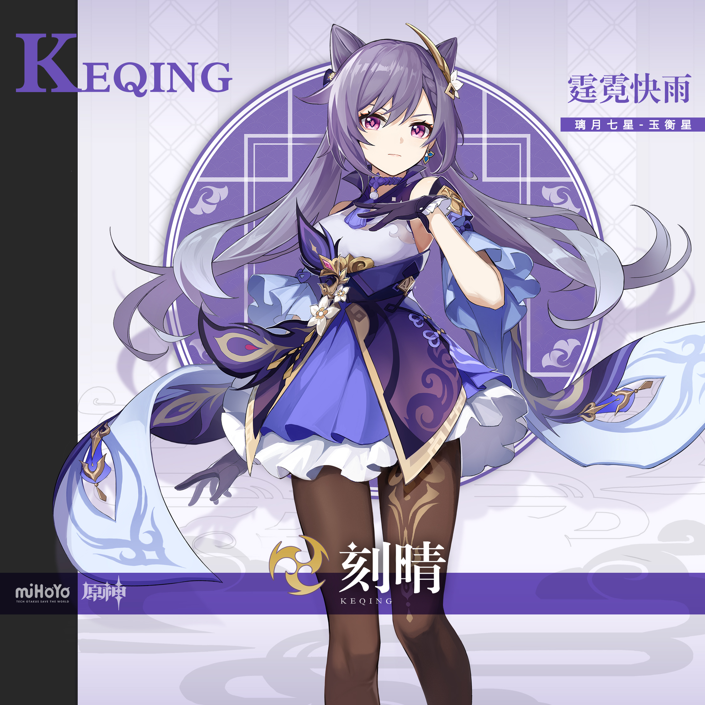
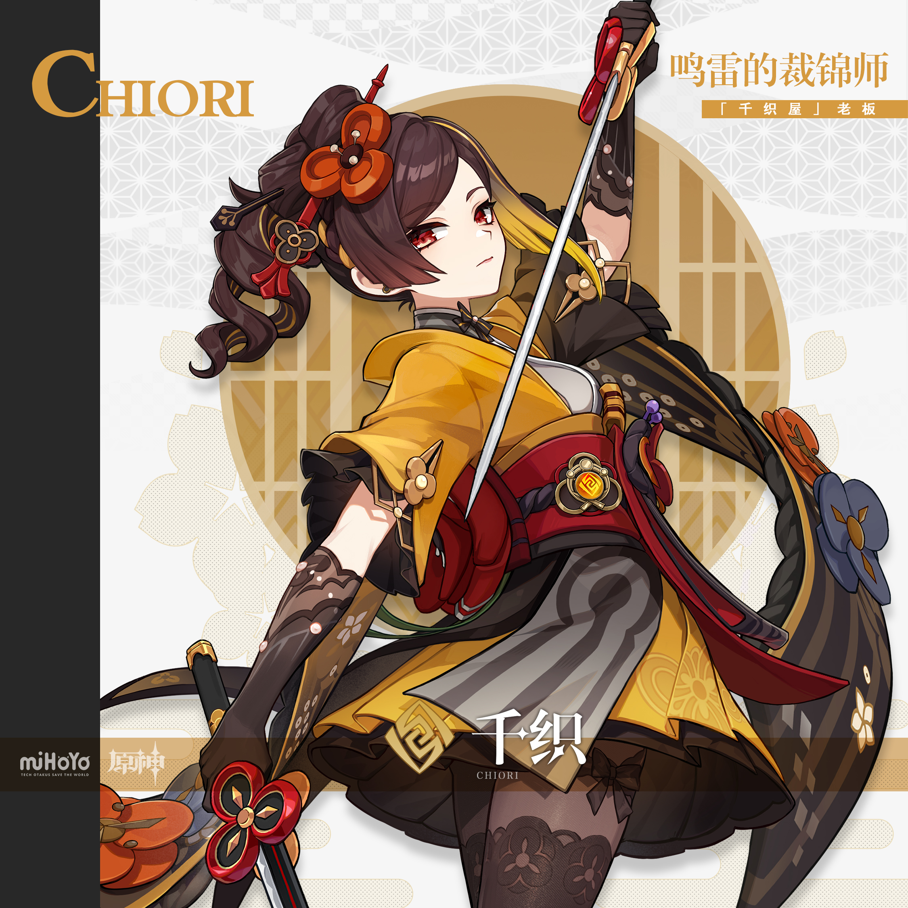
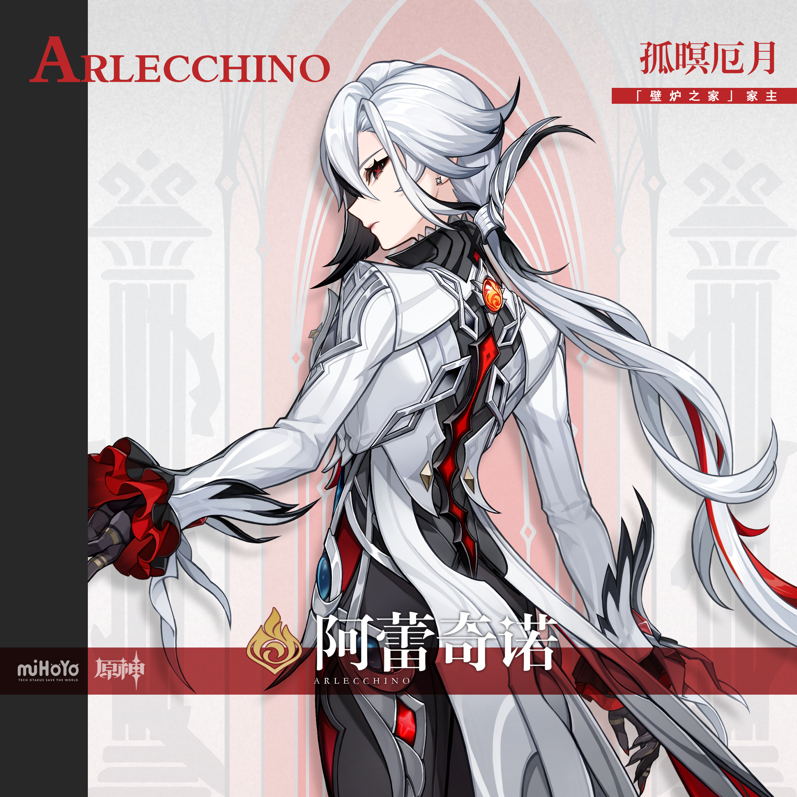
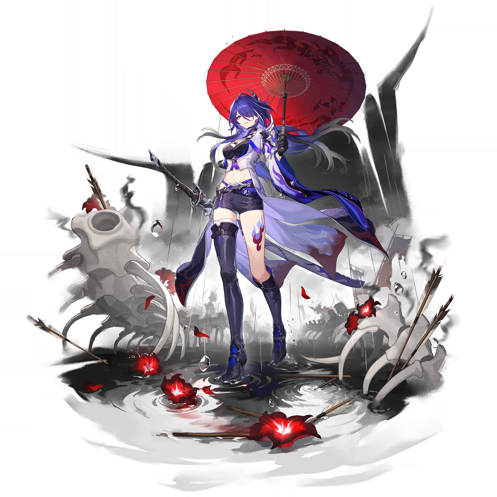
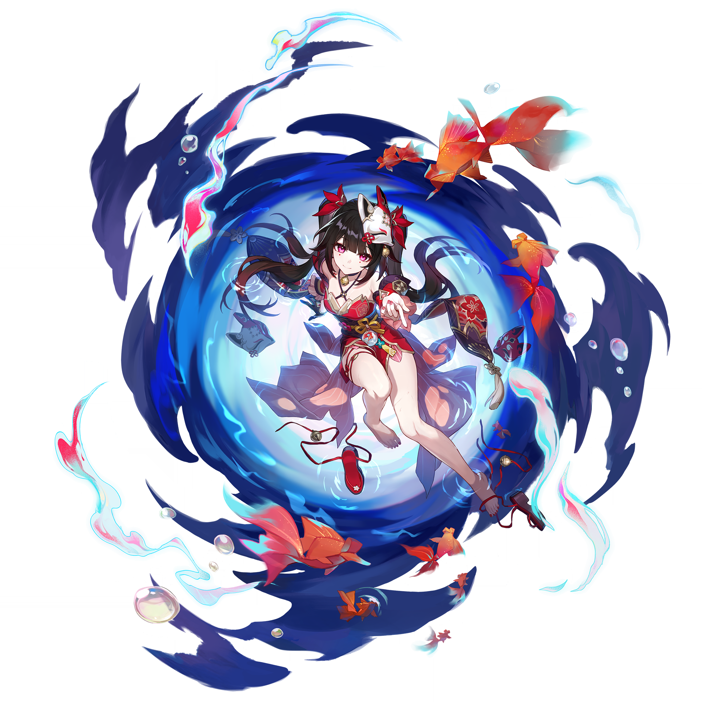
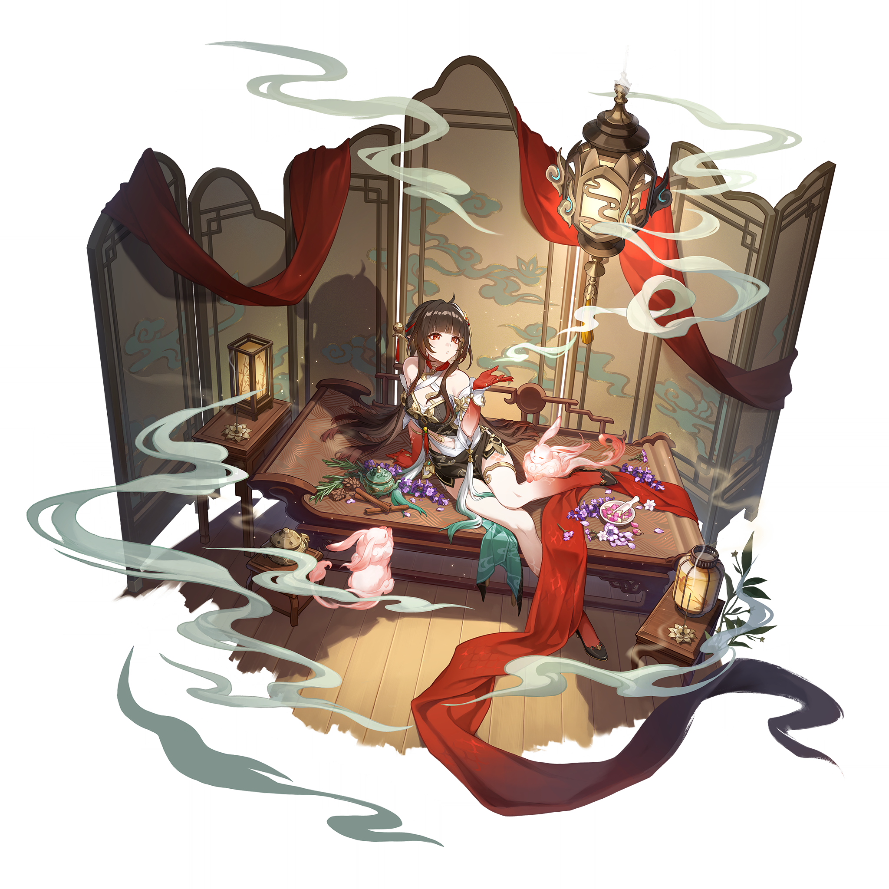
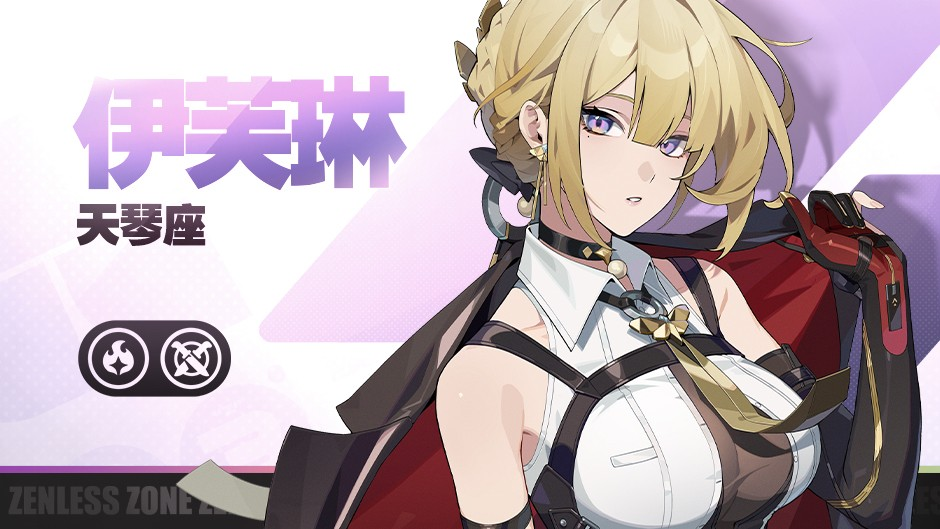
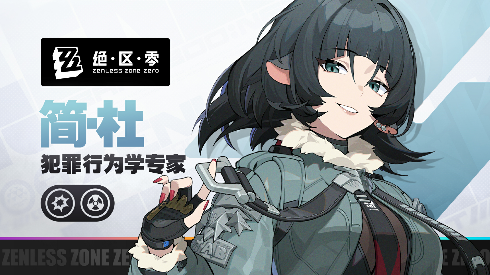
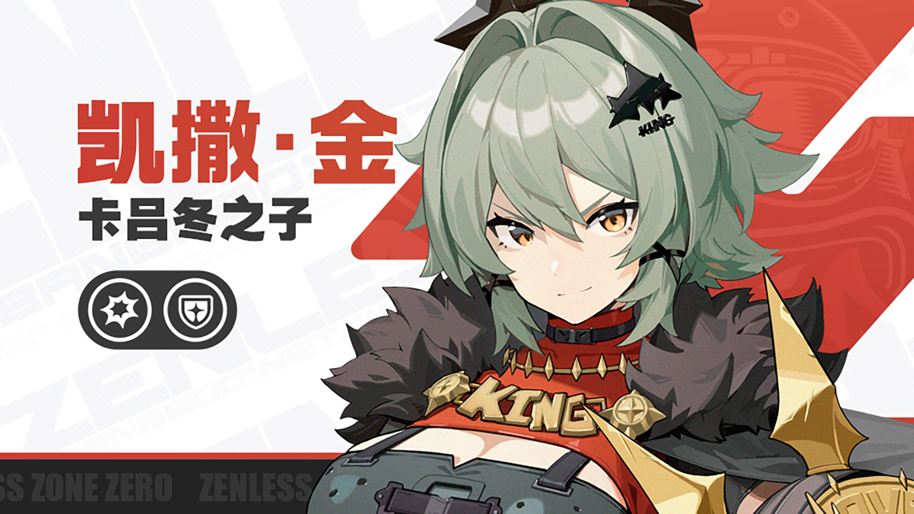

# 元气应援签·二期·米哈游角色JK九签（为生活打气）

> 类型：F 签图（用户手动触发生成）。本系列为「JK应援签」第二期，**完整沿用一期统一模板**（奶油纸质底 + 手绘放射日光线 + 左上角大缎带蝴蝶结 + 底部留白横幅 + 空白朱红印章 + 四角金银星屑），三固定一变化：全系列只有三处变化——**角色本体、主题色（放射线/蝴蝶结/领结/裙格纹同色联动）、应援道具**（九件全新）。
>
> 比例：`9:20 vertical mobile wallpaper`。全员成年角色，JK 制服性感风，tasteful and elegant throughout，no explicit content。
>
> 图片零文字纪律：**图片内部绝对不出现任何文字**；底部横幅与朱红印章全部留白，签名+签位后期写横幅，签语放抽签页/字幕，九签字体排版统一。
>
> 角色去重对照：不与「月谕圣牌」（胡桃、芙宁娜、钟离、温迪、卡芙卡、流萤、黑天鹅、三月七、星见雅、艾莲、妮可、安比）、「风物签」（纳西妲、可莉、万叶、丹恒、姬子、白露、猫又、可琳、朱鸢）、「JK应援签一期」（宵宫、夜兰、妮露、知更鸟、海瑟音、绯英、耀嘉音、11号、格莉丝）任何角色重复；本期九人均为首次出签。
>
> 参考图：全部在 `refs/`，经视觉工具逐张校对。刻晴/阿蕾奇诺复用工作区立绘；千织原目录图不可用（image.png 为错放的刻晴二创、image-1.png 为游戏截图），已从原神 WIKI 下载官方立绘；黄泉/花火/灵砂/伊芙琳/简/凯撒从对应 WIKI 下载。

## 一 · 刻晴｜锐气常在

**签位：上吉**

**签语：闪电不问路远，出手之前你已经在路上了。**

参考图：

Positive Prompt:
9:20 vertical mobile wallpaper, hand-drawn Japanese anime illustration with clean flowing lineart, soft flat coloring and a limited warm palette, designed as a cheerful cheer-up fortune-sign card. The whole card is a plain warm cream washi-paper background with a very subtle paper grain, and behind the character spreads one huge hand-drawn sunburst of thin radiating lines in electric violet, the lines evenly spaced and gently fading toward the edges, filling the card with a minimal, energetic vibe. In the upper left corner sits one big satin ribbon bow in electric violet with two flowing ribbon tails; the four corners of the paper are sprinkled with the same small gold and silver star confetti and tiny paper-scrap accents.

Keqing from Genshin Impact appears full-body, standing cheerfully at the center with her weight on one leg, one hand raised high holding up a silver whistle on a red lanyard, the other hand resting on her hip, head turned toward the viewer with a bright encouraging smile. Her unmistakable features: long light-lavender hair styled into two cat-ear shaped buns with long flowing twin tails, pink-violet eyes, a gold hairpin ornament, small blue earrings. She wears a JK cheer uniform: a white short-sleeve shirt slightly cropped at the waist, an electric-violet ribbon bow tie at the collar, and an electric-violet tartan pleated mini skirt, electric-violet thigh-high stockings with black loafers, tasteful and elegant throughout, no explicit content. At the bottom edge, one narrow blank cream paper banner lies flat with a small blank vermilion square seal shape beside it — both completely empty, no characters, no letters, no marks. Bright encouraging mood, clean composition, sharp focus on Keqing, hand-drawn anime aesthetic.

Negative Prompt:
low quality, worst quality, blurry, pixelated, bad anatomy, extra limbs, bad hands, extra fingers, fewer fingers, missing fingers, fused fingers, webbed fingers, merged fingers, overlapping fingers, deformed fingers, mutated fingers, six fingers, four fingers, three fingers, more than five fingers, disfigured hands, poorly drawn hands, bad hand anatomy, asymmetrical hands, broken fingers, claw hands, blurry hands, indistinct fingers, smeared hands, twisted legs, rotated hips, extra legs, fused legs, malformed knees, deformed feet, wrong hair color, wrong eye color, photorealistic, 3D render, semi-realistic, painterly, thick oil paint, any text, letters, numbers, japanese characters, chinese characters, logo, watermark, signature, UI elements, nude, topless, nipples, areola, explicit, childlike, loli, underage, dark gloomy background, cluttered background, busy props, canon liyue dress, cheongsam-style dress, bare legs.

## 二 · 千织｜手气正旺

**签位：中吉**

**签语：好料要自己裁，运气也一样，先下手就赢一半。**

参考图：

Positive Prompt:
9:20 vertical mobile wallpaper, hand-drawn Japanese anime illustration with clean flowing lineart, soft flat coloring and a limited warm palette, designed as a cheerful cheer-up fortune-sign card. The whole card is a plain warm cream washi-paper background with a very subtle paper grain, and behind the character spreads one huge hand-drawn sunburst of thin radiating lines in mustard gold, the lines evenly spaced and gently fading toward the edges, filling the card with a minimal, energetic vibe. In the upper left corner sits one big satin ribbon bow in mustard gold with two flowing ribbon tails; the four corners of the paper are sprinkled with the same small gold and silver star confetti and tiny paper-scrap accents.

Chiori from Genshin Impact appears full-body, standing cheerfully at the center with her weight on one leg, one hand raised high holding an unopened energy drink can, fingers wrapped around the can, the other hand resting on her hip, head turned toward the viewer with a confident encouraging smile. Her unmistakable features: dark brown hair in a high twisted side ponytail decorated with orange camellia ornaments and a blonde streak, red eyes, black lace gloves. She wears a JK cheer uniform: a white short-sleeve shirt slightly cropped at the waist, a mustard-gold ribbon bow tie at the collar, and a mustard-gold tartan pleated mini skirt, bare legs with short black boots, tasteful and elegant throughout, no explicit content. At the bottom edge, one narrow blank cream paper banner lies flat with a small blank vermilion square seal shape beside it — both completely empty, no characters, no letters, no marks. Bright encouraging mood, clean composition, sharp focus on Chiori, hand-drawn anime aesthetic.

Negative Prompt:
low quality, worst quality, blurry, pixelated, bad anatomy, extra limbs, bad hands, extra fingers, fewer fingers, missing fingers, fused fingers, webbed fingers, merged fingers, overlapping fingers, deformed fingers, mutated fingers, six fingers, four fingers, three fingers, more than five fingers, disfigured hands, poorly drawn hands, bad hand anatomy, asymmetrical hands, broken fingers, claw hands, blurry hands, indistinct fingers, smeared hands, twisted legs, rotated hips, extra legs, fused legs, malformed knees, deformed feet, wrong hair color, wrong eye color, photorealistic, 3D render, semi-realistic, painterly, thick oil paint, any text, letters, numbers, japanese characters, chinese characters, logo, watermark, signature, UI elements, nude, topless, nipples, areola, explicit, childlike, loli, underage, dark gloomy background, cluttered background, busy props, kimono jacket, canon inazuma outfit, thigh-high stockings.

## 三 · 阿蕾奇诺｜静气如山

**签位：大吉**

**签语：稳住的人不用大声，事情自己会来让路。**

参考图：

Positive Prompt:
9:20 vertical mobile wallpaper, hand-drawn Japanese anime illustration with clean flowing lineart, soft flat coloring and a limited warm palette, designed as a cheerful cheer-up fortune-sign card. The whole card is a plain warm cream washi-paper background with a very subtle paper grain, and behind the character spreads one huge hand-drawn sunburst of thin radiating lines in deep crimson, the lines evenly spaced and gently fading toward the edges, filling the card with a minimal, energetic vibe. In the upper left corner sits one big satin ribbon bow in deep crimson with two flowing ribbon tails; the four corners of the paper are sprinkled with the same small gold and silver star confetti and tiny paper-scrap accents.

Arlecchino from Genshin Impact appears full-body, standing cheerfully at the center with her weight on one leg, one hand raised high holding a bunch of glowing glow-stick bracelets gathered in one hand, the other hand resting on her hip, head turned toward the viewer with a calm composed encouraging smile. Her unmistakable features: white hair with black streaks swept into a low side ponytail, striking red eyes with black X-shaped pupils, a black earring. She wears a JK cheer uniform: a white short-sleeve shirt slightly cropped at the waist, a deep-crimson ribbon bow tie at the collar, and a deep-crimson tartan pleated mini skirt, bare legs with black loafers, tasteful and elegant throughout, no explicit content. At the bottom edge, one narrow blank cream paper banner lies flat with a small blank vermilion square seal shape beside it — both completely empty, no characters, no letters, no marks. Bright encouraging mood, clean composition, sharp focus on Arlecchino, hand-drawn anime aesthetic.

Negative Prompt:
low quality, worst quality, blurry, pixelated, bad anatomy, extra limbs, bad hands, extra fingers, fewer fingers, missing fingers, fused fingers, webbed fingers, merged fingers, overlapping fingers, deformed fingers, mutated fingers, six fingers, four fingers, three fingers, more than five fingers, disfigured hands, poorly drawn hands, bad hand anatomy, asymmetrical hands, broken fingers, claw hands, blurry hands, indistinct fingers, smeared hands, twisted legs, rotated hips, extra legs, fused legs, malformed knees, deformed feet, wrong hair color, wrong eye color, photorealistic, 3D render, semi-realistic, painterly, thick oil paint, any text, letters, numbers, japanese characters, chinese characters, logo, watermark, signature, UI elements, nude, topless, nipples, areola, explicit, childlike, loli, underage, dark gloomy background, cluttered background, busy props, long tailcoat, canon fatui uniform, thigh-high stockings.

## 四 · 黄泉｜侠气未凉

**签位：上上签**

**签语：走到哪都带着自己的光，黑夜只能退后半步。**

参考图：

Positive Prompt:
9:20 vertical mobile wallpaper, hand-drawn Japanese anime illustration with clean flowing lineart, soft flat coloring and a limited warm palette, designed as a cheerful cheer-up fortune-sign card. The whole card is a plain warm cream washi-paper background with a very subtle paper grain, and behind the character spreads one huge hand-drawn sunburst of thin radiating lines in deep sea blue, the lines evenly spaced and gently fading toward the edges, filling the card with a minimal, energetic vibe. In the upper left corner sits one big satin ribbon bow in deep sea blue with two flowing ribbon tails; the four corners of the paper are sprinkled with the same small gold and silver star confetti and tiny paper-scrap accents.

Acheron from Honkai: Star Rail appears full-body, standing cheerfully at the center with her weight on one leg, one hand raised high holding a pair of two-color cheer clapper sticks, the other hand resting on her hip, head turned toward the viewer with a warm encouraging smile. Her unmistakable features: long violet-purple hair fading to pale silver-grey at the ends, red eyes with faint yellow rings, red hair ornaments, a flame-like red tattoo on her left thigh. She wears a JK cheer uniform: a white short-sleeve shirt slightly cropped at the waist, a deep-sea-blue ribbon bow tie at the collar, and a deep-sea-blue tartan pleated mini skirt, bare legs with black long boots, tasteful and elegant throughout, no explicit content. At the bottom edge, one narrow blank cream paper banner lies flat with a small blank vermilion square seal shape beside it — both completely empty, no characters, no letters, no marks. Bright encouraging mood, clean composition, sharp focus on Acheron, hand-drawn anime aesthetic.

Negative Prompt:
low quality, worst quality, blurry, pixelated, bad anatomy, extra limbs, bad hands, extra fingers, fewer fingers, missing fingers, fused fingers, webbed fingers, merged fingers, overlapping fingers, deformed fingers, mutated fingers, six fingers, four fingers, three fingers, more than five fingers, disfigured hands, poorly drawn hands, bad hand anatomy, asymmetrical hands, broken fingers, claw hands, blurry hands, indistinct fingers, smeared hands, twisted legs, rotated hips, extra legs, fused legs, malformed knees, deformed feet, wrong hair color, wrong eye color, photorealistic, 3D render, semi-realistic, painterly, thick oil paint, any text, letters, numbers, japanese characters, chinese characters, logo, watermark, signature, UI elements, nude, topless, nipples, areola, explicit, childlike, loli, underage, dark gloomy background, cluttered background, busy props, red paper umbrella, katana, sword, crop-top armor, thigh-high boots, thigh-high stockings, rain.

## 五 · 花火｜俏气生风

**签位：中吉**

**签语：把日子当戏台，先笑的人先开场。**

参考图：

Positive Prompt:
9:20 vertical mobile wallpaper, hand-drawn Japanese anime illustration with clean flowing lineart, soft flat coloring and a limited warm palette, designed as a cheerful cheer-up fortune-sign card. The whole card is a plain warm cream washi-paper background with a very subtle paper grain, and behind the character spreads one huge hand-drawn sunburst of thin radiating lines in vivid magenta, the lines evenly spaced and gently fading toward the edges, filling the card with a minimal, energetic vibe. In the upper left corner sits one big satin ribbon bow in vivid magenta with two flowing ribbon tails; the four corners of the paper are sprinkled with the same small gold and silver star confetti and tiny paper-scrap accents.

Sparkle from Honkai: Star Rail appears full-body, standing cheerfully at the center with her weight on one leg, one hand raised high holding up a blank white hand-held cheer placard on a short stick, the other hand resting on her hip, head turned toward the viewer with a playful encouraging grin and a wink. Her unmistakable features: long dark-brown twin tails tied with red ribbons, magenta-pink eyes, a white kitsune mask tilted on the side of her head, a small bell choker. She wears a JK cheer uniform: a white short-sleeve shirt slightly cropped at the waist, a vivid-magenta ribbon bow tie at the collar, and a vivid-magenta tartan pleated mini skirt, vivid-magenta thigh-high stockings with black loafers, tasteful and elegant throughout, no explicit content. At the bottom edge, one narrow blank cream paper banner lies flat with a small blank vermilion square seal shape beside it — both completely empty, no characters, no letters, no marks. Bright encouraging mood, clean composition, sharp focus on Sparkle, hand-drawn anime aesthetic.

Negative Prompt:
low quality, worst quality, blurry, pixelated, bad anatomy, extra limbs, bad hands, extra fingers, fewer fingers, missing fingers, fused fingers, webbed fingers, merged fingers, overlapping fingers, deformed fingers, mutated fingers, six fingers, four fingers, three fingers, more than five fingers, disfigured hands, poorly drawn hands, bad hand anatomy, asymmetrical hands, broken fingers, claw hands, blurry hands, indistinct fingers, smeared hands, twisted legs, rotated hips, extra legs, fused legs, malformed knees, deformed feet, wrong hair color, wrong eye color, photorealistic, 3D render, semi-realistic, painterly, thick oil paint, any text, letters, numbers, japanese characters, chinese characters, logo, watermark, signature, UI elements, nude, topless, nipples, areola, explicit, childlike, loli, underage, dark gloomy background, cluttered background, busy props, red kimono dress, canon outfit, full face mask, bare legs.

## 六 · 灵砂｜暖气入怀

**签位：生签（缓缓向上的运气）**

**签语：累的时候就煮一壶热茶，心事会自己散成云。**

参考图：

Positive Prompt:
9:20 vertical mobile wallpaper, hand-drawn Japanese anime illustration with clean flowing lineart, soft flat coloring and a limited warm palette, designed as a cheerful cheer-up fortune-sign card. The whole card is a plain warm cream washi-paper background with a very subtle paper grain, and behind the character spreads one huge hand-drawn sunburst of thin radiating lines in warm amber orange, the lines evenly spaced and gently fading toward the edges, filling the card with a minimal, energetic vibe. In the upper left corner sits one big satin ribbon bow in warm amber orange with two flowing ribbon tails; the four corners of the paper are sprinkled with the same small gold and silver star confetti and tiny paper-scrap accents.

Lingsha from Honkai: Star Rail appears full-body, standing cheerfully at the center with her weight on one leg, one hand raised high holding a star-topped balloon stick, the other hand resting on her hip, head turned toward the viewer with a gentle encouraging smile. Her unmistakable features: long dark-brown hair fixed with a red-and-gold hairpin, crimson eyes, a single long red glove, small fluffy pink cloud-bunny companions floating near her shoulder. She wears a JK cheer uniform: a white short-sleeve shirt slightly cropped at the waist, a warm-amber ribbon bow tie at the collar, and a warm-amber tartan pleated mini skirt, bare legs with red loafers, tasteful and elegant throughout, no explicit content. At the bottom edge, one narrow blank cream paper banner lies flat with a small blank vermilion square seal shape beside it — both completely empty, no characters, no letters, no marks. Bright encouraging mood, clean composition, sharp focus on Lingsha, hand-drawn anime aesthetic.

Negative Prompt:
low quality, worst quality, blurry, pixelated, bad anatomy, extra limbs, bad hands, extra fingers, fewer fingers, missing fingers, fused fingers, webbed fingers, merged fingers, overlapping fingers, deformed fingers, mutated fingers, six fingers, four fingers, three fingers, more than five fingers, disfigured hands, poorly drawn hands, bad hand anatomy, asymmetrical hands, broken fingers, claw hands, blurry hands, indistinct fingers, smeared hands, twisted legs, rotated hips, extra legs, fused legs, malformed knees, deformed feet, wrong hair color, wrong eye color, photorealistic, 3D render, semi-realistic, painterly, thick oil paint, any text, letters, numbers, japanese characters, chinese characters, logo, watermark, signature, UI elements, nude, topless, nipples, areola, explicit, childlike, loli, underage, dark gloomy background, cluttered background, busy props, canon xianzhou dress, red sash, incense burner, bed, thigh-high stockings.

## 七 · 伊芙琳｜英气开路

**签位：上吉**

**签语：把披风甩在肩上的人，从来不担心风往哪吹。**

参考图：

Positive Prompt:
9:20 vertical mobile wallpaper, hand-drawn Japanese anime illustration with clean flowing lineart, soft flat coloring and a limited warm palette, designed as a cheerful cheer-up fortune-sign card. The whole card is a plain warm cream washi-paper background with a very subtle paper grain, and behind the character spreads one huge hand-drawn sunburst of thin radiating lines in sky blue, the lines evenly spaced and gently fading toward the edges, filling the card with a minimal, energetic vibe. In the upper left corner sits one big satin ribbon bow in sky blue with two flowing ribbon tails; the four corners of the paper are sprinkled with the same small gold and silver star confetti and tiny paper-scrap accents.

Evelyn Chevalier from Zenless Zone Zero appears full-body, standing cheerfully at the center with her weight on one leg, one hand raised high holding up a ring-shaped cheerleading wreath, the other hand resting on her hip, head turned toward the viewer with a poised encouraging smile. Her unmistakable features: golden-blonde hair swept up with a braided crown and side-swept bangs, violet eyes, gold earrings, a black choker. She wears a JK cheer uniform: a white short-sleeve shirt slightly cropped at the waist, a sky-blue ribbon bow tie at the collar, and a sky-blue tartan pleated mini skirt, sky-blue thigh-high stockings with black loafers, tasteful and elegant throughout, no explicit content. At the bottom edge, one narrow blank cream paper banner lies flat with a small blank vermilion square seal shape beside it — both completely empty, no characters, no letters, no marks. Bright encouraging mood, clean composition, sharp focus on Evelyn Chevalier, hand-drawn anime aesthetic.

Negative Prompt:
low quality, worst quality, blurry, pixelated, bad anatomy, extra limbs, bad hands, extra fingers, fewer fingers, missing fingers, fused fingers, webbed fingers, merged fingers, overlapping fingers, deformed fingers, mutated fingers, six fingers, four fingers, three fingers, more than five fingers, disfigured hands, poorly drawn hands, bad hand anatomy, asymmetrical hands, broken fingers, claw hands, blurry hands, indistinct fingers, smeared hands, twisted legs, rotated hips, extra legs, fused legs, malformed knees, deformed feet, wrong hair color, wrong eye color, photorealistic, 3D render, semi-realistic, painterly, thick oil paint, any text, letters, numbers, japanese characters, chinese characters, logo, watermark, signature, UI elements, nude, topless, nipples, areola, explicit, childlike, loli, underage, dark gloomy background, cluttered background, busy props, red cape, suspender outfit, canon uniform, bare legs.

## 八 · 简｜爽气到底

**签位：上上签**

**签语：想明白了就笑，看准了就伸手，别给犹豫留座位。**

参考图：

Positive Prompt:
9:20 vertical mobile wallpaper, hand-drawn Japanese anime illustration with clean flowing lineart, soft flat coloring and a limited warm palette, designed as a cheerful cheer-up fortune-sign card. The whole card is a plain warm cream washi-paper background with a very subtle paper grain, and behind the character spreads one huge hand-drawn sunburst of thin radiating lines in lake teal, the lines evenly spaced and gently fading toward the edges, filling the card with a minimal, energetic vibe. In the upper left corner sits one big satin ribbon bow in lake teal with two flowing ribbon tails; the four corners of the paper are sprinkled with the same small gold and silver star confetti and tiny paper-scrap accents.

Jane Doe from Zenless Zone Zero appears full-body, standing cheerfully at the center with her weight on one leg, one hand raised high holding a wooden hand clapper, the other hand resting on her hip, head turned toward the viewer with a sly encouraging smile. Her unmistakable features: messy dark charcoal hair, large round grey mouse ears on top of her head, teal-green eyes, piercings along one ear, red nail polish. She wears a JK cheer uniform: a white short-sleeve shirt slightly cropped at the waist, a lake-teal ribbon bow tie at the collar, and a lake-teal tartan pleated mini skirt, bare legs with short black boots, tasteful and elegant throughout, no explicit content. At the bottom edge, one narrow blank cream paper banner lies flat with a small blank vermilion square seal shape beside it — both completely empty, no characters, no letters, no marks. Bright encouraging mood, clean composition, sharp focus on Jane Doe, hand-drawn anime aesthetic.

Negative Prompt:
low quality, worst quality, blurry, pixelated, bad anatomy, extra limbs, bad hands, extra fingers, fewer fingers, missing fingers, fused fingers, webbed fingers, merged fingers, overlapping fingers, deformed fingers, mutated fingers, six fingers, four fingers, three fingers, more than five fingers, disfigured hands, poorly drawn hands, bad hand anatomy, asymmetrical hands, broken fingers, claw hands, blurry hands, indistinct fingers, smeared hands, twisted legs, rotated hips, extra legs, fused legs, malformed knees, deformed feet, wrong hair color, wrong eye color, photorealistic, 3D render, semi-realistic, painterly, thick oil paint, any text, letters, numbers, japanese characters, chinese characters, logo, watermark, signature, UI elements, nude, topless, nipples, areola, explicit, childlike, loli, underage, dark gloomy background, cluttered background, busy props, green utility jacket, fluffy fur collar, harness straps, thigh-high stockings.

## 九 · 凯撒｜豪气冲天

**签位：大吉**

**签语：兄弟都在身后的人，往前冲就对了。**

参考图：

Positive Prompt:
9:20 vertical mobile wallpaper, hand-drawn Japanese anime illustration with clean flowing lineart, soft flat coloring and a limited warm palette, designed as a cheerful cheer-up fortune-sign card. The whole card is a plain warm cream washi-paper background with a very subtle paper grain, and behind the character spreads one huge hand-drawn sunburst of thin radiating lines in caramel brown, the lines evenly spaced and gently fading toward the edges, filling the card with a minimal, energetic vibe. In the upper left corner sits one big satin ribbon bow in caramel brown with two flowing ribbon tails; the four corners of the paper are sprinkled with the same small gold and silver star confetti and tiny paper-scrap accents.

Caesar King from Zenless Zone Zero appears full-body, standing cheerfully at the center with her weight on one leg, one hand raised high wearing a giant oversized foam finger glove pointing upward, the other hand resting on her hip, head turned toward the viewer with a bold hearty encouraging grin. Her unmistakable features: fluffy sage-green short hair, golden-amber eyes, black bat-shaped hair clips, a dark studded choker, a gold spiked pauldron on her left shoulder. She wears a JK cheer uniform: a white short-sleeve shirt slightly cropped at the waist, a caramel-brown ribbon bow tie at the collar, and a caramel-brown tartan pleated mini skirt, caramel-brown thigh-high stockings with black-and-gold sneakers, tasteful and elegant throughout, no explicit content. At the bottom edge, one narrow blank cream paper banner lies flat with a small blank vermilion square seal shape beside it — both completely empty, no characters, no letters, no marks. Bright encouraging mood, clean composition, sharp focus on Caesar King, hand-drawn anime aesthetic.

Negative Prompt:
low quality, worst quality, blurry, pixelated, bad anatomy, extra limbs, bad hands, extra fingers, fewer fingers, missing fingers, fused fingers, webbed fingers, merged fingers, overlapping fingers, deformed fingers, mutated fingers, six fingers, four fingers, three fingers, more than five fingers, disfigured hands, poorly drawn hands, bad hand anatomy, asymmetrical hands, broken fingers, claw hands, blurry hands, indistinct fingers, smeared hands, twisted legs, rotated hips, extra legs, fused legs, malformed knees, deformed feet, wrong hair color, wrong eye color, photorealistic, 3D render, semi-realistic, painterly, thick oil paint, any text, letters, numbers, japanese characters, chinese characters, logo, watermark, signature, UI elements, nude, topless, nipples, areola, explicit, childlike, loli, underage, dark gloomy background, cluttered background, busy props, fur mantle, leather armor, red canon top, King lettering, bare legs.

---

## 落地说明

- **系列验收清单**：与一期同规格——九签只允许三处不同：①角色本体；②主题色（放射线/蝴蝶结/领结/裙格纹四处同色联动）；③应援道具（口哨/能量饮料/荧光手环束/应援拍棒/加油手幅/星星气球棒/花环/拍手器/泡沫拳套，九件全新不与一期重复）。其余模板句逐字一致。
- **主题色谱序**：电紫（刻晴）→ 芥末金（千织）→ 猩红（阿蕾奇诺）→ 深海蓝（黄泉）→ 洋红（花火）→ 琥珀橙（灵砂）→ 天蓝（伊芙琳）→ 湖绿（简）→ 焦糖棕（凯撒），相邻不撞色。
- **腿部方案**：光腿×5（千织/阿蕾奇诺/黄泉/灵砂/简）+ 主题色过膝袜×4（刻晴/花火/伊芙琳/凯撒），每签 negative 已互斥排除另一种。
- **手部安全设计**：大件道具优先分配给手势复杂的角色（花火手幅、凯撒泡沫拳套、灵砂气球棒、黄泉拍棒、简拍手器均能自然遮挡手指）；小件（刻晴口哨、千织饮料罐）已在 positive 写明握持方式。
- **img2img 定稿流程**：先用本系列第一签「锐气常在」定稿（或直接以一期定稿图为底图换角色）→ 低重绘幅度逐签替换角色/主题色/道具。
- **后期加字规范**：签名 + 签位写横幅，签语放抽签页/字幕；字体字号与一期保持一致，方便两期混剪成 18 签大合集。
- **签文速查**：一 刻晴「锐气常在」上吉；二 千织「手气正旺」中吉；三 阿蕾奇诺「静气如山」大吉；四 黄泉「侠气未凉」上上签；五 花火「俏气生风」中吉；六 灵砂「暖气入怀」生签；七 伊芙琳「英气开路」上吉；八 简「爽气到底」上上签；九 凯撒「豪气冲天」大吉。九个签名全部嵌「气」字且不与一期重复；签位分布：上上签×2、大吉×2、上吉×2、中吉×2、生签×1。
- **角色去重对照**：本期九人（刻晴、千织、阿蕾奇诺、黄泉、花火、灵砂、伊芙琳、简、凯撒）均未在「月谕圣牌」「风物签」「JK应援签一期」中出现。
- **遗留问题**：`原神/千织/image.png` 与 `原神/宵宫/image.png` 均为错放的刻晴二创图，千织本期已改用 WIKI 下载的官方立绘（refs/chiori-official.png）；建议后续清理这两个目录的错误图。
