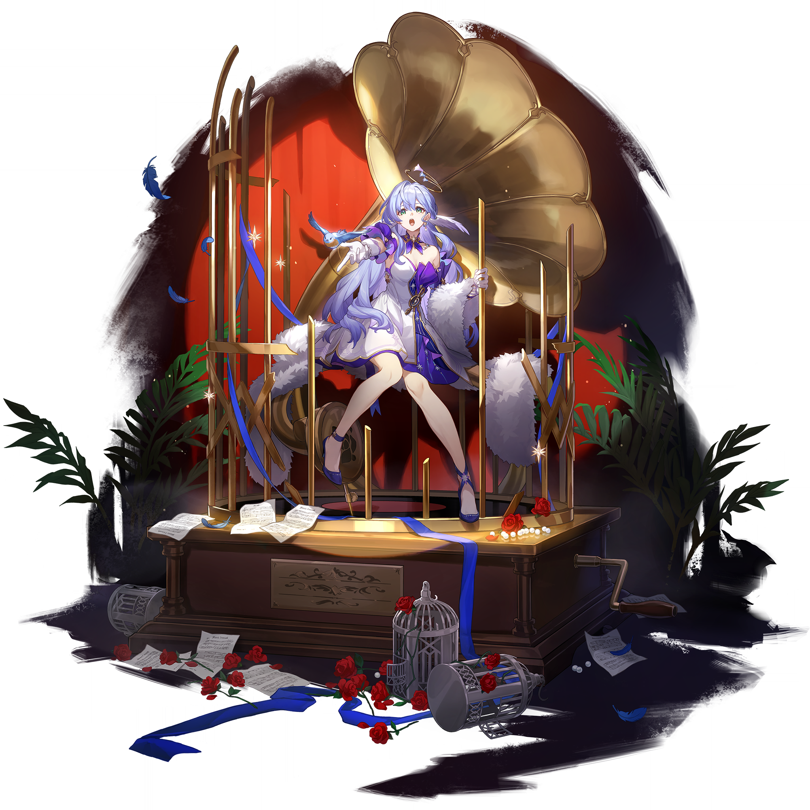
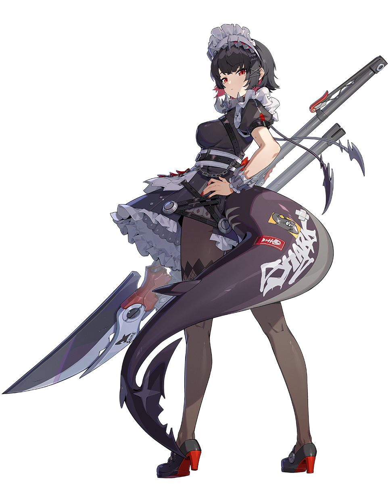
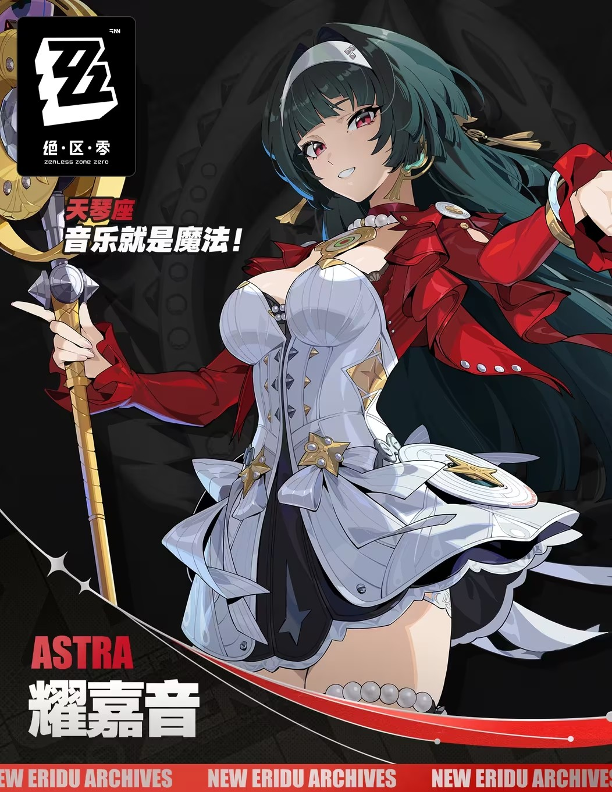
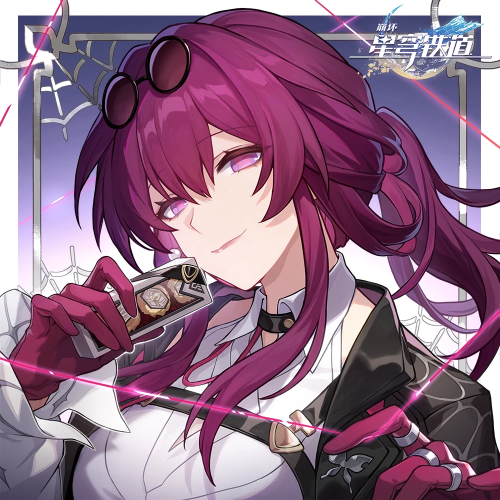

# 双城特快·联动月台 — 2026.10.14
> 视频类型：B · 主题类型合集
> 主题说明：米哈游双游联动「双向奔赴」视觉企划——星穹列车的乘客与 New Eridu 的代理人在同一座星空月台交汇，每人手持一张金色联动车票，等待开往对方世界的列车。知更鸟、卡芙卡将乘 3.4 版本列车抵达新艾利都；艾莲、耀嘉音将在 4.8 版本登上星穹列车。
> 热点背景：10/9 绝区零 3.3 前瞻特别节目尾声官宣《绝区零》×《崩坏：星穹铁道》双向联动：知更鸟、卡芙卡将于 3.4 版本登陆新艾利都，艾莲、耀嘉音将登上星穹列车（4.8 版本，2026 冬季）。官宣 2 小时内「等不及」刷屏、建模之争引爆两边社区；10/21 绝区零 3.3「重返天空的旅程」正式上线，当前正处联动预热最热窗口期。
> 涉及角色：知更鸟（崩铁→新艾利都）、卡芙卡（崩铁→新艾利都）、艾莲（绝区零→星穹列车）、耀嘉音（绝区零→星穹列车）
> 统一视觉母题：夜晚露天月台「星海月台」——深蓝星空、灰色石砌月台地面、远处亮着暖黄车窗灯的复古列车剪影；每人手持一张金色联动车票。主色调 = 深蓝夜色 + 暖金灯光 + 各角色主题色。
> 背景固定枚举规则（全系列适用）：每条背景枚举 ≤3 个朴素元素 + `no other background elements` 收口，禁止场所类开放词。
> 选定类型理由：重大热点（双向联动官宣 + 3.3 上线倒计时预热期）但热点本体是「多角色跨游戏串门」事件 → 类型 B 主题合集横向呈现四位联动角色，天然契合。
> 选角理由：四位均为官宣联动角色（官方热点权重 40% 满档）；均为女性角色，无性别系数调整；四人在工作区均有参考图素材（其中知更鸟立绘本期新校对）；社区「双厨狂喜」「三大歌姬同台」「通模之争」讨论正处峰值。
> 参考图说明：✅ 全部使用已校对素材——知更鸟 `splash-art-base.png`（本期新视觉校对：浅蓝紫超长波浪卷发、翠绿瞳、头顶金色光环、后脑一对小翅膀、左眼角下泪痣、白紫礼服白毛披肩、蓝鸟同伴、蓝色高跟鞋）；卡芙卡 `kafka-face.png`（酒紫波浪长发、紫红瞳、墨镜架上头顶，全身服装按官方设定+联动版细节补充）；艾莲 `巡历雪境·复刻冰系特辑/ellen-splash.png`（本期复核）；耀嘉音 `official-intro.png`（已登记）。

---

# 统一母题与基线

- 所有条目统一 `3:4 vertical portrait wallpaper`
- 月台系条目背景固定枚举：`deep blue night sky with faint stars above, grey stone platform floor underfoot, the distant silhouette of a vintage train with warm yellow lit windows far behind her` + `no other background elements`
- 车厢系条目背景固定枚举：`a large window showing deep blue starry night sky outside, warm wood-paneled train interior wall, a single brass wall lamp` + `no other background elements`
- 金色车票（golden ticket with a star emblem）为贯穿全组的联动信物
- 尺度红线：positive 统一含 `tasteful and elegant throughout, no explicit content`；negative 统一含 `nude, topless, nipples, areola, explicit, childlike, loli, underage`

---

# 人物设定

## 1 — 知更鸟·来自匹诺康尼的歌声（月台全身 · 定义基调）

Positive Prompt:
masterpiece anime-style illustration, highly detailed, 3:4 vertical portrait wallpaper. Robin from Honkai: Star Rail standing full-body on an open-air train platform at night, facing the viewer with a gentle serene smile, her head slightly tilted up toward the starry sky. Keep her canonical appearance exactly: very long wavy light blue-lavender hair cascading past her waist, teal-green eyes, a thin golden halo floating above her head, a pair of small white decorative wings attached at the back of her head, a delicate tear mole under her left eye. She wears her white dress with violet-blue ribbon accents and a soft white fur stole draped over her shoulders, blue high-heeled sandals. In her right hand she holds up a golden ticket with a star emblem, the ticket held delicately between her thumb and index finger with her remaining fingers relaxed; a small blue bird hovers beside her halo. Background: deep blue night sky with faint stars above, grey stone platform floor underfoot, the distant silhouette of a vintage train with warm yellow lit windows far behind her, no other background elements. Lighting: cool moonlight from above mixed with a warm golden rim light from the train windows behind her; color scheme of deep blue night tones with gold and her lavender-white palette. tasteful and elegant throughout, no explicit content. perfect hands, five fingers on each hand, anatomically correct hands, well-defined fingers, natural hand pose, detailed hands, clean finger separation, correct left-right hand orientation.

Negative Prompt:
low quality, worst quality, blurry, pixelated, bad anatomy, extra limbs, bad hands, extra fingers, fewer fingers, missing fingers, fused fingers, webbed fingers, merged fingers, overlapping fingers, deformed fingers, mutated fingers, six fingers, four fingers, three fingers, more than five fingers, less than five fingers, disfigured hands, poorly drawn hands, bad hand anatomy, asymmetrical hands, broken fingers, claw hands, blurry hands, indistinct fingers, smeared hands, missing legs, missing feet, missing calves, cropped legs, legs out of frame, twisted legs, rotated hips, dislocated hip, extra legs, third leg, fused legs, malformed knees, knees bending in opposite directions, unnatural sitting pose, disproportionate limbs, elongated calves, deformed feet, wrong hair color, wrong eye color, missing golden halo, missing head wings, incorrect character, another character, multiple characters, chibi, photorealistic, nude, topless, nipples, areola, explicit, childlike, loli, underage, palm trees, parasols, buildings, crowd, text, watermark, logo, signature

## 2 — 卡芙卡·持票的优雅猎手（月台全身）

Referring to the attached first artwork for style, lighting, and crossover send-off night atmosphere only, generate a full-body image of Kafka from Honkai: Star Rail on the same night platform, composed as a 3:4 vertical portrait wallpaper. Do not copy the pose, outfit, or composition of the reference. Kafka walking slowly toward the viewer with a confident, dangerous half-smile, one hand in her pocket, the other hand holding a golden ticket with a star emblem between two fingers. Keep her canonical appearance: long wavy wine-purple hair, magenta eyes, her signature sunglasses with gold trim pushed up on top of her head. She wears a dark purple-black tailored crossover jacket with gold buttons over a fitted top, slim dark trousers, and heeled lace-up boots, with a pair of silver handcuffs dangling and swaying from her right wrist. Background: deep blue night sky with faint stars above, grey stone platform floor underfoot, the distant silhouette of a vintage train with warm yellow lit windows far behind her, no other background elements. Warm golden rim light from the train windows behind her, deep blue night tones with her purple and magenta accent colors. tasteful and elegant throughout, no explicit content. perfect hands, five fingers on each hand, anatomically correct hands, well-defined fingers, natural hand pose, detailed hands, clean finger separation, correct left-right hand orientation.

Negative Prompt:
low quality, worst quality, blurry, pixelated, bad anatomy, extra limbs, bad hands, extra fingers, fewer fingers, missing fingers, fused fingers, webbed fingers, merged fingers, overlapping fingers, deformed fingers, mutated fingers, six fingers, four fingers, three fingers, more than five fingers, less than five fingers, disfigured hands, poorly drawn hands, bad hand anatomy, asymmetrical hands, broken fingers, claw hands, blurry hands, indistinct fingers, smeared hands, missing legs, missing feet, missing calves, cropped legs, legs out of frame, twisted legs, rotated hips, dislocated hip, extra legs, third leg, fused legs, malformed knees, knees bending in opposite directions, unnatural sitting pose, disproportionate limbs, elongated calves, deformed feet, wrong hair color, wrong eye color, sunglasses covering eyes, incorrect character, another character, multiple characters, chibi, photorealistic, nude, topless, nipples, areola, explicit, childlike, loli, underage, palm trees, parasols, buildings, crowd, text, watermark, logo, signature

## 3 — 艾莲·不情愿的旅客（月台全身）

Referring to the attached first artwork for style, lighting, and crossover send-off night atmosphere only, generate a full-body image of Ellen Joe from Zenless Zone Zero on the same night platform, composed as a 3:4 vertical portrait wallpaper. Do not copy the pose, outfit, or composition of the reference. Ellen standing with a slightly grumpy, reluctant expression, cheeks faintly puffed, looking away from the viewer with a small pout while still holding up her golden ticket with a star emblem in both hands in front of her chest — as if someone forced her to take the trip. Keep her canonical appearance: short black hair with red-pink inner streaks at the tips framing her face, red eyes, white frilled maid headdress with red accents, black maid dress with a white frilled apron and black belt with silver buckles and hanging chains, black diamond-pattern tights, red nail polish, grey-black platform heels with red heels. Her huge dark grey-purple shark tail rises behind her, decorated with white SHARK graffiti and a red fish-bone sticker. Her tail is fully visible and clearly separate from her legs. Background: deep blue night sky with faint stars above, grey stone platform floor underfoot, the distant silhouette of a vintage train with warm yellow lit windows far behind her, no other background elements. Warm golden rim light from the train windows behind her, deep blue night tones with her black-white-grey and red accent palette. tasteful and elegant throughout, no explicit content. perfect hands, five fingers on each hand, anatomically correct hands, well-defined fingers, natural hand pose, detailed hands, clean finger separation, correct left-right hand orientation.

Negative Prompt:
low quality, worst quality, blurry, pixelated, bad anatomy, extra limbs, bad hands, extra fingers, fewer fingers, missing fingers, fused fingers, webbed fingers, merged fingers, overlapping fingers, deformed fingers, mutated fingers, six fingers, four fingers, three fingers, more than five fingers, less than five fingers, disfigured hands, poorly drawn hands, bad hand anatomy, asymmetrical hands, broken fingers, claw hands, blurry hands, indistinct fingers, smeared hands, missing legs, missing feet, missing calves, cropped legs, legs out of frame, twisted legs, rotated hips, dislocated hip, extra legs, third leg, fused legs, malformed knees, knees bending in opposite directions, unnatural sitting pose, disproportionate limbs, elongated calves, deformed feet, missing shark tail, tail merged with legs, wrong hair color, wrong eye color, incorrect character, another character, multiple characters, chibi, photorealistic, nude, topless, nipples, areola, explicit, childlike, loli, underage, palm trees, parasols, buildings, crowd, giant saw weapon, text, watermark, logo, signature

## 4 — 耀嘉音·出发前的最后一场（月台全身）

Referring to the attached first artwork for style, lighting, and crossover send-off night atmosphere only, generate a full-body image of Astra Yao from Zenless Zone Zero on the same night platform, composed as a 3:4 vertical portrait wallpaper. Do not copy the pose, outfit, or composition of the reference. Astra standing gracefully with her weight on one leg, chin slightly lifted with a diva's confident soft smile, eyes looking at the viewer. Keep her canonical appearance: very long straight dark teal-green hair with blunt choppy bangs and long sidelocks, a white headband, rose-pink eyes, a tiny beauty mark below the inner corner of each eye, gold tassel earrings. She wears her white corset bodice, crimson ruffled short jacket, layered white-gold star-decorated skirt, pearl choker, pearl-beaded ring on her left thigh, and black heels with pearl ankle straps. Her tall golden ring microphone staff stands beside her right side held loosely in her right hand like a scepter, a golden ticket with a star emblem clipped to the top of the ring; her left hand rests relaxed at her side. Background: deep blue night sky with faint stars above, grey stone platform floor underfoot, the distant silhouette of a vintage train with warm yellow lit windows far behind her, no other background elements. Warm golden rim light from the train windows behind her, deep blue night tones with crimson, gold and white accents. tasteful and elegant throughout, no explicit content. perfect hands, five fingers on each hand, anatomically correct hands, well-defined fingers, natural hand pose, detailed hands, clean finger separation, correct left-right hand orientation.

Negative Prompt:
low quality, worst quality, blurry, pixelated, bad anatomy, extra limbs, bad hands, extra fingers, fewer fingers, missing fingers, fused fingers, webbed fingers, merged fingers, overlapping fingers, deformed fingers, mutated fingers, six fingers, four fingers, three fingers, more than five fingers, less than five fingers, disfigured hands, poorly drawn hands, bad hand anatomy, asymmetrical hands, broken fingers, claw hands, blurry hands, indistinct fingers, smeared hands, missing legs, missing feet, missing calves, cropped legs, legs out of frame, twisted legs, rotated hips, dislocated hip, extra legs, third leg, fused legs, malformed knees, knees bending in opposite directions, unnatural sitting pose, disproportionate limbs, elongated calves, deformed feet, wrong hair color, wrong eye color, missing golden ring staff, incorrect character, another character, multiple characters, chibi, photorealistic, nude, topless, nipples, areola, explicit, childlike, loli, underage, palm trees, parasols, buildings, crowd, text, watermark, logo, signature

## 5 — 知更鸟·车票与星光（特写肖像）

Referring to the attached first artwork for style and lighting only, generate a cinematic close-up portrait (chest-up) of Robin from Honkai: Star Rail, composed as a 3:4 vertical portrait wallpaper. Do not copy the pose, outfit, or composition of the reference. Robin holds the golden ticket with a star emblem up beside her cheek with her right hand, the ticket pinched delicately between her thumb and index finger with her remaining fingers softly curled, her visible teal-green eyes gazing directly at the viewer with a dreamy, hopeful smile, as if the little ticket is a promise of a whole new stage. Her thin golden halo floats above her head, the small white wings at the back of her head catching the light, tear mole under her left eye, long wavy light blue-lavender hair spilling over her shoulders, white dress collar and white fur stole visible at the bottom edge of the frame. Background: deep blue night sky with faint stars only, no other background elements. Cool moonlight on her face with a warm golden glow reflected from the ticket; deep blue and gold color scheme. tasteful and elegant throughout, no explicit content. perfect hands, five fingers on each hand, anatomically correct hands, well-defined fingers, natural hand pose, detailed hands, clean finger separation, correct left-right hand orientation.

Negative Prompt:
low quality, worst quality, blurry, pixelated, bad anatomy, extra limbs, bad hands, extra fingers, fewer fingers, missing fingers, fused fingers, webbed fingers, merged fingers, overlapping fingers, deformed fingers, mutated fingers, six fingers, four fingers, three fingers, more than five fingers, less than five fingers, disfigured hands, poorly drawn hands, bad hand anatomy, asymmetrical hands, broken fingers, claw hands, blurry hands, indistinct fingers, smeared hands, missing legs, missing feet, cropped legs, legs out of frame, twisted legs, malformed knees, elongated calves, deformed feet, wrong hair color, wrong eye color, missing golden halo, missing head wings, incorrect character, another character, multiple characters, chibi, photorealistic, nude, topless, nipples, areola, explicit, childlike, loli, underage, text, watermark, logo, signature

## 6 — 卡芙卡·手铐与车票（特写肖像）

Referring to the attached face reference for Kafka's facial features only, generate a cinematic close-up portrait (chest-up) of Kafka from Honkai: Star Rail, composed as a 3:4 vertical portrait wallpaper. Do not copy the pose or composition of the reference. Her long wavy wine-purple hair frames her face, magenta eyes looking at the viewer with a lazy, dangerous half-smile, her signature sunglasses with gold trim pushed up on top of her head. From the fingers of her right hand a silver handcuff dangles and swings gently in the foreground, the open cuff catching the light; her left hand holds the golden ticket with a star emblem near her chin, the ticket held lightly between two fingers. As if to say: the next stop is New Eridu — she decides who sits beside her. Background: deep blue night sky with faint stars only, no other background elements. Cool moonlight mixed with a warm golden glow from the ticket; deep blue, purple and gold color scheme. tasteful and elegant throughout, no explicit content. perfect hands, five fingers on each hand, anatomically correct hands, well-defined fingers, natural hand pose, detailed hands, clean finger separation, correct left-right hand orientation.

Negative Prompt:
low quality, worst quality, blurry, pixelated, bad anatomy, extra limbs, bad hands, extra fingers, fewer fingers, missing fingers, fused fingers, webbed fingers, merged fingers, overlapping fingers, deformed fingers, mutated fingers, six fingers, four fingers, three fingers, more than five fingers, less than five fingers, disfigured hands, poorly drawn hands, bad hand anatomy, asymmetrical hands, broken fingers, claw hands, blurry hands, indistinct fingers, smeared hands, missing legs, missing feet, cropped legs, legs out of frame, twisted legs, malformed knees, elongated calves, deformed feet, wrong hair color, wrong eye color, sunglasses covering eyes, incorrect character, another character, multiple characters, chibi, photorealistic, nude, topless, nipples, areola, explicit, childlike, loli, underage, text, watermark, logo, signature

## 7 — 艾莲·车厢靠窗的座位（车厢坐姿）

Referring to the attached first artwork for style and character design only, generate a full-body seated image of Ellen Joe from Zenless Zone Zero inside the vintage train, composed as a 3:4 vertical portrait wallpaper. Do not copy the pose, outfit, or composition of the reference. Ellen sits upright by the large window in a proper, slightly stiff posture with her knees together and both feet flat on the ground, hands resting on her lap holding the golden ticket with a star emblem, her red eyes gazing out at the starry sky with a calm, quietly curious expression — pretending she is not excited about her first trip on the Astral Express. Her huge dark grey-purple shark tail with white SHARK graffiti and red fish-bone sticker curls around beside the seat, fully visible and clearly separate from her legs. Keep her canonical appearance: short black hair with red-pink inner streaks at the tips, white frilled maid headdress with red accents, black maid dress with white frilled apron, black belt with silver buckles, black diamond-pattern tights, red nail polish, grey-black platform heels with red heels. Background: a large window showing deep blue starry night sky outside, warm wood-paneled train interior wall, a single brass wall lamp, no other background elements. Warm interior lamplight on her face, cool blue window light from her other side. tasteful and elegant throughout, no explicit content. correct hip-to-thigh-to-knee anatomy, natural leg proportions, natural seated posture, knees together, feet flat on the ground, perfect hands, five fingers on each hand, anatomically correct hands, well-defined fingers, natural hand pose, detailed hands, clean finger separation.

Negative Prompt:
low quality, worst quality, blurry, pixelated, bad anatomy, extra limbs, bad hands, extra fingers, fewer fingers, missing fingers, fused fingers, webbed fingers, merged fingers, overlapping fingers, deformed fingers, mutated fingers, six fingers, four fingers, three fingers, more than five fingers, less than five fingers, disfigured hands, poorly drawn hands, bad hand anatomy, asymmetrical hands, broken fingers, claw hands, blurry hands, indistinct fingers, smeared hands, missing legs, missing feet, missing calves, cropped legs, legs out of frame, twisted legs, rotated hips, dislocated hip, extra legs, third leg, fused legs, malformed knees, knees bending in opposite directions, one leg crossed over the other, unnatural sitting pose, disproportionate limbs, elongated calves, deformed feet, missing shark tail, tail merged with legs, wrong hair color, wrong eye color, incorrect character, another character, multiple characters, chibi, photorealistic, nude, topless, nipples, areola, explicit, childlike, loli, underage, giant saw weapon, text, watermark, logo, signature

## 8 — 耀嘉音·车厢里的彩排（车厢站姿）

Referring to the attached first artwork for style and character design only, generate a full-body image of Astra Yao from Zenless Zone Zero standing in the aisle of the vintage train, composed as a 3:4 vertical portrait wallpaper. Do not copy the pose, outfit, or composition of the reference. Astra sings softly with her eyes gently closed and one hand raised in a delicate singing gesture near her collarbone, the other hand holding her tall golden ring microphone staff planted lightly on the floor, the golden ticket with a star emblem clipped to the top of the ring glowing softly — a diva rehearsing her first song for a brand-new audience of stars. Keep her canonical appearance: very long straight dark teal-green hair with blunt choppy bangs and long sidelocks, white headband, rose-pink eyes, tiny beauty mark below the inner corner of each eye, gold tassel earrings, white corset bodice, crimson ruffled short jacket, layered white-gold star-decorated skirt, pearl choker, pearl-beaded ring on her left thigh, black heels with pearl ankle straps. Background: a large window showing deep blue starry night sky outside, warm wood-paneled train interior wall, a single brass wall lamp, no other background elements. Warm lamplight wrapping her figure, cool blue accents from the window; crimson, gold and deep blue color scheme. tasteful and elegant throughout, no explicit content. perfect hands, five fingers on each hand, anatomically correct hands, well-defined fingers, natural hand pose, detailed hands, clean finger separation, correct left-right hand orientation.

Negative Prompt:
low quality, worst quality, blurry, pixelated, bad anatomy, extra limbs, bad hands, extra fingers, fewer fingers, missing fingers, fused fingers, webbed fingers, merged fingers, overlapping fingers, deformed fingers, mutated fingers, six fingers, four fingers, three fingers, more than five fingers, less than five fingers, disfigured hands, poorly drawn hands, bad hand anatomy, asymmetrical hands, broken fingers, claw hands, blurry hands, indistinct fingers, smeared hands, missing legs, missing feet, missing calves, cropped legs, legs out of frame, twisted legs, rotated hips, dislocated hip, extra legs, third leg, fused legs, malformed knees, knees bending in opposite directions, unnatural sitting pose, disproportionate limbs, elongated calves, deformed feet, wrong hair color, wrong eye color, missing golden ring staff, incorrect character, another character, multiple characters, chibi, photorealistic, nude, topless, nipples, areola, explicit, childlike, loli, underage, text, watermark, logo, signature

## 9 — 双星同台·两大歌姬交换车票（双人）

Referring to the attached first artwork for style, lighting, and crossover send-off night atmosphere only, generate a full-body two-character scene on the same night platform, composed as a 3:4 vertical portrait wallpaper. Do not copy the pose, outfit, or composition of the reference. Exactly two characters, standing face to face about one step apart, each extending one arm toward the other to exchange a golden ticket with a star emblem — Robin from Honkai: Star Rail on the left handing her ticket with her right hand, Astra Yao from Zenless Zone Zero on the right handing hers with her left hand, both smiling warmly like two top singers meeting before the same stage for the first time. Robin: very long wavy light blue-lavender hair, teal-green eyes, thin golden halo above her head, small white wings at the back of her head, tear mole under her left eye, white dress with violet-blue ribbons, white fur stole, blue high-heeled sandals. Astra Yao: very long straight dark teal-green hair with blunt bangs, white headband, rose-pink eyes, beauty marks at the inner corners of both eyes, gold tassel earrings, white corset bodice, crimson ruffled short jacket, layered white-gold star skirt, pearl choker, black heels with pearl ankle straps; her tall golden ring microphone staff stands planted beside her on the right. Background: deep blue night sky with faint stars above, grey stone platform floor underfoot, the distant silhouette of a vintage train with warm yellow lit windows far behind them, no other background elements. Warm golden rim light from the train windows, deep blue night tones with lavender-white and crimson-gold accents. tasteful and elegant throughout, no explicit content. exactly two characters, each character with correctly attached arms, perfect hands, five fingers on each hand, anatomically correct hands, well-defined fingers, natural hand pose, detailed hands, clean finger separation, correct left-right hand orientation.

Negative Prompt:
low quality, worst quality, blurry, pixelated, bad anatomy, extra limbs, bad hands, extra fingers, fewer fingers, missing fingers, fused fingers, webbed fingers, merged fingers, overlapping fingers, deformed fingers, mutated fingers, six fingers, four fingers, three fingers, more than five fingers, less than five fingers, disfigured hands, poorly drawn hands, bad hand anatomy, asymmetrical hands, broken fingers, claw hands, blurry hands, indistinct fingers, smeared hands, missing legs, missing feet, missing calves, cropped legs, legs out of frame, twisted legs, rotated hips, dislocated hip, extra legs, third leg, fused legs, malformed knees, knees bending in opposite directions, unnatural sitting pose, disproportionate limbs, elongated calves, deformed feet, wrong number of characters, three or more characters, merged bodies, duplicated faces, same face for both characters, wrong hair color, wrong eye color, incorrect character, chibi, photorealistic, nude, topless, nipples, areola, explicit, childlike, loli, underage, palm trees, parasols, buildings, crowd, text, watermark, logo, signature

## 10 — 猎手与鲨鱼·月台擦肩（双人）

Referring to the attached first artwork for style, lighting, and crossover send-off night atmosphere only, generate a full-body two-character scene on the same night platform, composed as a 3:4 vertical portrait wallpaper. Do not copy the pose, outfit, or composition of the reference. Exactly two characters passing each other from opposite directions on the platform, both glancing sideways at each other with cool, sizing-up expressions — Kafka from Honkai: Star Rail on the left mid-stride with a confident smirk, a silver handcuff swaying from her right fingers and her golden ticket with a star emblem held loosely in her left hand; Ellen Joe from Zenless Zone Zero on the right standing her ground with a grumpy guarded pout, her golden ticket held in both hands in front of her chest, her huge dark grey-purple shark tail with white SHARK graffiti and red fish-bone sticker raised alertly behind her, clearly separate from her legs. Kafka: long wavy wine-purple hair, magenta eyes, sunglasses with gold trim pushed up on her head, dark purple-black tailored crossover jacket, slim dark trousers, heeled lace-up boots. Ellen Joe: short black hair with red-pink inner streaks at the tips, red eyes, white frilled maid headdress, black maid dress with white frilled apron, black diamond-pattern tights, grey-black platform heels with red heels. Background: deep blue night sky with faint stars above, grey stone platform floor underfoot, the distant silhouette of a vintage train with warm yellow lit windows far behind them, no other background elements. Warm golden rim light from the train windows, deep blue night tones with purple and red accents. tasteful and elegant throughout, no explicit content. exactly two characters, each character with correctly attached arms, perfect hands, five fingers on each hand, anatomically correct hands, well-defined fingers, natural hand pose, detailed hands, clean finger separation, correct left-right hand orientation.

Negative Prompt:
low quality, worst quality, blurry, pixelated, bad anatomy, extra limbs, bad hands, extra fingers, fewer fingers, missing fingers, fused fingers, webbed fingers, merged fingers, overlapping fingers, deformed fingers, mutated fingers, six fingers, four fingers, three fingers, more than five fingers, less than five fingers, disfigured hands, poorly drawn hands, bad hand anatomy, asymmetrical hands, broken fingers, claw hands, blurry hands, indistinct fingers, smeared hands, missing legs, missing feet, missing calves, cropped legs, legs out of frame, twisted legs, rotated hips, dislocated hip, extra legs, third leg, fused legs, malformed knees, knees bending in opposite directions, unnatural sitting pose, disproportionate limbs, elongated calves, deformed feet, missing shark tail, tail merged with legs, wrong number of characters, three or more characters, merged bodies, duplicated faces, same face for both characters, wrong hair color, wrong eye color, incorrect character, chibi, photorealistic, nude, topless, nipples, areola, explicit, childlike, loli, underage, giant saw weapon, palm trees, parasols, buildings, crowd, text, watermark, logo, signature

---

## 注

- 角色与联动关系：知更鸟、卡芙卡 =《崩坏：星穹铁道》→ 3.4 版本登陆新艾利都（10/9 官宣）；艾莲、耀嘉音 =《绝区零》→ 4.8 版本登上星穹列车（9/20 崩铁前瞻官宣，2026 冬季）。
- 双人条目（9、10）选用「歌姬×歌姬」「猎手×鲨鱼」两组官方联动叙事对称位：知更鸟与耀嘉音是两大跨游戏歌姬的同台伏笔，卡芙卡与艾莲是两边人气最高的"危险系"角色对位。
- 联动版服装细节（卡芙卡墨镜金边、系带长靴）来自社区逐帧对比报道，prompt 中作弱化处理以降低画崩率。
- 比例统一 3:4 竖版，10 条；背景全部固定枚举 + `no other background elements` 收口，未使用场所类开放词。
