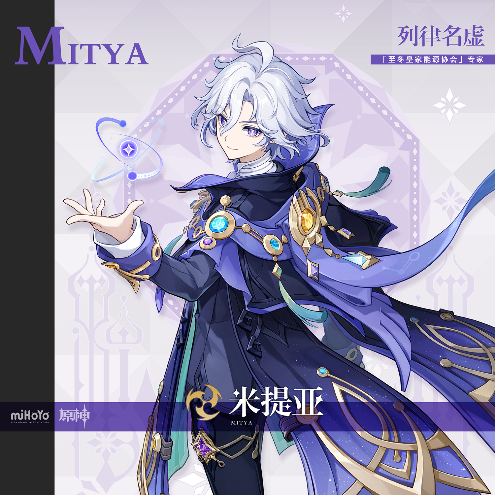
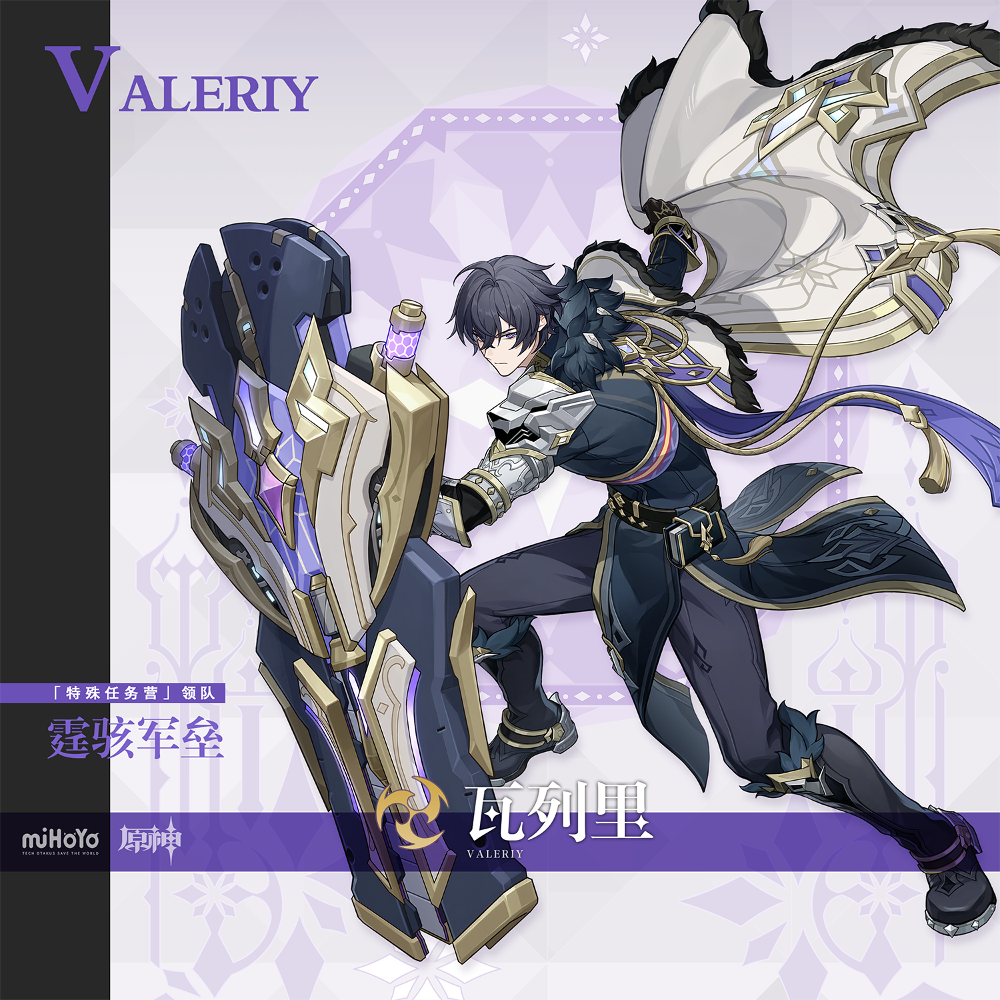
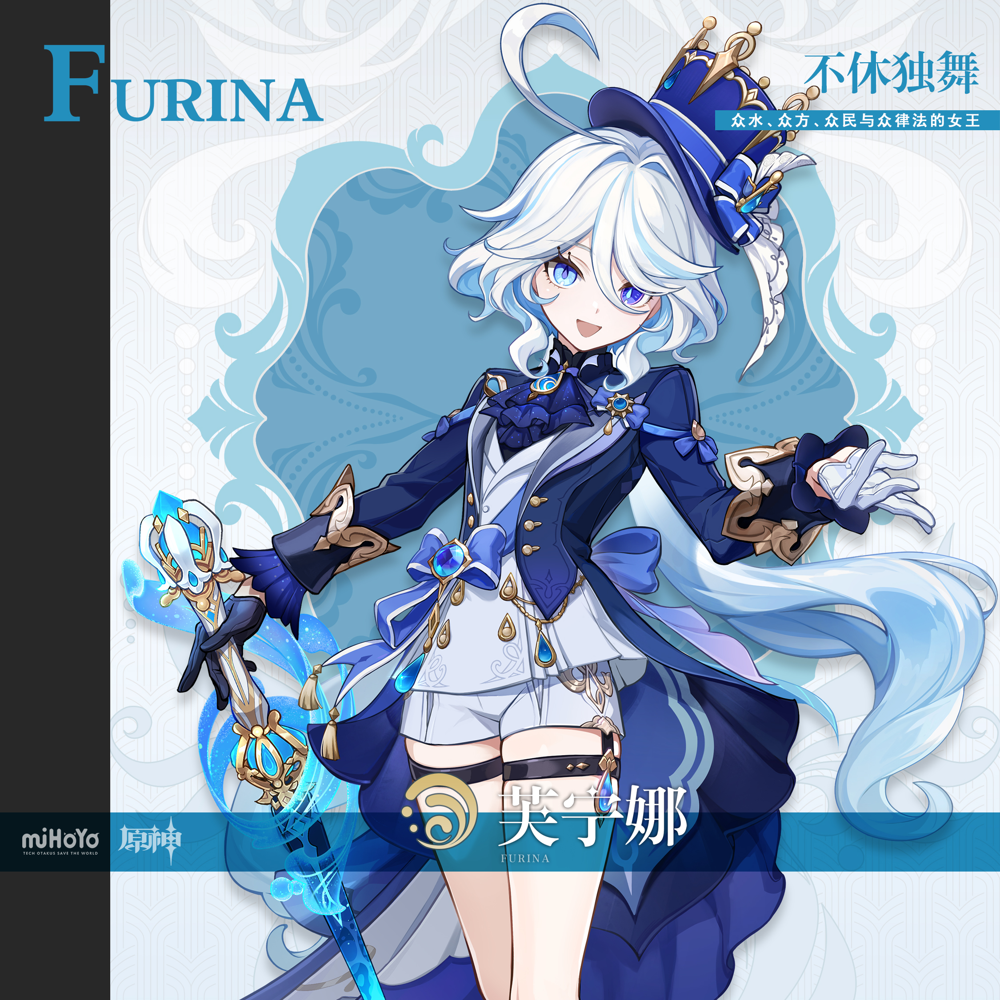
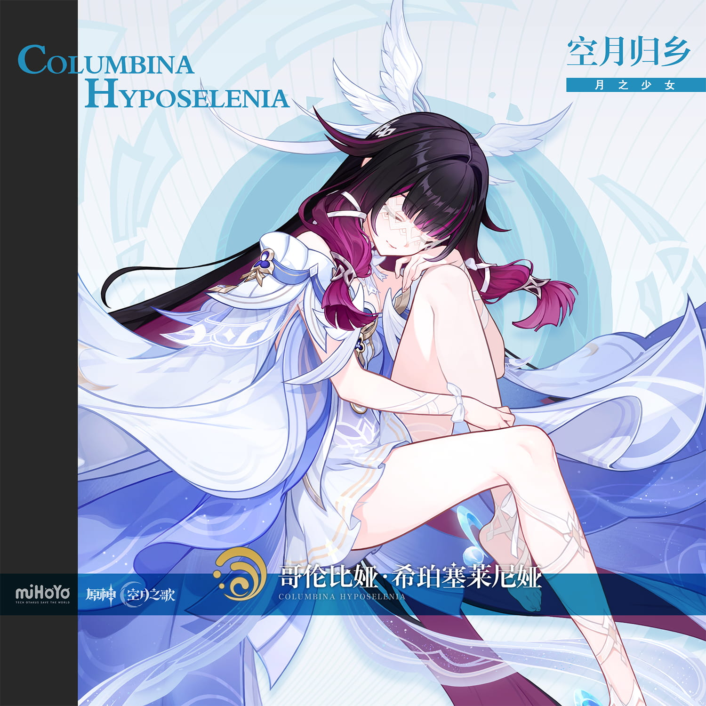
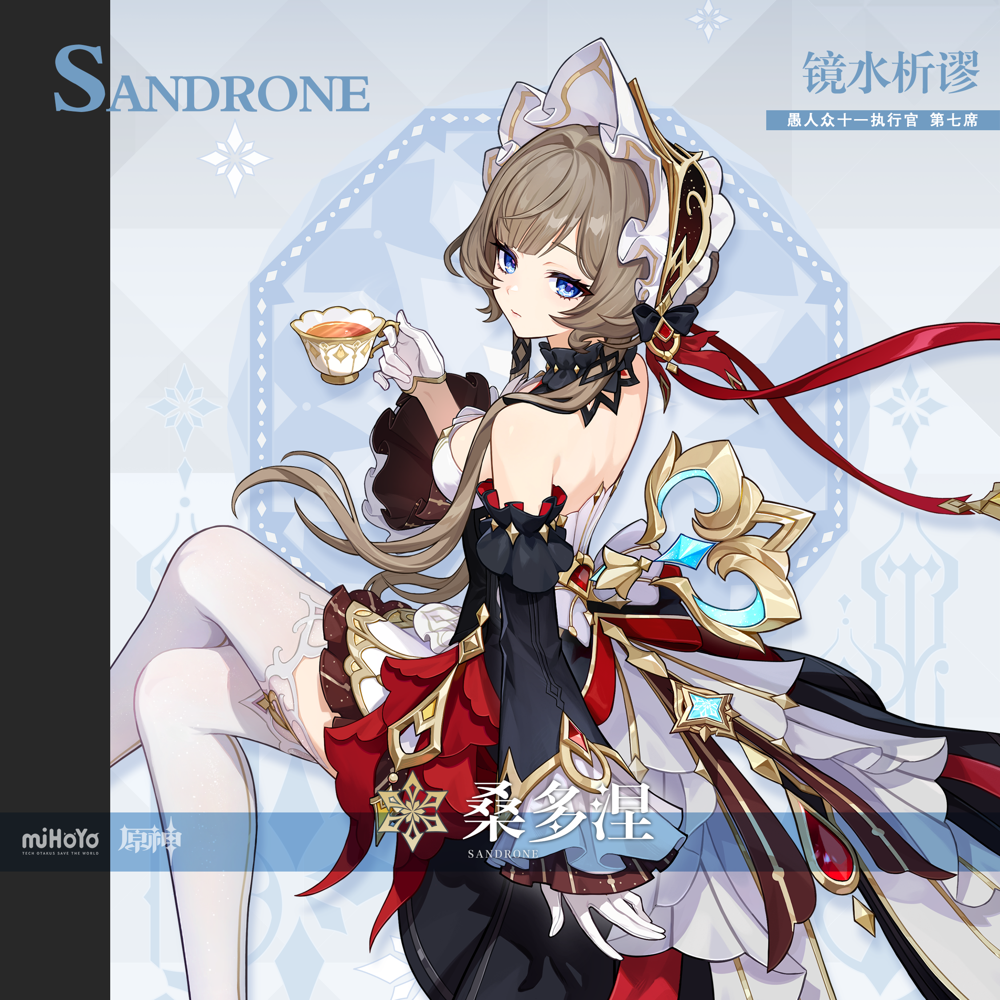
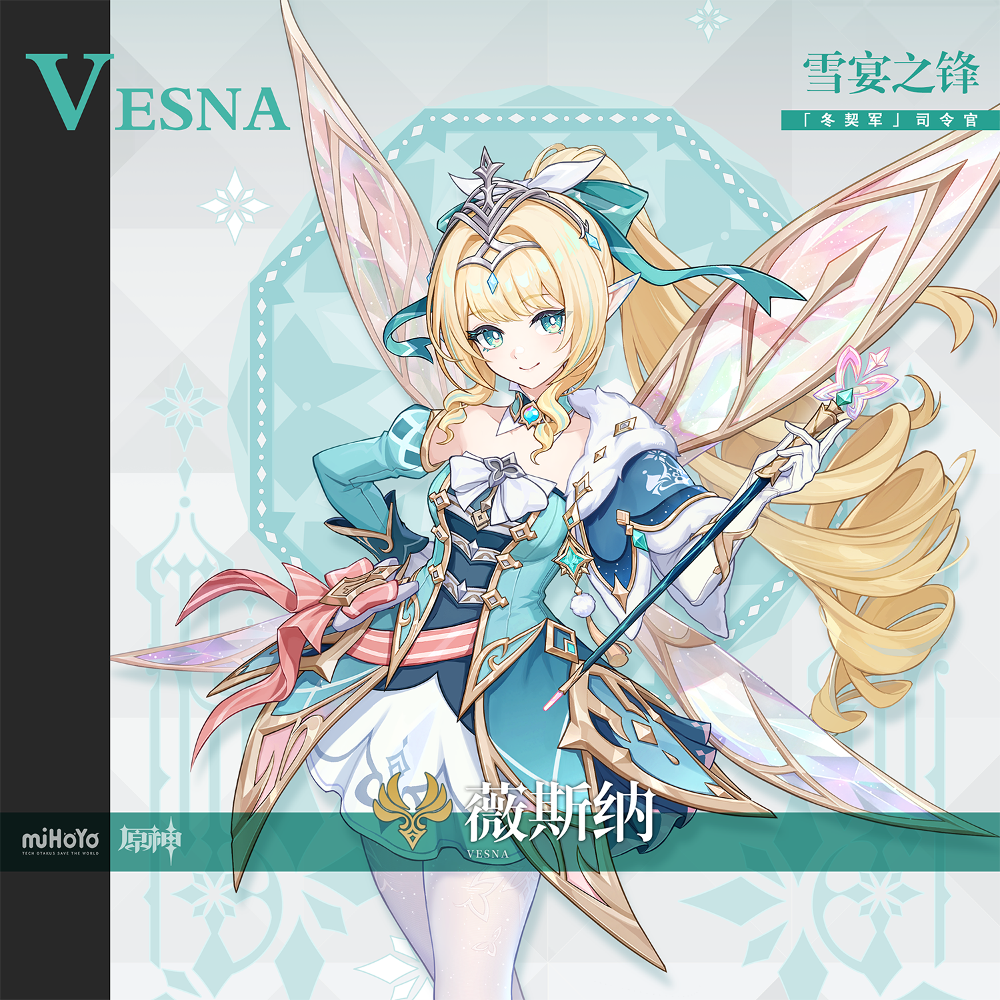

# 坏灭肇始之时·7.2前瞻特辑 — 2026.10.23
> 视频类型：B · 主题类型合集（版本前瞻特辑）
> 统一比例：**3:4 竖版**（`3:4 vertical portrait wallpaper`），10 条 prompts 全部一致
> 主题说明：《原神》7.2 版本「坏灭肇始之时」前瞻特别节目将于今日（10/23）晚 20:00 开播——本期以「坏灭前夜的至冬雪夜」为统一视觉母题：深蓝黑夜幕 + 紫青色极光帘幕 + 飘雪与霜星辉 + 至冬意象（雪原/宫城/机关/军装任选其一），定格「坏灭开始之前，至冬最后一个静谧的雪夜」
> 热点背景：①7.2 前瞻直播定档 10/23 晚 8 点（B站/抖音/米游社同步，3 组原石兑换码），为当日全网最大米哈游热点；②双新角色米提亚（新五星·雷·星超导体系主C）与瓦列里（新四星·雷·盾辅）立绘已于 9/29 官宣，测试服 V5 技能改动已出，社区讨论正热；③前瞻海报出镜阵容：薇斯纳、旅行者与派蒙、桑多涅、冰之女皇、丑角、米提亚及远处背身红发身影（公认诺伊）；④社区爆料上半卡池「米提亚+芙宁娜复刻」（以当晚直播官宣为准）
> 涉及角色：米提亚（7.2 新五星·雷·至冬皇家能源协会专家·列律名虚）、瓦列里（7.2 新四星·雷·特殊任务营领队·霆骇军垒）、芙宁娜（爆料复刻·水·枫丹前水神）、哥伦比娅（至冬篇核心·霜月女神·月之少女）、桑多涅（前瞻海报出镜·愚人众第七席「木偶」·镜水析谬）、薇斯纳（前瞻海报出镜·「冬契军」司令官·雪宴之锋）
> 选定类型理由：当日最强热点为 7.2 前瞻直播；最优热点角色米提亚与瓦列里均为男性，按性别流量权重规则不出类型 A 单人集 → 改选类型 B 多角色合集消化（前瞻特辑先例：与兽共舞-4.6前瞻特辑）；米提亚已于 9/15 做过单人集，单人集二连亦不可取
> 选角理由：①米提亚=7.2 唯一新五星、前瞻日版节目由其日配 CV 小林裕介出演、预览缩图 C 位；②瓦列里=7.2 双雷另一位、与米提亚「围巾保密权限」官方上下级喜剧梗热传；③芙宁娜=爆料复刻上半卡池、枫丹人气顶流、工作区立绘校对齐全；④哥伦比娅=至冬篇月之女神、版本名「坏灭肇始之时」的至冬叙事核心人物；⑤桑多涅+薇斯纳=前瞻海报出镜角色、立绘均已官宣且工作区已获取官方介绍图
> 系列画面规则：所有画面统一深蓝黑夜空 + 紫青极光 + 飘雪霜星辉；每张必须出现「雪 + 极光/星辉」母题与至少一个至冬意象；第 1 条最详细定义基调，后续角色引用第一张图作风格参考但**不可复制人物姿态**；尺度把控：成年角色、姿态优雅不露点，negative 统一排除 nude/topless/childlike
> 参考图说明：米提亚/瓦列里沿用 10/04 已校对官方立绘，芙宁娜沿用 10/05 已校对 B站WIKI 立绘；哥伦比娅/桑多涅/薇斯纳为本期新视觉校对的官方介绍图（2250×2250，外观锚点已逐一核对并登记 reference-registry.md）

---

## 1（米提亚·雪夜星穹·坏灭序章）【基调定义 · 最详细】

Positive Prompt:
3:4 vertical portrait wallpaper, Metia from Genshin Impact, highly detailed anime-style illustration, polished game-art quality, a snowbound ridge on the outskirts of Snezhnaya on the last quiet night before ruin — a deep indigo night sky filled with drifting snow and great curtains of violet-teal aurora borealis, distant snow-capped palace towers and machinery silhouettes glowing faintly on the horizon, frost starlight particles floating in the air. Metia stands at the crest of the snowy ridge, weight on one hip in a relaxed confident stance, one arm raised elegantly outward with fingers elegantly relaxed — natural hand pose, well-defined fingers — the other hand tucked behind his back, as a vast circular superconduct domain unfolds in the air above the snow: concentric golden orbit-rings and violet Electro sigils spinning like a living astral equation, thin lightning threads leaping between the rings, each ring stirring up gentle spirals of glowing snow below. His expression is brilliant and satisfied — a wide delighted grin, bright violet eyes lit with the joy of a hypothesis finally proven, as if the aurora itself were the answer he had been calculating all along. Keep Metia's recognizable features: fluffy layered silver-white hair with a springy ahoge, violet eyes, fair skin, slender youthful frame. He wears his canonical outfit: dark navy-blue long coat with black panels, high white cravat collar, long flowing white scarf caught in the freezing wind, sweeping blue-violet half-cape lined with starry nebula fabric and trimmed with golden orbital-ring brooches set with cyan, violet and amber gems, teal ribbons trailing from the shoulders, fitted dark trousers and dark boots. A small floating atom-orbit star sigil hovers beside his shoulder with a tiny lightning bolt glowing at its heart, snow crystals gathering along the golden rings, aurora light reflecting in violet and teal across the snowfield, deep indigo and violet palette with gold and teal accents, serene-yet-electric last-night-before-the-storm atmosphere. tasteful and elegant throughout, no explicit content. perfect hands, five fingers on each hand, anatomically correct hands, well-defined fingers, natural hand pose. Correct hip-to-thigh-to-knee anatomy, natural leg proportions, natural standing posture.

Negative Prompt:
low quality, worst quality, blurry, pixelated, bad anatomy, extra limbs, bad hands, extra fingers, fewer fingers, missing fingers, fused fingers, webbed fingers, overlapping fingers, deformed fingers, six fingers, bad hand anatomy, asymmetrical hands, broken fingers, claw hands, blurry hands, missing legs, missing feet, cropped legs, twisted legs, rotated hips, extra legs, fused legs, malformed knees, knees bending in opposite directions, unnatural sitting pose, disproportionate limbs, elongated calves, deformed feet, nude, topless, nipples, areola, explicit, childlike, loli, underage, feminine, androgynous, female body, skirt, crop top, warm cheerful daylight, sunny sky, green grass, tropical scene, wrong hair color, wrong eye color, incorrect character, text, watermark, logo, signature.

---

## 2（米提亚·围巾与请假条·能源协会前夜）

Referring to the attached first artwork for style, lighting, and winter-night aurora atmosphere only, generate a 3:4 vertical portrait wallpaper of Metia from Genshin Impact in the same snowbound Snezhnaya mood, without copying the first pose. Metia sits side-saddle on a supply crate outside a frost-covered laboratory doorway, both knees together and pointing in the same direction, calves hanging down side by side in natural parallel alignment, one hand lazily winding the end of his long white scarf — fingers naturally curled, well-defined fingers — the other hand waving a half-finished leave-request letter in the air as if defending it to an invisible supervisor. His expression is an unrepentant, teasing grin — violet eyes half-lidded with playful brilliance, the look of a genius who considers attendance reviews a beautiful theory that fails every practical test. Keep all his canonical features from the first artwork: fluffy silver-white hair with springy ahoge, violet eyes, dark navy-blue long coat with white cravat collar, nebula-lined blue-violet half-cape with golden orbital brooches and teal ribbons, long white scarf, dark trousers. Behind him the laboratory's round porthole window glows warm amber through frosted glass, brass gauges and pipes glinting, a small floating atom-orbit star sigil perched on the crate like a supervising companion, aurora curtains rippling in the night sky above snow-dusted rooftops, gentle snowfall catching the lamplight, deep indigo and gold palette with teal accents, cozy comedic genius-at-ease atmosphere. tasteful and elegant throughout, no explicit content. perfect hands, five fingers on each hand, anatomically correct hands, well-defined fingers, natural hand pose. Correct hip-to-thigh-to-knee anatomy, natural leg proportions, both legs in natural parallel alignment, natural seated posture.

Negative Prompt:
low quality, worst quality, blurry, pixelated, bad anatomy, extra limbs, bad hands, extra fingers, fewer fingers, missing fingers, fused fingers, webbed fingers, overlapping fingers, deformed fingers, six fingers, bad hand anatomy, asymmetrical hands, broken fingers, claw hands, blurry hands, missing legs, missing feet, cropped legs, twisted legs, rotated hips, extra legs, fused legs, malformed knees, knees bending in opposite directions, unnatural sitting pose, one leg crossed over the other, disproportionate limbs, elongated calves, deformed feet, nude, topless, nipples, areola, explicit, childlike, loli, underage, feminine, androgynous, warm cheerful daylight, sunny sky, green grass, wrong hair color, wrong eye color, incorrect character, text, watermark, logo, signature.

---

## 3（瓦列里·风雪哨位·霆骇军垒）

Referring to the attached first artwork for style, lighting, and winter-night aurora atmosphere only, generate a 3:4 vertical portrait wallpaper of Valeriy from Genshin Impact in the same snowbound Snezhnaya mood, without copying the first pose. Valeriy stands at his sentry post on a snow-covered rampart at night, weight on one leg in a firm military stance, one gauntleted hand resting calmly on the rim of his colossal mechanical tower shield planted upright beside him — fingers naturally curled, well-defined fingers — the other hand relaxed at his side. His expression is disciplined and quietly proud — sharp violet eyes scanning the aurora-lit horizon, composed jaw, the face of a squad leader whose watch has never once been late. Keep Valeriy's recognizable features: messy dark charcoal-blue hair with wind-blown fringe, violet eyes, fair skin, youthful masculine build with broad shoulders. He wears his canonical outfit: black long military tailcoat with gold trim and dark fur collar, white chest armor plate with silver pauldron, flowing white cape with gold-edged lining caught in the snow wind, purple-blue ribbons at his back, fitted black trousers and black boots with gold accents. His enormous black-blue-white mechanical shield with a violet energy core stands beside him like a bastion, snow sliding off its angled plates, faint Electro sparks crawling along its edge and lighting the falling snowflakes violet, aurora curtains stretched above the rampart battlements, a line of lantern-lit watchfires glowing far below, deep indigo and violet palette with gold accents, steadfast guardian-of-the-last-quiet-night atmosphere. tasteful and elegant throughout, no explicit content. perfect hands, five fingers on each hand, anatomically correct hands, well-defined fingers, natural hand pose. Correct hip-to-thigh-to-knee anatomy, natural leg proportions, natural standing posture.

Negative Prompt:
low quality, worst quality, blurry, pixelated, bad anatomy, extra limbs, bad hands, extra fingers, fewer fingers, missing fingers, fused fingers, webbed fingers, overlapping fingers, deformed fingers, six fingers, bad hand anatomy, asymmetrical hands, broken fingers, claw hands, blurry hands, missing legs, missing feet, cropped legs, twisted legs, rotated hips, extra legs, fused legs, malformed knees, knees bending in opposite directions, unnatural sitting pose, disproportionate limbs, elongated calves, deformed feet, nude, topless, nipples, areola, explicit, childlike, loli, underage, feminine, androgynous, female body, skirt, crop top, warm cheerful daylight, sunny sky, green grass, wrong hair color, wrong eye color, incorrect character, text, watermark, logo, signature.

---

## 4（瓦列里·盾后灯火·换岗前的热茶）

Referring to the attached first artwork for style, lighting, and winter-night aurora atmosphere only, generate a 3:4 vertical portrait wallpaper of Valeriy from Genshin Impact in the same snowbound Snezhnaya mood, without copying earlier poses. Valeriy kneels on one knee beside his planted tower shield just inside a sentry alcove, using the shield's broad face as a windbreak, one gloved hand cupping a small steaming tin cup close to his chest — five fingers on each hand, fingers naturally wrapped, well-defined fingers — the other hand resting on his knee. His expression is soft and quietly relieved — a faint, rare smile, violet eyes half-closed in the lantern warmth, the off-duty face of a bodyguard who has intercepted another ninety threats and finally counted himself off the roster. Keep all his canonical features from the first artwork: messy dark charcoal-blue hair, violet eyes, black military tailcoat with fur collar, white chest armor, gold-lined white cape draped over the shield's edge, black trousers and boots. A single storm lantern glows warm amber on a crate beside him, its light ringed by swirling snow that never reaches him behind the shield, faint violet Electro sparks warming the cup's rim, the aurora glowing dim green-violet through the alcove's open top, snow-covered weapon racks and rope coils in the background, deep indigo palette with warm lantern-gold accents, tender off-duty guardian atmosphere. tasteful and elegant throughout, no explicit content. perfect hands, five fingers on each hand, anatomically correct hands, well-defined fingers, natural hand pose. Correct hip-to-thigh-to-knee anatomy, natural leg proportions, natural kneeling posture.

Negative Prompt:
low quality, worst quality, blurry, pixelated, bad anatomy, extra limbs, bad hands, extra fingers, fewer fingers, missing fingers, fused fingers, webbed fingers, overlapping fingers, deformed fingers, six fingers, bad hand anatomy, asymmetrical hands, broken fingers, claw hands, blurry hands, missing legs, missing feet, cropped legs, twisted legs, rotated hips, extra legs, fused legs, malformed knees, knees bending in opposite directions, unnatural sitting pose, disproportionate limbs, elongated calves, deformed feet, nude, topless, nipples, areola, explicit, childlike, loli, underage, feminine, androgynous, warm cheerful daylight, sunny sky, green grass, wrong hair color, wrong eye color, incorrect character, text, watermark, logo, signature.

---

## 5（芙宁娜·雪夜歌台·水之咏叹）

Referring to the attached first artwork for style, lighting, and winter-night aurora atmosphere only, generate a 3:4 vertical portrait wallpaper of Furina from Genshin Impact in the same snowbound Snezhnaya mood, without copying the reference pose. Furina performs center-stage on an open-air snow theatre carved of pale ice, one arm raised gracefully skyward with fingers elegantly relaxed — natural hand pose, well-defined fingers — the other arm swept low holding the fold of her coat, weight balanced in a poised performer's stance. Her expression is theatrical and radiant — a brilliant stage smile, heterochromatic-tinged light-blue eyes flashing with showmanship, mid-aria at the exact moment the audience forgets to breathe. Keep Furina's recognizable features: wavy silver-white bob with pale blue inner layer and a curling ahoge, light blue water-drop shaped pupils, fair skin. She wears her canonical outfit: small deep-blue top hat with golden crown ornament and blue ribbon, deep-blue tailcoat with gold buttons over a white vest and shorts, a large blue bow with a water-drop gem at the small of her back, dark blue gloves, black leg ring on her right thigh, dark low-heeled shoes with white ruffled socks. Shards of conjured water orbit her like a slow galaxy, catching the aurora light in prismatic sparks, snow drifting down through the spotlights of moon and aurora, frosted orchestra pits and ice balustrades framing the stage, deep indigo and blue palette with silver-gold highlights, magnificent final-performance-before-the-curtain atmosphere. tasteful and elegant throughout, no explicit content. perfect hands, five fingers on each hand, anatomically correct hands, well-defined fingers, natural hand pose. Correct hip-to-thigh-to-knee anatomy, natural leg proportions, natural standing posture.

Negative Prompt:
low quality, worst quality, blurry, pixelated, bad anatomy, extra limbs, bad hands, extra fingers, fewer fingers, missing fingers, fused fingers, webbed fingers, overlapping fingers, deformed fingers, six fingers, bad hand anatomy, asymmetrical hands, broken fingers, claw hands, blurry hands, missing legs, missing feet, cropped legs, twisted legs, rotated hips, extra legs, fused legs, malformed knees, knees bending in opposite directions, unnatural sitting pose, disproportionate limbs, elongated calves, deformed feet, nude, topless, nipples, areola, explicit, childlike, loli, underage, wrong hair color, wrong eye color, incorrect character, crowd, audience faces, warm cheerful daylight, sunny sky, green grass, text, watermark, logo, signature.

---

## 6（芙宁娜·雪街灯影·深夜甜品小逃亡）

Referring to the attached first artwork for style, lighting, and winter-night aurora atmosphere only, generate a 3:4 vertical portrait wallpaper of Furina from Genshin Impact in the same snowbound Snezhnaya mood, without copying earlier poses. Furina strolls down a lantern-lit snow lane in mid-stride, a cheerful half-skip in her step, one hand hugging a paper bag of sweets against her chest — fingers naturally curled around the bag, well-defined fingers — the other hand tucked behind her back, glancing over her shoulder toward the viewer as if checking she hasn't been followed by the dessert bill. Her expression is playful and conspiratorial — a mischievous grin, light-blue eyes bright with stolen-pudding triumph, snowflakes catching in her lashes. Keep all her canonical features from the first artwork: wavy silver-white bob with pale blue inner layer and curling ahoge, light blue water-drop shaped pupils, small deep-blue top hat with golden crown ornament, deep-blue tailcoat with gold buttons, large blue bow with water-drop gem at her back, dark blue gloves, black leg ring on her right thigh, dark low-heeled shoes with white ruffled socks. Warm shop windows and strings of frost-rimmed lanterns line the snowy lane behind her, her footprints stitching a wandering line through fresh snow, faint drifting water-droplet sparkles trailing the bag, aurora glowing softly over the rooftops, deep indigo palette with warm lantern-gold and blue accents, cozy mischievous midnight-snack atmosphere. tasteful and elegant throughout, no explicit content. perfect hands, five fingers on each hand, anatomically correct hands, well-defined fingers, natural hand pose. Correct hip-to-thigh-to-knee anatomy, natural leg proportions, natural walking posture.

Negative Prompt:
low quality, worst quality, blurry, pixelated, bad anatomy, extra limbs, bad hands, extra fingers, fewer fingers, missing fingers, fused fingers, webbed fingers, overlapping fingers, deformed fingers, six fingers, bad hand anatomy, asymmetrical hands, broken fingers, claw hands, blurry hands, missing legs, missing feet, cropped legs, twisted legs, rotated hips, extra legs, fused legs, malformed knees, knees bending in opposite directions, unnatural sitting pose, disproportionate limbs, elongated calves, deformed feet, nude, topless, nipples, areola, explicit, childlike, loli, underage, wrong hair color, wrong eye color, incorrect character, crowd, warm cheerful daylight, sunny sky, green grass, text, watermark, logo, signature.

---

## 7（哥伦比娅·霜月归乡·月下白鸽）

Referring to the attached first artwork for style, lighting, and winter-night aurora atmosphere only, generate a 3:4 vertical portrait wallpaper of Columbina Hyposelenia from Genshin Impact in the same snowbound Snezhnaya mood, without copying the reference pose. Columbina hovers gently just above the mirror-smooth surface of a frozen lake, her bare feet with crescent-moon crystal heel ornaments dangling down side by side in natural parallel alignment, legs together in a serene floating pose, one hand resting peacefully over her heart with fingers relaxed, the other hand open palm-up at her side where a white dove has just alighted — fingers softly curled, well-defined fingers. Her expression is a gentle closed-eye smile beneath her veil, serene and otherworldly, as if listening to a song only the moon remembers. Keep Columbina's recognizable features: long black hair with deep ginger-red gradient streaks at the ends, a white gauze lattice veil covering her eyes, six small white wings arranged as a headpiece at the back of her head, fair skin. She wears her canonical outfit: white-and-pale-blue lunar goddess dress woven with moon motifs, blue gem and gold ornaments at her shoulders, white silk ribbons wound around her wrists and ankles, bare feet with pale blue crescent-moon heel bases. Behind her an enormous pale full moon rises over the snow-frosted shore, its reflection rippling with the frozen lake's cracks of pale blue light, white doves drifting like snow around her, aurora curtains in soft teal and violet blending with the moonlight, frost starlight particles floating, deep indigo and silver-white palette with soft blue accents, sacred quiet homecoming atmosphere. tasteful and elegant throughout, no explicit content. perfect hands, five fingers on each hand, anatomically correct hands, well-defined fingers, natural hand pose. Correct hip-to-thigh-to-knee anatomy, natural leg proportions, both legs in natural parallel alignment.

Negative Prompt:
low quality, worst quality, blurry, pixelated, bad anatomy, extra limbs, bad hands, extra fingers, fewer fingers, missing fingers, fused fingers, webbed fingers, overlapping fingers, deformed fingers, six fingers, bad hand anatomy, asymmetrical hands, broken fingers, claw hands, blurry hands, missing legs, missing feet, cropped legs, twisted legs, rotated hips, extra legs, fused legs, malformed knees, knees bending in opposite directions, unnatural sitting pose, disproportionate limbs, elongated calves, deformed feet, nude, topless, nipples, areola, explicit, childlike, loli, underage, open eyes, exposed eyes, wrong hair color, incorrect character, warm cheerful daylight, sunny sky, green grass, text, watermark, logo, signature.

---

## 8（哥伦比娅·雪原谛听·封目祷歌）

Referring to the attached first artwork for style, lighting, and winter-night aurora atmosphere only, generate a 3:4 vertical portrait wallpaper of Columbina Hyposelenia from Genshin Impact in the same snowbound Snezhnaya mood, without copying earlier poses. Columbina stands barefoot on an endless snowfield at night, her feet with crescent-moon crystal heel ornaments leaving no prints in the untouched snow, weight perfectly balanced in a serene standing pose, both hands gently cupped together in front of her chest holding a small drifting mote of pale blue moonlight — fingers relaxed and not interlocked, well-defined fingers — her head slightly bowed as snow gathers on her hair and shoulders. Her expression is tranquil and unknowable behind the lattice veil, the closed-eye softness of someone who sealed her own sight so as not to see the world's lies, waiting only to go home. Keep all her canonical features from the first artwork: long black hair with deep ginger-red gradient ends, white gauze lattice veil over her eyes, six small white wings as a headpiece, white-and-pale-blue lunar goddess dress with blue gem and gold shoulder ornaments, white silk ribbons on wrists and ankles, bare feet with pale blue crescent-moon heel bases. Around her the snowfall falls in perfect silence, thin moonbeams breaking through the aurora in shafts of silver, faint ghostly images of three moons hovering far above the horizon in the night sky, white feathers dissolving into snowflakes at her feet, deep indigo and silver palette with pale blue moonlight accents, hushed sacred vigil atmosphere. tasteful and elegant throughout, no explicit content. perfect hands, five fingers on each hand, anatomically correct hands, well-defined fingers, natural hand pose. Correct hip-to-thigh-to-knee anatomy, natural leg proportions, natural standing posture.

Negative Prompt:
low quality, worst quality, blurry, pixelated, bad anatomy, extra limbs, bad hands, extra fingers, fewer fingers, missing fingers, fused fingers, webbed fingers, overlapping fingers, deformed fingers, six fingers, bad hand anatomy, asymmetrical hands, broken fingers, claw hands, blurry hands, missing legs, missing feet, cropped legs, twisted legs, rotated hips, extra legs, fused legs, malformed knees, knees bending in opposite directions, unnatural sitting pose, disproportionate limbs, elongated calves, deformed feet, nude, topless, nipples, areola, explicit, childlike, loli, underage, open eyes, exposed eyes, wrong hair color, incorrect character, warm cheerful daylight, sunny sky, green grass, text, watermark, logo, signature.

---

## 9（桑多涅·镜水析谬·茶与发条）

Referring to the attached first artwork for style, lighting, and winter-night aurora atmosphere only, generate a 3:4 vertical portrait wallpaper of Sandrone from Genshin Impact in the same snowbound Snezhnaya mood, without copying the reference pose. Sandrone stands on the observation deck of her clockwork workshop-carriage halted in the snow, weight on one hip in an easy confident stance, one white-gloved hand holding a porcelain teacup at chest height — fingers naturally wrapped around the handle, well-defined fingers — the other gloved hand resting flat on the housing of a great brass clockwork engine looming beside her, whose gears have just finished turning for the night. Her expression is cool and appraising — calm blue eyes half-lidded over the teacup's rim, the unimpressed gaze of the seventh Harbinger reviewing a mechanism that is 0.3 seconds too slow, one eyebrow faintly raised. Keep Sandrone's recognizable features: light brown hair with a long side braid tied with a red ribbon, blue eyes, fair skin, white frilled maid-style headdress with a large bow and dark red gem ornament. She wears her canonical outfit: black off-shoulder corset dress with white and deep-red layered skirt panels, gold trim and gear motifs, dark choker, white gloves, thigh-high stocking visible as she stands. Her colossal golden clockwork apparatus rises behind her with a glowing cyan crystal heart and coiled red ribbons drifting in the cold air, steam venting softly into the night, snow piled on its brass rails, aurora curtains reflected in the polished gears, frost starlight particles drifting, deep indigo and brass-gold palette with red accents, precise aristocratic-engineer atmosphere. tasteful and elegant throughout, no explicit content. perfect hands, five fingers on each hand, anatomically correct hands, well-defined fingers, natural hand pose. Correct hip-to-thigh-to-knee anatomy, natural leg proportions, natural standing posture.

Negative Prompt:
low quality, worst quality, blurry, pixelated, bad anatomy, extra limbs, bad hands, extra fingers, fewer fingers, missing fingers, fused fingers, webbed fingers, overlapping fingers, deformed fingers, six fingers, bad hand anatomy, asymmetrical hands, broken fingers, claw hands, blurry hands, missing legs, missing feet, cropped legs, twisted legs, rotated hips, extra legs, fused legs, malformed knees, knees bending in opposite directions, unnatural sitting pose, disproportionate limbs, elongated calves, deformed feet, nude, topless, nipples, areola, explicit, childlike, loli, underage, wrong hair color, wrong eye color, incorrect character, warm cheerful daylight, sunny sky, green grass, text, watermark, logo, signature.

---

## 10（薇斯纳·雪宴之锋·冬契点兵）

Referring to the attached first artwork for style, lighting, and winter-night aurora atmosphere only, generate a 3:4 vertical portrait wallpaper of Vesna from Genshin Impact in the same snowbound Snezhnaya mood, without copying the reference pose. Vesna stands at the head of a snowbound parade ground at night, weight on one hip in a poised commander's stance, one hand gripping her slender staff planted upright before her — its tip crowned with a pink crystal butterfly that glows like a tiny lantern — fingers naturally wrapped, well-defined fingers — the other hand resting at her waist. Her expression is bright and commanding — a confident smile, teal-blue eyes gleaming with the thrill of the eve of the feast, chin lifted as her pale crystalline wings fan wide behind her, scattering iridescent frost dust. Keep Vesna's recognizable features: long golden-blonde hair in a high ponytail with curling side locks, teal-blue eyes, pointed elf ears, silver tiara-like headpiece with a turquoise ribbon bow, fair skin. She wears her canonical outfit: blue-white-gold winter commander dress with white fur collar, dark blue corset bodice with gold lattice trim, white bow at the chest with a teal gem, blue sleeves with white fur cuffs, layered white-and-blue skirt panels with pink sash and gold hardware, thigh-high white stockings with lace patterns. Her large translucent pastel crystal wings spread behind her like stained glass catching the aurora, rows of small lantern-lit tents and banners receding into the snowy field far below, snowflakes drifting between wing and aurora light, deep indigo palette with teal-gold and pastel pink accents, radiant eve-of-ceremony atmosphere. tasteful and elegant throughout, no explicit content. perfect hands, five fingers on each hand, anatomically correct hands, well-defined fingers, natural hand pose. Correct hip-to-thigh-to-knee anatomy, natural leg proportions, natural standing posture.

Negative Prompt:
low quality, worst quality, blurry, pixelated, bad anatomy, extra limbs, bad hands, extra fingers, fewer fingers, missing fingers, fused fingers, webbed fingers, overlapping fingers, deformed fingers, six fingers, bad hand anatomy, asymmetrical hands, broken fingers, claw hands, blurry hands, missing legs, missing feet, cropped legs, twisted legs, rotated hips, extra legs, fused legs, malformed knees, knees bending in opposite directions, unnatural sitting pose, disproportionate limbs, elongated calves, deformed feet, nude, topless, nipples, areola, explicit, childlike, loli, underage, wrong hair color, wrong eye color, incorrect character, crowd, soldiers, faces in background, warm cheerful daylight, sunny sky, green grass, text, watermark, logo, signature.

---

## 注
- 比例统一 3:4 竖版；第 1 条为基调定义条（最详细），第 2~10 条均通过「Referring to the attached first artwork for style, lighting, and winter-night aurora atmosphere only ... without copying」锁定系列成套感并禁止姿态复制
- 每张均含「雪 + 极光/星辉」母题与至少一个至冬意象：雪脊星轨领域（1）、霜窗实验室（2）、哨垒巨盾（3/4）、冰造歌台（5）、灯街雪巷（6）、冰湖满月（7/8）、发条车厢（9）、点兵雪场（10）
- 条目融入官方设定梗：请假条与出勤考核（2）、围巾（1/2）、换岗热茶与"按名册换岗"反差（4）、哥伦比娅蒙眼封心设定与三相月意象（7/8）、桑多涅茶杯与第七席「木偶」机关（9）、薇斯纳冬契军与雪宴之锋（10）
- 卡池阵容（米提亚+芙宁娜复刻上半）为社区爆料，以 10/23 晚前瞻直播官宣为准；前瞻后如有重大新情报（如冰神实装、诺伊官宣），下期可做跟进特辑
