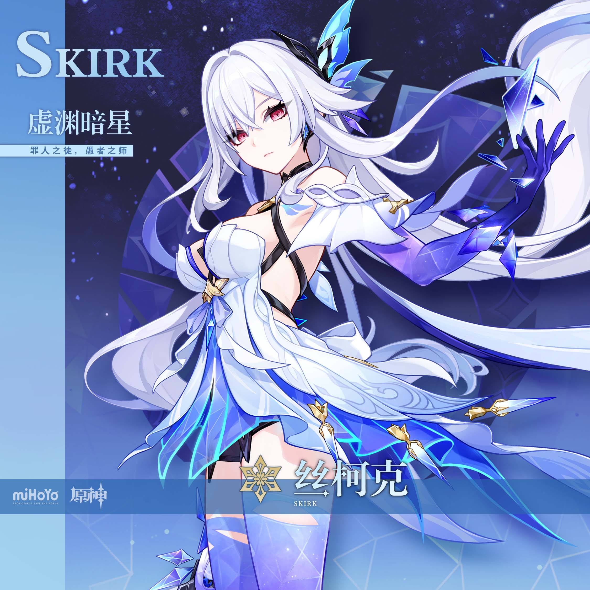
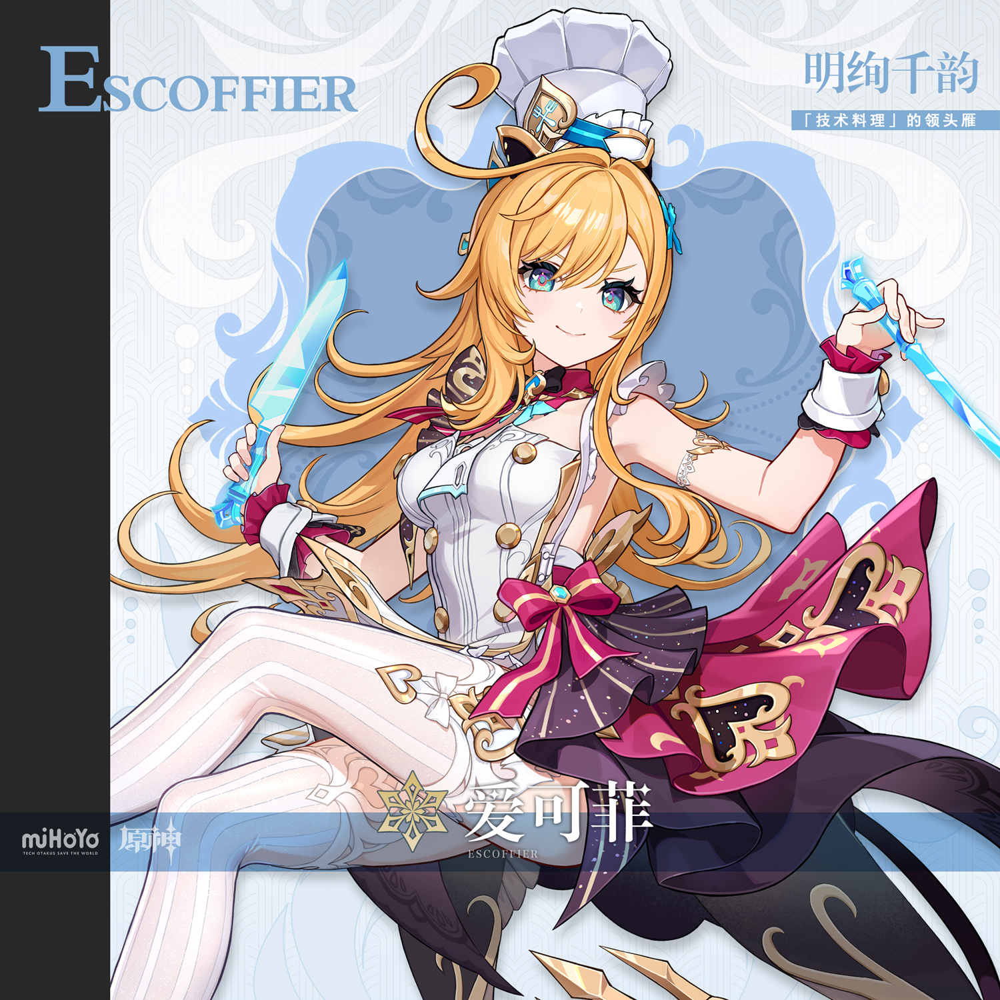
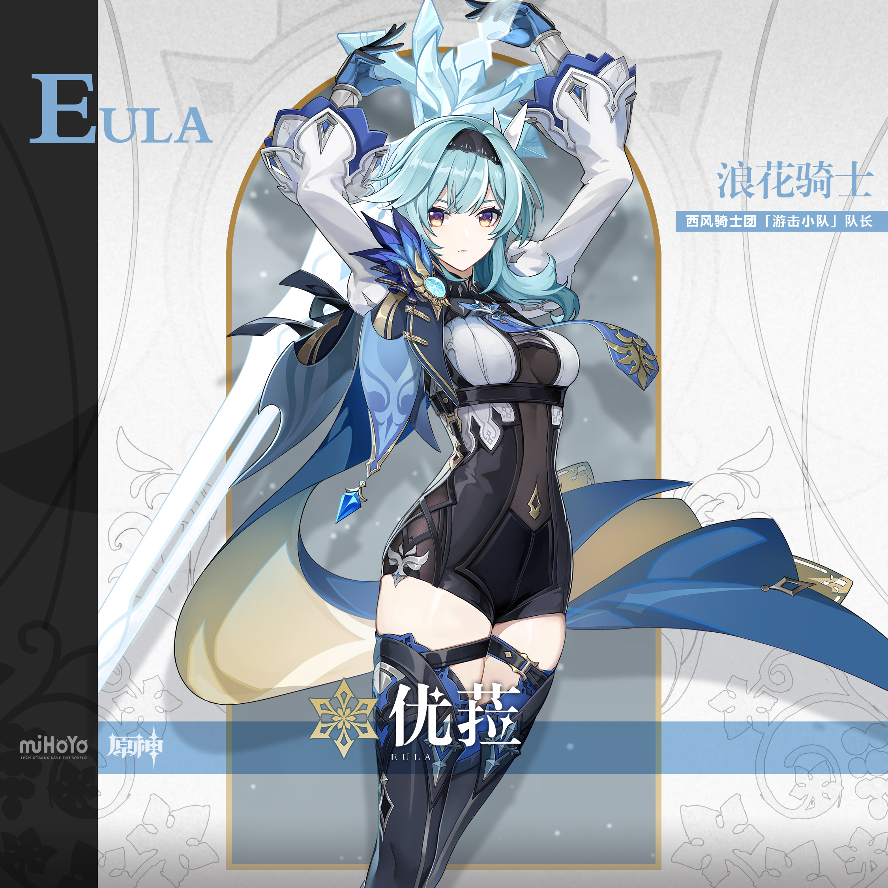
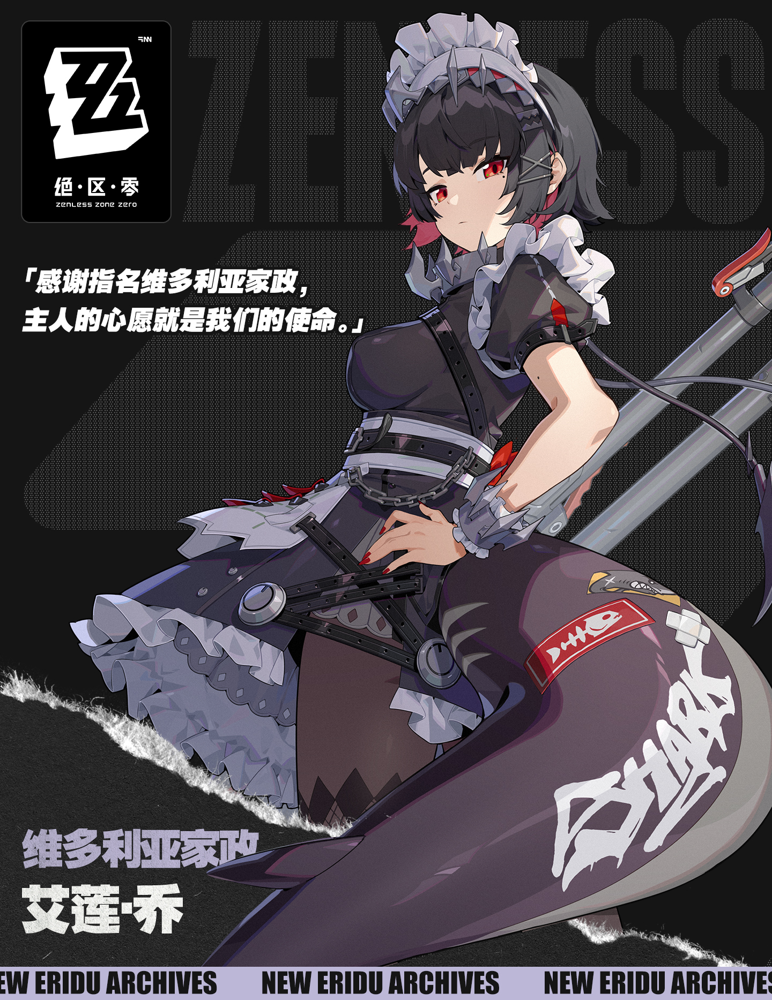
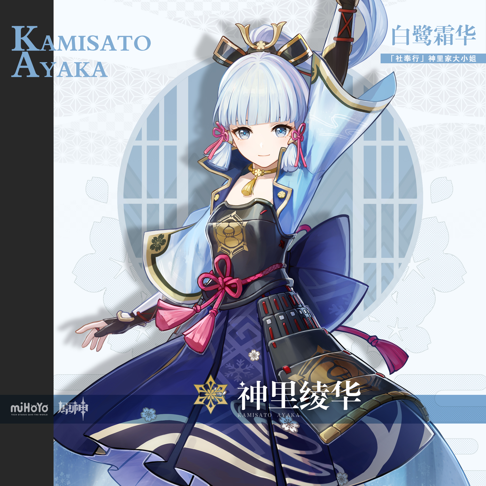

# 巡历雪境·复刻冰系特辑 — 2026.10.12
<!--
视频类型：B · 主题类型合集
主题说明：原神 7.1 下半复刻双池 + 常驻五星自选「巡历雪境，凝铸锋锐」双热点捆绑的冰系角色画报——统一视觉母题为「月夜雪原 + 极光垂落」：每位角色立于无垠雪原之上，身后极光帘幕随角色主题色变换颜色，冷银蓝夜色打底、角色主题色点缀，共 10 条 prompts，比例统一 3:4 竖版。
热点背景：①原神 7.1 下半「虚星临渡」丝柯克复刻池与「莓色香颂」爱可菲复刻池已官宣，10/13 开启，抽卡决策讨论正处峰值；②六周年常驻五星自选活动「巡历雪境，凝铸锋锐」进行中（11/3 截止），白嫖话题带量；③绝区零艾莲 3.4 崩铁联动官宣余热未散（"出嫁"话题）；④深秋向初冬过渡，雪境主题应季。
涉及角色：丝柯克、爱可菲（复刻双主角）、优菈、艾莲（均为工作区首次覆盖）、神里绫华（常青锚点）。
选定类型理由：本期最大热点为 7.1 下半复刻双池，但丝柯克（9/28 单人集）与爱可菲（9/13 单人集）均已做过类型 A，单人集不宜重复；复刻双池 + 自选活动 + 联动余热的多点爆发形态天然适合类型 B 多角色横向展示；类型 B 性别系数不适用。
选角理由：丝柯克=复刻头卡+「复刻最后一舞」社区话题+虚星临渡池名点题；爱可菲=复刻第二张+丝柯克永冻队专属辅助话题+莓色香颂池名点题；优菈=冰系人气角色且工作区从未覆盖（首覆盖引流）；艾莲=绝区零冰系强攻+3.4 联动"出嫁崩铁"话题+鲨鲨女仆高辨识度；神里绫华=雪境白鹭公主气质与本主题零成本契合+常青人气锚点。甘雨近期已在极简水墨 ep03 出场，本期轮休。
参考图说明：丝柯克/爱可菲/神里绫华外观描述沿用 reference-registry 已视觉校对的官方立绘索引（免校对）；优菈（eula-splash.jpg 2250×2250 官方介绍图）与艾莲（ellen-official-intro.png 1440×1865 官方介绍图 + ellen-splash.png 962×1246 透明底立绘）为本期新下载，已逐张视觉校对：优菈=冰蓝短发波波头+黑色发箍+淡紫晶瞳+白泡泡袖衬衣+黑蓝束身连体衣金纹+蓝色金纹披风+黑过膝靴蓝金腿环；艾莲=黑色短发+红瞳+白色褶边女仆发箍+黑色女仆短裙+白褶边围裙+黑菱纹裤袜+巨大灰紫鲨鱼尾（白色 SHARK 涂鸦+红色鱼骨贴纸）+银红巨锯（默认形象即女仆装）。
背景固定枚举声明：按 2026-10-07 背景固定枚举规则，全系列统一母题背景固定枚举 3 项元素（月夜雪原/极光帘幕/星空夜空梯度），极光颜色随角色主题色变化，每条 prompt 以 No other background elements 收口，杜绝场景堆叠。
-->

# 参考图索引

- 丝柯克官方立绘：
- 爱可菲官方立绘：
- 优菈官方介绍图（本期新增·已视觉校对）：
- 艾莲官方介绍图（本期新增·已视觉校对）：
- 艾莲透明底立绘（本期新增·已视觉校对）：
- 神里绫华官方立绘：

---

## 1（丝柯克·虚渊暗星落雪原）

Positive Prompt:

3:4 vertical portrait wallpaper, Skirk from Genshin Impact, highly detailed anime-style illustration, polished game-art quality, a lone swordmaster of the abyss standing in a moonlit snowfield beneath an aurora.

Skirk stands tall and still at the center of the snowfield, her posture straight and composed like a blade left in its sheath, both hands resting one over the other on the pommel of her longsword planted point-down in the snow before her, her head level, crimson-red eyes gazing calmly at the viewer with a cold, unreadable stare. Her unmistakable features: long white hair streaming gently in the freezing wind, crimson-red eyes, black-and-white crystal ornaments at the side of her head, a slim black choker at her throat. Her canonical outfit: fitted white and deep-blue battle suit with violet trims, dark blue-violet long gloves, layered armor plates at her waist. Thin shards of pale violet crystal hover and dissolve in the air around her shoulders like slow-falling stardust.

perfect hands, five fingers on each hand, anatomically correct hands, well-defined fingers, natural hand pose, clean finger separation, both hands stacked one over the other on the sword pommel.

Background exactly three elements: a rolling moonlit snowfield spreading to the horizon beneath her boots, a slow teal-and-violet aurora curtain draped across the sky behind her, a deep indigo-to-black starlit sky gradient above the aurora. No other background elements. Highly detailed background, sharp focus on Skirk, cold silver-blue night palette with violet aurora and crimson eye accents.

Negative Prompt:

low quality, worst quality, blurry, pixelated, bad anatomy, extra limbs, watermark, text, logo, signature, wrong hair color, wrong eye color, incorrect character, male, wrong gender, bad hands, extra fingers, fewer fingers, missing fingers, fused fingers, webbed fingers, merged fingers, overlapping fingers, deformed fingers, mutated fingers, six fingers, four fingers, three fingers, more than five fingers, less than five fingers, disfigured hands, poorly drawn hands, bad hand anatomy, asymmetrical hands, broken fingers, claw hands, blurry hands, indistinct fingers, smeared hands, missing legs, missing feet, missing calves, cropped legs, legs out of frame, twisted legs, rotated hips, dislocated hip, extra legs, third leg, fused legs, malformed knees, knees bending in opposite directions, unnatural sitting pose, disproportionate limbs, elongated calves, deformed feet, city, buildings, crowd, busy background, cluttered scene, chibi, photorealistic, 3D render, revealing outfits, indecent content, minor-looking body.

## 2（丝柯克·掌上星屑）

Positive Prompt:

3:4 vertical portrait wallpaper, referring to the attached first artwork for style, lighting, and snow-night atmosphere only — do not copy its pose, composition, or framing — generate a half-body close-up of Skirk from Genshin Impact in the same moonlit snowfield world.

Skirk faces the viewer in a relaxed half-body framing from the waist up, her chin slightly lowered, crimson-red eyes looking straight into the camera with cold composure. Her right arm is extended gently toward the viewer at chest height, the dark blue-violet glove fully revealing her open palm, fingers elegantly relaxed and slightly spread, while a single shard of glowing dark-violet crystal hovers just above her palm, scattering tiny sparks of stardust; her left hand hangs relaxed out of focus at her side. Her unmistakable features: long white hair falling over one shoulder, black-and-white crystal ornaments at the side of her head, slim black choker, crimson-red eyes. Her canonical outfit: fitted white and deep-blue battle suit with violet trims and layered waist armor. Tiny pale-violet crystal motes drift slowly around her like frozen stardust.

perfect hands, five fingers on each hand, anatomically correct hands, well-defined fingers, natural hand pose, detailed hands, clean finger separation, right hand open with fingers elegantly relaxed and slightly spread.

Background exactly three elements: a soft out-of-focus moonlit snowfield far behind her, a dim teal-and-violet aurora glow low in the blurred sky, a deep indigo starlit gradient filling the upper frame. No other background elements. Highly detailed, sharp focus on Skirk and the crystal shard, cold silver-blue night palette with violet accents.

Negative Prompt:

low quality, worst quality, blurry, pixelated, bad anatomy, extra limbs, watermark, text, logo, signature, wrong hair color, wrong eye color, incorrect character, male, wrong gender, bad hands, extra fingers, fewer fingers, missing fingers, fused fingers, webbed fingers, merged fingers, overlapping fingers, deformed fingers, mutated fingers, six fingers, four fingers, three fingers, more than five fingers, less than five fingers, disfigured hands, poorly drawn hands, bad hand anatomy, asymmetrical hands, broken fingers, claw hands, blurry hands, indistinct fingers, smeared hands, missing legs, missing feet, missing calves, cropped legs, legs out of frame, twisted legs, rotated hips, dislocated hip, extra legs, third leg, fused legs, malformed knees, knees bending in opposite directions, unnatural sitting pose, disproportionate limbs, elongated calves, deformed feet, city, buildings, crowd, busy background, cluttered scene, chibi, photorealistic, 3D render, revealing outfits, indecent content, minor-looking body.

---

## 3（爱可菲·莓色香颂雪夜宴）

Positive Prompt:

3:4 vertical portrait wallpaper, referring to the attached first artwork for style, lighting, and snow-night atmosphere only — do not copy its character, pose, costume, or composition — generate Escoffier from Genshin Impact standing in the moonlit snowfield beneath an aurora.

Escoffier stands with her weight settled on one hip in an elegant natural stance, one hand resting on her hip, the other raised beside her shoulder holding a slender crystalline dessert fork with fingers elegantly relaxed around its handle, her chin lifted with the confident poise of a master pâtissière presenting her life's finest course, pale blue eyes bright and gazing at the viewer with a composed smile. Her unmistakable features: golden wavy long hair with a prominent curled ahoge springing from her crown, softly curled hair tips, pale blue eyes, a tall white chef's toque hat. Her canonical outfit: white corset-style bodice with fine lacing over a deep magenta skirt trimmed with purple and gold patterns, delicate ice-crystal ornaments at her wrist like frozen cutlery. A swirl of frost and tiny berry-red light motes drifts around her raised hand.

perfect hands, five fingers on each hand, anatomically correct hands, well-defined fingers, natural hand pose, detailed hands, clean finger separation, one hand on hip, the other holding the dessert fork handle with fingers elegantly relaxed.

Background exactly three elements: a rolling moonlit snowfield with a faint sugar-frost sheen beneath her, a slow rose-pink-and-magenta aurora curtain draped across the sky behind her, a deep indigo-to-black starlit sky gradient above the aurora. No other background elements. Highly detailed background, sharp focus on Escoffier, cold silver-blue night palette with magenta and gold accents.

Negative Prompt:

low quality, worst quality, blurry, pixelated, bad anatomy, extra limbs, watermark, text, logo, signature, wrong hair color, wrong eye color, incorrect character, male, wrong gender, bad hands, extra fingers, fewer fingers, missing fingers, fused fingers, webbed fingers, merged fingers, overlapping fingers, deformed fingers, mutated fingers, six fingers, four fingers, three fingers, more than five fingers, less than five fingers, disfigured hands, poorly drawn hands, bad hand anatomy, asymmetrical hands, broken fingers, claw hands, blurry hands, indistinct fingers, smeared hands, missing legs, missing feet, missing calves, cropped legs, legs out of frame, twisted legs, rotated hips, dislocated hip, extra legs, third leg, fused legs, malformed knees, knees bending in opposite directions, unnatural sitting pose, disproportionate limbs, elongated calves, deformed feet, city, buildings, crowd, busy background, cluttered scene, chibi, photorealistic, 3D render, revealing outfits, indecent content, minor-looking body.

## 4（爱可菲·极光入眸特写）

Positive Prompt:

3:4 vertical portrait wallpaper, referring to the attached first artwork for style, lighting, and snow-night atmosphere only — do not copy its pose, composition, or framing — generate a bust close-up portrait of Escoffier from Genshin Impact in the same moonlit snowfield world.

Escoffier appears in an elegant bust framing from the chest up, her body angled three-quarters toward the viewer, her face turned slightly upward, pale blue eyes gazing softly past the viewer's shoulder with a serene knowing smile, the pink-and-magenta aurora light reflected as a faint colored sheen in her eyes and on her golden wavy hair, her prominent curled ahoge catching the glow. Her tall white chef's toque sits neatly on her golden wavy long hair, a slim gold earring visible on one ear. Her canonical outfit visible at the shoulders: white corset-style bodice with fine lacing and gold trim, a hint of deep magenta fabric. Her arms and hands are out of frame. Fine snowflakes rest briefly on the brim of her toque and melt into tiny sparks of frost light.

Background exactly three elements: a soft out-of-focus moonlit snowfield far below the frame edge, a dim rose-pink aurora glow across the blurred sky, a deep indigo starlit gradient filling the upper frame. No other background elements. Highly detailed, sharp focus on her face, cold silver-blue night palette with magenta and gold accents.

Negative Prompt:

low quality, worst quality, blurry, pixelated, bad anatomy, extra limbs, watermark, text, logo, signature, wrong hair color, wrong eye color, incorrect character, male, wrong gender, bad hands, extra fingers, fewer fingers, missing fingers, fused fingers, webbed fingers, merged fingers, overlapping fingers, deformed fingers, mutated fingers, six fingers, four fingers, three fingers, more than five fingers, less than five fingers, disfigured hands, poorly drawn hands, bad hand anatomy, asymmetrical hands, broken fingers, claw hands, blurry hands, indistinct fingers, smeared hands, missing legs, missing feet, missing calves, cropped legs, legs out of frame, twisted legs, rotated hips, dislocated hip, extra legs, third leg, fused legs, malformed knees, knees bending in opposite directions, unnatural sitting pose, disproportionate limbs, elongated calves, deformed feet, city, buildings, crowd, busy background, cluttered scene, chibi, photorealistic, 3D render, revealing outfits, indecent content, minor-looking body.

---

## 5（优菈·浪花骑士临雪原）

Positive Prompt:

3:4 vertical portrait wallpaper, referring to the attached first artwork for style, lighting, and snow-night atmosphere only — do not copy its character, pose, costume, or composition — generate Eula from Genshin Impact standing in the moonlit snowfield beneath an aurora.

Eula stands tall and squared in the snow, her weight even on both feet, her right arm reaching up to grip the hilt of the greatsword slung across her back, her left hand hanging relaxed at her side, her chin level, light violet eyes gazing at the viewer with the cool, prideful poise of a knight of noble blood. Her unmistakable features: short icy-blue hair in a soft bob with a long side-tail sweeping past one shoulder, a slim black hairband, light violet eyes, small icy-blue crystal formations rising near her hair like frozen feathers. Her canonical outfit: white puff-sleeve blouse under a fitted black corset-style leotard with blue and gold trim, a blue patterned half-cape with gold-lined interior draped from one shoulder, black thigh-high boots with blue-trimmed garter straps and gold buckles. A slow spiral of frost motes curls around her boots and the greatsword blade.

perfect hands, five fingers on each hand, anatomically correct hands, well-defined fingers, natural hand pose, detailed hands, clean finger separation, right hand gripping the greatsword hilt naturally, left hand relaxed at her side.

Background exactly three elements: a rolling moonlit snowfield spreading to the horizon beneath her boots, a slow ice-blue-and-lavender aurora curtain draped across the sky behind her, a deep indigo-to-black starlit sky gradient above the aurora. No other background elements. Highly detailed background, sharp focus on Eula, cold silver-blue night palette with ice-blue and gold accents.

Negative Prompt:

low quality, worst quality, blurry, pixelated, bad anatomy, extra limbs, watermark, text, logo, signature, wrong hair color, wrong eye color, incorrect character, male, wrong gender, bad hands, extra fingers, fewer fingers, missing fingers, fused fingers, webbed fingers, merged fingers, overlapping fingers, deformed fingers, mutated fingers, six fingers, four fingers, three fingers, more than five fingers, less than five fingers, disfigured hands, poorly drawn hands, bad hand anatomy, asymmetrical hands, broken fingers, claw hands, blurry hands, indistinct fingers, smeared hands, missing legs, missing feet, missing calves, cropped legs, legs out of frame, twisted legs, rotated hips, dislocated hip, extra legs, third leg, fused legs, malformed knees, knees bending in opposite directions, unnatural sitting pose, disproportionate limbs, elongated calves, deformed feet, city, buildings, crowd, busy background, cluttered scene, chibi, photorealistic, 3D render, revealing outfits, indecent content, minor-looking body.

## 6（优菈·回眸霜色）

Positive Prompt:

3:4 vertical portrait wallpaper, referring to the attached first artwork for style, lighting, and snow-night atmosphere only — do not copy its pose, composition, or framing — generate a bust close-up portrait of Eula from Genshin Impact in the same moonlit snowfield world.

Eula appears in an elegant bust framing from the chest up, her body turned three-quarters away from the viewer while her face glances back over her shoulder, light violet eyes meeting the viewer with a cool, faintly challenging half-smile, the ice-blue aurora light tracing the edge of her icy-blue bob and the slim black hairband, frost crystals glittering briefly in her lashes. Her canonical outfit visible at the shoulders and collar: white puff-sleeve blouse collar under the black corset-style leotard with blue and gold trim, the gold-lined edge of her blue half-cape at the frame's corner. Her arms and hands are out of frame. Fine snowflakes drift down past her cheek and dissolve into frost motes.

Background exactly three elements: a soft out-of-focus moonlit snowfield far behind her, a dim ice-blue aurora glow low in the blurred sky, a deep indigo starlit gradient filling the upper frame. No other background elements. Highly detailed, sharp focus on her face and glance, cold silver-blue night palette with ice-blue accents.

Negative Prompt:

low quality, worst quality, blurry, pixelated, bad anatomy, extra limbs, watermark, text, logo, signature, wrong hair color, wrong eye color, incorrect character, male, wrong gender, bad hands, extra fingers, fewer fingers, missing fingers, fused fingers, webbed fingers, merged fingers, overlapping fingers, deformed fingers, mutated fingers, six fingers, four fingers, three fingers, more than five fingers, less than five fingers, disfigured hands, poorly drawn hands, bad hand anatomy, asymmetrical hands, broken fingers, claw hands, blurry hands, indistinct fingers, smeared hands, missing legs, missing feet, missing calves, cropped legs, legs out of frame, twisted legs, rotated hips, dislocated hip, extra legs, third leg, fused legs, malformed knees, knees bending in opposite directions, unnatural sitting pose, disproportionate limbs, elongated calves, deformed feet, city, buildings, crowd, busy background, cluttered scene, chibi, photorealistic, 3D render, revealing outfits, indecent content, minor-looking body.

---

## 7（艾莲·鲨鲨女仆踏雪来）

Positive Prompt:

3:4 vertical portrait wallpaper, referring to the attached first artwork for style, lighting, and snow-night atmosphere only — do not copy its character, pose, costume, or composition — generate Ellen Joe from Zenless Zone Zero standing in the moonlit snowfield beneath an aurora.

Ellen Joe stands with a lazy, unhurried slouch, her weight resting mostly on one leg in a natural stance, one hand gripping the handle of her giant silver rotary-saw blade propped upright against her shoulder, her other hand hanging relaxed at her side with red-manicured fingers slightly curled, her head tilted slightly, red eyes half-lidded and gazing at the viewer with a bored, deadpan expression — the look of a maid who walked out of her shift the moment it ended. Her unmistakable features: short black hair with neat bangs, sharp red eyes, a white frilled maid headdress, a large dark gray-purple shark tail curling out of the snow beside her boots with white graffiti lettering and small red fishbone sticker patches on its surface. Her canonical outfit: short black maid dress with a white frilled apron, a white belt with a silver buckle, black utility straps at her waist, black diamond-pattern tights, black heels with red soles. A breath of cold air leaves faint frost mist at her lips.

perfect hands, five fingers on each hand, anatomically correct hands, well-defined fingers, natural hand pose, detailed hands, clean finger separation, one hand gripping the saw handle naturally, the other relaxed at her side.

Background exactly three elements: a rolling moonlit snowfield spreading to the horizon beneath her boots, a slow steel-blue-and-violet aurora curtain draped across the sky behind her, a deep indigo-to-black starlit sky gradient above the aurora. No other background elements. Highly detailed background, sharp focus on Ellen Joe, cold silver-blue night palette with red eye and shark-tail accents.

Negative Prompt:

low quality, worst quality, blurry, pixelated, bad anatomy, extra limbs, watermark, text, logo, signature, wrong hair color, wrong eye color, incorrect character, male, wrong gender, second shark tail, multiple tails, bad hands, extra fingers, fewer fingers, missing fingers, fused fingers, webbed fingers, merged fingers, overlapping fingers, deformed fingers, mutated fingers, six fingers, four fingers, three fingers, more than five fingers, less than five fingers, disfigured hands, poorly drawn hands, bad hand anatomy, asymmetrical hands, broken fingers, claw hands, blurry hands, indistinct fingers, smeared hands, missing legs, missing feet, missing calves, cropped legs, legs out of frame, twisted legs, rotated hips, dislocated hip, extra legs, third leg, fused legs, malformed knees, knees bending in opposite directions, unnatural sitting pose, disproportionate limbs, elongated calves, deformed feet, city, buildings, crowd, busy background, cluttered scene, chibi, photorealistic, 3D render, revealing outfits, indecent content, minor-looking body.

## 8（艾莲·雪夜困倦特写）

Positive Prompt:

3:4 vertical portrait wallpaper, referring to the attached first artwork for style, lighting, and snow-night atmosphere only — do not copy its pose, composition, or framing — generate a bust close-up portrait of Ellen Joe from Zenless Zone Zero in the same moonlit snowfield world.

Ellen Joe appears in a bust framing from the chest up, her body angled slightly away while her face turns toward the viewer, red eyes half-lidded with a drowsy, unimpressed deadpan stare, one white-frilled maid headdress slightly tilted on her short black hair, a single fine snowflake resting on her bangs, the tip of her dark gray-purple shark tail curling up into the lower corner of the frame with its white graffiti lettering and red fishbone sticker patch just visible. Her canonical outfit visible at the shoulders: black maid dress with white frilled collar trim, the white belt strap crossing at the frame edge. Her arms and hands are out of frame. Faint frost mist drifts past her cheek in the cold air.

Background exactly three elements: a soft out-of-focus moonlit snowfield far behind her, a dim steel-blue aurora glow low in the blurred sky, a deep indigo starlit gradient filling the upper frame. No other background elements. Highly detailed, sharp focus on her face and the shark tail tip, cold silver-blue night palette with red accents.

Negative Prompt:

low quality, worst quality, blurry, pixelated, bad anatomy, extra limbs, watermark, text, logo, signature, wrong hair color, wrong eye color, incorrect character, male, wrong gender, second shark tail, multiple tails, bad hands, extra fingers, fewer fingers, missing fingers, fused fingers, webbed fingers, merged fingers, overlapping fingers, deformed fingers, mutated fingers, six fingers, four fingers, three fingers, more than five fingers, less than five fingers, disfigured hands, poorly drawn hands, bad hand anatomy, asymmetrical hands, broken fingers, claw hands, blurry hands, indistinct fingers, smeared hands, missing legs, missing feet, missing calves, cropped legs, legs out of frame, twisted legs, rotated hips, dislocated hip, extra legs, third leg, fused legs, malformed knees, knees bending in opposite directions, unnatural sitting pose, disproportionate limbs, elongated calves, deformed feet, city, buildings, crowd, busy background, cluttered scene, chibi, photorealistic, 3D render, revealing outfits, indecent content, minor-looking body.

---

## 9（神里绫华·白鹭栖雪）

Positive Prompt:

3:4 vertical portrait wallpaper, referring to the attached first artwork for style, lighting, and snow-night atmosphere only — do not copy its character, pose, costume, or composition — generate Kamisato Ayaka from Genshin Impact standing in the moonlit snowfield beneath an aurora.

Ayaka stands with impeccable grace at the center of the snowfield, her posture upright and serene like a white heron at rest, both hands gently clasped together in front of her waist with fingers elegantly relaxed, her head level, blue eyes gazing at the viewer with a gentle, courteous smile worthy of the Shirasagi Himegimi. Her unmistakable features: long pale blue-white hair gathered in a high ponytail streaming softly in the cold wind, hime-style straight bangs, pink ribbons tied at both sides of her head, a golden hair ornament, blue eyes. Her canonical outfit: a blue haori jacket worn open over a dark fitted top with light chest armor and a pink bow at the collar, a deep blue pleated skirt, a dark sash at her waist. Delicate disks of pale frost bloom in the air around her, and fine snowflakes settle on her shoulders without melting.

perfect hands, five fingers on each hand, anatomically correct hands, well-defined fingers, natural hand pose, detailed hands, clean finger separation, both hands gently clasped in front of her waist.

Background exactly three elements: a rolling moonlit snowfield spreading to the horizon beneath her, a slow pale-blue-and-white aurora curtain draped across the sky behind her, a deep indigo-to-black starlit sky gradient above the aurora. No other background elements. Highly detailed background, sharp focus on Ayaka, cold silver-blue night palette with pale blue and pink accents.

Negative Prompt:

low quality, worst quality, blurry, pixelated, bad anatomy, extra limbs, watermark, text, logo, signature, wrong hair color, wrong eye color, incorrect character, male, wrong gender, bad hands, extra fingers, fewer fingers, missing fingers, fused fingers, webbed fingers, merged fingers, overlapping fingers, deformed fingers, mutated fingers, six fingers, four fingers, three fingers, more than five fingers, less than five fingers, disfigured hands, poorly drawn hands, bad hand anatomy, asymmetrical hands, broken fingers, claw hands, blurry hands, indistinct fingers, smeared hands, missing legs, missing feet, missing calves, cropped legs, legs out of frame, twisted legs, rotated hips, dislocated hip, extra legs, third leg, fused legs, malformed knees, knees bending in opposite directions, unnatural sitting pose, disproportionate limbs, elongated calves, deformed feet, city, buildings, crowd, busy background, cluttered scene, chibi, photorealistic, 3D render, revealing outfits, indecent content, minor-looking body.

## 10（神里绫华·雪落睫上）

Positive Prompt:

3:4 vertical portrait wallpaper, referring to the attached first artwork for style, lighting, and snow-night atmosphere only — do not copy its pose, composition, or framing — generate a bust close-up portrait of Kamisato Ayaka from Genshin Impact in the same moonlit snowfield world.

Ayaka appears in a serene bust framing from the chest up, her body facing the viewer, her head inclined slightly and demurely to one side, blue eyes looking up toward the viewer through pale lashes with a soft, warm smile, the pale-blue aurora light laying a gentle sheen along her long pale blue-white ponytail, her golden hair ornament glinting softly and the pink side ribbons stirring in a light breeze. Her canonical outfit visible at the shoulders: blue haori collar over a dark fitted top with a pink bow at her collar. Her arms and hands are out of frame. Fine snowflakes drift down around her face, one resting briefly on her lashes.

Background exactly three elements: a soft out-of-focus moonlit snowfield far behind her, a dim pale-blue aurora glow across the blurred sky, a deep indigo starlit gradient filling the upper frame. No other background elements. Highly detailed, sharp focus on her face, cold silver-blue night palette with pink accents.

Negative Prompt:

low quality, worst quality, blurry, pixelated, bad anatomy, extra limbs, watermark, text, logo, signature, wrong hair color, wrong eye color, incorrect character, male, wrong gender, bad hands, extra fingers, fewer fingers, missing fingers, fused fingers, webbed fingers, merged fingers, overlapping fingers, deformed fingers, mutated fingers, six fingers, four fingers, three fingers, more than five fingers, less than five fingers, disfigured hands, poorly drawn hands, bad hand anatomy, asymmetrical hands, broken fingers, claw hands, blurry hands, indistinct fingers, smeared hands, missing legs, missing feet, missing calves, cropped legs, legs out of frame, twisted legs, rotated hips, dislocated hip, extra legs, third leg, fused legs, malformed knees, knees bending in opposite directions, unnatural sitting pose, disproportionate limbs, elongated calves, deformed feet, city, buildings, crowd, busy background, cluttered scene, chibi, photorealistic, 3D render, revealing outfits, indecent content, minor-looking body.
