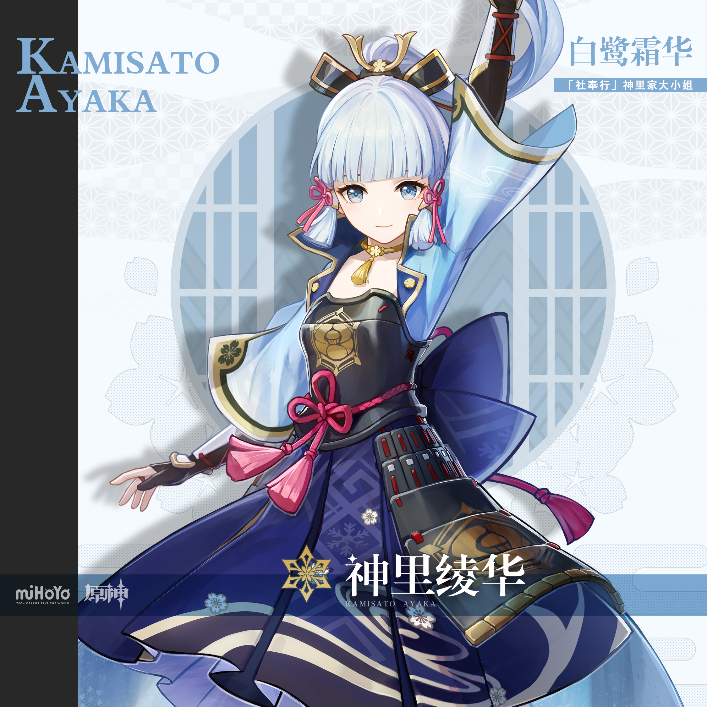
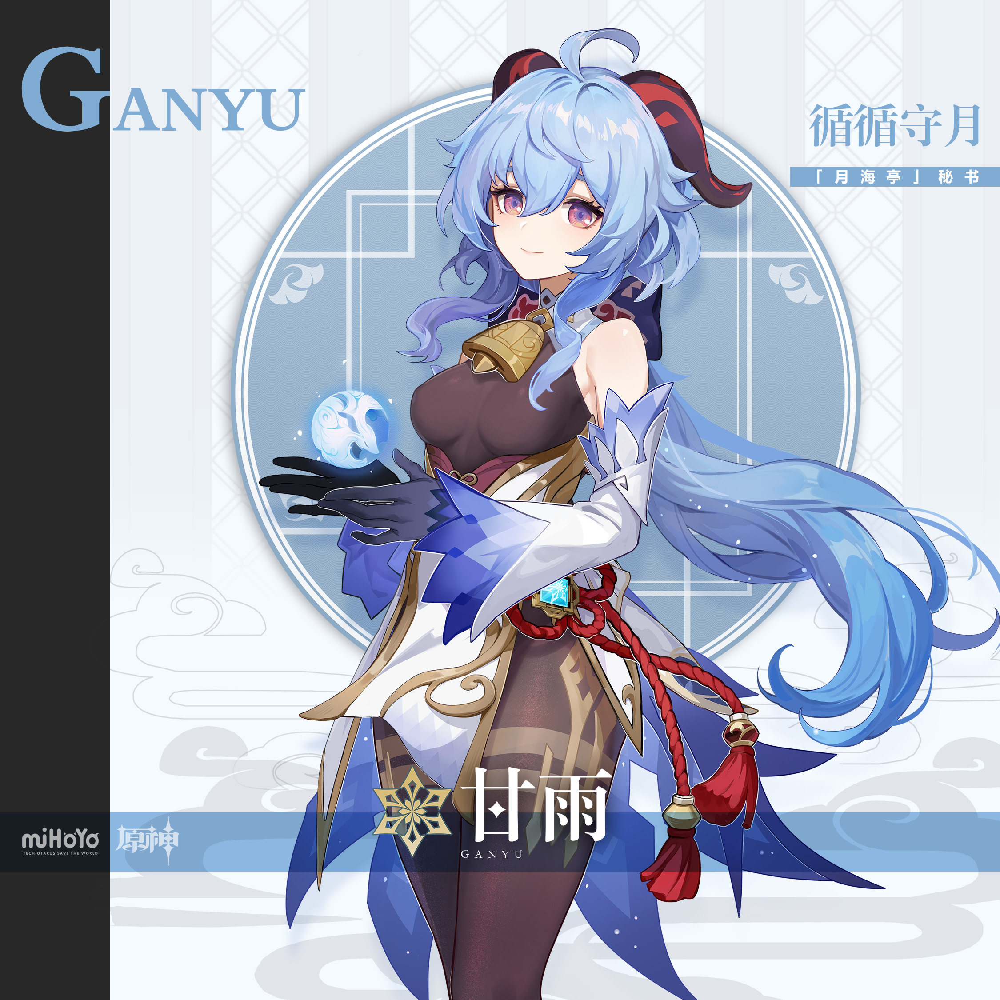
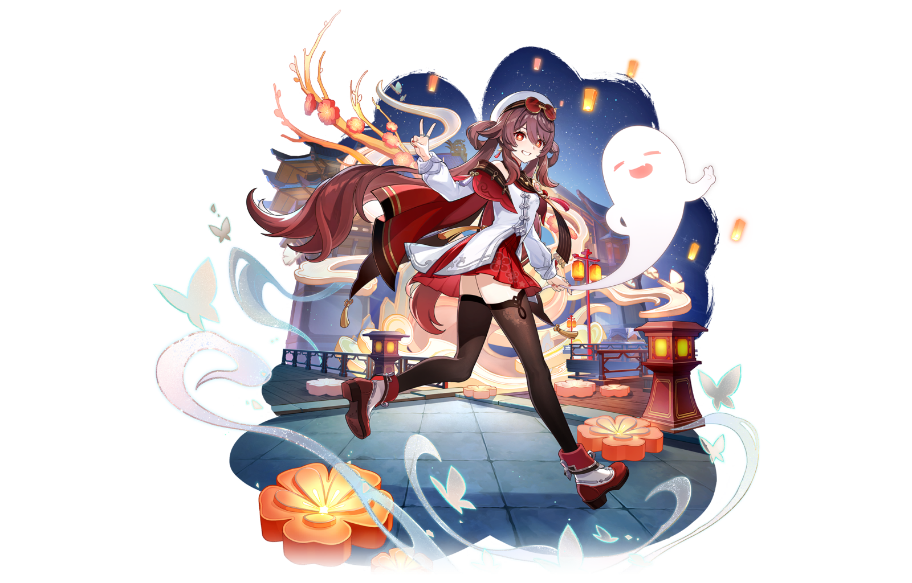
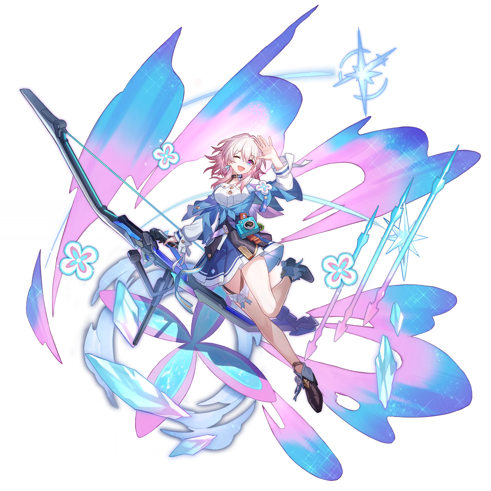
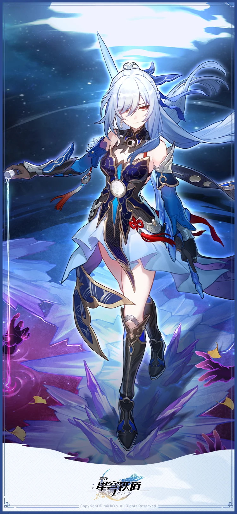
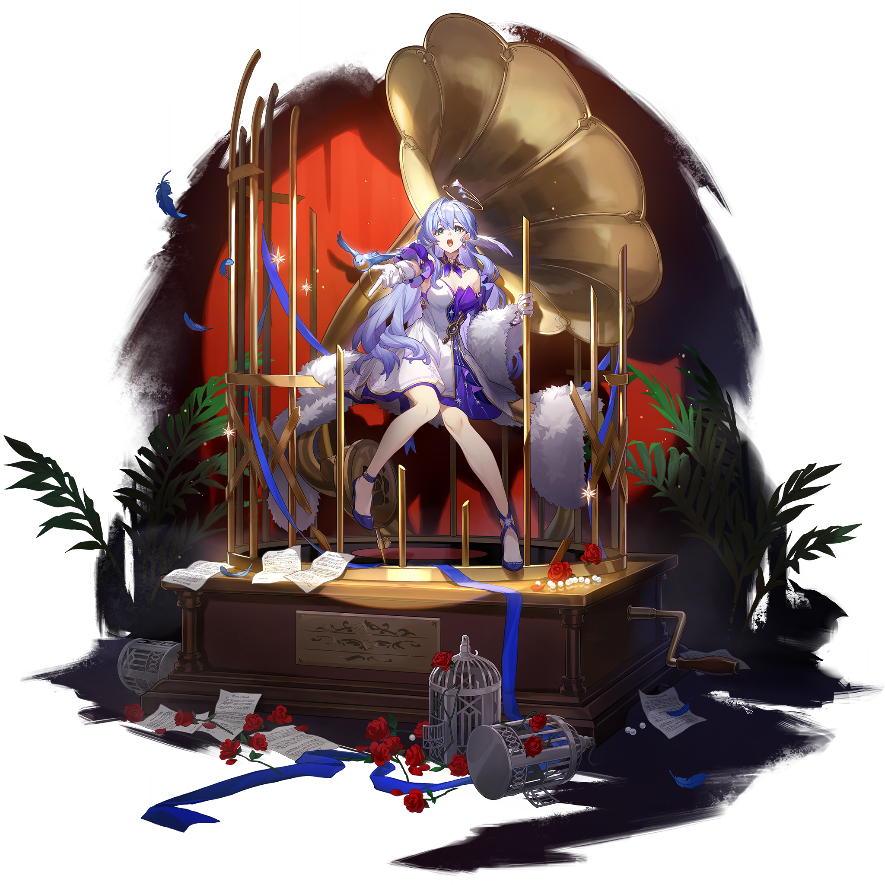
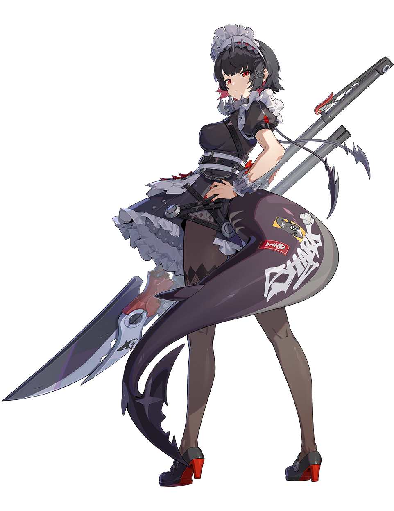
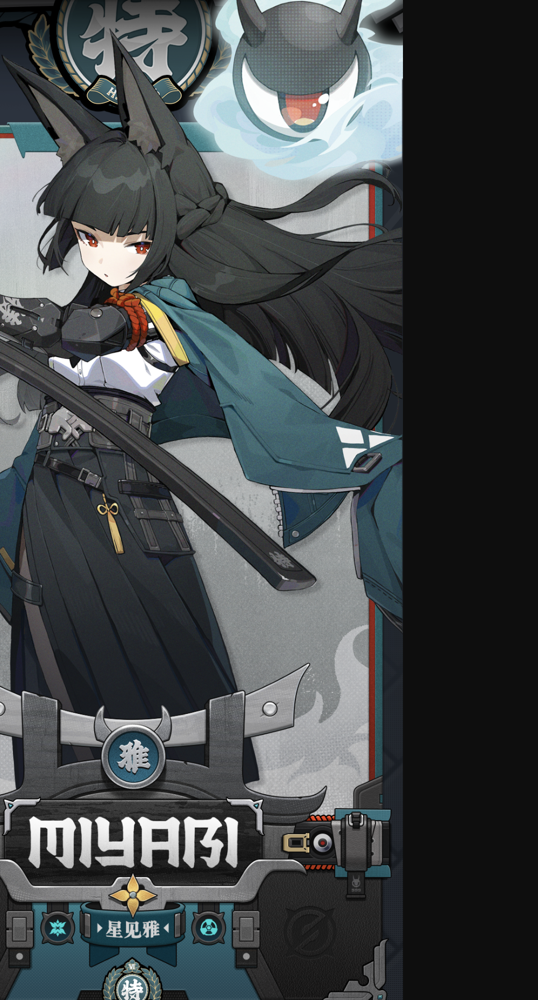

# 立冬·暖窗初雪 — 2026.11.07
<!--
视频类型：B · 主题类型合集（用户手动指定：立冬特辑，9 角色）
主题说明：今日 2026-11-07 17:52 立冬交节，「立冬补冬，补嘴空」——北方吃饺子、南方进补、全民围炉。统一视觉母题为「初雪夜 + 暖窗灯 + 立冬热食」：每位角色立于落初雪的靛蓝夜色中，身后一扇暖黄木格纸窗，双手捧一碗/一杯冒着热气的立冬吃食（饺子/姜茶/汤圆/温酒/热可可/红茶/热汤/拉面/烤红薯），呵出白气，冷靛蓝雪夜 × 暖琥珀窗光的补冬对照，角色主题色点缀，共 9 条 prompts，比例统一 3:4 竖版。
热点背景：①今日立冬交节（17:52），「立冬吃饺子不冻耳朵」「立冬补冬补嘴空」为当日全民民俗话题；②崩铁 4.8 绝区零联动余热：艾莲「出嫁崩铁」冰系毁灭话题仍在传播；③跨游戏女角色人气总榜 Top8（芙宁娜/爱莉希雅/流萤/胡桃/星见雅/雷电将军/三月七/知更鸟）中胡桃、星见雅、三月七、知更鸟在列，为选角人气背书。
涉及角色（3×3 全游戏覆盖）：神里绫华、甘雨、胡桃（原神）；三月七、镜流、知更鸟（崩铁）；艾莲、星见雅、猫又（绝区零）。
选定类型理由：用户明确指定「立冬特辑 + 9 个高人气角色」，节气时事主题天然适合类型 B 多角色横向展示；用户指定 9 角色超出 B 类型常规 4~6 上限，按用户指令执行；类型 B 性别系数不适用（全员女性）。
选角理由：神里绫华=冰系白鹭公主+常青人气锚点+立冬初雪气质零成本契合；甘雨=冰系麒麟半仙+人气榜常青+毛领冬装适配；胡桃=人气总榜常青树+官方宿雪桃红冬装皮肤现成+立冬饺子「不冻耳朵」梗天然绑定；三月七=看板娘+恒冰中苏醒的「生于冰」设定点题+人气总榜在列；镜流=冰系剑首大姐姐+温酒人设呼应补冬；知更鸟=人气总榜在列+白色毛披肩官方冬装气质；艾莲=冰系鲨鱼女仆+4.8 崩铁联动余热+女仆端热汤「主人的心愿就是我们的使命」梗；星见雅=人气总榜在列+冰系+狐耳落雪高辨识度；猫又=猫猫冬日窝炉气质+烤红薯补冬萌点+工作区首次入主题合集。
参考图说明：九位角色参考图全部沿用 reference-registry 已视觉校对索引（免重复校对）：绫华/甘雨/胡桃（宿雪桃红冬装皮肤）/镜流/知更鸟/星见雅/猫又走相对路径引用，三月七（开学季目录）与艾莲（巡历雪境目录）复制为本期目录内文件。外观描述均以登记表摘要为准。
背景固定枚举声明：按 2026-10-07 背景固定枚举规则，全系列统一母题背景固定枚举 3 项元素（靛蓝初雪夜空/暖琥珀木格纸窗/窗台薄雪），角色主题色仅体现于人物点缀，每条 prompt 以 No other background elements 收口，杜绝场景堆叠。
单一光源与简单背景约束（2026-11-07 用户要求，对齐人物壁纸集多比例 prompt 的约束口径）：每条 prompt 均显式声明「暖琥珀木格纸窗为唯一光源、靛蓝夜色仅作环境色调」，启用 Clean simple background + minimalist uncluttered composition 收口句式，negative 统一追加多光源/光效堆叠/背景复杂化禁词，并将「Highly detailed background」字样删除以免与简单背景指令自相矛盾。
-->

# 参考图索引

- 神里绫华官方立绘：
- 甘雨官方立绘：
- 胡桃宿雪桃红冬装皮肤立绘：
- 三月七官方立绘（复制自开学季目录·已校对）：
- 镜流官方壁纸图：
- 知更鸟官方立绘：
- 艾莲透明底官方立绘（复制自巡历雪境目录·已校对）：
- 星见雅官方档案卡：
- 猫又官方立绘：

---

## 1（神里绫华·白鹭捧汤圆）

Positive Prompt:

3:4 vertical portrait wallpaper, Kamisato Ayaka from Genshin Impact, highly detailed anime-style illustration, polished game-art quality, the Shirasagi Himegimi standing in the first-snow night of the Start of Winter, cradling a steaming bowl before a warm amber-lit window.

Ayaka stands in graceful three-quarter framing, her weight resting lightly on one leg in a natural stance, both hands cradling a white porcelain bowl of steaming sweet rice balls in hot syrup at chest height, all ten fingers naturally wrapped around the bowl with clean finger separation, soft white steam rising past her chin as she gazes down at it with a warm, courteous smile, her breath a faint mist in the cold air. Her unmistakable features: long pale blue-white hair gathered in a high ponytail, hime-style straight bangs, pink ribbons tied at both sides of her head, a golden hair ornament, blue eyes. Her canonical outfit: a blue haori jacket worn open over a dark fitted top with light chest armor and a pink bow at the collar, a deep blue pleated skirt, a dark sash at her waist. Fine first snow settles softly on her shoulders and hair without melting.

perfect hands, five fingers on each hand, anatomically correct hands, well-defined fingers, natural hand pose, clean finger separation, both hands cradling the bowl with all ten fingers naturally wrapped around it, correct hip-to-thigh-to-knee anatomy, natural leg proportions, both legs in natural parallel alignment, natural standing posture.

Background limited to three simple elements: a deep indigo night sky filled with slow-falling fine white first snow across the upper half of the frame, a single wooden-framed paper window glowing warm amber behind her, a thin untouched layer of fresh snow lining the window ledge. Clean simple background, minimalist uncluttered composition, no other background elements. The glowing paper window is the single and only light source, its warm amber light softly on her face and shoulders, the cold indigo night serving purely as ambient tonality, no additional light sources. Sharp focus on Ayaka, cold indigo snow-night palette warmed by amber window light, with pale blue and pink accents.

Negative Prompt:

low quality, worst quality, blurry, pixelated, bad anatomy, extra limbs, watermark, text, logo, signature, wrong hair color, wrong eye color, incorrect character, male, wrong gender, bad hands, extra fingers, fewer fingers, missing fingers, fused fingers, webbed fingers, overlapping fingers, deformed fingers, six fingers, bad hand anatomy, asymmetrical hands, broken fingers, claw hands, blurry hands, missing legs, missing feet, cropped legs, twisted legs, rotated hips, extra legs, fused legs, malformed knees, knees bending in opposite directions, unnatural sitting pose, disproportionate limbs, elongated calves, deformed feet, chibi, photorealistic, 3D render, revealing outfits, indecent content, minor-looking body, crowd, other people, busy background, cluttered scene, extra background elements, multiple light sources, additional lights, glowing particles, floating lights, light rays, lens flare, bokeh lights, complicated background, over-detailed background, stacked background elements.

## 2（甘雨·姜茶暖角）

Positive Prompt:

3:4 vertical portrait wallpaper, referring to the attached first artwork for style, lighting, and winter-night atmosphere only — do not copy its character, pose, costume, or composition — generate Ganyu from Genshin Impact standing in the first-snow night before the warm amber-lit window.

Ganyu stands in a gentle three-quarter framing, her weight settled evenly in a natural stance, her face lifted toward the falling first snow with quiet, wide-eyed wonder, a soft visible breath of mist at her lips, both hands cradling a steaming white mug of hot ginger tea at chest height, all ten fingers naturally wrapped around the mug with clean finger separation. Her unmistakable features: long blue-violet hair fading to pale blue at the tips, dark red qilin horns rising from her hair, violet-pink eyes, a golden bell choker at her throat. Her canonical outfit: a dark sleeveless fitted bodysuit with white-and-blue ice-crystal arm guards and red cord tassels, a soft white fur wrap draped over her shoulders for winter. Fine snowflakes settle on her horns and fur wrap without melting.

perfect hands, five fingers on each hand, anatomically correct hands, well-defined fingers, natural hand pose, clean finger separation, both hands cradling the mug with all ten fingers naturally wrapped around it, correct hip-to-thigh-to-knee anatomy, natural leg proportions, both legs in natural parallel alignment, natural standing posture.

Background limited to three simple elements: a deep indigo night sky filled with slow-falling fine white first snow across the upper half of the frame, a single wooden-framed paper window glowing warm amber behind her, a thin untouched layer of fresh snow lining the window ledge. Clean simple background, minimalist uncluttered composition, no other background elements. The glowing paper window is the single and only light source, its warm amber light softly on her face and shoulders, the cold indigo night serving purely as ambient tonality, no additional light sources. Sharp focus on Ganyu, cold indigo snow-night palette warmed by amber window light, with blue-violet accents.

Negative Prompt:

low quality, worst quality, blurry, pixelated, bad anatomy, extra limbs, watermark, text, logo, signature, wrong hair color, wrong eye color, incorrect character, male, wrong gender, bad hands, extra fingers, fewer fingers, missing fingers, fused fingers, webbed fingers, overlapping fingers, deformed fingers, six fingers, bad hand anatomy, asymmetrical hands, broken fingers, claw hands, blurry hands, missing legs, missing feet, cropped legs, twisted legs, rotated hips, extra legs, fused legs, malformed knees, knees bending in opposite directions, unnatural sitting pose, disproportionate limbs, elongated calves, deformed feet, chibi, photorealistic, 3D render, revealing outfits, indecent content, minor-looking body, crowd, other people, busy background, cluttered scene, extra background elements, multiple light sources, additional lights, glowing particles, floating lights, light rays, lens flare, bokeh lights, complicated background, over-detailed background, stacked background elements.

## 3（胡桃·立冬饺子不冻耳朵）

Positive Prompt:

3:4 vertical portrait wallpaper, referring to the attached first artwork for style, lighting, and winter-night atmosphere only — do not copy its character, pose, costume, or composition — generate Hu Tao from Genshin Impact standing in the first-snow night before the warm amber-lit window.

Hu Tao stands in lively three-quarter framing, her weight bouncing playfully onto one leg, both hands cradling a small steaming bowl of freshly boiled crescent-shaped dumplings at chest height, all ten fingers naturally wrapped around the bowl with clean finger separation, a mischievous grin on her face with one eye closed in a playful wink, a curl of white steam rising past her cheek while her breath puffs visibly in the cold air. Her unmistakable features: long dark brown-red twin tails fading to bright red tips, flower-shaped red eyes, a white beret with goggles perched on her head. Her official winter outfit: a white winter coat with a red cape worn over a red short skirt, black tights and red boots. Fine snow settles on her beret and cape.

perfect hands, five fingers on each hand, anatomically correct hands, well-defined fingers, natural hand pose, clean finger separation, both hands cradling the bowl with all ten fingers naturally wrapped around it, correct hip-to-thigh-to-knee anatomy, natural leg proportions, both legs in natural parallel alignment, natural standing posture.

Background limited to three simple elements: a deep indigo night sky filled with slow-falling fine white first snow across the upper half of the frame, a single wooden-framed paper window glowing warm amber behind her, a thin untouched layer of fresh snow lining the window ledge. Clean simple background, minimalist uncluttered composition, no other background elements. The glowing paper window is the single and only light source, its warm amber light softly on her face and shoulders, the cold indigo night serving purely as ambient tonality, no additional light sources. Sharp focus on Hu Tao, cold indigo snow-night palette warmed by amber window light, with red and white accents.

Negative Prompt:

low quality, worst quality, blurry, pixelated, bad anatomy, extra limbs, watermark, text, logo, signature, wrong hair color, wrong eye color, incorrect character, male, wrong gender, bad hands, extra fingers, fewer fingers, missing fingers, fused fingers, webbed fingers, overlapping fingers, deformed fingers, six fingers, bad hand anatomy, asymmetrical hands, broken fingers, claw hands, blurry hands, missing legs, missing feet, cropped legs, twisted legs, rotated hips, extra legs, fused legs, malformed knees, knees bending in opposite directions, unnatural sitting pose, disproportionate limbs, elongated calves, deformed feet, chibi, photorealistic, 3D render, revealing outfits, indecent content, minor-looking body, crowd, other people, busy background, cluttered scene, extra background elements, multiple light sources, additional lights, glowing particles, floating lights, light rays, lens flare, bokeh lights, complicated background, over-detailed background, stacked background elements.

## 4（三月七·初雪快门）

Positive Prompt:

3:4 vertical portrait wallpaper, referring to the attached first artwork for style, lighting, and winter-night atmosphere only — do not copy its character, pose, costume, or composition — generate March 7th from Honkai: Star Rail standing in the first-snow night before the warm amber-lit window.

March 7th stands in bright three-quarter framing, her weight on one leg in a cheerful natural stance, her beloved blue camera hanging from a neck strap resting against her chest, both hands cradling a tall paper cup of hot cocoa with all ten fingers naturally wrapped around it and clean finger separation, her face beaming with a big delighted smile, half-pink half-blue gradient eyes sparkling as she looks straight at the viewer, a soft red knitted scarf around her neck catching snowflakes, her breath a visible happy puff of mist. Her unmistakable features: short white-pink hair with a single ahoge sticking up, half-pink half-blue gradient eyes. Her canonical outfit: a white-and-blue dress uniform with its matching skirt, a soft red knitted scarf added for winter. Fine snow settles on her hair, ahoge, and camera.

perfect hands, five fingers on each hand, anatomically correct hands, well-defined fingers, natural hand pose, clean finger separation, both hands cradling the cup with all ten fingers naturally wrapped around it, correct hip-to-thigh-to-knee anatomy, natural leg proportions, both legs in natural parallel alignment, natural standing posture.

Background limited to three simple elements: a deep indigo night sky filled with slow-falling fine white first snow across the upper half of the frame, a single wooden-framed paper window glowing warm amber behind her, a thin untouched layer of fresh snow lining the window ledge. Clean simple background, minimalist uncluttered composition, no other background elements. The glowing paper window is the single and only light source, its warm amber light softly on her face and shoulders, the cold indigo night serving purely as ambient tonality, no additional light sources. Sharp focus on March 7th, cold indigo snow-night palette warmed by amber window light, with pink and blue accents.

Negative Prompt:

low quality, worst quality, blurry, pixelated, bad anatomy, extra limbs, watermark, text, logo, signature, wrong hair color, wrong eye color, incorrect character, male, wrong gender, bad hands, extra fingers, fewer fingers, missing fingers, fused fingers, webbed fingers, overlapping fingers, deformed fingers, six fingers, bad hand anatomy, asymmetrical hands, broken fingers, claw hands, blurry hands, missing legs, missing feet, cropped legs, twisted legs, rotated hips, extra legs, fused legs, malformed knees, knees bending in opposite directions, unnatural sitting pose, disproportionate limbs, elongated calves, deformed feet, chibi, photorealistic, 3D render, revealing outfits, indecent content, minor-looking body, crowd, other people, busy background, cluttered scene, extra background elements, multiple light sources, additional lights, glowing particles, floating lights, light rays, lens flare, bokeh lights, complicated background, over-detailed background, stacked background elements.

## 5（镜流·雪夜温酒）

Positive Prompt:

3:4 vertical portrait wallpaper, referring to the attached first artwork for style, lighting, and winter-night atmosphere only — do not copy its character, pose, costume, or composition — generate Jingliu from Honkai: Star Rail standing half-body framed in the first-snow night before the warm amber-lit window.

Jingliu appears in an elegant half-body framing from the waist up, her posture upright and composed, both hands cradling a small white porcelain cup of warm rice wine close to her chest, all ten fingers naturally wrapped around the cup with clean finger separation, thin white steam curling upward past her jaw as she holds it, her lone visible crimson eye gazing calmly at the viewer with serene, unreadable composure, her breath a faint sword-cold mist in the air. Her unmistakable features: long silver-white hair with side-swept bangs, her right eye covered by a black blindfold bearing a silver crescent-moon emblem, her left eye crimson, a dark blue crescent-shaped hair ornament, drop earrings. Her canonical outfit: a deep blue-black battle dress with white pleated skirt panels and silver pauldron trim. Fine snow rests briefly on her lashes without melting.

perfect hands, five fingers on each hand, anatomically correct hands, well-defined fingers, natural hand pose, clean finger separation, both hands cradling the cup with all ten fingers naturally wrapped around it.

Background limited to three simple elements: a deep indigo night sky filled with slow-falling fine white first snow across the upper half of the frame, a single wooden-framed paper window glowing warm amber behind her, a thin untouched layer of fresh snow lining the window ledge. Clean simple background, minimalist uncluttered composition, no other background elements. The glowing paper window is the single and only light source, its warm amber light softly on her face and shoulders, the cold indigo night serving purely as ambient tonality, no additional light sources. Sharp focus on Jingliu, cold indigo snow-night palette warmed by amber window light, with ice-blue and silver accents.

Negative Prompt:

low quality, worst quality, blurry, pixelated, bad anatomy, extra limbs, watermark, text, logo, signature, wrong hair color, wrong eye color, incorrect character, male, wrong gender, both eyes visible, missing blindfold, bad hands, extra fingers, fewer fingers, missing fingers, fused fingers, webbed fingers, overlapping fingers, deformed fingers, six fingers, bad hand anatomy, asymmetrical hands, broken fingers, claw hands, blurry hands, missing legs, missing feet, cropped legs, twisted legs, rotated hips, extra legs, fused legs, malformed knees, knees bending in opposite directions, unnatural sitting pose, disproportionate limbs, elongated calves, deformed feet, chibi, photorealistic, 3D render, revealing outfits, indecent content, minor-looking body, crowd, other people, busy background, cluttered scene, extra background elements, multiple light sources, additional lights, glowing particles, floating lights, light rays, lens flare, bokeh lights, complicated background, over-detailed background, stacked background elements.

## 6（知更鸟·暖声红茶）

Positive Prompt:

3:4 vertical portrait wallpaper, referring to the attached first artwork for style, lighting, and winter-night atmosphere only — do not copy its character, pose, costume, or composition — generate Robin from Honkai: Star Rail standing half-body framed in the first-snow night before the warm amber-lit window.

Robin appears in a graceful half-body framing from the waist up, her body angled gently toward the viewer, both hands cradling a white teacup of hot black tea at chest height, all ten fingers naturally wrapped around the cup with clean finger separation, soft steam rising past her chin as she smiles the warm, stage-ready smile of a singer about to begin a winter serenade, teal-green eyes soft and bright, her breath a delicate mist. Her unmistakable features: very long wavy light blue-violet hair past her waist, teal-green eyes, a golden halo floating above her head, a pair of small white wings at the back of her hair fluttering gently, a small teardrop mole under the corner of her left eye. Her canonical outfit: a white-and-violet stage dress with violet-blue ribbons, a white fur shawl draped over her shoulders. Fine snowflakes drift past her halo without touching it.

perfect hands, five fingers on each hand, anatomically correct hands, well-defined fingers, natural hand pose, clean finger separation, both hands cradling the teacup with all ten fingers naturally wrapped around it.

Background limited to three simple elements: a deep indigo night sky filled with slow-falling fine white first snow across the upper half of the frame, a single wooden-framed paper window glowing warm amber behind her, a thin untouched layer of fresh snow lining the window ledge. Clean simple background, minimalist uncluttered composition, no other background elements. The glowing paper window is the single and only light source, its warm amber light softly on her face and shoulders, the cold indigo night serving purely as ambient tonality, no additional light sources. Sharp focus on Robin, cold indigo snow-night palette warmed by amber window light, with white and gold accents.

Negative Prompt:

low quality, worst quality, blurry, pixelated, bad anatomy, extra limbs, watermark, text, logo, signature, wrong hair color, wrong eye color, incorrect character, male, wrong gender, extra wings, oversized wings, bad hands, extra fingers, fewer fingers, missing fingers, fused fingers, webbed fingers, overlapping fingers, deformed fingers, six fingers, bad hand anatomy, asymmetrical hands, broken fingers, claw hands, blurry hands, missing legs, missing feet, cropped legs, twisted legs, rotated hips, extra legs, fused legs, malformed knees, knees bending in opposite directions, unnatural sitting pose, disproportionate limbs, elongated calves, deformed feet, chibi, photorealistic, 3D render, revealing outfits, indecent content, minor-looking body, crowd, other people, busy background, cluttered scene, extra background elements, multiple light sources, additional lights, glowing particles, floating lights, light rays, lens flare, bokeh lights, complicated background, over-detailed background, stacked background elements.

## 7（艾莲·女仆端上一碗热汤）

Positive Prompt:

3:4 vertical portrait wallpaper, referring to the attached first artwork for style, lighting, and winter-night atmosphere only — do not copy its character, pose, costume, or composition — generate Ellen Joe from Zenless Zone Zero standing in the first-snow night before the warm amber-lit window.

Ellen Joe stands in three-quarter framing with her signature lazy, unhurried slouch, her weight resting mostly on one leg, both hands cradling a steaming white bowl of hot soup held forward toward the viewer like a maid presenting tonight's winter special, all ten fingers naturally wrapped around the bowl with clean finger separation, her head tilted slightly, red eyes half-lidded with a drowsy deadpan stare softened by the faintest smirk, her breath a slow visible mist. Her unmistakable features: short black hair with neat bangs, sharp red eyes, a white frilled maid headdress, a large dark gray-purple shark tail curling up out of the snow beside her boots with white graffiti lettering and small red fishbone sticker patches on its surface. Her canonical outfit: short black maid dress with a white frilled apron, black diamond-pattern tights, black heels with red soles, red-manicured nails. Fine snow settles on the tip of her shark tail.

perfect hands, five fingers on each hand, anatomically correct hands, well-defined fingers, natural hand pose, clean finger separation, both hands cradling the bowl with all ten fingers naturally wrapped around it, correct hip-to-thigh-to-knee anatomy, natural leg proportions, both legs in natural parallel alignment, natural standing posture.

Background limited to three simple elements: a deep indigo night sky filled with slow-falling fine white first snow across the upper half of the frame, a single wooden-framed paper window glowing warm amber behind her, a thin untouched layer of fresh snow lining the window ledge. Clean simple background, minimalist uncluttered composition, no other background elements. The glowing paper window is the single and only light source, its warm amber light softly on her face and shoulders, the cold indigo night serving purely as ambient tonality, no additional light sources. Sharp focus on Ellen Joe, cold indigo snow-night palette warmed by amber window light, with black, red, and gray-purple accents.

Negative Prompt:

low quality, worst quality, blurry, pixelated, bad anatomy, extra limbs, watermark, text, logo, signature, wrong hair color, wrong eye color, incorrect character, male, wrong gender, second shark tail, multiple tails, missing shark tail, bad hands, extra fingers, fewer fingers, missing fingers, fused fingers, webbed fingers, overlapping fingers, deformed fingers, six fingers, bad hand anatomy, asymmetrical hands, broken fingers, claw hands, blurry hands, missing legs, missing feet, cropped legs, twisted legs, rotated hips, extra legs, fused legs, malformed knees, knees bending in opposite directions, unnatural sitting pose, disproportionate limbs, elongated calves, deformed feet, chibi, photorealistic, 3D render, revealing outfits, indecent content, minor-looking body, crowd, other people, busy background, cluttered scene, extra background elements, multiple light sources, additional lights, glowing particles, floating lights, light rays, lens flare, bokeh lights, complicated background, over-detailed background, stacked background elements.

## 8（星见雅·狐耳吹汤）

Positive Prompt:

3:4 vertical portrait wallpaper, referring to the attached first artwork for style, lighting, and winter-night atmosphere only — do not copy its character, pose, costume, or composition — generate Hoshimi Miyabi from Zenless Zone Zero standing in the first-snow night before the warm amber-lit window.

Miyabi stands in composed three-quarter framing, her posture straight and disciplined, her katana sheathed at her hip, both hands lifting a large steaming ramen bowl close to her face as she gently blows across the rising steam, all ten fingers naturally wrapped around the bowl with clean finger separation, her crimson eyes half-lidded in quiet contentment above the steam, a rare soft calm on her face, her breath mixing into the warm white vapor. Her unmistakable features: long black hair, dark teal fox ears atop her head twitching at the falling snow, crimson eyes. Her canonical outfit: a crisp white shirt with dark hakama-style trousers and a teal-blue jacket, her katana sheathed at her hip. Fine snow settles softly on her fox ears.

perfect hands, five fingers on each hand, anatomically correct hands, well-defined fingers, natural hand pose, clean finger separation, both hands cradling the ramen bowl with all ten fingers naturally wrapped around it, correct hip-to-thigh-to-knee anatomy, natural leg proportions, both legs in natural parallel alignment, natural standing posture.

Background limited to three simple elements: a deep indigo night sky filled with slow-falling fine white first snow across the upper half of the frame, a single wooden-framed paper window glowing warm amber behind her, a thin untouched layer of fresh snow lining the window ledge. Clean simple background, minimalist uncluttered composition, no other background elements. The glowing paper window is the single and only light source, its warm amber light softly on her face and shoulders, the cold indigo night serving purely as ambient tonality, no additional light sources. Sharp focus on Miyabi, cold indigo snow-night palette warmed by amber window light, with black, teal, and crimson accents.

Negative Prompt:

low quality, worst quality, blurry, pixelated, bad anatomy, extra limbs, watermark, text, logo, signature, wrong hair color, wrong eye color, incorrect character, male, wrong gender, human ears alongside fox ears, extra ears, bad hands, extra fingers, fewer fingers, missing fingers, fused fingers, webbed fingers, overlapping fingers, deformed fingers, six fingers, bad hand anatomy, asymmetrical hands, broken fingers, claw hands, blurry hands, missing legs, missing feet, cropped legs, twisted legs, rotated hips, extra legs, fused legs, malformed knees, knees bending in opposite directions, unnatural sitting pose, disproportionate limbs, elongated calves, deformed feet, chibi, photorealistic, 3D render, revealing outfits, indecent content, minor-looking body, crowd, other people, busy background, cluttered scene, extra background elements, multiple light sources, additional lights, glowing particles, floating lights, light rays, lens flare, bokeh lights, complicated background, over-detailed background, stacked background elements.

## 9（猫又·猫猫焐红薯）

Positive Prompt:

3:4 vertical portrait wallpaper, referring to the attached first artwork for style, lighting, and winter-night atmosphere only — do not copy its character, pose, costume, or composition — generate Nekomata from Zenless Zone Zero standing in the first-snow night before the warm amber-lit window.

Nekomata stands in playful three-quarter framing, her weight on one leg with a bouncy natural stance, both hands cradling one hot roasted sweet potato wrapped in brown paper against her chest like a treasure, all ten fingers naturally wrapped around it with clean finger separation, a wide toothy cat grin on her face, amber-red eyes gleaming with mischief as the sweet potato's warmth steams faintly in the cold air, her breath a bright puff of mist, her grey mechanical tail and fluffy grey cat tail curling contentedly behind her. Her unmistakable features: tan skin, dark blue-black hair in a side ponytail, big red-and-white cat ears atop her head with snow settling on them, a red headband, amber-red eyes, a golden bell choker. Her canonical outfit: a white tube-style top with a red waist corset and gold bell accents, black shorts with a red belt, her red jacket slipping off her arms to the elbows. Fine snow dusts her shoulders and cat ears.

perfect hands, five fingers on each hand, anatomically correct hands, well-defined fingers, natural hand pose, clean finger separation, both hands cradling the wrapped sweet potato with all ten fingers naturally wrapped around it, correct hip-to-thigh-to-knee anatomy, natural leg proportions, both legs in natural parallel alignment, natural standing posture.

Background limited to three simple elements: a deep indigo night sky filled with slow-falling fine white first snow across the upper half of the frame, a single wooden-framed paper window glowing warm amber behind her, a thin untouched layer of fresh snow lining the window ledge. Clean simple background, minimalist uncluttered composition, no other background elements. The glowing paper window is the single and only light source, its warm amber light softly on her face and shoulders, the cold indigo night serving purely as ambient tonality, no additional light sources. Sharp focus on Nekomata, cold indigo snow-night palette warmed by amber window light, with red and warm-brown accents.

Negative Prompt:

low quality, worst quality, blurry, pixelated, bad anatomy, extra limbs, watermark, text, logo, signature, wrong hair color, wrong eye color, incorrect character, male, wrong gender, human ears alongside cat ears, extra ears, bad hands, extra fingers, fewer fingers, missing fingers, fused fingers, webbed fingers, overlapping fingers, deformed fingers, six fingers, bad hand anatomy, asymmetrical hands, broken fingers, claw hands, blurry hands, missing legs, missing feet, cropped legs, twisted legs, rotated hips, extra legs, fused legs, malformed knees, knees bending in opposite directions, unnatural sitting pose, disproportionate limbs, elongated calves, deformed feet, chibi, photorealistic, 3D render, revealing outfits, indecent content, minor-looking body, crowd, other people, busy background, cluttered scene, extra background elements, multiple light sources, additional lights, glowing particles, floating lights, light rays, lens flare, bokeh lights, complicated background, over-detailed background, stacked background elements.
