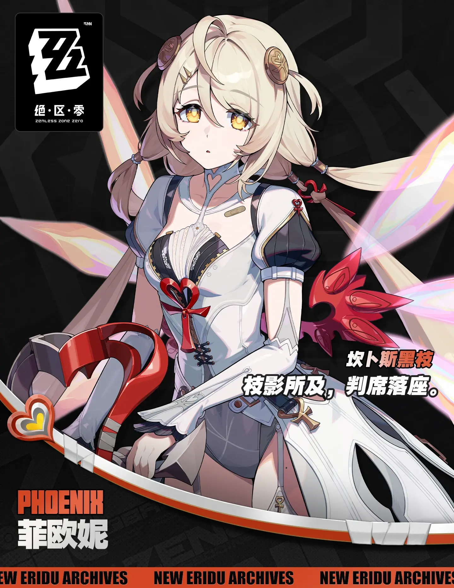
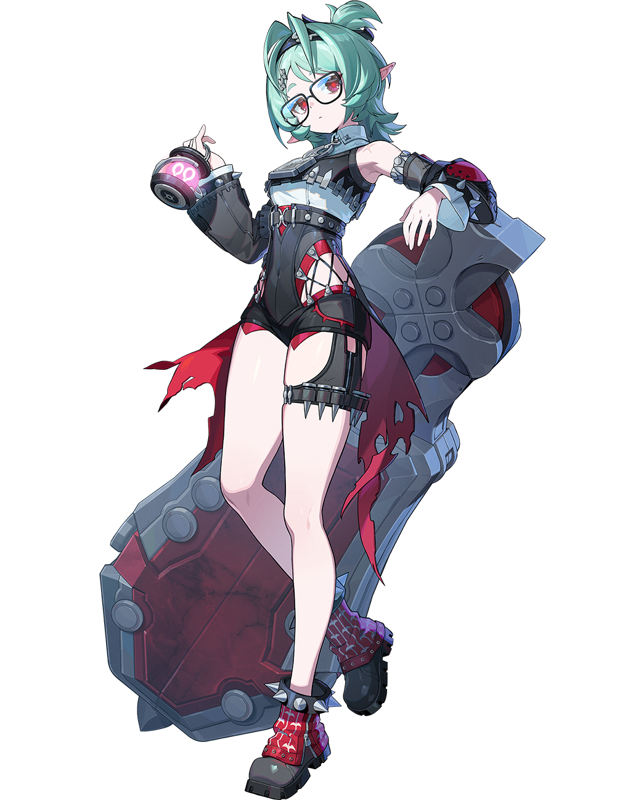

# 重返天空的旅程·绝区零3.3前瞻特辑 — 2026.10.10
<!--
视频类型：B · 主题类型合集（前瞻特辑，沿用「与兽共舞·4.6前瞻特辑」格式：每角色 16:9 横版 + 20:9 手机竖版）
主题说明：绝区零 3.3「重返天空的旅程」前瞻特别节目特辑——十条壁纸对应 3.3 前瞻热点角色，每人一张 16:9 横版 + 一张 20:9 手机竖版，共 10 条 prompts。全系列共用同一套「高天云海 + 浮空岛 + 风」视觉母题：每位角色置身天空旅程的一个瞬间，云海颜色随角色主题色变化，背景元素按固定枚举规则每张 ≤3 项并以 no other background elements 收口。
热点背景：①绝区零 3.3 前瞻特别节目昨晚（10/9 19:30）播出，版本「重返天空的旅程」10/21 上线，前瞻热度正处峰值；②两位新代理人菲欧妮（火异常·黑枝裁决官）与赛维里安（风强攻·都市秩序部秩序督察）携新地区宁息屿登场，社区讨论集中；③兑换码 PHOENIX1021（10/12 0点过期）带动攻略帖流量；④菲欧妮 3.3 新皮肤爆料预定；⑤3.4 星铁联动已官宣艾莲、耀嘉音"出嫁"崩铁，联动话题持续发酵。
涉及角色：菲欧妮（3.3 版本主角·新皮肤预定热点）、赛维里安（3.3 新代理人·社区"大魔"热梗）、洛克茜（3.2 风属性击破·风与天空母题天然契合）、星见雅（常青高人气·名场面巡礼系列成员）、耀嘉音（3.4 星铁联动官宣主角）。
选定类型理由：昨晚 3.3 前瞻刚播完，热点集中于两位新代理人——菲欧妮单人集已于 10/07 抢先发布（不宜重复），赛维里安为男性角色（类型 A 性别系数 0.5 不满足例外条款）→ 按规范改选类型 B 多角色合集消化，赛维里安以成员身份入列；前瞻刚落幕的多点爆发形态（新角色×2+新地区+新皮肤爆料+联动官宣）天然适合多角色横向展示。
选角理由：菲欧妮=3.3 版本绝对主角+"从天而降"与天空母题零成本契合+新皮肤爆料；赛维里安=3.3 新代理人+「我从没见过他笑」大魔梗与「给番茄浇水」反差萌双热梗+首次覆盖；洛克茜=风属性与"重返天空"母题最贴合的风系角色+薄荷绿配色补足系列色彩分布；星见雅=常青人气引流+狐耳角色与赛维里安狼耳形成毛茸茸呼应；耀嘉音=3.4 星铁联动"出嫁"话题主角+高人气。
参考图说明：菲欧妮/星见雅/洛克茜/耀嘉音外观描述均沿用 reference-registry 已视觉校对的官方立绘索引（免校对）；赛维里安为本期新覆盖角色，已从 B站WIKI 下载官方介绍图（severian-official.png 1440×1865，经视觉校对：银白长发发梢渐浅蓝、白色狼耳、金琥珀瞳、黑蓝金双排扣长外套+白衬衫黑领带、右臂黑色护甲臂铠带爪刃、左腕银色手铐锁链配饰、金纹内衬披风、左肩金色星徽+蓝缎带）。
背景固定枚举声明：按 2026-10-07 背景固定枚举规则，每条 prompt 背景固定枚举 3 项元素（云海/浮空岛/天空梯度），写明颜色形态位置，并以 no other background elements 收口，杜绝场景堆叠。
-->

# 参考图索引

- 菲欧妮官方面部与服装锚点：
- 赛维里安官方介绍图（本期新增·已视觉校对）：
- 洛克茜官方立绘：
- 星见雅官方档案立绘：
- 耀嘉音官方档案卡：

---

## 1（菲欧妮·从天而降的裁决官）

Positive Prompt:

16:9 2K wallpaper, Phoenix (Feoni Reffaella) from Zenless Zone Zero, highly detailed anime-style illustration, polished game-art quality, a weightless sky-descent tableau above a sunset cloud sea.

Phoenix drifts down through the open sky in a relaxed free-fall, her body tilted gently backward, arms spread wide and relaxed at shoulder height with fingers naturally extended, hair and ribbons floating upward in zero gravity. Her expression is a drowsy, contented half-smile, eyes half-lidded and gazing at the viewer, the unhurried calm of someone for whom falling is just another way of traveling. Her unmistakable features: champagne-gold short hair with soft pink inner layers, twin low braids tied with red heart hair ties, a round golden disc hair ornament with a tiny crown clip, warm amber-gold eyes. Her canonical outfit: white laced bodice top with black ribbon ties and layered page-ruffle trim, a small bandage on her right collarbone, single black puff-sleeve on one shoulder, long white gloves, a red ankh charm at her chest, dark shorts under a white slit skirt panel, red ribbon and a roll of bandage at the small of her back. Faint crimson-and-black ember trails curl upward from her shoulders like dissolving flame wings, scattering a few drifting embers that catch the sunset light.

perfect hands, five fingers on each hand, anatomically correct hands, well-defined fingers, natural hand pose, clean finger separation, arms relaxed with fingers naturally extended.

Background exactly three elements: a rolling sea of pale-gold sunset clouds far below her feet, one small floating stone island with a grassy crown directly beneath her descent path, a soft peach-to-lavender sky gradient streaked with thin horizontal wind lines. No other background elements. Highly detailed background, sharp focus on Phoenix, warm golden palette with crimson ember accents.

Negative Prompt:

low quality, worst quality, blurry, pixelated, bad anatomy, extra limbs, watermark, text, logo, signature, wrong hair color, wrong eye color, incorrect character, male, wrong gender, bad hands, extra fingers, fewer fingers, missing fingers, fused fingers, webbed fingers, merged fingers, overlapping fingers, deformed fingers, mutated fingers, six fingers, four fingers, three fingers, more than five fingers, less than five fingers, disfigured hands, poorly drawn hands, bad hand anatomy, asymmetrical hands, broken fingers, claw hands, blurry hands, indistinct fingers, smeared hands, missing legs, missing feet, missing calves, cropped legs, legs out of frame, twisted legs, rotated hips, dislocated hip, extra legs, third leg, fused legs, malformed knees, knees bending in opposite directions, unnatural sitting pose, disproportionate limbs, elongated calves, deformed feet, city, buildings, crowd, busy background, cluttered scene, chibi, photorealistic, 3D render.

## 1b（菲欧妮·同景手机竖版）

Positive Prompt:

20:9 vertical mobile wallpaper, same scene and character as the previous image: Phoenix (Feoni Reffaella) from Zenless Zone Zero drifting down through the sky in a tall vertical composition, the peach-to-lavender sky gradient filling the upper frame, the small grass-crowned floating island tiny and distant near the bottom, the pale-gold cloud sea stretching below. Her body tilted gently backward in weightless free-fall, arms spread wide and relaxed with fingers naturally extended, champagne-gold hair with pink inner layers and twin low braids floating upward, round golden disc hair ornament with tiny crown clip, warm amber-gold eyes half-lidded toward the viewer, drowsy contented half-smile. White laced bodice with black ribbon ties and page-ruffle trim, bandage on right collarbone, single black puff-sleeve, long white gloves, red ankh charm, dark shorts under white slit skirt panel, red ribbon and bandage roll at the small of her back. Crimson-and-black ember trails curling upward like dissolving flame wings, a few drifting embers catching the light. Highly detailed anime-style illustration, sharp focus on Phoenix, warm golden palette with crimson accents.

perfect hands, five fingers on each hand, anatomically correct hands, well-defined fingers, natural hand pose, clean finger separation.

Negative Prompt:

low quality, worst quality, blurry, pixelated, bad anatomy, extra limbs, watermark, text, logo, signature, wrong hair color, wrong eye color, incorrect character, male, wrong gender, bad hands, extra fingers, fewer fingers, missing fingers, fused fingers, webbed fingers, merged fingers, overlapping fingers, deformed fingers, mutated fingers, six fingers, four fingers, three fingers, more than five fingers, less than five fingers, disfigured hands, poorly drawn hands, bad hand anatomy, asymmetrical hands, broken fingers, claw hands, blurry hands, indistinct fingers, smeared hands, missing legs, missing feet, missing calves, cropped legs, legs out of frame, twisted legs, rotated hips, dislocated hip, extra legs, third leg, fused legs, malformed knees, knees bending in opposite directions, unnatural sitting pose, disproportionate limbs, elongated calves, deformed feet, city, buildings, crowd, busy background, cluttered scene, chibi, photorealistic, 3D render, landscape orientation, wide horizontal framing.

---

## 2（赛维里安·宁息屿上的秩序）

Positive Prompt:

16:9 2K wallpaper, Severian Lowell from Zenless Zone Zero, highly detailed anime-style illustration, polished game-art quality, a stern officer standing at the edge of a floating island high above the clouds.

Severian is male — he has a masculine athletic build with broad shoulders. He stands tall and squared at the island's edge, weight even on both feet, his right arm hanging relaxed at his side, his left hand loosely holding the silver handcuffs so the chain hangs and sways in the wind, his chin slightly lowered, golden-amber eyes gazing at the viewer with a cold, composed, unreadable stare — the stare of a chief inspector who never smiles. His unmistakable features: long silver-white hair with pale blue gradient tips streaming sideways in the high wind, tall white wolf ears, sharp golden-amber eyes. His canonical outfit: black double-breasted long coat with deep blue lining and gold buttons worn open over a white shirt and black tie, a black armored gauntlet with claw blades covering his right forearm, a dark cape with an ornate golden-pattern lining billowing behind him, a gold star badge ornament with a blue ribbon at his left shoulder. Thin ribbons of pale wind curl around his coat tails and the hanging chain.

perfect hands, five fingers on each hand, anatomically correct hands, well-defined fingers, natural hand pose, clean finger separation, right hand relaxed at his side, left hand loosely gripping the cuff chain.

Background exactly three elements: a silver-blue sea of clouds rolling far below, the flat grassy top of a single floating stone island under his boots, a pale steel-blue sky gradient crossed by faint horizontal wind streaks. No other background elements. Highly detailed background, sharp focus on Severian, cool steel-blue palette with gold trim accents.

Negative Prompt:

low quality, worst quality, blurry, pixelated, bad anatomy, extra limbs, watermark, text, logo, signature, wrong hair color, wrong eye color, incorrect character, female, wrong gender, feminine, androgynous, curvy figure, slender feminine figure, bad hands, extra fingers, fewer fingers, missing fingers, fused fingers, webbed fingers, merged fingers, overlapping fingers, deformed fingers, mutated fingers, six fingers, four fingers, three fingers, more than five fingers, less than five fingers, disfigured hands, poorly drawn hands, bad hand anatomy, asymmetrical hands, broken fingers, claw hands, blurry hands, indistinct fingers, smeared hands, missing legs, missing feet, missing calves, cropped legs, legs out of frame, twisted legs, rotated hips, dislocated hip, extra legs, third leg, fused legs, malformed knees, knees bending in opposite directions, unnatural sitting pose, disproportionate limbs, elongated calves, deformed feet, city, buildings, crowd, busy background, cluttered scene, chibi, photorealistic, 3D render.

## 2b（赛维里安·同景手机竖版）

Positive Prompt:

20:9 vertical mobile wallpaper, same scene and character as the previous image: Severian Lowell from Zenless Zone Zero standing at the edge of a floating island in a tall vertical composition, the pale steel-blue sky gradient filling the upper frame above his white wolf ears, the silver-blue cloud sea far below. Severian is male — masculine athletic build with broad shoulders. He stands tall and squared, right arm hanging relaxed, left hand loosely holding silver handcuffs with the chain swaying in the wind, chin slightly lowered, golden-amber eyes cold and unreadable. Long silver-white hair with pale blue gradient tips streaming sideways, tall white wolf ears. Black double-breasted long coat with deep blue lining and gold buttons over white shirt and black tie, black armored gauntlet with claw blades on his right forearm, dark cape with golden-pattern lining billowing, gold star badge with blue ribbon at his left shoulder. Thin ribbons of pale wind curling around his coat tails and the chain. Highly detailed anime-style illustration, sharp focus on Severian, cool steel-blue palette with gold trim accents.

perfect hands, five fingers on each hand, anatomically correct hands, well-defined fingers, natural hand pose, clean finger separation.

Negative Prompt:

low quality, worst quality, blurry, pixelated, bad anatomy, extra limbs, watermark, text, logo, signature, wrong hair color, wrong eye color, incorrect character, female, wrong gender, feminine, androgynous, curvy figure, slender feminine figure, bad hands, extra fingers, fewer fingers, missing fingers, fused fingers, webbed fingers, merged fingers, overlapping fingers, deformed fingers, mutated fingers, six fingers, four fingers, three fingers, more than five fingers, less than five fingers, disfigured hands, poorly drawn hands, bad hand anatomy, asymmetrical hands, broken fingers, claw hands, blurry hands, indistinct fingers, smeared hands, missing legs, missing feet, missing calves, cropped legs, legs out of frame, twisted legs, rotated hips, dislocated hip, extra legs, third leg, fused legs, malformed knees, knees bending in opposite directions, unnatural sitting pose, disproportionate limbs, elongated calves, deformed feet, city, buildings, crowd, busy background, cluttered scene, chibi, photorealistic, 3D render, landscape orientation, wide horizontal framing.

---

## 3（洛克茜·风眼航路）

Positive Prompt:

16:9 2K wallpaper, Roxy Ifritta Price from Zenless Zone Zero, highly detailed anime-style illustration, polished game-art quality, a cheerful engineer surfing her own wind current along the sky route.

Roxy stands balanced and easy on top of a slowly spinning ring of mint-green wind, her weight shifted onto one hip in a natural stance, one hand resting on her hip, the other holding her small pink-glowing lantern out to the side where its light scatters into the wind, her head tilted with a bright open grin, red eyes crinkling happily behind her round glasses as she looks straight at the viewer. Her unmistakable features: mint-green short hair swept up in a high ponytail that streams back in the wind, red eyes, round black-framed glasses, long pointed elf ears. Her canonical outfit: white cropped top with black strapping and buckles over her midriff, black utility straps crossing her waist, dark fitted shorts, sturdy boots, her giant round wheel-shield carried flat against her back like a wagon wheel. Faint mint-green wind ribbons spiral upward around her boots and dissolve into the bright sky.

perfect hands, five fingers on each hand, anatomically correct hands, well-defined fingers, natural hand pose, clean finger separation, one hand on hip, the other gripping the lantern handle naturally.

Background exactly three elements: a mint-white cloud sea churning far below, one floating stone island drifting behind her at mid-depth, a bright turquoise sky gradient filled with thin concentric wind rings around her. No other background elements. Highly detailed background, sharp focus on Roxy, fresh mint-and-turquoise palette with pink lantern accents.

Negative Prompt:

low quality, worst quality, blurry, pixelated, bad anatomy, extra limbs, watermark, text, logo, signature, wrong hair color, wrong eye color, incorrect character, male, wrong gender, bad hands, extra fingers, fewer fingers, missing fingers, fused fingers, webbed fingers, merged fingers, overlapping fingers, deformed fingers, mutated fingers, six fingers, four fingers, three fingers, more than five fingers, less than five fingers, disfigured hands, poorly drawn hands, bad hand anatomy, asymmetrical hands, broken fingers, claw hands, blurry hands, indistinct fingers, smeared hands, missing legs, missing feet, missing calves, cropped legs, legs out of frame, twisted legs, rotated hips, dislocated hip, extra legs, third leg, fused legs, malformed knees, knees bending in opposite directions, unnatural sitting pose, disproportionate limbs, elongated calves, deformed feet, city, buildings, crowd, busy background, cluttered scene, chibi, photorealistic, 3D render.

## 3b（洛克茜·同景手机竖版）

Positive Prompt:

20:9 vertical mobile wallpaper, same scene and character as the previous image: Roxy Ifritta Price from Zenless Zone Zero standing balanced atop a slowly spinning ring of mint-green wind in a tall vertical composition, the bright turquoise sky gradient filling the upper frame, the mint-white cloud sea churning at the bottom. Weight shifted onto one hip in a natural stance, one hand on her hip, the other holding her small pink-glowing lantern out to the side, bright open grin, red eyes crinkling behind round black-framed glasses, long pointed elf ears, mint-green high ponytail streaming back in the wind. White cropped top with black strapping and buckles, black utility straps at her waist, dark fitted shorts, sturdy boots, giant round wheel-shield carried flat against her back. Faint mint-green wind ribbons spiraling upward around her boots. Highly detailed anime-style illustration, sharp focus on Roxy, fresh mint-and-turquoise palette with pink accents.

perfect hands, five fingers on each hand, anatomically correct hands, well-defined fingers, natural hand pose, clean finger separation.

Negative Prompt:

low quality, worst quality, blurry, pixelated, bad anatomy, extra limbs, watermark, text, logo, signature, wrong hair color, wrong eye color, incorrect character, male, wrong gender, bad hands, extra fingers, fewer fingers, missing fingers, fused fingers, webbed fingers, merged fingers, overlapping fingers, deformed fingers, mutated fingers, six fingers, four fingers, three fingers, more than five fingers, less than five fingers, disfigured hands, poorly drawn hands, bad hand anatomy, asymmetrical hands, broken fingers, claw hands, blurry hands, indistinct fingers, smeared hands, missing legs, missing feet, missing calves, cropped legs, legs out of frame, twisted legs, rotated hips, dislocated hip, extra legs, third leg, fused legs, malformed knees, knees bending in opposite directions, unnatural sitting pose, disproportionate limbs, elongated calves, deformed feet, city, buildings, crowd, busy background, cluttered scene, chibi, photorealistic, 3D render, landscape orientation, wide horizontal framing.

---

## 4（星见雅·月出云海）

Positive Prompt:

16:9 2K wallpaper, Miyabi from Zenless Zone Zero, highly detailed anime-style illustration, polished game-art quality, a quiet swordmaster standing above a moonlit sea of clouds.

Miyabi stands serene and centered on a flat-topped floating stone island, her posture upright and still as still water, both hands resting one over the other on the pommel of her vertical sheathed katana planted point-down on the stone before her, her head level, crimson eyes gazing calmly at the viewer with the weightless composure of a blade already sheathed. Her unmistakable features: long black hair with a soft bluish sheen lifting gently in the cold wind, tall white fox ears, crimson eyes, a small dark ribbon at her collar. Her canonical outfit: white shirt under a pale teal haori jacket, dark navy hakama trousers with clean pleats, the katana's dark lacquered scabbard catching a line of moonlight. Faint pale-frost motes drift around her boots where cold air touches the stone.

perfect hands, five fingers on each hand, anatomically correct hands, well-defined fingers, natural hand pose, clean finger separation, both hands resting one over the other on the sword pommel.

Background exactly three elements: an ink-and-lavender dusk cloud sea spread far below, the single flat-topped floating stone island under her feet, a deep indigo sky gradient with the first pale glow of moonrise behind thin horizontal wind streaks. No other background elements. Highly detailed background, sharp focus on Miyabi, deep indigo-and-lavender palette with white hair and frost accents.

Negative Prompt:

low quality, worst quality, blurry, pixelated, bad anatomy, extra limbs, watermark, text, logo, signature, wrong hair color, wrong eye color, incorrect character, male, wrong gender, bad hands, extra fingers, fewer fingers, missing fingers, fused fingers, webbed fingers, merged fingers, overlapping fingers, deformed fingers, mutated fingers, six fingers, four fingers, three fingers, more than five fingers, less than five fingers, disfigured hands, poorly drawn hands, bad hand anatomy, asymmetrical hands, broken fingers, claw hands, blurry hands, indistinct fingers, smeared hands, missing legs, missing feet, missing calves, cropped legs, legs out of frame, twisted legs, rotated hips, dislocated hip, extra legs, third leg, fused legs, malformed knees, knees bending in opposite directions, unnatural sitting pose, disproportionate limbs, elongated calves, deformed feet, city, buildings, crowd, busy background, cluttered scene, chibi, photorealistic, 3D render.

## 4b（星见雅·同景手机竖版）

Positive Prompt:

20:9 vertical mobile wallpaper, same scene and character as the previous image: Miyabi from Zenless Zone Zero standing serene and centered on a flat-topped floating stone island in a tall vertical composition, the deep indigo sky gradient filling the upper frame with the first pale glow of moonrise, the ink-and-lavender dusk cloud sea far below. Both hands resting one over the other on the pommel of her vertical sheathed katana planted point-down on the stone, crimson eyes calm and level toward the viewer, long black hair with soft bluish sheen lifting in the cold wind, tall white fox ears, small dark ribbon at her collar. White shirt under pale teal haori jacket, dark navy pleated hakama, dark lacquered scabbard catching a line of moonlight, faint pale-frost motes around her boots. Highly detailed anime-style illustration, sharp focus on Miyabi, deep indigo-and-lavender palette with white accents.

perfect hands, five fingers on each hand, anatomically correct hands, well-defined fingers, natural hand pose, clean finger separation.

Negative Prompt:

low quality, worst quality, blurry, pixelated, bad anatomy, extra limbs, watermark, text, logo, signature, wrong hair color, wrong eye color, incorrect character, male, wrong gender, bad hands, extra fingers, fewer fingers, missing fingers, fused fingers, webbed fingers, merged fingers, overlapping fingers, deformed fingers, mutated fingers, six fingers, four fingers, three fingers, more than five fingers, less than five fingers, disfigured hands, poorly drawn hands, bad hand anatomy, asymmetrical hands, broken fingers, claw hands, blurry hands, indistinct fingers, smeared hands, missing legs, missing feet, missing calves, cropped legs, legs out of frame, twisted legs, rotated hips, dislocated hip, extra legs, third leg, fused legs, malformed knees, knees bending in opposite directions, unnatural sitting pose, disproportionate limbs, elongated calves, deformed feet, city, buildings, crowd, busy background, cluttered scene, chibi, photorealistic, 3D render, landscape orientation, wide horizontal framing.

---

## 5（耀嘉音·云间巡游的舞台）

Positive Prompt:

16:9 2K wallpaper, Yao from Zenless Zone Zero, highly detailed anime-style illustration, polished game-art quality, a songstress standing at the lip of a floating island as if it were the front edge of a stage above the clouds.

Yao stands gracefully at the island's edge, her body angled three-quarters toward the viewer, one hand resting lightly on the shaft of her golden halo staff planted beside her, her other hand lifted to chest height with fingers elegantly relaxed as if mid-refrain, her chin slightly raised, crimson eyes closed in a serene performing smile, the composed radiance of a headliner who treats the whole sky as her concert hall. Her unmistakable features: long dark green hair flowing down her back and catching the warm light, a white ribbon tying back part of her hair, crimson eyes behind gentle lashes, a delicate pearl chain at her thigh. Her canonical outfit: fitted white corset-style dress with fine gold trim, a short scarlet over-robe slipping off one shoulder, white gloves, the golden ring of her halo staff glowing softly above her hand. A few drifting motes of golden light float around her like distant audience lanterns.

perfect hands, five fingers on each hand, anatomically correct hands, well-defined fingers, natural hand pose, clean finger separation, one hand on the staff shaft, the other raised with fingers elegantly relaxed.

Background exactly three elements: a rose-gold evening cloud sea rolling far below, one floating stone island forming a flat stage edge beneath her feet, a warm apricot-to-lilac sky gradient dotted with drifting motes of golden light. No other background elements. Highly detailed background, sharp focus on Yao, warm rose-gold palette with dark green hair and scarlet accents.

Negative Prompt:

low quality, worst quality, blurry, pixelated, bad anatomy, extra limbs, watermark, text, logo, signature, wrong hair color, wrong eye color, incorrect character, male, wrong gender, bad hands, extra fingers, fewer fingers, missing fingers, fused fingers, webbed fingers, merged fingers, overlapping fingers, deformed fingers, mutated fingers, six fingers, four fingers, three fingers, more than five fingers, less than five fingers, disfigured hands, poorly drawn hands, bad hand anatomy, asymmetrical hands, broken fingers, claw hands, blurry hands, indistinct fingers, smeared hands, missing legs, missing feet, missing calves, cropped legs, legs out of frame, twisted legs, rotated hips, dislocated hip, extra legs, third leg, fused legs, malformed knees, knees bending in opposite directions, unnatural sitting pose, disproportionate limbs, elongated calves, deformed feet, city, buildings, crowd, busy background, cluttered scene, chibi, photorealistic, 3D render.

## 5b（耀嘉音·同景手机竖版）

Positive Prompt:

20:9 vertical mobile wallpaper, same scene and character as the previous image: Yao from Zenless Zone Zero standing gracefully at the edge of a floating island in a tall vertical composition, the warm apricot-to-lilac sky gradient filling the upper frame, the rose-gold evening cloud sea rolling far below. One hand resting on the shaft of her golden halo staff planted beside her, the other lifted to chest height with fingers elegantly relaxed, chin slightly raised, crimson eyes closed in a serene performing smile. Long dark green hair catching the warm light, white ribbon tying back part of her hair, pearl chain at her thigh, fitted white corset-style dress with fine gold trim, short scarlet over-robe slipping off one shoulder, white gloves, the golden halo ring glowing softly above her hand, drifting motes of golden light around her. Highly detailed anime-style illustration, sharp focus on Yao, warm rose-gold palette with scarlet accents.

perfect hands, five fingers on each hand, anatomically correct hands, well-defined fingers, natural hand pose, clean finger separation.

Negative Prompt:

low quality, worst quality, blurry, pixelated, bad anatomy, extra limbs, watermark, text, logo, signature, wrong hair color, wrong eye color, incorrect character, male, wrong gender, bad hands, extra fingers, fewer fingers, missing fingers, fused fingers, webbed fingers, merged fingers, overlapping fingers, deformed fingers, mutated fingers, six fingers, four fingers, three fingers, more than five fingers, less than five fingers, disfigured hands, poorly drawn hands, bad hand anatomy, asymmetrical hands, broken fingers, claw hands, blurry hands, indistinct fingers, smeared hands, missing legs, missing feet, missing calves, cropped legs, legs out of frame, twisted legs, rotated hips, dislocated hip, extra legs, third leg, fused legs, malformed knees, knees bending in opposite directions, unnatural sitting pose, disproportionate limbs, elongated calves, deformed feet, city, buildings, crowd, busy background, cluttered scene, chibi, photorealistic, 3D render, landscape orientation, wide horizontal framing.

---

## 注

- 前瞻汇总信息源：米游社前瞻讨论活动帖（版本 10/21 上线确认）、虎扑前瞻汇总帖（兑换码 PHOENIX1021、菲欧妮皮肤预定评论）、什么值得买前瞻定档文（两位新代理人档案、3.4 联动已官宣艾莲/耀嘉音出嫁崩铁）。
- 比例格式沿用「与兽共舞·4.6前瞻特辑」先例：每角色 16:9 横版 + 20:9 手机竖版，系列自洽。
- 赛维里安为类型 A 性别例外条款外的男性角色，按规范以 B 类成员身份消化，不做单人集。
