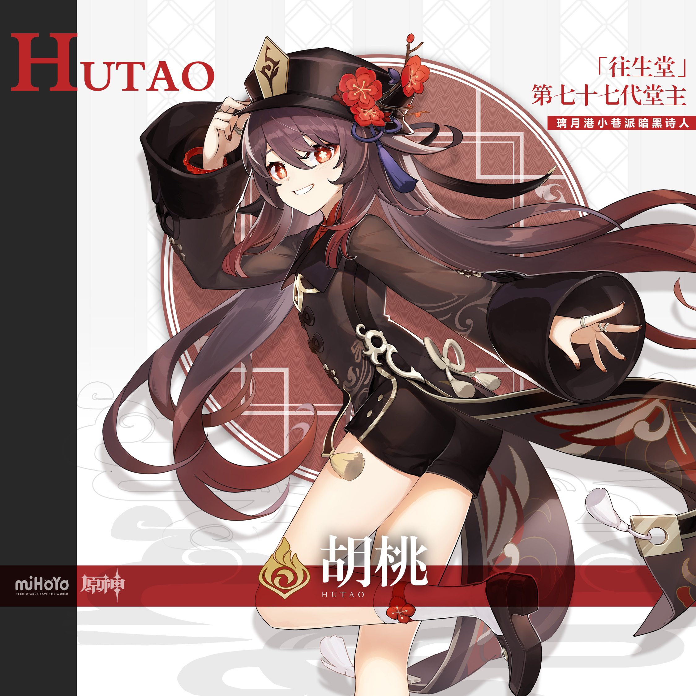
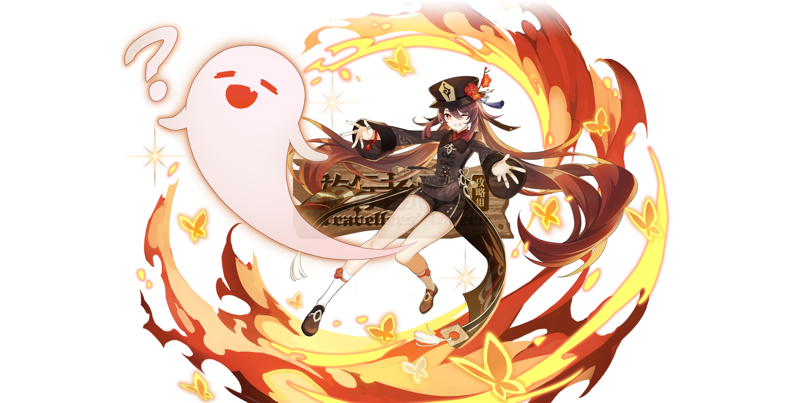
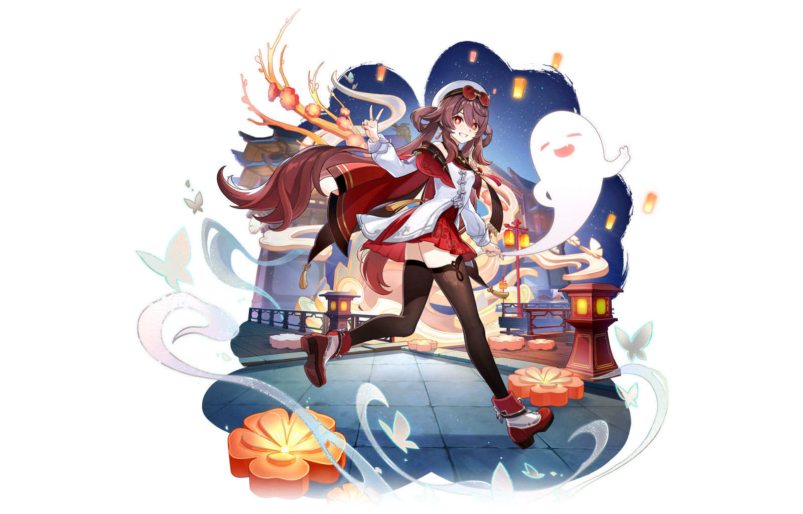
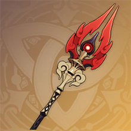
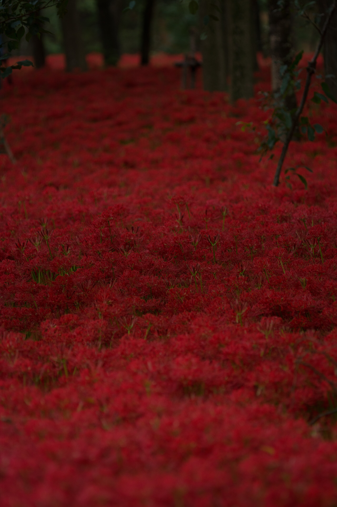
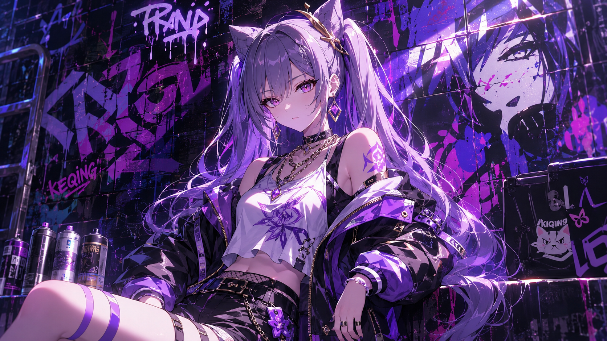
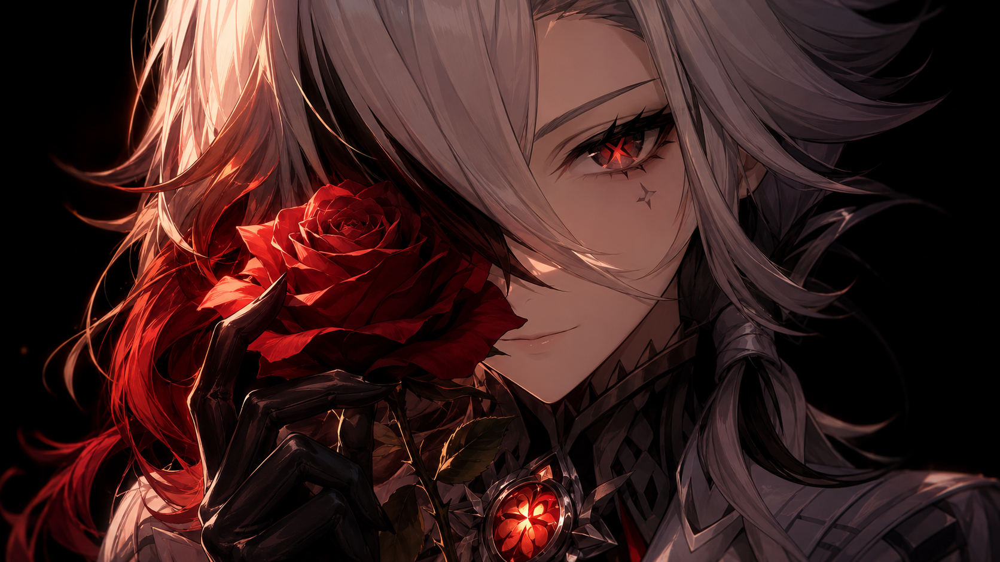

# 胡桃 Hu Tao — 2026.10.09
<!--
视频类型：A · 角色单人壁纸合集
角色来源：原神 · 5星火元素长柄武器 · 往生堂第七十七代堂主
热点背景：热点间歇期（绝区零3.3前瞻今晚19:30才开播且菲欧妮素材已备、原神7.2前瞻10/23、芙宁娜窗口10/10起），按降级策略回退类型A。
选定角色理由：胡桃从未做过单人集（原神/胡桃/ 此前仅有已登记立绘）；社区热度极高——B站厨力大赏22.9万登顶、外服人气评选"外服老婆"险胜雷神、玩家人气榜璃月三C之一且"璃月角色即将加强"话题在途；十月深秋往万圣季过渡，往生堂堂主"可爱又通冥"的气质与季节化学反应最强；女性角色，无性别系数调整。
参考图：splash-art.jpg（已登记·免校对）+ 本期新增 gacha-art.png / skin-suxue-splash.png / ref-staff-official.png / ref-higanbana-field.jpg（均已视觉校对）。
伴生元素清单（均已看图确认）：①幽灵小伴——圆润白色小幽灵、极简笑脸（抽卡立绘与皮肤立绘均出现）；②火焰彼岸蝶——橙金色辉光蝴蝶剪影（抽卡立绘环绕特效）；③护摩之杖——暗色杖身、金色雕纹握柄、红焰双刃、刃心嵌红色宝珠（官方图标）。
-->

# 参考图

- 官方立绘（已校对·登记表索引）：
- 官方抽卡立绘（本期新增·已视觉校对：含幽灵小伴与火焰彼岸蝶形态）：
- 宿雪桃红皮肤立绘（本期新增·已视觉校对：白贝雷帽+护目镜、白外套红披风红短裙）：
- 护摩之杖官方图（本期新增·已视觉校对）：
- 跨领域参考·彼岸花花海暮色摄影（本期新增·已视觉校对）：
- 角色外貌锚点（各条通用）：深棕红长发渐绯红发尾、双侧低马尾、花形绯红瞳、黑绅士帽（红梅花饰+往生堂徽记）

---

## 1 — 涂鸦墙街头风（16:9 横版）



**Positive Prompt:**

```text
Refer to the attached reference image (Figure 1) for composition, graffiti-wall style, and overall atmosphere only. Generate an image of Hu Tao from Genshin Impact, a young woman with a slender feminine figure, sitting casually in front of a bold graffiti wall, perfect hands, five fingers on each hand, anatomically correct hands, well-defined fingers, natural hand pose, clean finger separation. Hu Tao is seated in a relaxed but confident posture, leaning back against the graffiti wall with one knee raised, her other leg extended straight along the ground with her foot flat on the floor, both legs clearly separated with a visible gap and never crossing or overlapping, with her body language calm, controlled, and slightly provocative. Her hands rest naturally, one on her raised knee and one on the crate beside her. Her expression should show cold, disdainful eyes, aloof, sharp, and superior, as if she is silently judging the viewer, hands clearly visible and not hidden behind the knees or legs, the resting hand's fingers naturally draped and slightly spread with clear gaps.
Keep Hu Tao's recognizable features: long dark brown hair with crimson gradient tips in low twin ponytails, plum-blossom shaped crimson eyes, black gentleman top hat with a red plum blossom ornament. Blend her canonical design with a modern edgy streetwear aesthetic: black cropped tank top with red trim, an open cropped bomber jacket with crimson lining worn off one shoulder, high-waisted denim shorts, black thigh-high socks, red-and-white high-top sneakers, a thin chain necklace with a tiny plum blossom charm. Preserve her identity while giving her a fresh urban street-style look.
The graffiti wall behind her should be vivid and layered, full of expressive abstract shapes and energetic street-art textures in crimson-red and black tones, with graffiti elements including stylized "HUTAO" lettering, swirling flame symbols, glowing butterfly motifs and plum blossom spray tags, creating a rebellious urban backdrop that resonates with her character theme. Add subtle pyro flame energy effects, drifting orange embers, and her small cute white ghost companion floating beside the wall to reinforce her identity.
Use a wide cinematic framing suitable for a 16:9 2K wallpaper, with Hu Tao as the main focal point while still showing enough of the graffiti wall and surrounding environment for atmosphere. The mood should feel cool, stylish, intimidating, and mysterious. Highly detailed background, rich shadows, crimson glowing highlights, sharp focus on Hu Tao, and a refined high-end anime illustration look.
```

**Negative Prompt:**

```text
lowres, worst quality, low quality, blurry, pixelated, bad anatomy, disfigured, mutation, deformed, watermark, text, logo, signature, wrong hair color, wrong eye color, incorrect character, bad hands, extra fingers, fewer fingers, missing fingers, fused fingers, webbed fingers, merged fingers, overlapping fingers, deformed fingers, mutated fingers, six fingers, four fingers, three fingers, more than five fingers, less than five fingers, disfigured hands, poorly drawn hands, bad hand anatomy, asymmetrical hands, broken fingers, claw hands, blurry hands, indistinct fingers, smeared hands, missing legs, missing feet, missing calves, cropped legs, legs out of frame, twisted legs, rotated hips, dislocated hip, extra legs, third leg, fused legs, malformed knees, knees bending in opposite directions, both knees raised, legs folded underneath, kneeling pose, unnatural sitting pose, disproportionate limbs, elongated calves, deformed feet, extra limbs, standing, standing pose, upright posture, singing, open mouth singing, warm smile, gentle smile, cheerful expression, cute expression, adorable, sweet, innocent, game canonical outfit, official costume, fantasy dress, medieval clothing, armor, full gown, formal dress, beach background, ocean background, nature background, indoor background, plain background, minimal background, missing graffiti wall, low detail graffiti, generic graffiti, wrong graffiti colors, wrong streetwear, missing crop top, missing jacket, missing shorts, missing skirt, long dress, full pants, business suit, school uniform
```

---

## 2 — 特写肖像·彼岸花半遮面（16:9 横版）



**Positive Prompt:**

```text
Refer to the attached reference image (Figure 2). Generate a cinematic close-up portrait of Hu Tao from Genshin Impact, perfect hands, five fingers on each hand, anatomically correct hands, well-defined fingers, natural hand pose, clean finger separation. She holds a single crimson spider lily close to the left side of her face, its spidery petals partially obscuring her left eye. Her visible right eye — a plum-blossom shaped crimson iris — gazes directly at the viewer with a mischievous glint softened by unexpected solemnity. Expression: a prankster's smile that never fully forms, as if she is simultaneously about to jump-scare you and to bid you a gentle farewell, playfulness and grief occupying the same face. Dramatic single-source lighting from the upper left casts deep chiaroscuro across her features, the spider lily petals glowing translucent deep red where the light passes through, with a faint ember-gold secondary glow at the petal edges. Her fair skin contrasts sharply against a pure black background. Her signature black gentleman top hat with red plum blossom is barely visible at the top of the frame; her long dark brown hair with crimson gradient tips melts into the darkness; her dark high-collar coat is only barely visible at the collar. The director who writes comic poems for the dead, so the living may leave smiling. 16:9 2K wallpaper.
```

**Negative Prompt:**

```text
lowres, worst quality, low quality, blurry, pixelated, bad anatomy, disfigured, mutation, deformed, watermark, text, logo, signature, wrong hair color, wrong eye color, incorrect character, bad hands, extra fingers, fewer fingers, missing fingers, fused fingers, webbed fingers, merged fingers, overlapping fingers, deformed fingers, mutated fingers, six fingers, four fingers, three fingers, more than five fingers, less than five fingers, disfigured hands, poorly drawn hands, bad hand anatomy, asymmetrical hands, broken fingers, claw hands, blurry hands, indistinct fingers, smeared hands, missing legs, missing feet, missing calves, cropped legs, legs out of frame, twisted legs, rotated hips, dislocated hip, extra legs, third leg, fused legs, malformed knees, knees bending in opposite directions, unnatural sitting pose, disproportionate limbs, elongated calves, deformed feet, extra limbs, full body shot, wide shot, landscape, multiple subjects, busy background, bright cheerful lighting, outdoor scene, action pose, weapon drawn
```

---

## 3 — 特写肖像·彼岸花半遮面（9:20 手机竖版）


**Positive Prompt:**

```text
Refer to the attached reference image (Figure 2). Generate a cinematic close-up portrait of Hu Tao from Genshin Impact, framed as a chest-up vertical composition with her face as the focal point, perfect hands, five fingers on each hand, anatomically correct hands, well-defined fingers, natural hand pose, clean finger separation. She holds a single crimson spider lily close to the left side of her face, its spidery petals partially obscuring her left eye. Her visible right eye — a plum-blossom shaped crimson iris — gazes directly at the viewer with a mischievous glint softened by unexpected solemnity. Expression: a prankster's smile that never fully forms, as if she is simultaneously about to jump-scare you and to bid you a gentle farewell, playfulness and grief occupying the same face. Dramatic single-source lighting from the upper left casts deep chiaroscuro across her features, the spider lily petals glowing translucent deep red where the light passes through, with a faint ember-gold secondary glow at the petal edges. Her fair skin contrasts sharply against a pure black background. Her signature black gentleman top hat with red plum blossom crowns the frame; her long dark brown hair with crimson gradient tips melts into the darkness; her dark high-collar coat is only barely visible at the collar. The director who writes comic poems for the dead, so the living may leave smiling. 9:20 vertical mobile wallpaper.
```

**Negative Prompt:**

```text
lowres, worst quality, low quality, blurry, pixelated, bad anatomy, disfigured, mutation, deformed, watermark, text, logo, signature, wrong hair color, wrong eye color, incorrect character, bad hands, extra fingers, fewer fingers, missing fingers, fused fingers, webbed fingers, merged fingers, overlapping fingers, deformed fingers, mutated fingers, six fingers, four fingers, three fingers, more than five fingers, less than five fingers, disfigured hands, poorly drawn hands, bad hand anatomy, asymmetrical hands, broken fingers, claw hands, blurry hands, indistinct fingers, smeared hands, missing legs, missing feet, missing calves, cropped legs, legs out of frame, twisted legs, rotated hips, dislocated hip, extra legs, third leg, fused legs, malformed knees, knees bending in opposite directions, unnatural sitting pose, disproportionate limbs, elongated calves, deformed feet, extra limbs, full body shot, wide shot, landscape, multiple subjects, busy background, bright cheerful lighting, outdoor scene, action pose, weapon drawn, lower body, legs, feet
```

---

## 4 — 蝶火流转·夜之彼岸花原（角色设定场景）


**Positive Prompt:**

```text
Referring to the attached artwork for character appearance only — hair color, hairstyle, eye color and facial features. Do not copy the outfit, pose, or composition of the reference. Masterpiece anime-style illustration, 3:4 vertical portrait wallpaper, perfect hands, five fingers on each hand, anatomically correct hands, well-defined fingers, natural hand pose, clean finger separation, Hu Tao from Genshin Impact standing in a dark clearing at night, weight on one leg with arms gracefully spread wide, her expression a delighted laughing grin with eyes curved into crescents, wearing her canonical black gentleman top hat with red plum blossom and blue tassel, dark high-collared coat with wide sleeves and crimson lining, dark shorts and one red glove, long dark brown hair with crimson gradient tips in low twin ponytails, plum-blossom shaped crimson eyes. Around her feet a scattering of crimson spider lilies, above her a dark indigo night sky, and dozens of glowing orange-gold flame butterflies spiraling upward in a gentle vortex around her figure, her small cute white ghost companion floating at her side with an equally delighted expression. Deep crimson and ember-gold palette against the dark night, soft cinematic rim light from the butterflies. Clean simple background, minimalist uncluttered composition, no other background elements.
```

**Negative Prompt:**

```text
lowres, worst quality, low quality, blurry, pixelated, bad anatomy, disfigured, mutation, deformed, watermark, text, logo, signature, wrong hair color, wrong eye color, incorrect character, bad hands, extra fingers, fewer fingers, missing fingers, fused fingers, webbed fingers, merged fingers, overlapping fingers, deformed fingers, mutated fingers, six fingers, four fingers, three fingers, more than five fingers, less than five fingers, disfigured hands, poorly drawn hands, bad hand anatomy, asymmetrical hands, broken fingers, claw hands, blurry hands, indistinct fingers, smeared hands, missing legs, missing feet, missing calves, cropped legs, legs out of frame, twisted legs, rotated hips, dislocated hip, extra legs, third leg, fused legs, malformed knees, knees bending in opposite directions, unnatural sitting pose, disproportionate limbs, elongated calves, deformed feet, extra limbs, cluttered background, busy background, overly detailed background, stacked overlapping elements, excessive glowing particles, excessive bokeh, light clutter, messy composition, 3d render, photorealistic, western cartoon
```

---

## 5 — 宿雪桃红·雪夜灯市（角色设定场景·皮肤特别版）


**Positive Prompt:**

```text
Referring to the attached artwork for character appearance only — hair color, hairstyle, eye color and facial features. Do not copy the outfit, pose, or composition of the reference. Masterpiece anime-style illustration, 16:9 2K wallpaper, perfect hands, five fingers on each hand, anatomically correct hands, well-defined fingers, natural hand pose, clean finger separation, Hu Tao from Genshin Impact walking through a snowy night street market in her Suzue Touhou winter outfit: a white beret with ski goggles perched on top, a white jacket with dark trim over a red-lined cape, a crimson pleated skirt, black thigh-high stockings and red-strapped winter boots, her long dark brown hair with crimson gradient tips in low twin ponytails dusted with snowflakes, plum-blossom shaped crimson eyes, a bright playful smile as she glances back over her shoulder mid-step. She raises one hand in a peace sign near her cheek, her other hand relaxed at her side holding a small paper lantern. Around her only three background elements: soft falling snow, warm glowing red paper lanterns lining the stone street, and a dark blue winter night sky. Cool blue and warm crimson palette, soft cinematic lighting. Clean simple background, minimalist uncluttered composition, no other background elements.
```

**Negative Prompt:**

```text
lowres, worst quality, low quality, blurry, pixelated, bad anatomy, disfigured, mutation, deformed, watermark, text, logo, signature, wrong hair color, wrong eye color, incorrect character, bad hands, extra fingers, fewer fingers, missing fingers, fused fingers, webbed fingers, merged fingers, overlapping fingers, deformed fingers, mutated fingers, six fingers, four fingers, three fingers, more than five fingers, less than five fingers, disfigured hands, poorly drawn hands, bad hand anatomy, asymmetrical hands, broken fingers, claw hands, blurry hands, indistinct fingers, smeared hands, missing legs, missing feet, missing calves, cropped legs, legs out of frame, twisted legs, rotated hips, dislocated hip, extra legs, third leg, fused legs, malformed knees, knees bending in opposite directions, unnatural sitting pose, disproportionate limbs, elongated calves, deformed feet, extra limbs, cluttered background, busy background, overly detailed background, stacked overlapping elements, excessive glowing particles, excessive bokeh, light clutter, messy composition, 3d render, photorealistic, western cartoon
```

---

## 6 — 万圣南瓜夜·现代私服（现代风改造 × 十月热点特别版）

**Positive Prompt:**

```text
Masterpiece anime-style illustration, 3:4 vertical portrait wallpaper, perfect hands, five fingers on each hand, anatomically correct hands, well-defined fingers, natural hand pose, clean finger separation, Hu Tao from Genshin Impact in a modern Halloween casual outfit: an oversized black knit cardigan with crimson buttons over a pumpkin-orange camisole, a red plaid pleated skirt, black ankle boots, a small pumpkin-shaped crossbody bag, keeping her signature black gentleman top hat with red plum blossom tilted playfully on her head, long dark brown hair with crimson gradient tips in low twin ponytails, plum-blossom shaped crimson eyes. She crouches slightly on a stone step, hugging a carved jack-o'-lantern with a grinning face that glows warm amber from within, her own expression a scheming teasing grin leaning toward the lantern as if conspiring with it, her small cute white ghost companion peeking out from behind the pumpkin looking startled. Background limited to three simple elements: a plain deep-blue dusk wall, scattered orange autumn leaves on the ground, and soft amber lantern glow on her face. Warm orange and deep black palette, soft cinematic evening light. Clean simple background, minimalist uncluttered composition, no other background elements.
```

**Negative Prompt:**

```text
lowres, worst quality, low quality, blurry, pixelated, bad anatomy, disfigured, mutation, deformed, watermark, text, logo, signature, wrong hair color, wrong eye color, incorrect character, bad hands, extra fingers, fewer fingers, missing fingers, fused fingers, webbed fingers, merged fingers, overlapping fingers, deformed fingers, mutated fingers, six fingers, four fingers, three fingers, more than five fingers, less than five fingers, disfigured hands, poorly drawn hands, bad hand anatomy, asymmetrical hands, broken fingers, claw hands, blurry hands, indistinct fingers, smeared hands, missing legs, missing feet, missing calves, cropped legs, legs out of frame, twisted legs, rotated hips, dislocated hip, extra legs, third leg, fused legs, malformed knees, knees bending in opposite directions, unnatural sitting pose, disproportionate limbs, elongated calves, deformed feet, extra limbs, cluttered background, busy background, overly detailed background, stacked overlapping elements, excessive glowing particles, excessive bokeh, light clutter, messy composition, 3d render, photorealistic, western cartoon, game canonical outfit, official costume, horror, gore, creepy, scary monster
```

---

## 7 — 小巷派打油诗人·往生堂夜话（日常反差）

**Positive Prompt:**

```text
Masterpiece anime-style illustration, 9:20 vertical mobile wallpaper, waist-up composition, perfect hands, five fingers on each hand, anatomically correct hands, well-defined fingers, natural hand pose, clean finger separation, Hu Tao from Genshin Impact sitting upright at the wooden writing desk of the Wangsheng Funeral Parlor at night, knees together, holding a bamboo brush with elegantly relaxed fingers as she writes a comic poem on a sheet of paper, her tongue sticking out slightly in concentration, plum-blossom shaped crimson eyes sparkling with mischief, wearing her canonical black gentleman top hat with red plum blossom and dark high-collared coat with wide sleeves, long dark brown hair with crimson gradient tips in low twin ponytails. Her small cute white ghost companion is curled up dozing on her ink stone. Background limited to three simple elements: the warm flicker of a single candle on the desk, a neat stack of paper talismans, and a wooden lattice window with soft moonlight. Warm amber and ink-black palette, soft cinematic candlelight, gentle and cozy atmosphere of the prankster poet at her most serious work. Clean simple background, minimalist uncluttered composition, no other background elements.
```

**Negative Prompt:**

```text
lowres, worst quality, low quality, blurry, pixelated, bad anatomy, disfigured, mutation, deformed, watermark, text, logo, signature, wrong hair color, wrong eye color, incorrect character, bad hands, extra fingers, fewer fingers, missing fingers, fused fingers, webbed fingers, merged fingers, overlapping fingers, deformed fingers, mutated fingers, six fingers, four fingers, three fingers, more than five fingers, less than five fingers, disfigured hands, poorly drawn hands, bad hand anatomy, asymmetrical hands, broken fingers, claw hands, blurry hands, indistinct fingers, smeared hands, missing legs, missing feet, missing calves, cropped legs, legs out of frame, twisted legs, rotated hips, dislocated hip, extra legs, third leg, fused legs, malformed knees, knees bending in opposite directions, unnatural sitting pose, disproportionate limbs, elongated calves, deformed feet, extra limbs, cluttered background, busy background, overly detailed background, stacked overlapping elements, excessive glowing particles, excessive bokeh, light clutter, messy composition, 3d render, photorealistic, western cartoon, weapon, combat, action pose
```

---

# 动漫性感风 — 2D 日漫简约背景四连（同一服装体系）

**系列统一设定**：黑色一字肩露脐短上衣（红边收口）+ 绯红高腰短裤 + 黑色细腰带，保留绅士帽与红梅花饰；背景统一为暮色天空下的缓草坡与零星彼岸花；米橙×绯红配色。

## 8 — 性感风·手机竖版（9:20）

**Positive Prompt:**

```text
2D Japanese anime style, flat cel shading, clean thin lineart, soft anime coloring, Japanese anime aesthetic, 9:20 vertical mobile wallpaper, half-body centered composition, perfect hands, five fingers on each hand, anatomically correct hands, well-defined fingers, natural hand pose, clean finger separation, Hu Tao from Genshin Impact wearing a black off-shoulder crop top with red trim, high-waisted crimson shorts and a thin black belt, keeping her black gentleman top hat with red plum blossom and blue tassel, long dark brown hair with crimson gradient tips in low twin ponytails, plum-blossom shaped crimson eyes, tasteful and elegant throughout, no explicit content. She glances back over her bare shoulder toward the viewer with a calm confident smile, one hand touching the brim of her hat, fingers elegantly relaxed. Background: simple anime scenery background, clean minimal scene composition, Ghibli-inspired soft background, flat background with simple shapes and soft colors — a soft sunset sky with two or three simple clouds above a gentle grassy slope dotted with a few crimson spider lilies, warm cream-orange palette echoing her crimson accents. Soft even lighting, gentle rim light in crimson. Clean simple background, minimalist uncluttered composition, no other background elements.
```

**Negative Prompt:**

```text
lowres, worst quality, low quality, blurry, pixelated, bad anatomy, disfigured, mutation, deformed, watermark, text, logo, signature, wrong hair color, wrong eye color, incorrect character, bad hands, extra fingers, fewer fingers, missing fingers, fused fingers, webbed fingers, merged fingers, overlapping fingers, deformed fingers, mutated fingers, six fingers, four fingers, three fingers, more than five fingers, less than five fingers, disfigured hands, poorly drawn hands, bad hand anatomy, asymmetrical hands, broken fingers, claw hands, blurry hands, indistinct fingers, smeared hands, missing legs, missing feet, missing calves, cropped legs, legs out of frame, twisted legs, rotated hips, dislocated hip, extra legs, third leg, fused legs, malformed knees, knees bending in opposite directions, unnatural sitting pose, disproportionate limbs, elongated calves, deformed feet, extra limbs, 3D render, semi-realistic, realistic, painterly, thick oil paint, game 3D model, complex background, cluttered background, multiple overlapping scenes, busy props, heavy details, photorealistic background, weapon combat, fighting, blood, gore, childlike
```

## 9 — 性感风·电脑横版（16:9）

**Positive Prompt:**

```text
2D Japanese anime style, flat cel shading, clean thin lineart, soft anime coloring, Japanese anime aesthetic, 16:9 desktop wallpaper, Hu Tao from Genshin Impact standing on the left third of the frame with generous negative space for breathing room, perfect hands, five fingers on each hand, anatomically correct hands, well-defined fingers, natural hand pose, clean finger separation, wearing a black off-shoulder crop top with red trim, high-waisted crimson shorts and a thin black belt, keeping her black gentleman top hat with red plum blossom and blue tassel, long dark brown hair with crimson gradient tips in low twin ponytails, plum-blossom shaped crimson eyes, tasteful and elegant throughout, no explicit content. She stands with weight on one hip in a natural stance, hands relaxed at sides, head tilted slightly with a soft knowing smile, eyes half-lidded and calm. Background: simple anime scenery background, clean minimal scene composition, Ghibli-inspired soft background, flat background with simple shapes and soft colors — a soft sunset sky with two or three simple clouds above a gentle grassy slope dotted with a few crimson spider lilies, warm cream-orange palette echoing her crimson accents. Soft even lighting, gentle rim light in crimson. Clean simple background, minimalist uncluttered composition, no other background elements.
```

**Negative Prompt:**

```text
lowres, worst quality, low quality, blurry, pixelated, bad anatomy, disfigured, mutation, deformed, watermark, text, logo, signature, wrong hair color, wrong eye color, incorrect character, bad hands, extra fingers, fewer fingers, missing fingers, fused fingers, webbed fingers, merged fingers, overlapping fingers, deformed fingers, mutated fingers, six fingers, four fingers, three fingers, more than five fingers, less than five fingers, disfigured hands, poorly drawn hands, bad hand anatomy, asymmetrical hands, broken fingers, claw hands, blurry hands, indistinct fingers, smeared hands, missing legs, missing feet, missing calves, cropped legs, legs out of frame, twisted legs, rotated hips, dislocated hip, extra legs, third leg, fused legs, malformed knees, knees bending in opposite directions, unnatural sitting pose, disproportionate limbs, elongated calves, deformed feet, extra limbs, 3D render, semi-realistic, realistic, painterly, thick oil paint, game 3D model, complex background, cluttered background, multiple overlapping scenes, busy props, heavy details, photorealistic background, weapon combat, fighting, blood, gore, childlike
```

## 10 — 性感风·平板横版（4:3）

**Positive Prompt:**

```text
2D Japanese anime style, flat cel shading, clean thin lineart, soft anime coloring, Japanese anime aesthetic, 4:3 tablet wallpaper, centered waist-up composition, perfect hands, five fingers on each hand, anatomically correct hands, well-defined fingers, natural hand pose, clean finger separation, Hu Tao from Genshin Impact wearing a black off-shoulder crop top with red trim, high-waisted crimson shorts and a thin black belt, keeping her black gentleman top hat with red plum blossom and blue tassel, long dark brown hair with crimson gradient tips in low twin ponytails, plum-blossom shaped crimson eyes, tasteful and elegant throughout, no explicit content. She faces the viewer with eyes gently closed and a serene soft smile, both hands loosely clasped behind her back, a single crimson spider lily petal drifting past her cheek. Background: simple anime scenery background, clean minimal scene composition, Ghibli-inspired soft background, flat background with simple shapes and soft colors — a soft sunset sky with two or three simple clouds above a gentle grassy slope dotted with a few crimson spider lilies, warm cream-orange palette echoing her crimson accents. Soft even lighting, gentle rim light in crimson. Clean simple background, minimalist uncluttered composition, no other background elements.
```

**Negative Prompt:**

```text
lowres, worst quality, low quality, blurry, pixelated, bad anatomy, disfigured, mutation, deformed, watermark, text, logo, signature, wrong hair color, wrong eye color, incorrect character, bad hands, extra fingers, fewer fingers, missing fingers, fused fingers, webbed fingers, merged fingers, overlapping fingers, deformed fingers, mutated fingers, six fingers, four fingers, three fingers, more than five fingers, less than five fingers, disfigured hands, poorly drawn hands, bad hand anatomy, asymmetrical hands, broken fingers, claw hands, blurry hands, indistinct fingers, smeared hands, missing legs, missing feet, missing calves, cropped legs, legs out of frame, twisted legs, rotated hips, dislocated hip, extra legs, third leg, fused legs, malformed knees, knees bending in opposite directions, unnatural sitting pose, disproportionate limbs, elongated calves, deformed feet, extra limbs, 3D render, semi-realistic, realistic, painterly, thick oil paint, game 3D model, complex background, cluttered background, multiple overlapping scenes, busy props, heavy details, photorealistic background, weapon combat, fighting, blood, gore, childlike
```

## 11 — 性感风·阔折叠横版（√2:1）

**Positive Prompt:**

```text
2D Japanese anime style, flat cel shading, clean thin lineart, soft anime coloring, Japanese anime aesthetic, √2:1 (1.414:1) foldable phone unfolded wallpaper, horizontal minimalist composition with wide negative space, perfect hands, five fingers on each hand, anatomically correct hands, well-defined fingers, natural hand pose, clean finger separation, Hu Tao from Genshin Impact positioned at the right of the frame, wearing a black off-shoulder crop top with red trim, high-waisted crimson shorts and a thin black belt, keeping her black gentleman top hat with red plum blossom and blue tassel, long dark brown hair with crimson gradient tips in low twin ponytails, plum-blossom shaped crimson eyes, tasteful and elegant throughout, no explicit content. She leans forward slightly with a playful wink toward the viewer, one hand raised beside her cheek in a small wave, fingers elegantly relaxed. Background: simple anime scenery background, clean minimal scene composition, Ghibli-inspired soft background, flat background with simple shapes and soft colors — a soft sunset sky with two or three simple clouds above a gentle grassy slope dotted with a few crimson spider lilies, warm cream-orange palette echoing her crimson accents. Soft even lighting, gentle rim light in crimson. Clean simple background, minimalist uncluttered composition, no other background elements.
```

**Negative Prompt:**

```text
lowres, worst quality, low quality, blurry, pixelated, bad anatomy, disfigured, mutation, deformed, watermark, text, logo, signature, wrong hair color, wrong eye color, incorrect character, bad hands, extra fingers, fewer fingers, missing fingers, fused fingers, webbed fingers, merged fingers, overlapping fingers, deformed fingers, mutated fingers, six fingers, four fingers, three fingers, more than five fingers, less than five fingers, disfigured hands, poorly drawn hands, bad hand anatomy, asymmetrical hands, broken fingers, claw hands, blurry hands, indistinct fingers, smeared hands, missing legs, missing feet, missing calves, cropped legs, legs out of frame, twisted legs, rotated hips, dislocated hip, extra legs, third leg, fused legs, malformed knees, knees bending in opposite directions, unnatural sitting pose, disproportionate limbs, elongated calves, deformed feet, extra limbs, 3D render, semi-realistic, realistic, painterly, thick oil paint, game 3D model, complex background, cluttered background, multiple overlapping scenes, busy props, heavy details, photorealistic background, weapon combat, fighting, blood, gore, childlike
```

---

# 跨领域参考图

## 12 — 参考彼岸花花海暮色摄影·角色融合（3:4 竖版）


**Positive Prompt:**

```text
Referring to the attached photograph for lighting, atmosphere, depth and color grading only — a dim twilight forest clearing carpeted with countless crimson spider lilies, deep shadows between dark tree trunks, muted green-black undergrowth. Generate a masterpiece anime-style illustration of Hu Tao from Genshin Impact standing knee-deep in that crimson flower sea, 3:4 vertical portrait wallpaper, perfect hands, five fingers on each hand, anatomically correct hands, well-defined fingers, natural hand pose, clean finger separation. She keeps her canonical design with complete clarity: black gentleman top hat with red plum blossom and blue tassel, dark high-collared coat with wide sleeves and crimson lining, long dark brown hair with crimson gradient tips in low twin ponytails, plum-blossom shaped crimson eyes. Her pose: standing with weight on one leg, one hand extended palm-up as a single glowing orange-gold flame butterfly alights on her fingers, fingers elegantly relaxed, her expression quiet and uncharacteristically gentle, a faint fond smile. The photo's dim twilight atmosphere is reinterpreted in soft painterly anime rendering: the crimson spider lily carpet glowing faintly like embers, dark tree trunks reduced to simple silhouettes, a last thread of amber dusk light falling on her face. Deep crimson and near-black palette with amber highlights. Clean simple background, minimalist uncluttered composition.
```

**Negative Prompt:**

```text
lowres, worst quality, low quality, blurry, pixelated, bad anatomy, disfigured, mutation, deformed, watermark, text, logo, signature, wrong hair color, wrong eye color, incorrect character, bad hands, extra fingers, fewer fingers, missing fingers, fused fingers, webbed fingers, merged fingers, overlapping fingers, deformed fingers, mutated fingers, six fingers, four fingers, three fingers, more than five fingers, less than five fingers, disfigured hands, poorly drawn hands, bad hand anatomy, asymmetrical hands, broken fingers, claw hands, blurry hands, indistinct fingers, smeared hands, missing legs, missing feet, missing calves, cropped legs, legs out of frame, twisted legs, rotated hips, dislocated hip, extra legs, third leg, fused legs, malformed knees, knees bending in opposite directions, unnatural sitting pose, disproportionate limbs, elongated calves, deformed feet, extra limbs, 3d render, photorealistic character, western cartoon, cluttered background, busy background, overly detailed background, stacked overlapping elements, excessive glowing particles, excessive bokeh, light clutter, messy composition
```
