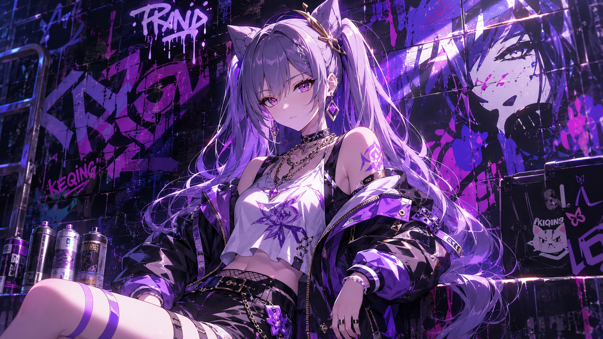
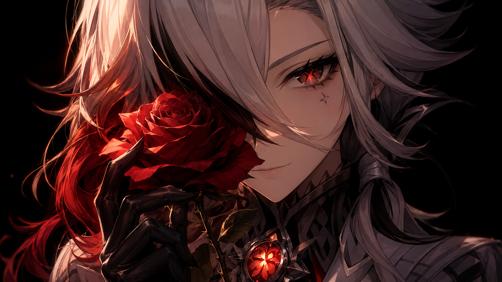

# 达妮卡 Danica — 2026.11.10
> 视频类型：A · 角色单人壁纸合集
> 角色来源：原神 7.3「至冬」卡池 · 五星雷元素（星之楔·雷）成女，命之座「逆戟鲸座」，称号「冬宫侍影」，官方标语「仪轨无缺，静影藏锋」
> 身份：别捷尼茨卡娅家族第三代宫廷女仆长，冰之女皇最忠诚的近侍，游走于各方势力间的隐形枢纽，执行官「队长」的亲传弟子；星烁体系生存位关键辅助
> 设计参考：黑白配色形似虎鲸（逆戟鲸）——鲸尾状长发束、梭形发饰对应虎鲸眼后白斑、后脑银色虎鲸饰品坠雷元素星之楔；至冬俄式美学（喀秋莎头饰、船锚元素、宫廷茶仪）
> 热点背景：7.3 卡池双新五星立绘近日官宣——冰神安娜丝塔夏 + 雷系女仆长达妮卡，达妮卡立绘二创热度爆炸（DeepSeek 同人版爆火、热度一度超越冰神二创），「女仆长」「白丝虎鲸」标签刷屏；同期崩铁 4.7 版本 11-10/11 上线，米哈游双端热点叠加
> 今日特殊：达妮卡立绘官宣热度窗口期（本工作区首次覆盖）
> 选定类型理由：重大官方热点（7.3 立绘官宣 + 卡池确认）→ 类型 A 深度呈现
> 选定角色理由：性别系数 1.0（女性角色）；官方热点权重拉满（立绘官宣数日内、7.3 卡池正式确定）；社区热度极高（立绘二创热度爆炸、知乎高赞热议「你只要招她就会被她奖励」「欠她八百万摩拉的挂脸」、薇斯纳禁驾令官方文案疯传）；素材覆盖 0%（工作区首次覆盖；冰神安娜丝塔夏与阿哈均已有单人集）；形象辨识度极强（墨绿鲸尾长发、喀秋莎女仆头饰、黑白虎鲸配色、白丝过膝袜+端茶盘仪态），反差萌张力强（肃穆女仆长 × 鲸跃式雷元素爆发）
> 参考图说明：已下载 B站WIKI 官方介绍图两张（splash-art.png 1500×1500 官方介绍图、splash-art-2.png 750×1900 竖版 INTRO 档案卡），均经 read_file 目视校对：身材高挑成女、深墨青绿长发垂至大腿（内层碧蓝挑染、M 字刘海及眉、发梢以带刺黑色铁环束成鲸尾状）、碧蓝瞳外缘泛淡红圈、白色褶边女仆头饰（喀秋莎）+红宝石额冠+白色翼状饰、两侧梭形白色发饰形似虎鲸眼后白斑、后脑银色虎鲸饰品坠雷元素星之楔、黑色女仆连身裙（白色束身围裙前片、白色泡泡肩褶饰、青宝石高领、右臂黑色蕾丝纹纱袖、白褶袖口嵌红宝石+红色腕带）、黑色锯齿冰晶边多层裙摆+白蓝内衬、白色过膝袜、黑色高跟鞋、左手托银盘（白瓷冰晶纹茶壶+茶杯）
> 伴生元素说明：无常规伴生生物；标志性伴生物为冰晶茶具（银盘+白瓷冰晶纹茶壶茶杯，官方立绘中左手托举，已目视确认）与命之座「逆戟鲸座」的虎鲸意象（官方设定层面，非具象召唤物——prompts 中虎鲸仅作元素显化物使用并已在跨领域参考图中锚定真实虎鲸形态）；后脑银色虎鲸饰品在立绘中仅露出局部，prompt 描述弱化为「a small silver orca-shaped hair ornament」不展开细节
> 跨领域参考图说明：Wikimedia/Unsplash 上传域不可达（实测 upload.wikimedia.org TLS 握手超时）；Pexels 搜索页被 Cloudflare 拦截；改用 iNaturalist 开放数据 API（CC 授权）获取虎鲸跃身击浪实拍 ref-orca-surface.jpg（1024×768，黑白配色与眼后白斑清晰可辨，与角色发饰设定直接对应），经 read_file 目视校对

---

# 必需

## 1 — 涂鸦墙街头风（Graffiti Wall Street Style · 女版公式）

Positive Prompt:
Refer to the attached reference image (Figure 1) for composition, graffiti-wall style, and overall atmosphere only. Generate a similar style image of Danica from Genshin Impact sitting casually in front of a bold graffiti wall. Danica is seated in a relaxed but confident posture, leaning back against the graffiti wall with one knee raised, her other leg extended straight along the ground with the foot flat on the floor, both legs clearly separated with a visible gap and never crossing or overlapping, one hand resting loosely on her raised knee, her body language calm, controlled, and slightly provocative. Her expression should show cold, disdainful eyes, aloof, sharp, and superior, as if she is silently judging the viewer — the flawless head maid of the Winter Palace whose face reads like everyone owes her eight million Mora, and who has absolutely no intention of correcting that impression.

Keep Danica's recognizable features: very tall statuesque adult feminine figure with fair skin, thigh-length dark teal-green hair with aqua-blue inner layers and an M-shaped fringe, the ends of her hair bound with spiked black iron rings so the twin tails flare like a whale's tail fluke, deep blue eyes with a faint crimson rim along the outer edge, a white frilled kokoshnik-style maid headdress with a red gem tiara and small white wing ornaments, two spindle-shaped white hair ornaments resembling orca eye-patches hanging on either side of her face, and a small silver orca-shaped hair ornament at the back of her head. Blend her canonical design with a modern edgy streetwear aesthetic: a fitted black tube crop top under an open cropped white-and-black varsity bomber jacket with purple electro-bolt embroidery, black high-waist denim shorts with a silver anchor-buckle belt, sheer white thigh-high stockings, chunky black platform boots with silver buckles, a slim chain necklace with a tiny whale-tail pendant, and a single red wristband on her right wrist. Preserve her identity while giving her a fresh urban street-style look.

The graffiti wall behind her should be vivid and layered, full of expressive abstract shapes and energetic street-art textures in deep teal, icy white, and violet tones, with graffiti elements including "DANICA" in sharp hand-painted ice-crackle lettering, violet lightning bolts, a breaching orca silhouette in black and white, anchor tags, and a doodled teacup with a crack of lightning through it, creating a rebellious urban backdrop that resonates with her character theme. Add subtle violet Electro energy effects, crackling lightning arcs, and drifting frost particles around her to reinforce her identity.

Use a wide cinematic framing suitable for a 16:9 2K wallpaper, with Danica as the main focal point while still showing enough of the graffiti wall and surrounding environment for atmosphere. The mood should feel cool, stylish, intimidating, and mysterious. Highly detailed background, rich shadows, teal and violet glowing highlights, sharp focus on Danica, and a refined high-end anime illustration look.

perfect hands, five fingers on each hand, anatomically correct hands, well-defined fingers, natural relaxed hand pose, the resting hand's fingers naturally draped with clear gaps.

Negative Prompt:
low quality, worst quality, blurry, pixelated, bad anatomy, extra limbs, bad hands, extra fingers, fewer fingers, missing fingers, fused fingers, webbed fingers, overlapping fingers, deformed fingers, six fingers, bad hand anatomy, asymmetrical hands, broken fingers, claw hands, blurry hands, missing legs, missing feet, cropped legs, twisted legs, rotated hips, extra legs, fused legs, malformed knees, knees bending in opposite directions, unnatural sitting pose, disproportionate limbs, elongated calves, deformed feet, standing, standing pose, upright posture, singing, open mouth singing, warm smile, gentle smile, cheerful expression, cute expression, adorable, sweet, innocent, game canonical outfit, official costume, fantasy dress, medieval clothing, armor, full gown, formal dress, beach background, ocean background, nature background, indoor background, plain background, minimal background, missing graffiti wall, low detail graffiti, generic graffiti, wrong graffiti colors, wrong streetwear, missing crop top, missing jacket, missing shorts, missing skirt, long dress, full pants, business suit, school uniform, both knees raised, legs folded underneath, kneeling pose, wrong hair color, wrong eye color, incorrect character, male, wrong gender, text, watermark, logo, signature.

---

## 2 — 静影藏锋（角色特写肖像 / Close-up Portrait · 16:9）

Positive Prompt:
Refer to the attached reference image (Figure 2). Generate a cinematic close-up portrait of Danica from Genshin Impact. She holds a small silver orca statuette — a palm-sized polished metal figurine of a breaching killer whale, the same motif as the hair ornament pinned behind her head — close to the left side of her face, the statuette's dorsal fin partially obscuring her left eye. Her visible right eye — deep blue with a faint crimson rim along its outer edge — gazes directly at the viewer, simultaneously composed with flawless etiquette and quietly alert, the look of a shadow that has stood beside the Tsaritsa for years and catalogued every visitor who ever underestimated her. Expression: the rigid courtesy of a palace maid who never smiles in public, and — barely visible — the faintest flicker at the corner of her mouth, a suppressed smirk she would deny under oath. Dramatic single-source lighting from the upper left casts deep chiaroscuro across her features, the silver statuette gleaming coldly with a faint violet Electro glow tracing its fin. Her fair skin contrasts sharply against a pure black background. Her signature thigh-length dark teal-green hair with aqua inner layers frames one side of the composition, the white frilled kokoshnik headdress and red gem tiara crowning the top of the frame; the high collar of her black maid dress with its cyan gem is only barely visible at the bottom edge. The Winter Palace's perfect shadow: every step by the book, every blade hidden in stillness. 16:9 2K wallpaper.

perfect hands, five fingers on each hand, anatomically correct hands, well-defined fingers, fingers elegantly holding the statuette with natural spacing.

Negative Prompt:
low quality, worst quality, blurry, pixelated, bad anatomy, extra limbs, bad hands, extra fingers, fewer fingers, missing fingers, fused fingers, webbed fingers, overlapping fingers, deformed fingers, six fingers, bad hand anatomy, asymmetrical hands, broken fingers, claw hands, blurry hands, missing legs, missing feet, cropped legs, twisted legs, rotated hips, extra legs, fused legs, malformed knees, knees bending in opposite directions, unnatural sitting pose, disproportionate limbs, elongated calves, deformed feet, full body shot, wide shot, landscape, multiple subjects, busy background, bright cheerful lighting, outdoor scene, action pose, weapon drawn, standing, chibi, photorealistic, male, wrong gender, wrong hair color, wrong eye color, incorrect character, text, watermark, logo, signature.

---

## 2b — 特写肖像·手机竖屏版（9:20 · 胸部及以上取景）

Positive Prompt:
9:20 vertical mobile wallpaper, cinematic close-up portrait of Danica from Genshin Impact. Chest-up framing, her face as the focal point of the tall composition, no full body. She holds a small silver orca statuette — a palm-sized polished metal figurine of a breaching killer whale, the same motif as the hair ornament pinned behind her head — close to the left side of her face, the statuette's dorsal fin partially obscuring her left eye. Her visible right eye — deep blue with a faint crimson rim along its outer edge — gazes directly at the viewer, simultaneously composed with flawless etiquette and quietly alert, the look of a shadow that has stood beside the Tsaritsa for years and catalogued every visitor who ever underestimated her. Expression: the rigid courtesy of a palace maid who never smiles in public, and — barely visible — the faintest flicker at the corner of her mouth, a suppressed smirk she would deny under oath. Dramatic single-source lighting from the upper left casts deep chiaroscuro across her features, the silver statuette gleaming coldly with a faint violet Electro glow tracing its fin. Her fair skin contrasts sharply against a pure black background. Her signature thigh-length dark teal-green hair with aqua inner layers and the white frilled kokoshnik headdress with red gem tiara crown the top of the frame; the high collar of her black maid dress with its cyan gem is only barely visible at the bottom edge. The Winter Palace's perfect shadow: every step by the book, every blade hidden in stillness. perfect hands, five fingers on each hand, anatomically correct hands, well-defined fingers, fingers elegantly holding the statuette with natural spacing.

Negative Prompt:
low quality, worst quality, blurry, pixelated, bad anatomy, extra limbs, bad hands, extra fingers, fewer fingers, missing fingers, fused fingers, webbed fingers, overlapping fingers, deformed fingers, six fingers, bad hand anatomy, asymmetrical hands, broken fingers, claw hands, blurry hands, missing legs, missing feet, cropped legs, twisted legs, rotated hips, extra legs, fused legs, malformed knees, knees bending in opposite directions, unnatural sitting pose, disproportionate limbs, elongated calves, deformed feet, full body shot, wide shot, lower body, legs, feet, landscape, multiple subjects, busy background, bright cheerful lighting, outdoor scene, action pose, weapon drawn, standing, chibi, photorealistic, male, wrong gender, wrong hair color, wrong eye color, incorrect character, text, watermark, logo, signature.

---

# 人物设定

## 3 — 冬宫侍影·茶仪如仪（身份/背景经典场景）

Positive Prompt:
16:9 2K wallpaper, Danica from Genshin Impact, highly detailed anime-style illustration, polished game-art quality, stately palace ceremony atmosphere, hushed and elegant.

Depict Danica walking through a grand hall of the Winter Palace in profile three-quarter view, carrying her ceremonial silver tray level in her left hand — upon it a white porcelain teapot and a single teacup, both glazed with delicate ice-crystal patterns, the tray held steady at shoulder height exactly as in her official art, fingers clearly visible beneath the tray with correct left-right hand orientation. Her right hand rests relaxed at her side. Her expression is composed, unreadable, and quietly dignified — the perfect head maid mid-service. Her unmistakable features: a very tall statuesque adult figure with fair skin, thigh-length dark teal-green hair with aqua-blue inner layers and an M-shaped fringe, the hair ends bound with spiked black iron rings flaring like a whale's tail fluke behind her, deep blue eyes with a faint crimson rim, white frilled kokoshnik-style maid headdress with a red gem tiara and small white wing ornaments, two spindle-shaped white hair ornaments resembling orca eye-patches beside her face, a small silver orca hair ornament at the back of her head. She wears her canonical outfit: a black maid dress with a fitted white apron bodice, white puffed shoulder ruffles, a high collar fastened with a cyan gem, a sheer black lace-patterned sleeve on her right arm, a white ruffle cuff set with red gems and a red wristband on her right wrist, a layered black skirt edged with jagged ice-crystal trim over white and ice-blue underlayers, white thigh-high stockings, and black heeled shoes.

The hall around her is rendered in soft focus: towering pale stone columns, tall arched windows with snowlight streaming through, deep violet banners with the Snowland crest hanging between the columns, faint frost patterns creeping along the floor edges. The mood is serene, disciplined, and quietly majestic — a servant whose silence is itself a form of authority. Color palette: deep teal, black, porcelain white, ice blue, violet accents. perfect hands, five fingers on each hand, anatomically correct hands, well-defined fingers, tray hand shown with natural finger spacing and correct left-right hand orientation.

Negative Prompt:
low quality, worst quality, blurry, pixelated, bad anatomy, extra limbs, bad hands, extra fingers, fewer fingers, missing fingers, fused fingers, webbed fingers, overlapping fingers, deformed fingers, six fingers, bad hand anatomy, asymmetrical hands, broken fingers, claw hands, blurry hands, mirrored hands, reversed hands, hands with wrong chirality, missing legs, missing feet, cropped legs, twisted legs, rotated hips, extra legs, fused legs, malformed knees, knees bending in opposite directions, unnatural sitting pose, disproportionate limbs, elongated calves, deformed feet, wrong hair color, wrong eye color, incorrect character, modern clothing, combat pose, action pose, crowd, multiple people, chibi, photorealistic, text, watermark, logo, signature.

---

## 4 — 逆戟鲸座·雷海鲸跃（战斗场景）

Positive Prompt:
16:9 2K wallpaper, Danica from Genshin Impact, highly detailed anime-style illustration, dynamic action composition, dramatic Electro elemental effects, polished game-art quality, epic battle atmosphere.

Depict Danica at the climax of battle on a dark frozen sea at night, having just swept her right arm forward — her right hand extended toward the viewer's left with the palm open and the thumb visible, correct left-right hand orientation, fingers spread with natural gaps — as the answer to her call erupts from the black water: a colossal orca made of crackling violet lightning breaches upward in a great arc behind her, its body woven from pure Electro energy, ice shattering and violet sparks raining where it rises, echoing the killer-whale constellation above. Her thigh-length dark teal-green hair with aqua inner layers whips upward in the elemental wind, the spiked iron rings at its ends flaring like a whale's tail, her white frilled kokoshnik headdress and red gem tiara gleaming, deep blue eyes blazing with fierce focus, the faint crimson rim catching the violet light. She wears her canonical outfit: black maid dress with fitted white apron bodice, white puffed shoulder ruffles, cyan-gem high collar, sheer black lace-patterned right sleeve, white ruffle cuff with red gems and red wristband, layered black skirt with jagged ice-crystal edges flaring in the wind, white thigh-high stockings, black heeled shoes braced against the ice. Her left arm is drawn back beside her, fingers elegantly relaxed.

The composition is a dynamic low-angle shot with the lightning orca dominating the sky behind her, violet Electro energy arcing across the clouds, frost and spray suspended mid-air. The mood is commanding and breathtaking — the silent head maid revealing the leviathan that answers when the etiquette ends. Color palette: violet, deep teal, black, ice white. perfect hands, five fingers on each hand, anatomically correct hands, well-defined fingers, channeling hand fingers clearly spread with natural gaps and correct left-right hand orientation.

Negative Prompt:
low quality, worst quality, blurry, pixelated, bad anatomy, extra limbs, bad hands, extra fingers, fewer fingers, missing fingers, fused fingers, webbed fingers, overlapping fingers, deformed fingers, six fingers, bad hand anatomy, asymmetrical hands, broken fingers, claw hands, blurry hands, mirrored hands, reversed hands, hands with wrong chirality, missing legs, missing feet, cropped legs, twisted legs, rotated hips, extra legs, fused legs, malformed knees, knees bending in opposite directions, unnatural sitting pose, disproportionate limbs, elongated calves, deformed feet, wrong hair color, wrong eye color, incorrect character, cluttered background, busy background, daylight, peaceful scene, crowd, multiple people, blood, gore, extra companion creatures beyond one lightning orca, chibi, photorealistic, text, watermark, logo, signature.

---

## 5 — 禁驾令之后·不说话（现代风改造 · 玩梗场景）

Positive Prompt:
16:9 2K wallpaper, Danica from Genshin Impact, highly detailed anime-style illustration, polished game-art quality, crisp winter-city atmosphere with a hint of deadpan comedy.

Reimagine Danica on a modern city street just after snowfall, standing beside a parked dark sedan with her arms crossed and her head turned slightly away, deliberately ignoring someone shouting from a car window off-frame — the notorious head maid who got her driving license revoked and refuses to acknowledge the topic exists. Her iconic features remain: a very tall statuesque adult figure with fair skin, thigh-length dark teal-green hair with aqua-blue inner layers and an M-shaped fringe, the hair ends bound with spiked black iron rings, deep blue eyes with a faint crimson rim looking off into the distance with cold indifference, white frilled kokoshnik-inspired knit headband with a red gem brooch, two spindle-shaped silver hair ornaments resembling orca eye-patches beside her face. Her modernized outfit: a long black down coat worn open over a fitted white turtleneck sweater, a black pleated midi skirt, sheer white thigh-high stockings, black ankle boots with low heels, a single red wristband on her right wrist, and a paper grocery bag set neatly at her feet with a baguette and vegetables peeking out — evidence of the most dangerous grocery run in Snezhnaya. Her arms are crossed with hands tucked into her elbows, pose clean and stable.

The background is a quiet residential street after snow: pale grey sky, soft snow banks along the curb, warm streetlamp glow, tire tracks in fresh snow. The mood is deadpan, cool, and quietly hilarious — she is not speaking, and that will not make her look any less cool. Color palette: black, porcelain white, pale grey, muted teal, red accents. perfect hands, five fingers on each hand, anatomically correct hands, well-defined fingers, arms crossed with hands neatly tucked.

Negative Prompt:
low quality, worst quality, blurry, pixelated, bad anatomy, extra limbs, bad hands, extra fingers, fewer fingers, missing fingers, fused fingers, webbed fingers, overlapping fingers, deformed fingers, six fingers, bad hand anatomy, asymmetrical hands, broken fingers, claw hands, blurry hands, mirrored hands, reversed hands, hands with wrong chirality, missing legs, missing feet, cropped legs, twisted legs, rotated hips, extra legs, fused legs, malformed knees, knees bending in opposite directions, unnatural sitting pose, disproportionate limbs, elongated calves, deformed feet, wrong hair color, wrong eye color, incorrect character, game canonical fantasy outfit, maid dress, apron, headdress, medieval clothing, combat pose, crowd, multiple people in focus, chibi, photorealistic, text, watermark, logo, signature.

---

## 6 — 偷笑被抓包的那一秒（情感/日常反差场景）

Positive Prompt:
16:9 2K wallpaper, Danica from Genshin Impact, highly detailed anime-style illustration, polished game-art quality, warm intimate private-moment atmosphere.

Depict Danica alone in a small warm palace pantry kitchen in the late afternoon, caught in an unguarded second: she stands beside a wooden counter, pouring hot tea from the white ice-crystal-patterned porcelain teapot into a cup with her right hand — fingers clearly wrapped around the handle with correct left-right hand orientation — while the corner of her mouth twitches upward into a tiny, suppressed, thoroughly deniable smile, the exact smirk a certain chatty companion once caught her doing. Her eyes are lowered toward the cup, soft and quietly amused. Her unmistakable features: a very tall statuesque adult figure with fair skin, thigh-length dark teal-green hair with aqua-blue inner layers loosely tied back, M-shaped fringe, hair ends bound with spiked black iron rings, deep blue eyes with a faint crimson rim, her white frilled kokoshnik maid headdress set slightly askew for once, spindle-shaped white hair ornaments beside her face. She wears her canonical outfit: black maid dress with fitted white apron bodice, white puffed shoulder ruffles, cyan-gem high collar, sheer black lace-patterned right sleeve, white ruffle cuff with red gems, layered black skirt with jagged ice-crystal edges, white thigh-high stockings, black heeled shoes. Her left hand rests lightly on the counter.

Behind her, simple pantry details in soft focus: wooden shelves with jars of preserves, a small window with snowlight and a potted plant on the sill, steam curling from the cup. The mood is warm, gentle, and secretly funny — the most terrifying shadow of the Winter Palace, grinning for exactly one second a day. Color palette: warm amber, deep teal, porcelain white, soft brown. perfect hands, five fingers on each hand, anatomically correct hands, well-defined fingers, pouring hand shown with natural finger spacing and correct left-right hand orientation.

Negative Prompt:
low quality, worst quality, blurry, pixelated, bad anatomy, extra limbs, bad hands, extra fingers, fewer fingers, missing fingers, fused fingers, webbed fingers, overlapping fingers, deformed fingers, six fingers, bad hand anatomy, asymmetrical hands, broken fingers, claw hands, blurry hands, mirrored hands, reversed hands, hands with wrong chirality, missing legs, missing feet, cropped legs, twisted legs, rotated hips, extra legs, fused legs, malformed knees, knees bending in opposite directions, unnatural sitting pose, disproportionate limbs, elongated calves, deformed feet, wrong hair color, wrong eye color, incorrect character, crowd, multiple people, combat pose, dark gloomy scene, chibi, photorealistic, text, watermark, logo, signature.

---

# 动漫性感风 — 2D 日漫简约背景系列（黑白虎鲸泳装 · 四比例）

## 7 — 手机壁纸（9:20 竖版）

Positive Prompt:
9:20 vertical mobile wallpaper, Danica from Genshin Impact, 2D Japanese anime style, flat cel shading, clean thin lineart, soft anime coloring, Japanese anime aesthetic.

Full-body centered composition. Danica stands at the edge of a calm pale-blue infinity pool in a tasteful orca-colored swim set: a black-and-white halter bikini top with a white orca eye-patch motif at the chest, a black high-waist bikini bottom, and a sheer white chiffon cover-up slipping off one shoulder, a single red wristband on her right wrist. Her unmistakable features: a very tall statuesque adult figure with fair skin, thigh-length dark teal-green hair with aqua-blue inner layers and an M-shaped fringe, hair ends bound with spiked black iron rings flaring like a whale's tail, deep blue eyes with a faint crimson rim, white frilled kokoshnik-inspired white headband, two spindle-shaped white hair ornaments beside her face. She stands with her weight on one hip in a natural relaxed stance, hands relaxed at her sides, fingers softly visible with natural spacing, chin slightly lifted with composed confidence, a cool unimpressed gaze toward the viewer.

Background limited to three simple elements: the flat pale-blue pool surface behind her, a pale sky band at the top, and one thin white pool edge line — no other background elements. Single and only light source is the soft afternoon sun from the upper left, giving gentle rim light on her hair; the scene color is ambient tonality only, no additional light sources. Clean simple background, minimalist uncluttered composition, soft even lighting, gentle rim light in ice blue. Color palette: black, white, pale blue, deep teal. tasteful and elegant throughout, no explicit content. perfect hands, five fingers on each hand, anatomically correct hands, well-defined fingers, natural hand pose.

Negative Prompt:
low quality, worst quality, blurry, pixelated, bad anatomy, extra limbs, bad hands, extra fingers, fewer fingers, missing fingers, fused fingers, webbed fingers, overlapping fingers, deformed fingers, six fingers, bad hand anatomy, asymmetrical hands, broken fingers, claw hands, blurry hands, missing legs, missing feet, cropped legs, twisted legs, rotated hips, extra legs, fused legs, malformed knees, knees bending in opposite directions, unnatural sitting pose, disproportionate limbs, elongated calves, deformed feet, 3D render, semi-realistic, realistic, painterly, thick oil paint, game 3D model, complex background, cluttered background, multiple overlapping scenes, busy props, heavy details, photorealistic background, weapon combat, fighting, blood, gore, palm trees, parasols, deck chairs, resort furniture, sea waves, mountains, crowds, multiple light sources, additional lights, glowing particles, floating lights, light rays, lens flare, bokeh lights, over-detailed background, stacked background elements, wrong hair color, wrong eye color, incorrect character, chibi, male, text, watermark, logo, signature.

---

## 8 — 电脑壁纸（16:9 横版）

Positive Prompt:
16:9 desktop wallpaper, Danica from Genshin Impact, 2D Japanese anime style, flat cel shading, clean thin lineart, soft anime coloring, Japanese anime aesthetic.

Danica stands on the right third of the wide frame with generous negative space to the left, at the edge of a calm pale-blue infinity pool, in the same tasteful orca-colored swim set: a black-and-white halter bikini top with a white orca eye-patch motif at the chest, a black high-waist bikini bottom, a sheer white chiffon cover-up slipping off one shoulder, a single red wristband on her right wrist. Her unmistakable features: a very tall statuesque adult figure with fair skin, thigh-length dark teal-green hair with aqua-blue inner layers and an M-shaped fringe, hair ends bound with spiked black iron rings flaring like a whale's tail, deep blue eyes with a faint crimson rim, white frilled kokoshnik-inspired white headband, two spindle-shaped white hair ornaments beside her face. She stands with her weight on one hip in a natural relaxed stance, hands relaxed at her sides, fingers softly visible with natural spacing, glancing back over her shoulder toward the viewer with cool, faintly amused composure.

Background limited to three simple elements: the flat pale-blue pool surface, a pale sky band, and one thin white pool edge line — no other background elements. Single and only light source is the soft afternoon sun from the upper left, giving gentle rim light on her hair; the scene color is ambient tonality only, no additional light sources. Clean simple background, minimalist uncluttered composition, soft even lighting, gentle rim light in ice blue. Color palette: black, white, pale blue, deep teal. tasteful and elegant throughout, no explicit content. perfect hands, five fingers on each hand, anatomically correct hands, well-defined fingers, natural hand pose.

Negative Prompt:
low quality, worst quality, blurry, pixelated, bad anatomy, extra limbs, bad hands, extra fingers, fewer fingers, missing fingers, fused fingers, webbed fingers, overlapping fingers, deformed fingers, six fingers, bad hand anatomy, asymmetrical hands, broken fingers, claw hands, blurry hands, missing legs, missing feet, cropped legs, twisted legs, rotated hips, extra legs, fused legs, malformed knees, knees bending in opposite directions, unnatural sitting pose, disproportionate limbs, elongated calves, deformed feet, 3D render, semi-realistic, realistic, painterly, thick oil paint, game 3D model, complex background, cluttered background, multiple overlapping scenes, busy props, heavy details, photorealistic background, weapon combat, fighting, blood, gore, palm trees, parasols, deck chairs, resort furniture, sea waves, mountains, crowds, multiple light sources, additional lights, glowing particles, floating lights, light rays, lens flare, bokeh lights, over-detailed background, stacked background elements, wrong hair color, wrong eye color, incorrect character, chibi, male, text, watermark, logo, signature.

---

## 9 — iPad 壁纸（4:3 横版）

Positive Prompt:
4:3 tablet wallpaper, Danica from Genshin Impact, 2D Japanese anime style, flat cel shading, clean thin lineart, soft anime coloring, Japanese anime aesthetic.

Centered waist-up composition. Danica sits side-saddle on a simple white lounge stool at the pool edge, both knees together and pointing in the same direction, calves hanging down side by side in natural parallel alignment, one hand resting flat on her thigh and the other lifting a glass of iced water near her collarbone, fingers clearly wrapped around the glass with correct left-right hand orientation, correct hip-to-thigh-to-knee anatomy, natural leg proportions, natural seated posture. She wears the same tasteful orca-colored swim set: a black-and-white halter bikini top with a white orca eye-patch motif at the chest, a black high-waist bikini bottom, a sheer white chiffon cover-up slipping off one shoulder, a single red wristband on her right wrist. Her unmistakable features: a very tall statuesque adult figure with fair skin, thigh-length dark teal-green hair with aqua-blue inner layers and an M-shaped fringe, hair ends bound with spiked black iron rings, deep blue eyes with a faint crimson rim gazing at the viewer with cool serenity, white frilled kokoshnik-inspired white headband, two spindle-shaped white hair ornaments beside her face.

Background limited to three simple elements: the flat pale-blue pool surface behind her, a pale sky band, and one thin white pool edge line — no other background elements. Single and only light source is the soft afternoon sun from the upper left, giving gentle rim light on her hair; the scene color is ambient tonality only, no additional light sources. Clean simple background, minimalist uncluttered composition, soft even lighting, gentle rim light in ice blue. Color palette: black, white, pale blue, deep teal. tasteful and elegant throughout, no explicit content. perfect hands, five fingers on each hand, anatomically correct hands, well-defined fingers.

Negative Prompt:
low quality, worst quality, blurry, pixelated, bad anatomy, extra limbs, bad hands, extra fingers, fewer fingers, missing fingers, fused fingers, webbed fingers, overlapping fingers, deformed fingers, six fingers, bad hand anatomy, asymmetrical hands, broken fingers, claw hands, blurry hands, mirrored hands, reversed hands, hands with wrong chirality, missing legs, missing feet, cropped legs, twisted legs, rotated hips, extra legs, fused legs, malformed knees, knees bending in opposite directions, unnatural sitting pose, disproportionate limbs, elongated calves, deformed feet, 3D render, semi-realistic, realistic, painterly, thick oil paint, game 3D model, complex background, cluttered background, multiple overlapping scenes, busy props, heavy details, photorealistic background, weapon combat, fighting, blood, gore, palm trees, parasols, deck chairs, resort furniture, sea waves, mountains, crowds, multiple light sources, additional lights, glowing particles, floating lights, light rays, lens flare, bokeh lights, over-detailed background, stacked background elements, wrong hair color, wrong eye color, incorrect character, chibi, male, text, watermark, logo, signature.

---

## 10 — 阔折叠手机壁纸（√2:1 展开态）

Positive Prompt:
√2:1 (1.414:1) foldable phone unfolded wallpaper, Danica from Genshin Impact, 2D Japanese anime style, flat cel shading, clean thin lineart, soft anime coloring, Japanese anime aesthetic.

Wide horizontal minimalist composition with Danica positioned on the left quarter of the frame and a long expanse of calm negative space flowing to the right. She stands with her weight on one hip in a natural relaxed stance, hands relaxed at her sides, fingers softly visible with natural spacing, profile view glancing toward the open space as if watching something far across the water, hair swaying gently. She wears the same tasteful orca-colored swim set: a black-and-white halter bikini top with a white orca eye-patch motif at the chest, a black high-waist bikini bottom, a sheer white chiffon cover-up slipping off one shoulder, a single red wristband on her right wrist. Her unmistakable features: a very tall statuesque adult figure with fair skin, thigh-length dark teal-green hair with aqua-blue inner layers and an M-shaped fringe, hair ends bound with spiked black iron rings flaring like a whale's tail, deep blue eyes with a faint crimson rim, white frilled kokoshnik-inspired white headband, two spindle-shaped white hair ornaments beside her face.

Background limited to three simple elements: the flat pale-blue pool surface stretching across the lower half, a pale sky band above, and one thin white pool edge line — no other background elements. Single and only light source is the soft afternoon sun from the upper left, giving gentle rim light on her hair; the scene color is ambient tonality only, no additional light sources. Clean simple background, minimalist uncluttered composition, soft even lighting, gentle rim light in ice blue. Color palette: black, white, pale blue, deep teal. tasteful and elegant throughout, no explicit content. perfect hands, five fingers on each hand, anatomically correct hands, well-defined fingers, natural hand pose.

Negative Prompt:
low quality, worst quality, blurry, pixelated, bad anatomy, extra limbs, bad hands, extra fingers, fewer fingers, missing fingers, fused fingers, webbed fingers, overlapping fingers, deformed fingers, six fingers, bad hand anatomy, asymmetrical hands, broken fingers, claw hands, blurry hands, missing legs, missing feet, cropped legs, twisted legs, rotated hips, extra legs, fused legs, malformed knees, knees bending in opposite directions, unnatural sitting pose, disproportionate limbs, elongated calves, deformed feet, 3D render, semi-realistic, realistic, painterly, thick oil paint, game 3D model, complex background, cluttered background, multiple overlapping scenes, busy props, heavy details, photorealistic background, weapon combat, fighting, blood, gore, palm trees, parasols, deck chairs, resort furniture, sea waves, mountains, crowds, multiple light sources, additional lights, glowing particles, floating lights, light rays, lens flare, bokeh lights, over-detailed background, stacked background elements, wrong hair color, wrong eye color, incorrect character, chibi, male, text, watermark, logo, signature.

---

# 跨领域参考图

## 11 — 逆戟鲸座·跃身击浪（参考真实虎鲸摄影 · 元素显化融合）

Positive Prompt:
Referring to the attached photograph (Figure 3) for the orca's breaching pose, black-and-white markings, and the quality of the water and spray only — generate an image of Danica from Genshin Impact, highly detailed anime-style illustration, polished game-art quality, in 16:9 2K wallpaper framing. Do not copy any human figure from the photograph; the photo supplies only the killer whale's silhouette and the sea.

Depict Danica standing serene on a dark wet basalt shore at the edge of a calm pale sea, hands relaxed at her sides, fingers softly visible with natural spacing, three-quarter view facing the water. Behind her, a real orca breaches from the sea in exactly the pose of the reference photograph — black back, white belly, the white eye-patch behind its eye clearly visible, water sheeting off its body in fine spray — but its wake is a vein of violet Electro light, and faint violet lightning arcs trace the splash. Her unmistakable features: a very tall statuesque adult figure with fair skin, thigh-length dark teal-green hair with aqua-blue inner layers and an M-shaped fringe, hair ends bound with spiked black iron rings flaring like a whale's tail fluke, deep blue eyes with a faint crimson rim, white frilled kokoshnik-style maid headdress with a red gem tiara and small white wing ornaments, two spindle-shaped white hair ornaments resembling the orca's eye-patch beside her face, a small silver orca hair ornament at the back of her head. She wears her canonical outfit: black maid dress with fitted white apron bodice, white puffed shoulder ruffles, cyan-gem high collar, sheer black lace-patterned right sleeve, white ruffle cuff with red gems, layered black skirt with jagged ice-crystal edges moving gently in the sea wind, white thigh-high stockings, black heeled shoes.

The mood is mythic and quiet — the constellation's namesake surfacing to greet its maid. The color palette stays natural like the photograph: slate water, overcast silver sky, black-and-white orca — with Danica's teal hair and a restrained violet glow as the only saturated accents. perfect hands, five fingers on each hand, anatomically correct hands, well-defined fingers, natural hand pose.

Negative Prompt:
low quality, worst quality, blurry, pixelated, bad anatomy, extra limbs, bad hands, extra fingers, fewer fingers, missing fingers, fused fingers, webbed fingers, overlapping fingers, deformed fingers, six fingers, bad hand anatomy, asymmetrical hands, broken fingers, claw hands, blurry hands, mirrored hands, reversed hands, hands with wrong chirality, missing legs, missing feet, cropped legs, twisted legs, rotated hips, extra legs, fused legs, malformed knees, knees bending in opposite directions, unnatural sitting pose, disproportionate limbs, elongated calves, deformed feet, wrong hair color, wrong eye color, incorrect character, photorealistic human, realistic human face, extra orcas beyond one, dolphins, sharks, boats, ships, crowd, multiple people, combat pose, chibi, text, watermark, logo, signature.

---

## 注
- 立绘官宣热度期首覆盖：达妮卡为 7.3 卡池第二位新五星（雷系女仆长），立绘二创热度爆炸（DeepSeek 同人版出圈、热度一度超越冰神二创），同期冰神安娜丝塔夏已于 2026.08.03 覆盖、崩铁 4.7 星神阿哈已于 2026.09.17 覆盖，故今日选择零覆盖的达妮卡
- 场景 5「禁驾令」与场景 6「偷笑」均取自官方立绘档案卡中薇斯纳对达妮卡的两段评语文案（被下达禁驾令的前一日/生效当日、「刚刚你嘴角是不是抽了一下？你绝对偷笑了对吧」）
- 虎鲸意象来源：命之座「逆戟鲸座」+ 百度百科「黑白相间的造型形似虎鲸」「梭形发饰形似虎鲸眼后白斑」「发尾用带刺黑色铁环束起，从背后看宛如虎鲸的鱼尾」
- 跨领域参考图来自 iNaturalist 开放数据（CC 授权，照片 ID 223550594），Wikimedia/Unsplash/Pexels 上传域与搜索页在本网络环境不可达
