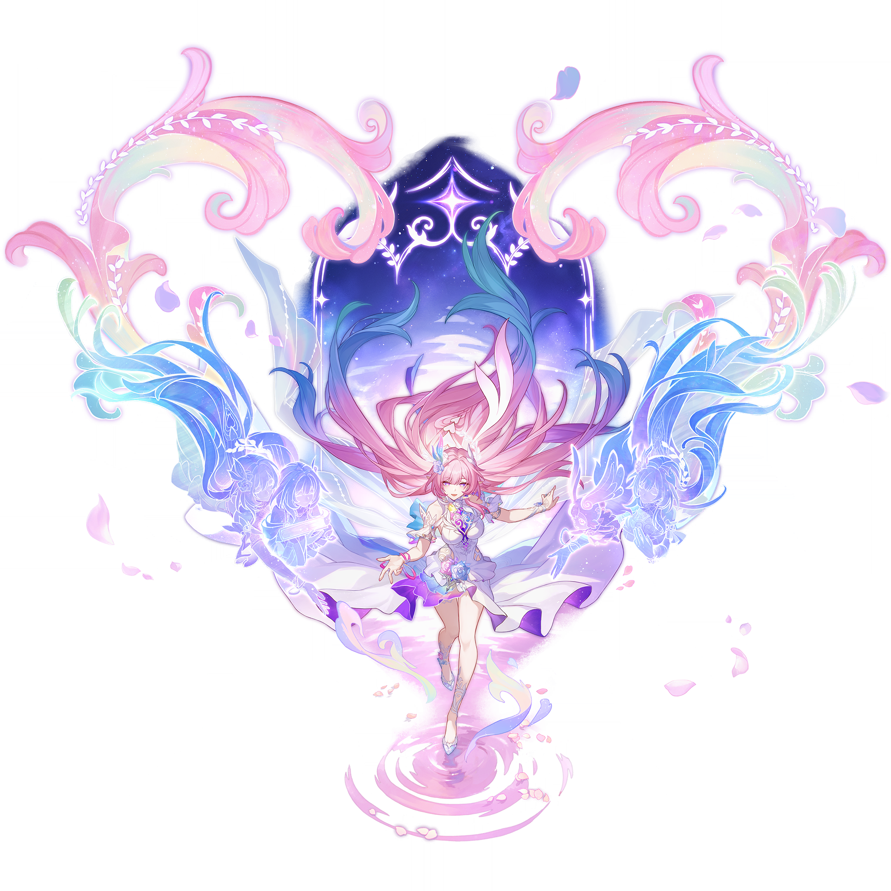
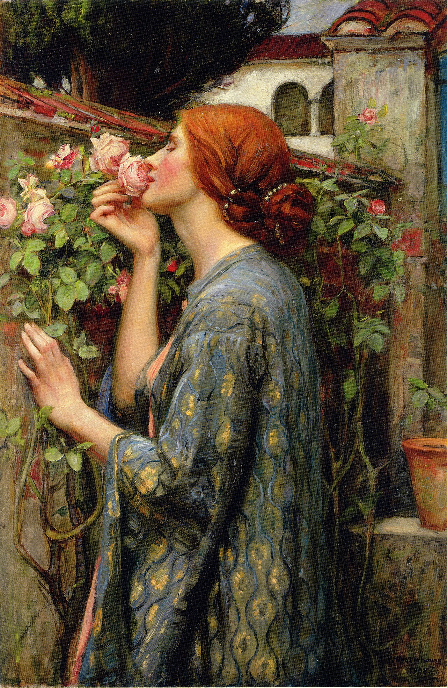

# 昔涟 Cyrene — 2026.10.11
> 视频类型：A · 角色单人壁纸合集
> 角色来源：崩坏星穹铁道 3.7「翁法罗斯终章」· 5星冰属性记忆命途 · 无漏净子
> 身份：最初的智种「德谬歌」、无人知晓的第十三位泰坦、哀丽秘榭的女儿、翁法罗斯之心；也是陪在开拓者身边的小妖精「迷迷（Mem）」的长大形态，别名小涟、桃子、粉色兔子、另一位作者♪
> 设计参考：粉长发蓝绿内层海浪式长发（发梢鳍状）、粉紫瞳、右则蓝玫瑰白羽浅蓝晶羽饰+左则白色月桂/橄榄叶冠弧形环戴（两件分处两边不并置）、尖精灵耳、白裙紫蓝渐变裙摆、白纱披风、左腿白色蕾丝花纹、紫水晶高跟鞋；伴生元素「迷迷」= 圆滚滚粉色毛绒妖精、单块深色显示面+像素眼、手持金羽毛笔与紫色故事书
> 热点背景：3.7 前瞻特别节目已播（兑换码有效期至 10/25），版本新角色昔涟（翁法罗斯剧情女主角、爱莉希雅同位体）为版本主推，翁法罗斯大版本迎来结局；本期发布卡在 3.7 开卡池前预热窗口
> 选定角色理由：①官方热点 40%：3.7 版本唯一新五星、翁法罗斯终章主推，B站WIKI 已上线全套官方立绘与档案卡，社区讨论爆量；②社区热度 25%：知乎「昔涟。是桃子。是爱。」刷屏、被刀讨论出圈；③时事契合 20%：终章+新版本预热双热点叠加；④素材覆盖 15%：工作区从未做过昔涟，崩铁目录亦无该角色。女性角色系数 1.0，无性别调整。
> 外观校对：基于 B站WIKI 官方立绘 splash-art.png（2048px）与官方角色介绍图 1/2 视觉确认；伴生元素「迷迷」经 mem-official.png 视觉确认（圆滚滚粉色毛绒、深色显示面像素眼、尖耳、金羽毛笔+紫故事书）。

# 参考图

# 必需

## 1 — 涂鸦墙街头风（封面级）

Positive Prompt:
Refer to the attached reference image (Figure 1). Generate a similar style image of Cyrene (Xi Lian) from Honkai: Star Rail sitting casually in front of a bold graffiti wall. Cyrene is seated in a relaxed but confident posture, leaning back against the graffiti wall with one knee raised and her other leg extended straight along the ground with her foot flat on the floor, both legs clearly separated with a visible gap and never crossing or overlapping, her body language calm, controlled, and slightly provocative. Her expression should show cold, disdainful eyes, aloof, sharp, and superior, as if she is silently judging the viewer.

Keep Cyrene's recognizable features: extremely long pink hair with pale blue-teal inner layers and white gradient tips flowing like soft ocean waves, soft pink-violet eyes, a blue rose with a white feather and pale-blue crystal spray pinned on the right side of her head, a white laurel-leaf wreath arcing over the crown toward the left side of her head, small pointed elf ears, a few thin braids woven through her hair. She has a slender feminine figure. Blend her canonical design with a modern edgy streetwear aesthetic: a white cropped tube top with a blue lace-up band across the chest, an open cropped denim jacket in white and lavender slung off one shoulder, a white pleated mini skirt with purple petal-hem accents, a pink bracelet stacked with a silver chain bracelet on her right wrist, sheer white tights, chunky white-and-lavender sneakers, a small blue rose pinned at her hip. Preserve her identity while giving her a fresh urban street-style look.

The graffiti wall behind her should be vivid and layered, full of expressive abstract shapes and energetic street-art textures in pink, lavender and ice-blue tones, with graffiti elements including her name "CYRENE" in bold wildstyle lettering, a stylized blooming blue rose, a whale-tail and ocean-wave motif, a small round fairy silhouette with pixel eyes, spray-paint drips and peeling wall texture, a spray can resting beside her on the ground, creating a rebellious urban backdrop that resonates with her ice attribute and memory theme. Add subtle frost-crystal sparkle effects, faint pink petals drifting in the air, and a golden quill tucked behind her ear to reinforce her identity.

Use a wide cinematic framing suitable for a 16:9 wallpaper, with Cyrene as the main focal point while still showing enough of the graffiti wall and surrounding environment for atmosphere. The mood should feel cool, stylish, intimidating, and mysterious. Highly detailed background, rich shadows, pink-and-lavender glowing highlights, sharp focus on Cyrene, and a refined high-end anime illustration look.

perfect hands, five fingers on each hand, anatomically correct hands, well-defined fingers, natural hand pose, clean finger separation, hands clearly visible and not hidden behind the knees or legs, the resting hand's fingers naturally draped and slightly spread with clear gaps.

Negative Prompt:
low quality, worst quality, blurry, pixelated, jpeg artifacts, bad anatomy, extra limbs, wrong hair color, wrong eye color, incorrect character, text, watermark, logo, signature, bad hands, extra fingers, fewer fingers, missing fingers, fused fingers, webbed fingers, merged fingers, overlapping fingers, deformed fingers, mutated fingers, six fingers, four fingers, three fingers, more than five fingers, less than five fingers, disfigured hands, poorly drawn hands, bad hand anatomy, asymmetrical hands, broken fingers, claw hands, blurry hands, indistinct fingers, smeared hands, missing legs, missing feet, missing calves, cropped legs, legs out of frame, twisted legs, rotated hips, dislocated hip, extra legs, third leg, fused legs, malformed knees, knees bending in opposite directions, both knees raised, legs folded underneath, kneeling pose, unnatural sitting pose, disproportionate limbs, elongated calves, deformed feet, standing, standing pose, upright posture, singing, open mouth singing, warm smile, gentle smile, cheerful expression, cute expression, adorable, sweet, innocent, game canonical outfit, official costume, fantasy dress, medieval clothing, armor, full gown, formal dress, beach background, ocean background, nature background, indoor background, plain background, minimal background, missing graffiti wall, low detail graffiti, generic graffiti, wrong graffiti colors, wrong streetwear, missing crop top, missing jacket, missing shorts, missing skirt, long dress, full pants, business suit, school uniform

# 人物设定

## 2 — 哀丽秘榭的水晶花海（翁法罗斯之心）

Positive Prompt:
16:9 2K wallpaper, Cyrene (Xi Lian) from Honkai: Star Rail, highly detailed anime-style illustration. Cyrene stands amid the crystal-flower meadow of Aedes Elysiae at twilight, weight on one leg in a natural stance, one hand gently lifting the hem of her ruffled skirt and the other hand softly extended toward the small fairy floating beside her, fingers elegantly relaxed. Surrounding her bloom translucent crystal flowers glowing with pale pink and ice-blue inner light, white marble arches and broken colonnades half-covered in blooming vines rising behind her, thin veils of frost mist drifting low across the ground, petals and tiny ice crystals suspended mid-air. Beside her floats Mem, a round pink fluffy fairy with a single large dark visor-like face showing two glowing pixel eyes curved in a happy expression, a tiny pointed ear tuft on top, hugging a small purple storybook to its chest. Keep her canonical design: extremely long pink hair with pale blue-teal inner layers and white gradient tips flowing like ocean waves, soft pink-violet eyes, a blue rose with white feather and pale-blue crystal spray ornament pinned on the right side of her head, a white laurel-leaf wreath arcing over the crown toward the left side of her head, small pointed elf ears, white puff-shoulder top with blue and purple ribbon accents and a golden heart-shaped emblem at her chest, layered ruffled white skirt with purple-blue gradient petal hems, flowing white cape-veil catching the twilight breeze, translucent purple glass-like high heels. Warm lavender dusk light with cool ice-blue rim light on her hair, cinematic contrast, dreamlike and gentle mood, sharp focus on Cyrene.

Negative Prompt:
low quality, worst quality, blurry, pixelated, jpeg artifacts, bad anatomy, extra limbs, wrong hair color, wrong eye color, incorrect character, text, watermark, logo, signature, bad hands, extra fingers, fewer fingers, missing fingers, fused fingers, webbed fingers, merged fingers, overlapping fingers, deformed fingers, mutated fingers, six fingers, four fingers, three fingers, more than five fingers, less than five fingers, disfigured hands, poorly drawn hands, bad hand anatomy, asymmetrical hands, broken fingers, claw hands, blurry hands, indistinct fingers, smeared hands, missing legs, missing feet, missing calves, cropped legs, legs out of frame, twisted legs, rotated hips, dislocated hip, extra legs, third leg, fused legs, malformed knees, knees bending in opposite directions, unnatural sitting pose, disproportionate limbs, elongated calves, deformed feet, modern clothing, streetwear, indoor scene, harsh lighting

## 3 — 迷迷的睡前故事（另一位作者♪）

Positive Prompt:
16:9 2K wallpaper, Cyrene (Xi Lian) from Honkai: Star Rail, highly detailed anime-style illustration. Cyrene sits side-saddle on a wide cushioned window seat in a warm lamplit study of the holy city, both knees together and pointing in the same direction, calves hanging down side by side in natural parallel alignment, a soft white blanket draped over her lap. She holds open a small purple storybook in one hand, the other hand resting lightly on the blanket, reading aloud with a tender smile and gently lowered eyes. On the cushion in front of her sits Mem, a round pink fluffy fairy with a single large dark visor-like face showing two glowing pixel eyes bent into delighted arcs, a tiny pointed ear tuft, scribbling with a golden quill in its own miniature book as if racing her to finish the chapter first, tiny golden script particles floating above the pages. The window behind frames a starry night sky over amber rooftops, warm candlelight and soft moonlight mixing on her hair, a cup of tea and a small hourglass resting on the windowsill. Keep her canonical design: extremely long pink hair with pale blue-teal inner layers and white gradient tips, soft pink-violet eyes, a blue rose with white feather and pale-blue crystal spray ornament pinned on the right side of her head, a white laurel-leaf wreath arcing over the crown toward the left side of her head, small pointed elf ears, white puff-shoulder top with blue and purple ribbon accents, layered ruffled white skirt with purple-blue gradient petal hems. Cozy warm palette of cream, pink and lavender, soft even lighting, intimate storybook mood, sharp focus on Cyrene and Mem.

Negative Prompt:
low quality, worst quality, blurry, pixelated, jpeg artifacts, bad anatomy, extra limbs, wrong hair color, wrong eye color, incorrect character, text, watermark, logo, signature, bad hands, extra fingers, fewer fingers, missing fingers, fused fingers, webbed fingers, merged fingers, overlapping fingers, deformed fingers, mutated fingers, six fingers, four fingers, three fingers, more than five fingers, less than five fingers, disfigured hands, poorly drawn hands, bad hand anatomy, asymmetrical hands, broken fingers, claw hands, blurry hands, indistinct fingers, smeared hands, missing legs, missing feet, missing calves, cropped legs, legs out of frame, twisted legs, rotated hips, dislocated hip, extra legs, third leg, fused legs, malformed knees, knees bending in opposite directions, unnatural sitting pose, disproportionate limbs, elongated calves, deformed feet, one leg crossed over the other, leg stretched out toward the viewer, dark horror atmosphere, cluttered room

# 现代风改造

## 4 — 花店街角的粉色诗人

Positive Prompt:
16:9 2K wallpaper, Cyrene (Xi Lian) from Honkai: Star Rail, highly detailed anime-style illustration, modern casual outfit redesign. Cyrene stands in a sunlit flower-shop street corner in late morning, weight on one hip in a natural stance, cradling a small bouquet of pale pink roses wrapped in kraft paper against her chest with both hands, the bouquet naturally covering her hands. She wears a soft pink off-shoulder knit sweater with white lace trim at the collar, a long flowing white maxi skirt with a purple petal-hem print, a small blue rose brooch at her waist, a thin gold anklet above white sneakers, a white canvas tote bag slung over one shoulder with a tiny round fairy charm hanging from the strap. Her expression is warm and dreamy, eyes half-closed as if memorizing the scent of the roses, a gentle content smile. Keep her recognizable features: extremely long pink hair with pale blue-teal inner layers and white gradient tips flowing down her back, soft pink-violet eyes, a blue rose with white feather and pale-blue crystal spray ornament pinned on the right side of her head, a white laurel-leaf wreath arcing over the crown toward the left side of her head, small pointed elf ears. The shopfront behind her displays buckets of roses and peonies in soft pastel rows, a striped awning, dappled sunlight through leaves, light bokeh of a quiet street. Fresh palette of pink, cream and soft green, soft natural lighting, gentle rim light in pink, clean composition, sharp focus on Cyrene.

Negative Prompt:
low quality, worst quality, blurry, pixelated, jpeg artifacts, bad anatomy, extra limbs, wrong hair color, wrong eye color, incorrect character, text, watermark, logo, signature, bad hands, extra fingers, fewer fingers, missing fingers, fused fingers, webbed fingers, merged fingers, overlapping fingers, deformed fingers, mutated fingers, six fingers, four fingers, three fingers, more than five fingers, less than five fingers, disfigured hands, poorly drawn hands, bad hand anatomy, asymmetrical hands, broken fingers, claw hands, blurry hands, indistinct fingers, smeared hands, missing legs, missing feet, missing calves, cropped legs, legs out of frame, twisted legs, rotated hips, dislocated hip, extra legs, third leg, fused legs, malformed knees, knees bending in opposite directions, unnatural sitting pose, disproportionate limbs, elongated calves, deformed feet, game canonical outfit, fantasy armor, cape, medieval clothing

# 情感/反差

## 5 — 千年等待的星漏之夜

Positive Prompt:
16:9 2K wallpaper, Cyrene (Xi Lian) from Honkai: Star Rail, highly detailed anime-style illustration. Night scene: Cyrene sits side-saddle on a tall cushioned bench beside a giant ornate hourglass taller than herself, both knees together and pointing in the same direction, hands folded calmly in her lap, her head tilted slightly toward the glass. Inside the hourglass, luminous stardust sand falls upward instead of down, each grain a tiny glowing memory-mote drifting from the bottom bulb back to the top, casting soft pink-blue light across her face. Her expression is the quiet paradox of a girl who waited a thousand years: a gentle serene smile on her lips while her pink-violet eyes glisten faintly with unshed tears, as if she promised herself she would not be caught crying when the awaited one finally returns. Keep her canonical design: extremely long pink hair with pale blue-teal inner layers and white gradient tips pooling around the bench like a tide, soft pink-violet eyes, a blue rose with white feather and pale-blue crystal spray ornament pinned on the right side of her head, a white laurel-leaf wreath arcing over the crown toward the left side of her head, small pointed elf ears, white puff-shoulder top with blue and purple ribbon accents, layered ruffled white skirt with purple-blue gradient petal hems, translucent purple glass-like high heels resting side by side on the floor. Around them float faint translucent pages of an unfinished storybook and slow-drifting petals; a tall arched window behind opens onto a vast quiet galaxy. Deep blue-violet night palette with rose-pink highlights, soft cinematic rim light, melancholic yet tender mood, sharp focus on Cyrene.

Negative Prompt:
low quality, worst quality, blurry, pixelated, jpeg artifacts, bad anatomy, extra limbs, wrong hair color, wrong eye color, incorrect character, text, watermark, logo, signature, bad hands, extra fingers, fewer fingers, missing fingers, fused fingers, webbed fingers, merged fingers, overlapping fingers, deformed fingers, mutated fingers, six fingers, four fingers, three fingers, more than five fingers, less than five fingers, disfigured hands, poorly drawn hands, bad hand anatomy, asymmetrical hands, broken fingers, claw hands, blurry hands, indistinct fingers, smeared hands, missing legs, missing feet, missing calves, cropped legs, legs out of frame, twisted legs, rotated hips, dislocated hip, extra legs, third leg, fused legs, malformed knees, knees bending in opposite directions, unnatural sitting pose, disproportionate limbs, elongated calves, deformed feet, one leg crossed over the other, leg stretched out toward the viewer, open crying mouth, heavy tears streaming

# 热点特别版

## 6 — 让明天，如我们所书（翁法罗斯终章主视觉）

Positive Prompt:
16:9 2K wallpaper, Cyrene (Xi Lian) from Honkai: Star Rail, highly detailed anime-style illustration, version key visual style. Cyrene floats serenely in the center of a vast cosmic night sky above the world of Amphoreus, her long pink hair with pale blue-teal inner layers and white gradient tips streaming weightlessly around her like a galaxy tide. In one hand she holds a giant quill of golden light, its tip tracing the final glowing line of script across an immense translucent storybook page unfolding across the sky; her other arm is gracefully outstretched with fingers elegantly relaxed, as if releasing the written tomorrow into the stars. The golden script blooms into constellations of ice crystals and pink petals as it is written; translucent whale-like light spirits swim through the nebula around her, and faint luminous outlines of companions' silhouettes shimmer deep in the starfield background. Keep her canonical design: soft pink-violet eyes gazing gently upward, a blue rose with white feather and pale-blue crystal spray ornament pinned on the right side of her head, a white laurel-leaf wreath arcing over the crown toward the left side of her head, small pointed elf ears, white puff-shoulder top with blue and purple ribbon accents and a golden heart-shaped emblem at her chest, layered ruffled white skirt with purple-blue gradient petal hems, flowing white cape-veil rippling like a sail of light, translucent purple glass-like high heels. Epic symmetrical composition, deep indigo and rose-gold color scheme, dramatic god-rays, ultra-detailed star and crystal particle effects, hopeful farewell mood, sharp focus on Cyrene at the center.

Negative Prompt:
low quality, worst quality, blurry, pixelated, jpeg artifacts, bad anatomy, extra limbs, wrong hair color, wrong eye color, incorrect character, text, watermark, logo, signature, bad hands, extra fingers, fewer fingers, missing fingers, fused fingers, webbed fingers, merged fingers, overlapping fingers, deformed fingers, mutated fingers, six fingers, four fingers, three fingers, more than five fingers, less than five fingers, disfigured hands, poorly drawn hands, bad hand anatomy, asymmetrical hands, broken fingers, claw hands, blurry hands, indistinct fingers, smeared hands, missing legs, missing feet, missing calves, cropped legs, legs out of frame, twisted legs, rotated hips, dislocated hip, extra legs, third leg, fused legs, malformed knees, knees bending in opposite directions, unnatural sitting pose, disproportionate limbs, elongated calves, deformed feet, standing on ground, sitting, indoor scene

# 动漫性感风 — 2D 日漫简约背景系列（活力系）

## 7 — 手机竖屏 9:20

Positive Prompt:
9:20 vertical mobile wallpaper, Cyrene (Xi Lian) from Honkai: Star Rail, 2D Japanese anime style, flat cel shading, clean thin lineart, soft anime coloring, Japanese anime aesthetic. Full-body centered composition. Cyrene wears a fresh summer outfit: a pink off-shoulder cropped camisole top with white lace trim, a white high-waist flared mini skirt with a small blue rose brooch, a delicate gold anklet on her left ankle, and white strappy sandals, her left thigh showing its signature delicate white lace floral pattern. Keep her recognizable features: extremely long pink hair with pale blue-teal inner layers and white gradient tips flowing like a soft wave down her back, soft pink-violet eyes, a blue rose with white feather and pale-blue crystal spray ornament pinned on the right side of her head, a white laurel-leaf wreath arcing over the crown toward the left side of her head, small pointed elf ears. She stands with one hand lightly holding her skirt hem and the other raised beside her cheek in a gentle waving gesture, fingers elegantly relaxed, head tilted with a sweet confident smile, eyes looking straight at the viewer. Simple anime scenery background, clean minimal scene composition, Ghibli-inspired soft background: a soft pink-lavender dawn sky above a calm pale sea with gentle ripples, a few flat soft clouds, flat background with simple shapes and soft colors echoing her name of gentle ripples. Soft even lighting, gentle rim light in pink, tasteful and elegant throughout, no explicit content.

Negative Prompt:
low quality, worst quality, blurry, pixelated, jpeg artifacts, bad anatomy, extra limbs, wrong hair color, wrong eye color, incorrect character, text, watermark, logo, signature, bad hands, extra fingers, fewer fingers, missing fingers, fused fingers, webbed fingers, merged fingers, overlapping fingers, deformed fingers, mutated fingers, six fingers, four fingers, three fingers, more than five fingers, less than five fingers, disfigured hands, poorly drawn hands, bad hand anatomy, asymmetrical hands, broken fingers, claw hands, blurry hands, indistinct fingers, smeared hands, missing legs, missing feet, missing calves, cropped legs, legs out of frame, twisted legs, rotated hips, dislocated hip, extra legs, third leg, fused legs, malformed knees, knees bending in opposite directions, unnatural sitting pose, disproportionate limbs, elongated calves, deformed feet, 3D render, semi-realistic, realistic, painterly, thick oil paint, game 3D model, complex background, cluttered background, multiple overlapping scenes, busy props, heavy details, photorealistic background, weapon combat, fighting, blood, gore, revealing outfits, immodest clothing, indecent content, inappropriate content, minor-looking body

## 8 — 电脑横屏 16:9

Positive Prompt:
16:9 desktop wallpaper, Cyrene (Xi Lian) from Honkai: Star Rail, 2D Japanese anime style, flat cel shading, clean thin lineart, soft anime coloring, Japanese anime aesthetic. Cyrene stands on the right third of the frame leaving breathing space on the left, same summer outfit as the series: pink off-shoulder cropped camisole top with white lace trim, white high-waist flared mini skirt with blue rose brooch, gold anklet, white strappy sandals, white lace floral pattern on her left thigh. Keep her recognizable features: extremely long pink hair with pale blue-teal inner layers and white gradient tips flowing like a soft wave, soft pink-violet eyes, a blue rose with white feather and pale-blue crystal spray ornament pinned on the right side of her head, a white laurel-leaf wreath arcing over the crown toward the left side of her head, small pointed elf ears. She stands with weight on one hip in a natural stance, hands relaxed at her sides with one hand loosely holding a wide-brimmed white sun hat, gazing back over her shoulder at the viewer with a gentle knowing smile. Simple anime scenery background, clean minimal scene composition, Ghibli-inspired soft background: the same soft pink-lavender dawn sky above a calm pale sea with gentle ripples, a few flat soft clouds, flat background with simple shapes and soft colors. Soft even lighting, gentle rim light in pink, tasteful and elegant throughout, no explicit content.

Negative Prompt:
low quality, worst quality, blurry, pixelated, jpeg artifacts, bad anatomy, extra limbs, wrong hair color, wrong eye color, incorrect character, text, watermark, logo, signature, bad hands, extra fingers, fewer fingers, missing fingers, fused fingers, webbed fingers, merged fingers, overlapping fingers, deformed fingers, mutated fingers, six fingers, four fingers, three fingers, more than five fingers, less than five fingers, disfigured hands, poorly drawn hands, bad hand anatomy, asymmetrical hands, broken fingers, claw hands, blurry hands, indistinct fingers, smeared hands, missing legs, missing feet, missing calves, cropped legs, legs out of frame, twisted legs, rotated hips, dislocated hip, extra legs, third leg, fused legs, malformed knees, knees bending in opposite directions, unnatural sitting pose, disproportionate limbs, elongated calves, deformed feet, 3D render, semi-realistic, realistic, painterly, thick oil paint, game 3D model, complex background, cluttered background, multiple overlapping scenes, busy props, heavy details, photorealistic background, weapon combat, fighting, blood, gore, revealing outfits, immodest clothing, indecent content, inappropriate content, minor-looking body

## 9 — iPad 4:3

Positive Prompt:
4:3 tablet wallpaper, Cyrene (Xi Lian) from Honkai: Star Rail, 2D Japanese anime style, flat cel shading, clean thin lineart, soft anime coloring, Japanese anime aesthetic. Centered half-body composition. Same summer outfit: pink off-shoulder cropped camisole top with white lace trim, white high-waist flared mini skirt with blue rose brooch, gold anklet, white lace floral pattern on her left thigh. Keep her recognizable features: extremely long pink hair with pale blue-teal inner layers and white gradient tips, soft pink-violet eyes, a blue rose with white feather and pale-blue crystal spray ornament pinned on the right side of her head, a white laurel-leaf wreath arcing over the crown toward the left side of her head, small pointed elf ears. She leans slightly forward toward the viewer with both hands clasped gently behind her back, chin tilted up in a playful proud expression, eyes half-lidded looking straight at the camera, a drifting pink petal reflected in her eyes. Simple anime scenery background, clean minimal scene composition, Ghibli-inspired soft background: soft pink-lavender dawn sky, flat soft clouds and the calm pale sea horizon low in the frame, flat background with simple shapes and soft colors. Soft even lighting, gentle rim light in pink, tasteful and elegant throughout, no explicit content.

Negative Prompt:
low quality, worst quality, blurry, pixelated, jpeg artifacts, bad anatomy, extra limbs, wrong hair color, wrong eye color, incorrect character, text, watermark, logo, signature, bad hands, extra fingers, fewer fingers, missing fingers, fused fingers, webbed fingers, merged fingers, overlapping fingers, deformed fingers, mutated fingers, six fingers, four fingers, three fingers, more than five fingers, less than five fingers, disfigured hands, poorly drawn hands, bad hand anatomy, asymmetrical hands, broken fingers, claw hands, blurry hands, indistinct fingers, smeared hands, missing legs, missing feet, missing calves, cropped legs, legs out of frame, twisted legs, rotated hips, dislocated hip, extra legs, third leg, fused legs, malformed knees, knees bending in opposite directions, unnatural sitting pose, disproportionate limbs, elongated calves, deformed feet, 3D render, semi-realistic, realistic, painterly, thick oil paint, game 3D model, complex background, cluttered background, multiple overlapping scenes, busy props, heavy details, photorealistic background, weapon combat, fighting, blood, gore, revealing outfits, immodest clothing, indecent content, inappropriate content, minor-looking body

## 10 — 阔折叠 √2:1

Positive Prompt:
√2:1 (1.414:1) foldable phone unfolded wallpaper, Cyrene (Xi Lian) from Honkai: Star Rail, 2D Japanese anime style, flat cel shading, clean thin lineart, soft anime coloring, Japanese anime aesthetic. Wide horizontal minimalist composition with generous negative space, Cyrene placed in the left third of the frame. Same summer outfit: pink off-shoulder cropped camisole top with white lace trim, white high-waist flared mini skirt with blue rose brooch, gold anklet, white strappy sandals, white lace floral pattern on her left thigh. Keep her recognizable features: extremely long pink hair with pale blue-teal inner layers and white gradient tips flowing behind her like a tide, soft pink-violet eyes, a blue rose with white feather and pale-blue crystal spray ornament pinned on the right side of her head, a white laurel-leaf wreath arcing over the crown toward the left side of her head, small pointed elf ears. She walks barefoot along the waterline with her eyes closed in a blissful smile, leaving a trail of small ripples and ice-crystal blossoms on the wet sand, one hand stretched lazily mid-stretch and the other swinging a white sun hat, fingers elegantly relaxed. Simple anime scenery background, clean minimal scene composition, Ghibli-inspired soft background: a vast soft pink-lavender dawn sky stretching across the wide frame above the calm pale sea, flat soft clouds, a single low sun disc, flat background with simple shapes and soft colors. Soft even lighting, gentle rim light in pink, tasteful and elegant throughout, no explicit content.

Negative Prompt:
low quality, worst quality, blurry, pixelated, jpeg artifacts, bad anatomy, extra limbs, wrong hair color, wrong eye color, incorrect character, text, watermark, logo, signature, bad hands, extra fingers, fewer fingers, missing fingers, fused fingers, webbed fingers, merged fingers, overlapping fingers, deformed fingers, mutated fingers, six fingers, four fingers, three fingers, more than five fingers, less than five fingers, disfigured hands, poorly drawn hands, bad hand anatomy, asymmetrical hands, broken fingers, claw hands, blurry hands, indistinct fingers, smeared hands, missing legs, missing feet, missing calves, cropped legs, legs out of frame, twisted legs, rotated hips, dislocated hip, extra legs, third leg, fused legs, malformed knees, knees bending in opposite directions, unnatural sitting pose, disproportionate limbs, elongated calves, deformed feet, 3D render, semi-realistic, realistic, painterly, thick oil paint, game 3D model, complex background, cluttered background, multiple overlapping scenes, busy props, heavy details, photorealistic background, weapon combat, fighting, blood, gore, revealing outfits, immodest clothing, indecent content, inappropriate content, minor-looking body

# 必需2 — 角色特写肖像

## 11 — 特写肖像·迷迷的金羽毛笔（16:9 横版）

Positive Prompt:
Refer to the attached reference image (Figure 2). Generate a cinematic close-up portrait of Cyrene (Xi Lian) from Honkai: Star Rail. She holds a slender golden quill with a soft pale-pink feather vane close to the left side of her face, the feather partially obscuring her left eye, the quill's golden nib catching a spark of light. Her visible right eye gazes directly at the viewer — soft pink-violet, gentle, warm, and impossibly far away. Expression: the tender serenity of a long-awaited reunion crossed with the quiet grace of a farewell already written; a faint gentle smile that never fully reaches her eyes, as if she is memorizing this exact moment to write it into tomorrow's page. Dramatic single-source lighting from the upper left casts deep chiaroscuro across her features, the feather vane glowing rose-pink where the light passes through it, tiny golden script particles drifting from the nib. Her fair skin contrasts sharply against a pure black background. Her signature extremely long pink hair with pale blue-teal inner layers spills softly past her shoulders, the blue rose with white feather ornament visible on the right side of her head and the white laurel-leaf wreath arcing on the left side of her head — the two clearly on opposite sides — both catching points of light; her white collar with blue and purple ribbon accents is only barely visible at the frame edge. The fairy who recorded a thousand lifetimes of everyone else's stories, now writing tomorrow for the whole world — but a tomorrow she herself will not walk into. 16:9 2K wallpaper.

Negative Prompt:
low quality, worst quality, blurry, pixelated, jpeg artifacts, bad anatomy, extra limbs, wrong hair color, wrong eye color, incorrect character, text, watermark, logo, signature, bad hands, extra fingers, fewer fingers, missing fingers, fused fingers, webbed fingers, merged fingers, overlapping fingers, deformed fingers, mutated fingers, six fingers, four fingers, three fingers, more than five fingers, less than five fingers, disfigured hands, poorly drawn hands, bad hand anatomy, asymmetrical hands, broken fingers, claw hands, blurry hands, indistinct fingers, smeared hands, missing legs, missing feet, missing calves, cropped legs, legs out of frame, twisted legs, rotated hips, dislocated hip, extra legs, third leg, fused legs, malformed knees, knees bending in opposite directions, unnatural sitting pose, disproportionate limbs, elongated calves, deformed feet, full body shot, wide shot, landscape, multiple subjects, busy background, bright cheerful lighting, outdoor scene, action pose, weapon drawn

## 12 — 特写肖像·迷迷的金羽毛笔（9:20 手机竖屏版）

Positive Prompt:
Refer to the attached reference image (Figure 2). Generate a cinematic close-up portrait of Cyrene (Xi Lian) from Honkai: Star Rail, framed as a chest-up vertical composition with her face as the absolute focal point, no lower body in frame. She holds a slender golden quill with a soft pale-pink feather vane close to the left side of her face, the feather partially obscuring her left eye, the quill's golden nib catching a spark of light. Her visible right eye gazes directly at the viewer — soft pink-violet, gentle, warm, and impossibly far away. Expression: the tender serenity of a long-awaited reunion crossed with the quiet grace of a farewell already written; a faint gentle smile that never fully reaches her eyes, as if she is memorizing this exact moment to write it into tomorrow's page. Dramatic single-source lighting from the upper left casts deep chiaroscuro across her features, the feather vane glowing rose-pink where the light passes through it, tiny golden script particles drifting from the nib. Her fair skin contrasts sharply against a pure black background. Her signature extremely long pink hair with pale blue-teal inner layers spills softly past her shoulders, the blue rose with white feather ornament visible on the right side of her head and the white laurel-leaf wreath arcing on the left side of her head — the two clearly on opposite sides — both catching points of light; her white collar with blue and purple ribbon accents is only barely visible at the bottom edge. The fairy who recorded a thousand lifetimes of everyone else's stories, now writing tomorrow for the whole world — but a tomorrow she herself will not walk into. 9:20 vertical mobile wallpaper.

Negative Prompt:
low quality, worst quality, blurry, pixelated, jpeg artifacts, bad anatomy, extra limbs, wrong hair color, wrong eye color, incorrect character, text, watermark, logo, signature, bad hands, extra fingers, fewer fingers, missing fingers, fused fingers, webbed fingers, merged fingers, overlapping fingers, deformed fingers, mutated fingers, six fingers, four fingers, three fingers, more than five fingers, less than five fingers, disfigured hands, poorly drawn hands, bad hand anatomy, asymmetrical hands, broken fingers, claw hands, blurry hands, indistinct fingers, smeared hands, missing legs, missing feet, missing calves, cropped legs, legs out of frame, twisted legs, rotated hips, dislocated hip, extra legs, third leg, fused legs, malformed knees, knees bending in opposite directions, unnatural sitting pose, disproportionate limbs, elongated calves, deformed feet, full body shot, wide shot, lower body, legs, feet, landscape, multiple subjects, busy background, bright cheerful lighting, outdoor scene, action pose, weapon drawn

# 跨领域参考图

## 13 — 玫瑰之魂·墙角的告别之吻（前拉斐尔派油画融合）

Positive Prompt:
Referring to the attached reference painting for its Pre-Raphaelite oil-painting style, romantic atmosphere, and composition only, generate an image of Cyrene (Xi Lian) from Honkai: Star Rail. Do not copy the painting's character appearance. Cyrene stands in profile in a walled Mediterranean garden at golden hour, leaning slightly over an old stone wall to breathe in the scent of a single pale-pink rose held delicately between her fingertips, her eyes closed, her expression steeped in tender melancholy — the look of someone saying goodbye to something beautiful she is about to leave behind. Keep her canonical design: extremely long pink hair with pale blue-teal inner layers and white gradient tips spilling over her shoulder and down her back, a blue rose with white feather ornament on the right side of her head and a white laurel-leaf wreath arcing on the left side, her white puff-shoulder dress with blue and purple ribbon accents and layered ruffled skirt, the white cape-veil draped over her arms, translucent purple glass-like high heels half-hidden by climbing rose vines. Render the scene in rich Pre-Raphaelite oil-painting style: luminous glazed color, fine brushwork, botanical detail on the rose canes and ivy, warm ochre walls with terracotta rooftops and a small arched window behind her, low golden sunlight grazing across the flowers. Her ice attribute adds a subtle touch: a delicate frost rime blooming on the wall stones nearest her hand, a few petals freezing mid-fall into tiny crystals. Rich romantic palette of rose, cream, olive green and deep shadow, soft golden light, poetic and elegiac mood, sharp focus on Cyrene. 16:9 2K wallpaper.

Negative Prompt:
low quality, worst quality, blurry, pixelated, jpeg artifacts, bad anatomy, extra limbs, wrong hair color, wrong eye color, incorrect character, text, watermark, logo, signature, bad hands, extra fingers, fewer fingers, missing fingers, fused fingers, webbed fingers, merged fingers, overlapping fingers, deformed fingers, mutated fingers, six fingers, four fingers, three fingers, more than five fingers, less than five fingers, disfigured hands, poorly drawn hands, bad hand anatomy, asymmetrical hands, broken fingers, claw hands, blurry hands, indistinct fingers, smeared hands, missing legs, missing feet, missing calves, cropped legs, legs out of frame, twisted legs, rotated hips, dislocated hip, extra legs, third leg, fused legs, malformed knees, knees bending in opposite directions, unnatural sitting pose, disproportionate limbs, elongated calves, deformed feet, photograph, photorealistic, 3D render, flat cel shading, anime lineart, modern clothing, red-haired woman copying the reference figure, facing the viewer
