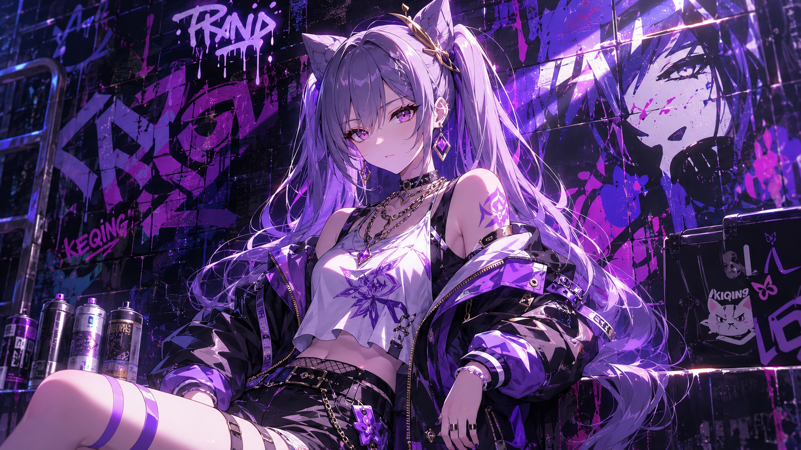
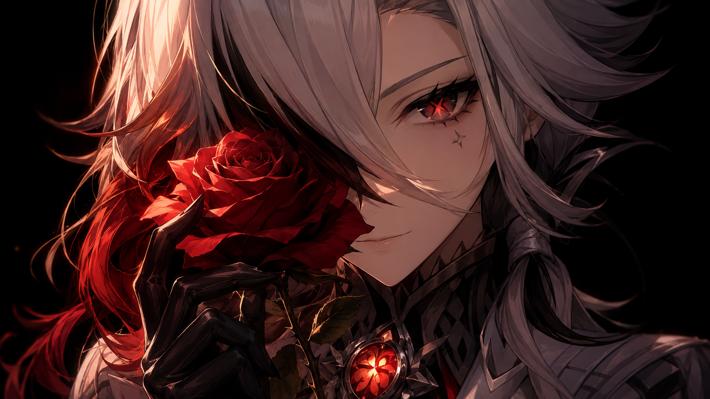
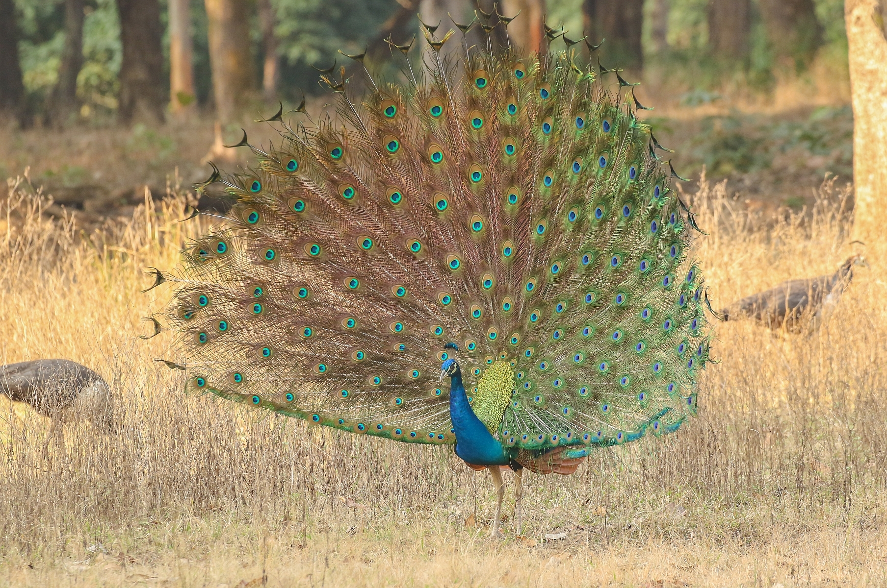

# 爻光 Yao Guang — 2026.11.11
> 视频类型：A · 角色单人壁纸合集
> 角色来源：崩坏：星穹铁道 4.0 · 五星物理属性欢愉命途成女，帝弓七天将之一，封号「戎韬将军」，驻守巡猎星舰「玉阙」
> 身份：仙舟联盟帝弓七天将·戎韬将军，遍智格物院荣誉院长、十方光映法界之主、仙舟非物质文化遗产雀形拳传人，在仙舟民众中被尊为「爻老板」，被视为带来吉兆的财神；以巡猎之「眼」遍观吉凶，明知天意难违仍孤身涉险
> 设计参考：白发孔雀意象——银白长发内层蓝黑挑染、头侧孔雀羽饰、白青孔雀纹开叉裙装、左手白拂尘、银色踝链高跟；官方立绘金色光辉+孔雀羽扇开屏式背景
> 热点背景：崩铁 4.7「此刻，将群星付之一笑」今日（2026-11-11）正式上线——欢愉版本终章，首位可玩星神阿哈全程 UP，上半卡池爻光+火花+银狼Lv999 三欢愉复刻同开；爻光终结技联动阿哈额外回合，欢愉体系核心之一，「爻老板」讨论度随版本上线再起； headline 新角色阿哈已有 2026-09-17 单人集，工作区零覆盖的最强女性候选为爻光
> 今日特殊：崩铁 4.7 版本上线日 + 双十一光棍节（「牌桌上上签」财神梗天然契合求签许愿场景）
> 选定类型理由：版本上线日重大官方热点 → 类型 A 深度呈现
> 选定角色理由：性别系数 1.0（白发成女）；官方热点权重高（4.7 上线当日、上半复刻池在池、欢愉终章叙事核心之一）；社区热度持续（4.7 上半卡池三欢愉同开、爻光战技/终结技攻略讨论密集、「爻老板」外号贯穿 PV 与社区）；素材覆盖 0%（工作区首次覆盖；同池阿哈/火花/银狼均已做过）；形象辨识度强（银白长发+孔雀羽饰+开叉孔雀裙+白拂尘，白青金三色体系）；气质反差张力强（遍观吉凶的戎韬将军 × 牌桌上的财神爻老板 × 「摇一摇」全民鬼畜）
> 参考图说明：已下载 B站WIKI 官方图两张并经 read_file 目视校对——splash-art.png（2048×2048 官方立绘：银白长发内层蓝黑、淡蓝紫瞳、左侧孔雀羽饰、白色束身上衣银胸饰、青白孔雀纹开叉裙+蓝羽瓣裙摆、右臂白色垂袖、右腕银镯、左手白拂尘银链环、银色绑带高跟踝链、金色光柱+孔雀羽扇背景）与 intro-card.jpg（2560×1440 官方 INTRO 档案卡，实为 JPEG 数据已改正扩展名：五星图标+欢愉命途徽记+「爻光」书法字+青绿水墨孔雀羽背景），外观锚点均以目视校对为准
> 伴生元素说明：无伴生生物/召唤物。标志性随身物为左手白拂尘（官方立绘中左手持握，已目视确认，可直接描述外观：白色马尾毫束+银链银环握柄）；孔雀羽为意象/元素显化物而非具象伙伴（prompts 中仅作羽饰与羽扇特效使用）；舰载设备「瞰云镜」无独立参考图，场景中仅作弱化处理（古铜色观星仪具，不展开细节）
> 跨领域参考图说明：沿用 2026-11-10 验证的 iNaturalist 开放数据 API 通道（CC 授权），获取蓝孔雀开屏实拍 ref-peacock-display.jpg（1808×1200，正对镜头尾屏全开、羽眼清晰、金黄草地衬底），经 read_file 目视校对

---

# 必需

## 1 — 涂鸦墙街头风（Graffiti Wall Street Style · 女版公式）

Positive Prompt:
Refer to the attached reference image (Figure 1) for composition, graffiti-wall style, and overall atmosphere only. Generate a similar style image of Yao Guang from Honkai: Star Rail sitting casually in front of a bold graffiti wall. Yao Guang is seated in a relaxed but confident posture, leaning back against the graffiti wall with one knee raised, her other leg extended straight along the ground with the foot flat on the floor, both legs clearly separated with a visible gap and never crossing or overlapping, one hand resting loosely on her raised knee with fingers naturally draped and clearly separated, her body language calm, controlled, and slightly provocative. Her expression should show cold, disdainful eyes, aloof, sharp, and superior, as if she is silently judging the viewer — the General of Strategy and Tactics who has seen every gambler's fate on the table, and finds yours predictable.

Keep Yao Guang's recognizable features: tall elegant adult feminine figure with fair skin, long wavy silvery-white hair with dark blue-black inner layers falling past her waist, pale blue-violet eyes, a teal-blue peacock feather cluster ornament on the left side of her head with an iridescent feather eye, and small teardrop blue earrings. Blend her canonical design with a modern edgy streetwear aesthetic: a fitted white tube crop top under an open cropped teal-blue bomber jacket with gold peacock-feather embroidery, black high-waist denim shorts with a thin gold-chain belt, sheer white thigh-high stockings, chunky black platform boots with silver buckles, a slim gold necklace with a tiny peacock-feather pendant, and a silver cuff bracelet on her right wrist. Preserve her identity while giving her a fresh urban street-style look.

The graffiti wall behind her should be vivid and layered, full of expressive abstract shapes and energetic street-art textures in teal, white, and gold tones, with graffiti elements including "YAO GUANG" in sharp hand-painted lettering styled like ink-brush strokes, iridescent peacock feather eyes, golden fortune-slip tags reading lucky numbers, doodled playing-card suits, and a spray-painted white whisk silhouette, creating a rebellious urban backdrop that resonates with her character theme. Add subtle golden light flares and drifting teal peacock-feather sparks around her to reinforce her identity.

Use a wide cinematic framing suitable for a 16:9 2K wallpaper, with Yao Guang as the main focal point while still showing enough of the graffiti wall and surrounding environment for atmosphere. The mood should feel cool, stylish, intimidating, and mysterious. Highly detailed background, rich shadows, teal and gold glowing highlights, sharp focus on Yao Guang, and a refined high-end anime illustration look.

perfect hands, five fingers on each hand, anatomically correct hands, well-defined fingers, natural relaxed hand pose, the resting hand's fingers naturally draped with clear gaps.

Negative Prompt:
low quality, worst quality, blurry, pixelated, bad anatomy, extra limbs, wrong hair color, wrong eye color, incorrect character, text, watermark, logo, signature, chibi, photorealistic, 3D render, bad hands, extra fingers, fewer fingers, missing fingers, fused fingers, webbed fingers, overlapping fingers, deformed fingers, six fingers, bad hand anatomy, asymmetrical hands, broken fingers, claw hands, blurry hands, missing legs, missing feet, cropped legs, twisted legs, rotated hips, extra legs, fused legs, malformed knees, knees bending in opposite directions, unnatural sitting pose, disproportionate limbs, elongated calves, deformed feet, standing, standing pose, upright posture, singing, open mouth singing, warm smile, gentle smile, cheerful expression, cute expression, adorable, sweet, innocent, game canonical outfit, official costume, fantasy dress, medieval clothing, armor, full gown, formal dress, beach background, ocean background, nature background, indoor background, plain background, minimal background, missing graffiti wall, low detail graffiti, generic graffiti, wrong graffiti colors, wrong streetwear, missing crop top, missing jacket, missing shorts, missing skirt, long dress, full pants, business suit, school uniform, both knees raised, legs folded underneath, kneeling pose

## 2 — 万事如意（角色特写肖像 / Close-up Portrait · 16:9）

Positive Prompt:
Refer to the attached reference image (Figure 2). Generate a cinematic close-up portrait of Yao Guang from Honkai: Star Rail. She holds a slender golden fortune slip with a small iridescent peacock-feather eye painted at its top close to the left side of her face, the slip's narrow edge rising to eye height, partially obscuring her left eye. Her visible right eye gazes directly at the viewer — the warm amber glint of a bestower of blessings holding something back. Expression: a gentle fortune-teller's smile that never fully reaches her eyes, simultaneously inviting and guarded, the look of a general who happily reads good fortune for everyone while quietly never drawing a slip of her own; a faint tenderness at the corner of her mouth, as if she already knows how this particular wish ends. Dramatic single-source lighting from the upper right casts deep chiaroscuro across her features, the golden slip glowing warm amber where the light passes through its edge, with a subtle teal secondary glow tracing the painted feather eye. Her fair skin contrasts sharply against a pure black background. Her long silvery-white hair with dark blue-black inner layers falls loose over her shoulders, a few strands catching gold light; her teal peacock-feather head ornament is softly visible at the upper left of her hair; her white-and-teal collar with a silver filigree chest ornament is only barely visible at the bottom edge. The general who reads good fortune for everyone, never daring to draw a slip for herself. 16:9 2K wallpaper.

perfect hands, five fingers on each hand, anatomically correct hands, well-defined fingers, natural hand pose, the fingers holding the slip clearly separated with visible gaps.

Negative Prompt:
low quality, worst quality, blurry, pixelated, bad anatomy, extra limbs, wrong hair color, wrong eye color, incorrect character, text, watermark, logo, signature, chibi, photorealistic, 3D render, bad hands, extra fingers, fewer fingers, missing fingers, fused fingers, webbed fingers, overlapping fingers, deformed fingers, six fingers, bad hand anatomy, asymmetrical hands, broken fingers, claw hands, blurry hands, missing legs, missing feet, cropped legs, twisted legs, rotated hips, extra legs, fused legs, malformed knees, knees bending in opposite directions, unnatural sitting pose, disproportionate limbs, elongated calves, deformed feet, full body shot, wide shot, landscape, multiple subjects, busy background, bright cheerful lighting, outdoor scene, action pose, weapon drawn

## 2b — 特写肖像·手机竖屏版（9:20 · 胸部及以上取景）

Positive Prompt:
Refer to the attached reference image (Figure 2). Generate a cinematic close-up portrait of Yao Guang from Honkai: Star Rail, framed as a vertical chest-up composition. She holds a slender golden fortune slip with a small iridescent peacock-feather eye painted at its top close to the left side of her face, the slip's narrow edge rising to eye height, partially obscuring her left eye. Her visible right eye gazes directly at the viewer — the warm amber glint of a bestower of blessings holding something back. Expression: a gentle fortune-teller's smile that never fully reaches her eyes, simultaneously inviting and guarded, the look of a general who happily reads good fortune for everyone while quietly never drawing a slip of her own; a faint tenderness at the corner of her mouth, as if she already knows how this particular wish ends. Dramatic single-source lighting from the upper right casts deep chiaroscuro across her features, the golden slip glowing warm amber where the light passes through its edge, with a subtle teal secondary glow tracing the painted feather eye. Her fair skin contrasts sharply against a pure black background. Her long silvery-white hair with dark blue-black inner layers falls loose over her shoulders, a few strands catching gold light; her teal peacock-feather head ornament is softly visible at the upper left of her hair; her white-and-teal collar with a silver filigree chest ornament is only barely visible at the bottom edge. The general who reads good fortune for everyone, never daring to draw a slip for herself. Face and upper chest as the focal point, no lower body visible. 9:20 vertical mobile wallpaper.

perfect hands, five fingers on each hand, anatomically correct hands, well-defined fingers, natural hand pose, the fingers holding the slip clearly separated with visible gaps.

Negative Prompt:
low quality, worst quality, blurry, pixelated, bad anatomy, extra limbs, wrong hair color, wrong eye color, incorrect character, text, watermark, logo, signature, chibi, photorealistic, 3D render, bad hands, extra fingers, fewer fingers, missing fingers, fused fingers, webbed fingers, overlapping fingers, deformed fingers, six fingers, bad hand anatomy, asymmetrical hands, broken fingers, claw hands, blurry hands, missing legs, missing feet, cropped legs, twisted legs, rotated hips, extra legs, fused legs, malformed knees, knees bending in opposite directions, unnatural sitting pose, disproportionate limbs, elongated calves, deformed feet, full body shot, wide shot, landscape, multiple subjects, busy background, bright cheerful lighting, outdoor scene, action pose, weapon drawn, lower body, legs, feet

# 人物设定

## 3 — 玉阙夜观·以巡猎之眼遍观吉凶（身份/背景经典场景）

Positive Prompt:
16:9 2K wallpaper, Yao Guang from Honkai: Star Rail, highly detailed anime-style illustration. On the open observation deck of the Xianzhou starship Yuque at night, Yao Guang stands before a weakened, softly out-of-focus antique brass armillary viewing instrument, one hand resting lightly on the railing. Beyond the deck railing stretches a vast field of drifting stars and slow-moving nebula clouds in deep teal and violet. Yao Guang is a tall elegant adult woman with long wavy silvery-white hair with dark blue-black inner layers falling past her waist, pale blue-violet eyes, a teal-blue peacock feather cluster ornament on the left side of her head, and teardrop blue earrings. She wears her canonical outfit: a white fitted sleeveless bodice with a silver filigree chest ornament, a teal-and-white skirt with peacock-feather motifs and a high front slit, layered blue petal-shaped hem panels like folded feather fans, a detached white drape-sleeve flowing from her right shoulder, a silver cuff bracelet on her right wrist, and silver strappy high heels with delicate ankle chains. In her left hand she loosely holds a white horsetail whisk with a silver-ringed handle. Her expression is calm and far-seeing, chin slightly lifted, eyes reflecting the star field as if weighing fates written in the sky. A few loose peacock feathers drift in the low-gravity air around her, catching pale starlight.

She stands with weight on one leg, natural stance, back straight, both arms in relaxed natural positions, fingers softly curled.

perfect hands, five fingers on each hand, anatomically correct hands, well-defined fingers, natural hand pose, correct hip-to-thigh-to-knee anatomy, natural leg proportions.

Soft moonlight as the key light with cool teal ambient tones, warm gold accents from distant nebula glow, rich but restrained color palette of white, teal, and gold, sharp focus on Yao Guang, refined high-end anime illustration look.

Negative Prompt:
low quality, worst quality, blurry, pixelated, bad anatomy, extra limbs, wrong hair color, wrong eye color, incorrect character, text, watermark, logo, signature, chibi, photorealistic, 3D render, bad hands, extra fingers, fewer fingers, missing fingers, fused fingers, webbed fingers, overlapping fingers, deformed fingers, six fingers, bad hand anatomy, asymmetrical hands, broken fingers, claw hands, blurry hands, missing legs, missing feet, cropped legs, twisted legs, rotated hips, extra legs, fused legs, malformed knees, knees bending in opposite directions, unnatural sitting pose, disproportionate limbs, elongated calves, deformed feet

## 4 — 孔雀开屏·雀形拳（战斗场景）

Positive Prompt:
16:9 2K wallpaper, Yao Guang from Honkai: Star Rail, highly detailed anime-style illustration, dynamic battle scene. In a wide stone plaza of the Xianzhou flagship Yuque, Yao Guang executes the legendary Sparrow-Form Fist: her right arm sweeps upward in a wide arc, and behind her a colossal fan of golden light unfolds like a peacock displaying its tail, dozens of luminous feather blades radiating outward, each tipped with an iridescent peacock-feather eye, shockwaves of teal-gold energy scattering loose feathers across the frame. Yao Guang is a tall elegant adult woman with long wavy silvery-white hair with dark blue-black inner layers sweeping with her motion, pale blue-violet eyes sharp with focus, a teal-blue peacock feather cluster ornament on the left side of her head, and teardrop blue earrings. She wears her canonical outfit: a white fitted sleeveless bodice with a silver filigree chest ornament, a teal-and-white skirt with peacock-feather motifs and a high front slit, layered blue petal-shaped hem panels flaring with her spin, a detached white drape-sleeve trailing from her right shoulder, a silver cuff bracelet on her raised right wrist, and silver strappy high heels with ankle chains. Her left hand grips the white horsetail whisk low at her side, the white strands whipping with momentum. Her expression is confident and slightly amused, the smile of a general who has already read the outcome before the strike lands, one eyebrow faintly raised.

Her raised right hand is open with all five fingers clearly visible and slightly spread with clear gaps; her left hand's fingers curl naturally around the whisk handle with clear gaps.

perfect hands, five fingers on each hand, anatomically correct hands, well-defined fingers, natural hand pose, correct hip-to-thigh-to-knee anatomy, natural leg proportions, both legs in natural parallel alignment at the base of the stance.

Warm golden backlight from the feather fan as the dominant light source, teal rim light tracing her silhouette, white feathers and gold particles mid-air, sharp focus on Yao Guang, cinematic composition, refined high-end anime illustration look.

Negative Prompt:
low quality, worst quality, blurry, pixelated, bad anatomy, extra limbs, wrong hair color, wrong eye color, incorrect character, text, watermark, logo, signature, chibi, photorealistic, 3D render, bad hands, extra fingers, fewer fingers, missing fingers, fused fingers, webbed fingers, overlapping fingers, deformed fingers, six fingers, bad hand anatomy, asymmetrical hands, broken fingers, claw hands, blurry hands, missing legs, missing feet, cropped legs, twisted legs, rotated hips, extra legs, fused legs, malformed knees, knees bending in opposite directions, unnatural sitting pose, disproportionate limbs, elongated calves, deformed feet

## 5 — 牌桌财神（情感/日常反差场景）

Positive Prompt:
16:9 2K wallpaper, Yao Guang from Honkai: Star Rail, highly detailed anime-style illustration, warm slice-of-life scene. Inside a cozy Xianzhou teahouse with warm wooden screens and a low round table, Yao Guang — the fearsome General of Strategy and Tactics — sits at the table playing a casual card game, and for once she is not remotely composed: she leans slightly forward with a sly, delighted grin, one eye narrowed in triumph, having just drawn the winning card. Yao Guang is a tall elegant adult woman with long wavy silvery-white hair with dark blue-black inner layers, pale blue-violet eyes curved with mischief, a teal-blue peacock feather cluster ornament on the left side of her head, and teardrop blue earrings. She wears her canonical outfit: a white fitted sleeveless bodice with a silver filigree chest ornament, a teal-and-white skirt with peacock-feather motifs and a high front slit, layered blue petal-shaped hem panels, a detached white drape-sleeve on her right shoulder, a silver cuff bracelet, and silver strappy high heels with ankle chains; her white horsetail whisk leans against the table edge within reach. She is seated upright with knees together and feet flat on the ground, holding a loose hand of playing cards close to her chest with her fingers curled naturally around the card edges, clearly separated, never splayed. On the table: a small porcelain teapot, two cups, and one face-up golden fortune slip that reads as a jackpot omen — a tiny painted peacock-feather eye glowing softly. Warm amber lantern light fills the room, soft shadows, homey and mischievous mood.

perfect hands, five fingers on each hand, anatomically correct hands, well-defined fingers, natural hand pose, the fingers holding the cards clearly separated with visible gaps, correct hip-to-thigh-to-knee anatomy, natural leg proportions, both legs in natural parallel alignment, natural seated posture.

Negative Prompt:
low quality, worst quality, blurry, pixelated, bad anatomy, extra limbs, wrong hair color, wrong eye color, incorrect character, text, watermark, logo, signature, chibi, photorealistic, 3D render, bad hands, extra fingers, fewer fingers, missing fingers, fused fingers, webbed fingers, overlapping fingers, deformed fingers, six fingers, bad hand anatomy, asymmetrical hands, broken fingers, claw hands, blurry hands, missing legs, missing feet, cropped legs, twisted legs, rotated hips, extra legs, fused legs, malformed knees, knees bending in opposite directions, unnatural sitting pose, disproportionate limbs, elongated calves, deformed feet, one leg crossed over the other, legs crossed

## 6 — 光棍节上上签（热点特别版 · 双十一求签 · 9:20 竖版）

Positive Prompt:
9:20 vertical mobile wallpaper, Yao Guang from Honkai: Star Rail, highly detailed anime-style illustration, festive scene. A festive golden-lantern fortune-drawing stand on a Xianzhou street at dusk, strings of small gold lanterns hanging overhead in a neat row. Yao Guang stands facing the viewer, leaning slightly forward with a playful wink and a bright confident smile, holding out toward the camera a single golden fortune slip bearing a small painted iridescent peacock-feather eye — the coveted best-luck slip, offered to the viewer like a blessing for the year's loneliest night. Yao Guang is a tall elegant adult woman with long wavy silvery-white hair with dark blue-black inner layers falling past her waist, pale blue-violet eyes, a teal-blue peacock feather cluster ornament on the left side of her head, and teardrop blue earrings. She wears her canonical outfit: a white fitted sleeveless bodice with a silver filigree chest ornament, a teal-and-white skirt with peacock-feather motifs and a high front slit, layered blue petal-shaped hem panels, a detached white drape-sleeve flowing from her right shoulder, a silver cuff bracelet on her right wrist, and silver strappy high heels with ankle chains; her white horsetail whisk hangs at her left hip. Her outstretched hand presents the slip at chest height with the fingers naturally curled around its lower edge, clearly separated; her other hand rests relaxed at her side.

perfect hands, five fingers on each hand, anatomically correct hands, well-defined fingers, natural hand pose, the fingers holding the slip clearly separated with visible gaps, correct hip-to-thigh-to-knee anatomy, natural leg proportions.

Warm golden lantern glow as the single dominant light source with soft teal ambient evening tonality, gentle bokeh-free background kept simple: the lantern row, the fortune-drawing stand with slips in small wooden boxes, and a soft gradient dusk sky, no other background elements, sharp focus on Yao Guang and the slip, refined high-end anime illustration look.

Negative Prompt:
low quality, worst quality, blurry, pixelated, bad anatomy, extra limbs, wrong hair color, wrong eye color, incorrect character, text, watermark, logo, signature, chibi, photorealistic, 3D render, bad hands, extra fingers, fewer fingers, missing fingers, fused fingers, webbed fingers, overlapping fingers, deformed fingers, six fingers, bad hand anatomy, asymmetrical hands, broken fingers, claw hands, blurry hands, missing legs, missing feet, cropped legs, twisted legs, rotated hips, extra legs, fused legs, malformed knees, knees bending in opposite directions, unnatural sitting pose, disproportionate limbs, elongated calves, deformed feet, crowded street, pedestrians, complicated background, over-detailed background, stacked background elements, floating lights, light rays, lens flare, bokeh lights

# 动漫性感风 — 2D 日漫简约背景系列（白青孔雀泳装 · 四比例）

## 7 — 手机壁纸（9:20 竖版）

Positive Prompt:
9:20 vertical mobile wallpaper, 2D Japanese anime style, flat cel shading, clean thin lineart, soft anime coloring, Japanese anime aesthetic. Yao Guang from Honkai: Star Rail as a tall elegant adult woman with long wavy silvery-white hair with dark blue-black inner layers, pale blue-violet eyes, her teal-blue peacock feather cluster ornament on the left side of her head, and teardrop blue earrings. Swimwear outfit: a white halter one-piece swimsuit with teal trim, a sheer teal sarong wrap loosely knotted at her waist, a thin gold anklet on her right ankle, and a silver cuff bracelet on her right wrist. She stands centered in a full-body composition, weight on one hip in a natural stance, hands relaxed at her sides with fingers softly curled, chin slightly lifted with a calm, faintly amused smile, gazing at the viewer. Simple anime scenery background, clean minimal scene composition, Ghibli-inspired soft background, flat background with simple shapes and soft colors: a flat teal-to-white gradient sky, two small soft white clouds, and a single calm horizontal waterline with a pale gold reflection. Background limited to three simple elements: the gradient sky, the two clouds, and the waterline. Clean simple background, minimalist uncluttered composition, no other background elements. The low golden sun is the single and only light source, environment color appears only as ambient tonality, no additional light sources; soft even lighting, gentle rim light in teal.

tasteful and elegant throughout, no explicit content. perfect hands, five fingers on each hand, anatomically correct hands, well-defined fingers, natural hand pose, correct hip-to-thigh-to-knee anatomy, natural leg proportions.

Negative Prompt:
low quality, worst quality, blurry, pixelated, bad anatomy, extra limbs, wrong hair color, wrong eye color, incorrect character, text, watermark, logo, signature, bad hands, extra fingers, fewer fingers, missing fingers, fused fingers, webbed fingers, overlapping fingers, deformed fingers, six fingers, bad hand anatomy, asymmetrical hands, broken fingers, claw hands, blurry hands, missing legs, missing feet, cropped legs, twisted legs, rotated hips, extra legs, fused legs, malformed knees, knees bending in opposite directions, unnatural sitting pose, disproportionate limbs, elongated calves, deformed feet, 3D render, semi-realistic, realistic, painterly, thick oil paint, game 3D model, complex background, cluttered background, multiple overlapping scenes, busy props, heavy details, photorealistic background, weapon combat, fighting, blood, gore, palm trees, parasols, deck chairs, resort furniture, boats, buildings, beach crowds, mountains, multiple light sources, additional lights, glowing particles, floating lights, light rays, lens flare, bokeh lights, complicated background, over-detailed background, stacked background elements

## 8 — 电脑壁纸（16:9 横版）

Positive Prompt:
16:9 desktop wallpaper, 2D Japanese anime style, flat cel shading, clean thin lineart, soft anime coloring, Japanese anime aesthetic. Yao Guang from Honkai: Star Rail as a tall elegant adult woman with long wavy silvery-white hair with dark blue-black inner layers, pale blue-violet eyes, her teal-blue peacock feather cluster ornament on the left side of her head, and teardrop blue earrings. Swimwear outfit: a white halter one-piece swimsuit with teal trim, a sheer teal sarong wrap loosely knotted at her waist, a thin gold anklet on her right ankle, and a silver cuff bracelet on her right wrist. She stands on the right third of the frame with generous negative space to the left for breathing room, weight on one hip in a natural stance, one hand relaxed at her side and the other lightly brushing a loose strand of hair back from her face, fingers softly curled with clear gaps, calm confident smile with a soft sideways glance. Simple anime scenery background, clean minimal scene composition, Ghibli-inspired soft background, flat background with simple shapes and soft colors: a flat teal-to-white gradient sky, two small soft white clouds, and a single calm horizontal waterline with a pale gold reflection. Background limited to three simple elements: the gradient sky, the two clouds, and the waterline. Clean simple background, minimalist uncluttered composition, no other background elements. The low golden sun is the single and only light source, environment color appears only as ambient tonality, no additional light sources; soft even lighting, gentle rim light in teal.

tasteful and elegant throughout, no explicit content. perfect hands, five fingers on each hand, anatomically correct hands, well-defined fingers, natural hand pose, correct hip-to-thigh-to-knee anatomy, natural leg proportions.

Negative Prompt:
low quality, worst quality, blurry, pixelated, bad anatomy, extra limbs, wrong hair color, wrong eye color, incorrect character, text, watermark, logo, signature, bad hands, extra fingers, fewer fingers, missing fingers, fused fingers, webbed fingers, overlapping fingers, deformed fingers, six fingers, bad hand anatomy, asymmetrical hands, broken fingers, claw hands, blurry hands, missing legs, missing feet, cropped legs, twisted legs, rotated hips, extra legs, fused legs, malformed knees, knees bending in opposite directions, unnatural sitting pose, disproportionate limbs, elongated calves, deformed feet, 3D render, semi-realistic, realistic, painterly, thick oil paint, game 3D model, complex background, cluttered background, multiple overlapping scenes, busy props, heavy details, photorealistic background, weapon combat, fighting, blood, gore, palm trees, parasols, deck chairs, resort furniture, boats, buildings, beach crowds, mountains, multiple light sources, additional lights, glowing particles, floating lights, light rays, lens flare, bokeh lights, complicated background, over-detailed background, stacked background elements

## 9 — iPad 壁纸（4:3 横版）

Positive Prompt:
4:3 tablet wallpaper, 2D Japanese anime style, flat cel shading, clean thin lineart, soft anime coloring, Japanese anime aesthetic. Yao Guang from Honkai: Star Rail as a tall elegant adult woman with long wavy silvery-white hair with dark blue-black inner layers, pale blue-violet eyes, her teal-blue peacock feather cluster ornament on the left side of her head, and teardrop blue earrings. Swimwear outfit: a white halter one-piece swimsuit with teal trim, a sheer teal sarong wrap loosely knotted at her waist, a thin gold anklet on her right ankle, and a silver cuff bracelet on her right wrist. Centered half-body composition: she faces the viewer with a gentle closed-lip smile and slightly lowered lashes, head tilted a touch to one side, both hands loosely clasped in front of her waist with fingers softly curled and clearly separated. Simple anime scenery background, clean minimal scene composition, Ghibli-inspired soft background, flat background with simple shapes and soft colors: a flat teal-to-white gradient sky, two small soft white clouds, and a single calm horizontal waterline with a pale gold reflection. Background limited to three simple elements: the gradient sky, the two clouds, and the waterline. Clean simple background, minimalist uncluttered composition, no other background elements. The low golden sun is the single and only light source, environment color appears only as ambient tonality, no additional light sources; soft even lighting, gentle rim light in teal.

tasteful and elegant throughout, no explicit content. perfect hands, five fingers on each hand, anatomically correct hands, well-defined fingers, natural hand pose.

Negative Prompt:
low quality, worst quality, blurry, pixelated, bad anatomy, extra limbs, wrong hair color, wrong eye color, incorrect character, text, watermark, logo, signature, bad hands, extra fingers, fewer fingers, missing fingers, fused fingers, webbed fingers, overlapping fingers, deformed fingers, six fingers, bad hand anatomy, asymmetrical hands, broken fingers, claw hands, blurry hands, missing legs, missing feet, cropped legs, twisted legs, rotated hips, extra legs, fused legs, malformed knees, knees bending in opposite directions, unnatural sitting pose, disproportionate limbs, elongated calves, deformed feet, 3D render, semi-realistic, realistic, painterly, thick oil paint, game 3D model, complex background, cluttered background, multiple overlapping scenes, busy props, heavy details, photorealistic background, weapon combat, fighting, blood, gore, palm trees, parasols, deck chairs, resort furniture, boats, buildings, beach crowds, mountains, multiple light sources, additional lights, glowing particles, floating lights, light rays, lens flare, bokeh lights, complicated background, over-detailed background, stacked background elements

## 10 — 阔折叠手机壁纸（√2:1 展开态）

Positive Prompt:
√2:1 (1.414:1) foldable phone unfolded wallpaper, 2D Japanese anime style, flat cel shading, clean thin lineart, soft anime coloring, Japanese anime aesthetic. Yao Guang from Honkai: Star Rail as a tall elegant adult woman with long wavy silvery-white hair with dark blue-black inner layers, pale blue-violet eyes, her teal-blue peacock feather cluster ornament on the left side of her head, and teardrop blue earrings. Swimwear outfit: a white halter one-piece swimsuit with teal trim, a sheer teal sarong wrap loosely knotted at her waist, a thin gold anklet on her right ankle, and a silver cuff bracelet on her right wrist. Horizontal minimalist composition: she stands at the left third of the frame in a relaxed natural stance with weight on one hip, hands relaxed at her sides with fingers softly curled, a soft gentle smile with eyes lightly closed, hair drifting in a mild sea breeze; the right two-thirds of the frame remain open negative space. Simple anime scenery background, clean minimal scene composition, Ghibli-inspired soft background, flat background with simple shapes and soft colors: a flat teal-to-white gradient sky, two small soft white clouds, and a single calm horizontal waterline with a pale gold reflection. Background limited to three simple elements: the gradient sky, the two clouds, and the waterline. Clean simple background, minimalist uncluttered composition, no other background elements. The low golden sun is the single and only light source, environment color appears only as ambient tonality, no additional light sources; soft even lighting, gentle rim light in teal.

tasteful and elegant throughout, no explicit content. perfect hands, five fingers on each hand, anatomically correct hands, well-defined fingers, natural hand pose, correct hip-to-thigh-to-knee anatomy, natural leg proportions.

Negative Prompt:
low quality, worst quality, blurry, pixelated, bad anatomy, extra limbs, wrong hair color, wrong eye color, incorrect character, text, watermark, logo, signature, bad hands, extra fingers, fewer fingers, missing fingers, fused fingers, webbed fingers, overlapping fingers, deformed fingers, six fingers, bad hand anatomy, asymmetrical hands, broken fingers, claw hands, blurry hands, missing legs, missing feet, cropped legs, twisted legs, rotated hips, extra legs, fused legs, malformed knees, knees bending in opposite directions, unnatural sitting pose, disproportionate limbs, elongated calves, deformed feet, 3D render, semi-realistic, realistic, painterly, thick oil paint, game 3D model, complex background, cluttered background, multiple overlapping scenes, busy props, heavy details, photorealistic background, weapon combat, fighting, blood, gore, palm trees, parasols, deck chairs, resort furniture, boats, buildings, beach crowds, mountains, multiple light sources, additional lights, glowing particles, floating lights, light rays, lens flare, bokeh lights, complicated background, over-detailed background, stacked background elements

# 跨领域参考图

## 11 — 十方光映法界·孔雀开屏（参考真实孔雀开屏摄影 · 意象融合）

Positive Prompt:
16:9 2K wallpaper, Yao Guang from Honkai: Star Rail, highly detailed anime-style illustration. Referring to the attached real photograph of a displaying Indian peafowl for the fan-arch composition, the iridescent feather-eye pattern, and the warm golden meadow color palette only, generate a fusion artwork: Yao Guang stands centered before a towering radiant arch of peacock tail feathers reimagined as her Emanator of Mirth light construct — a great circular fan of luminous feathers arcing over and around her, each feather eye glowing with real peacock iridescence in emerald, sapphire, and gold. Yao Guang herself keeps her canonical design fully clear and recognizable: tall elegant adult woman, long wavy silvery-white hair with dark blue-black inner layers, pale blue-violet eyes, teal-blue peacock feather cluster ornament on the left side of her head, teardrop blue earrings, white fitted sleeveless bodice with silver filigree chest ornament, teal-and-white peacock-motif skirt with high front slit and layered blue petal-shaped hem, detached white drape-sleeve on her right shoulder, silver cuff bracelet, silver strappy high heels with ankle chains, white horsetail whisk held loosely in her left hand at her side with fingers naturally curled. Her right arm is raised in a graceful open-palm gesture toward the sky with all five fingers clearly visible and slightly spread with clear gaps. Her expression is serene and triumphant, a faint knowing smile. She stands with weight on one leg, natural stance, correct hip-to-thigh-to-knee anatomy, natural leg proportions. The environment borrows the photograph's warm golden meadow ground and soft hazy treeline, rendered as a simplified painterly anime backdrop beneath the glowing feather arch. Loose glowing feathers drift around her.

perfect hands, five fingers on each hand, anatomically correct hands, well-defined fingers, natural hand pose.

Negative Prompt:
low quality, worst quality, blurry, pixelated, bad anatomy, extra limbs, wrong hair color, wrong eye color, incorrect character, text, watermark, logo, signature, chibi, photorealistic, 3D render, bad hands, extra fingers, fewer fingers, missing fingers, fused fingers, webbed fingers, overlapping fingers, deformed fingers, six fingers, bad hand anatomy, asymmetrical hands, broken fingers, claw hands, blurry hands, missing legs, missing feet, cropped legs, twisted legs, rotated hips, extra legs, fused legs, malformed knees, knees bending in opposite directions, unnatural sitting pose, disproportionate limbs, elongated calves, deformed feet, turning the character into a bird, bird wings on the character, beak, feathered face, extra characters, second figure

## 注
- 条目共 12 条（含 2b 竖版特写）：涂鸦墙 1 + 特写肖像成对 2 + 经典场景 1 + 战斗 1 + 日常反差 1 + 热点特别版（双十一求签）1 + 性感风四比例 4 + 跨领域融合 1
- 「瞰云镜」为玉阙舰载设备、无独立参考图，第 3 条中按规范弱化处理为古铜色观星仪具，不展开外观细节
- 崩铁 4.7 上线日（2026-11-11）产物；同卡池阿哈（2026-09-17）、火花、银狼均已有单人集或覆盖，爻光为本期零覆盖最优女性候选
