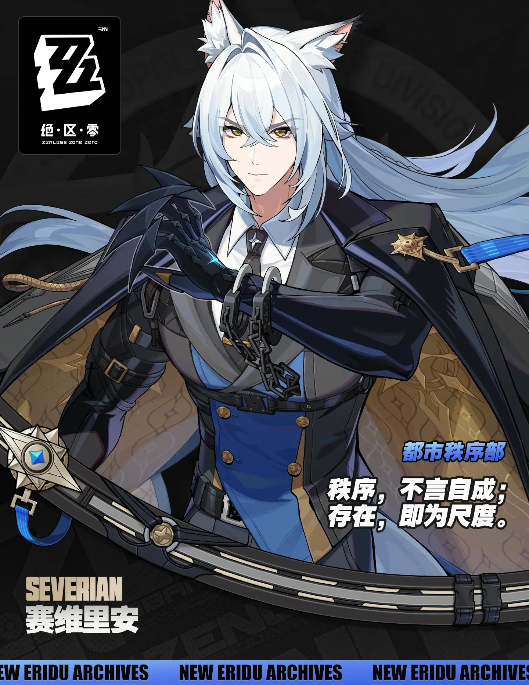

# 赛维里安·洛威尔 Severian Lowell — 2026.10.21
> 视频类型：A · 角色单人壁纸合集
> 角色来源：绝区零 3.3「重返天空的旅程」· S级风属性强攻代理人 · 治安局都市秩序部
> 身份：治安局秩序督察（全名：赛维里安·洛威尔 Severian Lowell），赛斯·洛威尔的哥哥，档案台词「治安局秩序督察，赛维里安·洛威尔。不必寒暄了，现在情况如何？」
> 设计参考：白狼 + 秩序执法者；银白黑蓝金配色、爪刃臂铠、手铐锁链、金色星徽
> 热点背景：3.3 版本今日（10/21）正式上线，主线第三季第四章「重返天空的旅程」同步解锁，赛维里安身负市长之命现身宁息屿、卷入罗斯凯利法局势；其专属卡池「答案在风中」将于下半（11/11）开启，专武音擎「禁罪囚笼」同步实装
> 选定类型理由：版本上线日为当期最强官方热点 → 类型 A 深度呈现
> 选定角色理由：①3.3 版本双新 S 级之一，今日随主线章节实装登场，官方热点权重满档；②**性别调整记录**：男性角色系数 0.5，判定触发 SKILL 例外条款 1——版本新角色中无未做过的同热度女性候选（菲欧妮 10-07 已出单人集、维琳娜 9-11 已出、联动双姝卡芙卡/知更鸟 10-14 已入 B 合集且 3.4 才落地），且角色素材已于 10-10 预备完毕 → 出单人集，记录在案供流量复盘；③工作区绝区零目录从未做过赛维里安；④社区梗素材密度极高（大魔/没见过他笑/带薪停职两天/番茄浇水/红字加粗三次），且其卡池 11-11 开启，本合集可同时吃到主线热度与未来卡池长尾
> 参考图校对：`severian-official.png`（B站WIKI 官方介绍图 1440×1865，已登记 2026-10-10，本期 10-21 再次目视复核）——银白长发过腰、发梢渐浅冰蓝、中分碎刘海；白色狼耳（耳内粉色、耳簇毛蓬松）；金琥珀瞳锐利；白衬衫黑领带（领带银色星形别针）；深蓝近黑双排扣长外套金扣、蓝色腰封区、黑色束腰带；右臂黑色爪刃臂铠（指尖锋利爪刃、爪心青蓝色发光纹路，右手全程被臂铠包裹）；左腕银色手铐锁链配饰（左手裸手）；披风暗金纹内衬；左肩金色星徽肩章+蓝色绶带缎带；官方介绍图下缘可见弧形环状巨刃轮廓（银黑配色金色圆盘锁扣——即专武「禁罪囚笼」形态，仅弱化引用）
> 跨领域参考图：弗里德里希《雾海上的旅者》因沙盒网络阻断（upload.wikimedia.org 超时，已尝试 UA 伪装仍失败）未下载本地文件，第 13 条按公有领域名画公开常识做概念引用（延续 9-11 维琳娜期先例）

---

# 必需

## 1 — 涂鸦墙街头风（封面级）

Positive Prompt:
Refer to the attached reference image (Figure 1) for composition, graffiti-wall style, and overall atmosphere only. Generate an image of Severian Lowell, a young man from Zenless Zone Zero, sitting casually in front of a bold graffiti wall. Severian is male — do not render him with feminine features or attire. Severian is seated in a relaxed but dominant posture, one knee raised with his right armored forearm resting on it, his other leg extended straight along the ground with his foot flat on the floor, both legs clearly separated with a visible gap and never crossing or overlapping, with his body language calm, controlled, and quietly provocative. His expression should show cold, disdainful eyes, aloof, sharp, and superior, as if he is silently judging the viewer.

Keep Severian's recognizable features: waist-length silver-white hair fading to pale ice-blue at the ends with middle-parted bangs, white wolf ears with pink inner fur and fluffy tufts, sharp golden-amber eyes, white shirt with a black tie fastened by a small silver star pin. He has a masculine youthful build with broad shoulders. Blend his canonical design with a modern edgy streetwear aesthetic: an oversized charcoal-black graphic tee under an open deep-navy bomber jacket with silver zippers, relaxed cargo pants in slate grey, black-and-white high-top sneakers, a thin silver chain necklace, and his signature silver handcuff-and-chain accessory worn loosely around his bare left wrist. His right arm keeps the black clawed gauntlet with glowing cyan lines, fingers of his bare left hand relaxed and natural — perfect hands, five fingers on his bare left hand, anatomically correct hands, well-defined fingers, natural hand pose, hands clearly visible and not hidden behind the knees or legs, the resting hand's fingers naturally draped and slightly spread with clear gaps.

The graffiti wall behind him should be vivid and layered, full of expressive abstract shapes and energetic street-art textures in deep blue, charcoal-black, silver and gold tones, with graffiti elements including his name "SEVERIAN" in bold wildstyle lettering, a white wolf head silhouette, shackle-chain and handcuff motifs, a star badge emblem, swirling wind-line tags, spray-paint drips and peeling wall texture, a spray can resting on the ground beside him, creating a rebellious urban backdrop that resonates with his wind attribute. Add subtle cyan-white wind energy streaks and faint glowing gauntlet lines around him to reinforce his identity.

Use a wide cinematic framing suitable for a 16:9 2K wallpaper, with Severian as the main focal point while still showing enough of the graffiti wall and surrounding environment for atmosphere. The mood should feel cool, stylish, intimidating, and mysterious. Highly detailed background, rich shadows, deep-blue glowing highlights, sharp focus on Severian, and a refined high-end anime illustration look.

Negative Prompt:
low quality, worst quality, blurry, pixelated, jpeg artifacts, bad anatomy, extra limbs, wrong hair color, wrong eye color, incorrect character, text, watermark, logo, signature, bad hands, extra fingers, fewer fingers, missing fingers, fused fingers, webbed fingers, merged fingers, overlapping fingers, deformed fingers, mutated fingers, six fingers, four fingers, three fingers, more than five fingers, less than five fingers, disfigured hands, poorly drawn hands, bad hand anatomy, asymmetrical hands, broken fingers, claw hands, blurry hands, indistinct fingers, smeared hands, missing legs, missing feet, missing calves, cropped legs, legs out of frame, twisted legs, rotated hips, dislocated hip, extra legs, third leg, fused legs, malformed knees, knees bending in opposite directions, both knees raised, legs folded underneath, kneeling pose, unnatural sitting pose, disproportionate limbs, elongated calves, deformed feet, standing, standing pose, upright posture, singing, open mouth singing, warm smile, gentle smile, cheerful expression, cute expression, adorable, sweet, innocent, game canonical outfit, official costume, fantasy dress, medieval clothing, armor, full gown, formal dress, beach background, ocean background, nature background, indoor background, plain background, minimal background, missing graffiti wall, low detail graffiti, generic graffiti, wrong graffiti colors, wrong streetwear, missing jacket, long dress, business suit, school uniform, feminine, androgynous, female body, curvy figure, skirt, crop top, tube top, fishnet, thigh strap, makeup, lipstick, slender feminine figure

# 人物设定

## 2 — 秩序与尺度（特写肖像·横版）

Positive Prompt:
Refer to the attached reference image (Figure 2). Generate a cinematic close-up portrait of Severian Lowell from Zenless Zone Zero. He holds an antique silver pocket watch close to the left side of his face, the open lid tilted so its chain drapes across his bare fingers — perfect hands, five fingers on each hand, anatomically correct hands, well-defined fingers — partially obscuring his left eye. His visible right eye gazes directly at the viewer — cold, judicial, and utterly composed, yet with a barely-there softening at its corner, the look of a man who schedules every minute of everyone else's day but has never once left the office on time. Expression: glacial authority layered over buried, carefully hidden weariness, a faint unreadable tension at the corner of his mouth that is neither a smile nor a frown. Dramatic single-source lighting from the upper left casts deep chiaroscuro across his features, the watch's silver lid glowing cool white where the light catches it, a thin line of cyan glint along the chain. His fair skin contrasts sharply against a pure black background. His waist-length silver-white hair with pale ice-blue ends spills over one shoulder; his white wolf ears with pink inner fur catch the rim light; his black tie and white shirt collar are only barely visible. A sliver of the black clawed gauntlet on his right arm rests at the bottom edge of the frame. The demon of the Public Order never smiles — and the watch he keeps has never once been obeyed. 16:9 2K wallpaper.

Negative Prompt:
low quality, worst quality, blurry, pixelated, jpeg artifacts, bad anatomy, extra limbs, wrong hair color, wrong eye color, incorrect character, text, watermark, logo, signature, bad hands, extra fingers, fewer fingers, missing fingers, fused fingers, webbed fingers, merged fingers, overlapping fingers, deformed fingers, mutated fingers, six fingers, four fingers, three fingers, more than five fingers, less than five fingers, disfigured hands, poorly drawn hands, bad hand anatomy, asymmetrical hands, broken fingers, claw hands, blurry hands, indistinct fingers, smeared hands, missing legs, missing feet, missing calves, cropped legs, legs out of frame, twisted legs, rotated hips, dislocated hip, extra legs, third leg, fused legs, malformed knees, knees bending in opposite directions, unnatural sitting pose, disproportionate limbs, elongated calves, deformed feet, full body shot, wide shot, landscape, multiple subjects, busy background, bright cheerful lighting, outdoor scene, action pose, weapon drawn, warm smile, cheerful expression

## 3 — 秩序与尺度（特写肖像·手机竖版）

Positive Prompt:
Refer to the attached reference image (Figure 2). Generate a cinematic close-up portrait of Severian Lowell from Zenless Zone Zero, framed as a chest-up vertical composition with his face as the focal point. He holds an antique silver pocket watch close to the left side of his face, the open lid tilted so its chain drapes across his bare fingers — perfect hands, five fingers on each hand, anatomically correct hands, well-defined fingers — partially obscuring his left eye. His visible right eye gazes directly at the viewer — cold, judicial, and utterly composed, yet with a barely-there softening at its corner, the look of a man who schedules every minute of everyone else's day but has never once left the office on time. Expression: glacial authority layered over buried, carefully hidden weariness, a faint unreadable tension at the corner of his mouth that is neither a smile nor a frown. Dramatic single-source lighting from the upper left casts deep chiaroscuro across his features, the watch's silver lid glowing cool white where the light catches it, a thin line of cyan glint along the chain. His fair skin contrasts sharply against a pure black background. His waist-length silver-white hair with pale ice-blue ends frames his face; his white wolf ears with pink inner fur catch the rim light; his black tie and white shirt collar are only barely visible at the bottom of the frame. The demon of the Public Order never smiles — and the watch he keeps has never once been obeyed. 9:20 vertical mobile wallpaper.

Negative Prompt:
low quality, worst quality, blurry, pixelated, jpeg artifacts, bad anatomy, extra limbs, wrong hair color, wrong eye color, incorrect character, text, watermark, logo, signature, bad hands, extra fingers, fewer fingers, missing fingers, fused fingers, webbed fingers, merged fingers, overlapping fingers, deformed fingers, mutated fingers, six fingers, four fingers, three fingers, more than five fingers, less than five fingers, disfigured hands, poorly drawn hands, bad hand anatomy, asymmetrical hands, broken fingers, claw hands, blurry hands, indistinct fingers, smeared hands, missing legs, missing feet, missing calves, cropped legs, legs out of frame, twisted legs, rotated hips, dislocated hip, extra legs, third leg, fused legs, malformed knees, knees bending in opposite directions, unnatural sitting pose, disproportionate limbs, elongated calves, deformed feet, full body shot, wide shot, lower body, legs, feet, landscape, multiple subjects, busy background, bright cheerful lighting, outdoor scene, action pose, weapon drawn, warm smile, cheerful expression

## 4 — 秩序督察（都市秩序部·夜间指挥室）

Positive Prompt:
16:9 2K wallpaper, Severian Lowell from Zenless Zone Zero, highly detailed anime-style illustration, polished game-art quality, cinematic composition, cold institutional atmosphere.

Depict Inspector Severian Lowell standing at the head of a long strategy table in the Public Order department's night briefing room, reviewing a spread of case files. He stands upright with correct hip-to-thigh-to-knee anatomy, natural leg proportions, natural standing posture, weight even on both feet. The fingers of his black clawed gauntlet on his right arm rest lightly and flatly on the table surface, the cyan lines along the claws glowing faintly, while his bare left hand holds a single case file at chest height — perfect hands, five fingers on his bare left hand, anatomically correct hands, well-defined fingers, natural hand pose. His expression is calm, exacting, and faintly stern, golden-amber eyes scanning the documents, the look of an inspector whose report cards make other departments write his name in bold red three times.

Keep his canonical design: waist-length silver-white hair fading to pale ice-blue at the ends, middle-parted bangs, white wolf ears with pink inner fur and fluffy tufts, sharp golden-amber eyes, white shirt with black tie and a silver star pin, dark navy double-breasted long coat with gold buttons and a blue waist panel, black belt, long black cape with ornate gold-patterned lining draped over his shoulders, gold star-shaped epaulette with a blue ribbon sash on his left shoulder, silver handcuff-and-chain accessory on his bare left wrist, right arm encased in the black clawed gauntlet with glowing cyan lines.

The room features a large window wall behind him revealing the night skyline of New Eridu with distant holographic billboards, a hanging projector casting a pale blue tactical map glow over the table, and a single desk lamp with warm light at the far end. Cool blue dominant lighting with a warm lamp accent, deep shadows, high contrast, disciplined navy-silver-gold color scheme, sharp focus on Severian.

Negative Prompt:
low quality, worst quality, blurry, pixelated, jpeg artifacts, bad anatomy, extra limbs, wrong hair color, wrong eye color, incorrect character, text, watermark, logo, signature, bad hands, extra fingers, fewer fingers, missing fingers, fused fingers, webbed fingers, merged fingers, overlapping fingers, deformed fingers, mutated fingers, six fingers, four fingers, three fingers, more than five fingers, less than five fingers, disfigured hands, poorly drawn hands, bad hand anatomy, asymmetrical hands, broken fingers, claw hands, blurry hands, indistinct fingers, smeared hands, missing legs, missing feet, missing calves, cropped legs, legs out of frame, twisted legs, rotated hips, dislocated hip, extra legs, third leg, fused legs, malformed knees, knees bending in opposite directions, unnatural sitting pose, disproportionate limbs, elongated calves, deformed feet, one leg crossed over the other, leg stretched out toward the viewer, sitting, smiling, laughing, warm cheerful atmosphere, daytime, multiple people, crowds

## 5 — 答案在风中（宁息屿·风压觉醒）

Positive Prompt:
16:9 2K wallpaper, Severian Lowell from Zenless Zone Zero, highly detailed anime-style illustration, polished game-art quality, dynamic action scene, dramatic cinematic lighting.

Depict the moment Inspector Severian Lowell unleashes his wind-powered assault above the rooftops of the sky isle of Ningxi Island. He is captured mid-leap in a forward lunging strike, his right arm — encased in the black clawed gauntlet with blazing cyan lines — swept across the frame, sharp blade-like claws trailing crescent arcs of cyan-white wind blades that shear through the air; his bare left arm trails behind his body for balance, bare left hand open and relaxed — perfect hands, five fingers on his bare left hand, anatomically correct hand, well-defined fingers. His waist-length silver-white hair with pale ice-blue ends whips violently in the wind pressure, his white wolf ears flattened back by the gale, his black cape with gold-patterned lining billowing like a banner. His expression is fierce and utterly focused, golden-amber eyes locked on an unseen target, jaw set, not a trace of a smile — the first and only wind-attribute assault specialist in New Eridu answering with his fists.

Keep his canonical design: white shirt with black tie and silver star pin, dark navy double-breasted long coat with gold buttons and blue waist panel, black belt, gold star-shaped epaulette with blue ribbon sash on his left shoulder, silver handcuff-and-chain accessory on his bare left wrist. Do not include his large curved shackle blade device in this shot.

The background shows the pale stone rooftops and wind-worn spires of the sky isle far below, swirling stratus clouds torn open by the wind strike, shafts of cool morning light breaking through. Cyan-white wind trails dominate the frame, cool silver-blue color scheme with gold accents, strong motion blur on the wind arcs but sharp focus on Severian, cinematic wide framing.

Negative Prompt:
low quality, worst quality, blurry, pixelated, jpeg artifacts, bad anatomy, extra limbs, wrong hair color, wrong eye color, incorrect character, text, watermark, logo, signature, bad hands, extra fingers, fewer fingers, missing fingers, fused fingers, webbed fingers, merged fingers, overlapping fingers, deformed fingers, mutated fingers, six fingers, four fingers, three fingers, more than five fingers, less than five fingers, disfigured hands, poorly drawn hands, bad hand anatomy, asymmetrical hands, broken fingers, claw hands, blurry hands, indistinct fingers, smeared hands, missing legs, missing feet, missing calves, cropped legs, legs out of frame, twisted legs, rotated hips, dislocated hip, extra legs, third leg, fused legs, malformed knees, knees bending in opposite directions, unnatural sitting pose, disproportionate limbs, elongated calves, deformed feet, smiling, laughing, calm standing pose, static pose, fire effects, lightning effects, multiple people, crowds, daytime beach

## 6 — 焦点剧场·同台共演（西装特别版）

Positive Prompt:
16:9 2K wallpaper, Severian Lowell from Zenless Zone Zero, highly detailed anime-style illustration, polished game-art quality, theatrical stage portrait, elegant modern formal styling.

Depict Inspector Severian Lowell in a flawlessly tailored modern black three-piece suit, standing under a single warm spotlight on the wooden stage of a grand theater — the stage-play special edition look. His suit fits his broad masculine shoulders perfectly: black suit jacket worn closed over a matching waistcoat, crisp white dress shirt, deep navy silk tie fastened with a small silver star pin, polished black leather shoes catching the spotlight, correct hip-to-thigh-to-knee anatomy, natural leg proportions, natural standing posture. His right hand rests in his trouser pocket with the black clawed gauntlet half-hidden but its cyan lines glowing softly against the fabric; his bare left hand holds a folded paper playbill at his side — perfect hands, five fingers on his bare left hand, anatomically correct hands, well-defined fingers, natural hand pose. His expression is composed and coolly professional, golden-amber eyes level with the camera, one white wolf ear tilted very slightly, as if the "actor" is patiently enduring yet another costume check.

Keep his canonical design: waist-length silver-white hair fading to pale ice-blue at the ends with middle-parted bangs, white wolf ears with pink inner fur and fluffy tufts, sharp golden-amber eyes, silver handcuff-and-chain accessory on his bare left wrist.

The stage behind him is dim and out of focus: heavy crimson curtains at the edges, a few soft warm footlight glows along the stage floor, faint dust motes drifting in the spotlight beam, no audience visible. Warm golden spotlight against deep shadow, elegant black-gold-navy palette, refined theatrical atmosphere, sharp focus on Severian.

Negative Prompt:
low quality, worst quality, blurry, pixelated, jpeg artifacts, bad anatomy, extra limbs, wrong hair color, wrong eye color, incorrect character, text, watermark, logo, signature, bad hands, extra fingers, fewer fingers, missing fingers, fused fingers, webbed fingers, merged fingers, overlapping fingers, deformed fingers, mutated fingers, six fingers, four fingers, three fingers, more than five fingers, less than five fingers, disfigured hands, poorly drawn hands, bad hand anatomy, asymmetrical hands, broken fingers, claw hands, blurry hands, indistinct fingers, smeared hands, missing legs, missing feet, missing calves, cropped legs, legs out of frame, twisted legs, rotated hips, dislocated hip, extra legs, third leg, fused legs, malformed knees, knees bending in opposite directions, unnatural sitting pose, disproportionate limbs, elongated calves, deformed feet, wrinkled suit, ill-fitting clothes, casual clothing, streetwear, singing, dancing, open mouth, warm smile, cheerful expression, audience, crowd, multiple people, daytime, outdoor

## 7 — 下班之后（番茄浇水·反差日常）

Positive Prompt:
16:9 2K wallpaper, Severian Lowell from Zenless Zone Zero, highly detailed anime-style illustration, polished game-art quality, warm slice-of-life scene, gentle comedic atmosphere.

Depict a rare off-duty moment: Inspector Severian Lowell, the feared "demon" of the Public Order department, secretly watering a potted tomato plant on a quiet rooftop garden after hours, caught in the act. He leans slightly forward, holding a small green watering can tilted over a wooden crate planter where a healthy tomato plant grows with green unripe tomatoes and a second leafy potted plant beside it. The watering can is held in his bare left hand, fingers wrapped naturally around the handle — perfect hands, five fingers on his bare left hand, anatomically correct hands, well-defined fingers, natural hand pose — while his right arm, encased in the black clawed gauntlet with glowing cyan lines, hangs relaxed at his side. His posture is correct hip-to-thigh-to-knee anatomy, natural leg proportions, natural standing posture. He glances back over his shoulder directly at the viewer with his golden-amber eyes, expression caught between stern composure and the faintest uncharacteristic softness, one white wolf ear perked and the other tilted, as if silently daring the viewer to report what they just saw.

Keep his canonical design: waist-length silver-white hair fading to pale ice-blue at the ends tied loosely low, middle-parted bangs, white wolf ears with pink inner fur and fluffy tufts, white shirt with sleeves rolled up to his elbows, black tie slightly loosened, silver star pin, dark navy suit trousers, silver handcuff-and-chain accessory on his bare left wrist, black clawed gauntlet on his right arm.

Background is simple and enumerated: a flat rooftop floor in warm dusk tones, the wooden crate planter with the tomato plant and one leafy potted plant, and a soft gradient dusk sky in peach and lavender with no other elements. Warm low sunset light from the side, gentle rim light outlining his silver hair, cozy muted palette with navy and green accents, sharp focus on Severian and the tomato plant.

Negative Prompt:
low quality, worst quality, blurry, pixelated, jpeg artifacts, bad anatomy, extra limbs, wrong hair color, wrong eye color, incorrect character, text, watermark, logo, signature, bad hands, extra fingers, fewer fingers, missing fingers, fused fingers, webbed fingers, merged fingers, overlapping fingers, deformed fingers, mutated fingers, six fingers, four fingers, three fingers, more than five fingers, less than five fingers, disfigured hands, poorly drawn hands, bad hand anatomy, asymmetrical hands, broken fingers, claw hands, blurry hands, indistinct fingers, smeared hands, missing legs, missing feet, missing calves, cropped legs, legs out of frame, twisted legs, rotated hips, dislocated hip, extra legs, third leg, fused legs, malformed knees, knees bending in opposite directions, unnatural sitting pose, disproportionate limbs, elongated calves, deformed feet, one leg crossed over the other, leg stretched out toward the viewer, palm trees, parasols, deck chairs, resort furniture, sea, mountains, buildings, fences, railings, garden tools clutter, multiple people, crowds, combat, weapons drawn, dark gritty atmosphere, night, rain

# 动漫性感风 — 2D 日漫简约背景系列

> 四条共用同一套人物与服装设定（便服·解领白衬衫版，卸下爪铠臂铠），仅调整姿势、构图与背景疏密；同一背景场景：淡银蓝渐变晴空 + 低位城市天际线剪影线。

## 8 — 晴空便装·手机竖版

Positive Prompt:
9:20 vertical mobile wallpaper, Severian Lowell from Zenless Zone Zero, 2D Japanese anime style, flat cel shading, clean thin lineart, soft anime coloring, Japanese anime aesthetic, tasteful and elegant throughout, no explicit content.

Depict Severian Lowell in casual civilian clothing, without his armor gauntlet: a loose white dress shirt unbuttoned at the collar with the top two buttons open and sleeves rolled up to his elbows, slim black trousers with a black leather belt, a thin silver chain bracelet on his bare left wrist, black loafers. Keep his recognizable features: waist-length silver-white hair fading to pale ice-blue at the ends with middle-parted bangs, white wolf ears with pink inner fur and fluffy tufts, sharp golden-amber eyes, silver handcuff-and-chain accessory on his bare left wrist. He stands in half-body composition centered in the frame, weight on one hip in a natural stance, his bare left hand raised loosely raking his bangs back from his forehead — perfect hands, five fingers on each hand, anatomically correct hands, well-defined fingers, natural hand pose — his right bare hand relaxed at his side. His expression is calm and faintly teasing, gaze directly at the viewer, a light breeze stirring his long hair and one wolf ear.

Simple anime scenery background: a pale silver-blue gradient sky with two soft white clouds and a single thin dark skyline silhouette line at the bottom, flat background with simple shapes and soft colors, clean minimal scene composition, Ghibli-inspired softness, background colors echoing his silver-blue theme. Soft even lighting, gentle rim light in pale blue, no complex structures, sharp focus on Severian.

Negative Prompt:
low quality, worst quality, blurry, pixelated, jpeg artifacts, bad anatomy, extra limbs, wrong hair color, wrong eye color, incorrect character, text, watermark, logo, signature, bad hands, extra fingers, fewer fingers, missing fingers, fused fingers, webbed fingers, merged fingers, overlapping fingers, deformed fingers, mutated fingers, six fingers, four fingers, three fingers, more than five fingers, less than five fingers, disfigured hands, poorly drawn hands, bad hand anatomy, asymmetrical hands, broken fingers, claw hands, blurry hands, indistinct fingers, smeared hands, missing legs, missing feet, missing calves, cropped legs, legs out of frame, twisted legs, rotated hips, dislocated hip, extra legs, third leg, fused legs, malformed knees, knees bending in opposite directions, unnatural sitting pose, disproportionate limbs, elongated calves, deformed feet, 3D render, semi-realistic, realistic, painterly, thick oil paint, game 3D model, complex background, cluttered background, multiple overlapping scenes, busy props, heavy details, photorealistic background, weapon combat, fighting, blood, gore, childlike, armor gauntlet, full body shot

## 9 — 晴空便装·电脑横版

Positive Prompt:
16:9 desktop wallpaper, Severian Lowell from Zenless Zone Zero, 2D Japanese anime style, flat cel shading, clean thin lineart, soft anime coloring, Japanese anime aesthetic, tasteful and elegant throughout, no explicit content.

Depict Severian Lowell in the same casual civilian outfit, without his armor gauntlet: loose white dress shirt unbuttoned at the collar with sleeves rolled to his elbows, slim black trousers, black leather belt, thin silver chain bracelet on his bare left wrist, black loafers. Keep his recognizable features: waist-length silver-white hair fading to pale ice-blue at the ends with middle-parted bangs, white wolf ears with pink inner fur and fluffy tufts, sharp golden-amber eyes, silver handcuff-and-chain accessory on his bare left wrist. He stands on the right third of the wide frame leaving open sky on the left for breathing room, weight on one hip in a natural stance, correct hip-to-thigh-to-knee anatomy, natural leg proportions, natural standing posture, both bare hands relaxed at his sides — perfect hands, five fingers on each hand, anatomically correct hands, well-defined fingers, natural hand pose. His expression is serene with a faint knowing look, eyes toward the viewer, his long hair and cape-less silhouette stirred by a soft breeze.

Simple anime scenery background: a pale silver-blue gradient sky with two soft white clouds and a single thin dark skyline silhouette line low in the frame, flat background with simple shapes and soft colors, clean minimal scene composition, Ghibli-inspired softness, background colors echoing his silver-blue theme. Soft even lighting, gentle rim light in pale blue, no complex structures, sharp focus on Severian.

Negative Prompt:
low quality, worst quality, blurry, pixelated, jpeg artifacts, bad anatomy, extra limbs, wrong hair color, wrong eye color, incorrect character, text, watermark, logo, signature, bad hands, extra fingers, fewer fingers, missing fingers, fused fingers, webbed fingers, merged fingers, overlapping fingers, deformed fingers, mutated fingers, six fingers, four fingers, three fingers, more than five fingers, less than five fingers, disfigured hands, poorly drawn hands, bad hand anatomy, asymmetrical hands, broken fingers, claw hands, blurry hands, indistinct fingers, smeared hands, missing legs, missing feet, missing calves, cropped legs, legs out of frame, twisted legs, rotated hips, dislocated hip, extra legs, third leg, fused legs, malformed knees, knees bending in opposite directions, unnatural sitting pose, disproportionate limbs, elongated calves, deformed feet, 3D render, semi-realistic, realistic, painterly, thick oil paint, game 3D model, complex background, cluttered background, multiple overlapping scenes, busy props, heavy details, photorealistic background, weapon combat, fighting, blood, gore, childlike, armor gauntlet

## 10 — 晴空便装·平板版

Positive Prompt:
4:3 tablet wallpaper, Severian Lowell from Zenless Zone Zero, 2D Japanese anime style, flat cel shading, clean thin lineart, soft anime coloring, Japanese anime aesthetic, tasteful and elegant throughout, no explicit content.

Depict Severian Lowell in the same casual civilian outfit, without his armor gauntlet: loose white dress shirt unbuttoned at the collar with sleeves rolled to his elbows, slim black trousers, black leather belt, thin silver chain bracelet on his bare left wrist. Keep his recognizable features: waist-length silver-white hair fading to pale ice-blue at the ends with middle-parted bangs, white wolf ears with pink inner fur and fluffy tufts, sharp golden-amber eyes, silver handcuff-and-chain accessory on his bare left wrist. Waist-up centered composition: he sits casually on a simple low concrete ledge, side-saddle with both knees together and pointing in the same direction, calves hanging down side by side in natural parallel alignment, correct hip-to-thigh-to-knee anatomy, natural leg proportions, natural seated posture; his bare left forearm rests across his knee, bare right hand loosely holding a canned coffee — perfect hands, five fingers on each hand, anatomically correct hands, well-defined fingers, natural hand pose. His expression is calm and unhurried, eyes half toward the viewer with a faint trace of warmth he would deny in public.

Simple anime scenery background: a pale silver-blue gradient sky with two soft white clouds and a single thin dark skyline silhouette line at the very bottom, flat background with simple shapes and soft colors, clean minimal scene composition, Ghibli-inspired softness, background colors echoing his silver-blue theme. Soft even lighting, gentle rim light in pale blue, no complex structures, sharp focus on Severian.

Negative Prompt:
low quality, worst quality, blurry, pixelated, jpeg artifacts, bad anatomy, extra limbs, wrong hair color, wrong eye color, incorrect character, text, watermark, logo, signature, bad hands, extra fingers, fewer fingers, missing fingers, fused fingers, webbed fingers, merged fingers, overlapping fingers, deformed fingers, mutated fingers, six fingers, four fingers, three fingers, more than five fingers, less than five fingers, disfigured hands, poorly drawn hands, bad hand anatomy, asymmetrical hands, broken fingers, claw hands, blurry hands, indistinct fingers, smeared hands, missing legs, missing feet, missing calves, cropped legs, legs out of frame, twisted legs, rotated hips, dislocated hip, extra legs, third leg, fused legs, malformed knees, knees bending in opposite directions, unnatural sitting pose, disproportionate limbs, elongated calves, deformed feet, one leg crossed over the other, leg stretched out toward the viewer, 3D render, semi-realistic, realistic, painterly, thick oil paint, game 3D model, complex background, cluttered background, multiple overlapping scenes, busy props, heavy details, photorealistic background, weapon combat, fighting, blood, gore, childlike, armor gauntlet

## 11 — 晴空便装·阔折叠展开版

Positive Prompt:
√2:1 (1.414:1) foldable phone unfolded wallpaper, Severian Lowell from Zenless Zone Zero, 2D Japanese anime style, flat cel shading, clean thin lineart, soft anime coloring, Japanese anime aesthetic, tasteful and elegant throughout, no explicit content.

Depict Severian Lowell in the same casual civilian outfit, without his armor gauntlet: loose white dress shirt unbuttoned at the collar with sleeves rolled to his elbows, slim black trousers, black leather belt, thin silver chain bracelet on his bare left wrist, black loafers. Keep his recognizable features: waist-length silver-white hair fading to pale ice-blue at the ends with middle-parted bangs, white wolf ears with pink inner fur and fluffy tufts, sharp golden-amber eyes, silver handcuff-and-chain accessory on his bare left wrist. Horizontal minimalist composition with generous negative space: he stands at the far left of the frame in profile-to-three-quarter view walking leisurely, weight on one hip in a natural stance, correct hip-to-thigh-to-knee anatomy, natural leg proportions, natural standing posture, both bare hands relaxed at his sides — perfect hands, five fingers on each hand, anatomically correct hands, well-defined fingers, natural hand pose — his long silver-blue hair streaming gently leftward in the wind, gaze calm and forward.

Simple anime scenery background: a pale silver-blue gradient sky filling most of the frame with one soft white cloud, and a single thin dark skyline silhouette line running along the bottom edge, flat background with simple shapes and soft colors, clean minimal scene composition, Ghibli-inspired softness, background colors echoing his silver-blue theme. Soft even lighting, gentle rim light in pale blue, no complex structures, sharp focus on Severian.

Negative Prompt:
low quality, worst quality, blurry, pixelated, jpeg artifacts, bad anatomy, extra limbs, wrong hair color, wrong eye color, incorrect character, text, watermark, logo, signature, bad hands, extra fingers, fewer fingers, missing fingers, fused fingers, webbed fingers, merged fingers, overlapping fingers, deformed fingers, mutated fingers, six fingers, four fingers, three fingers, more than five fingers, less than five fingers, disfigured hands, poorly drawn hands, bad hand anatomy, asymmetrical hands, broken fingers, claw hands, blurry hands, indistinct fingers, smeared hands, missing legs, missing feet, missing calves, cropped legs, legs out of frame, twisted legs, rotated hips, dislocated hip, extra legs, third leg, fused legs, malformed knees, knees bending in opposite directions, unnatural sitting pose, disproportionate limbs, elongated calves, deformed feet, 3D render, semi-realistic, realistic, painterly, thick oil paint, game 3D model, complex background, cluttered background, multiple overlapping scenes, busy props, heavy details, photorealistic background, weapon combat, fighting, blood, gore, childlike, crowd, vehicles

# 参考图

## 12（官方立绘·手机竖屏壁纸）

Referring to the attached official artwork of Severian Lowell from Zenless Zone Zero for his exact design, generate a 9:20 vertical mobile wallpaper with a chest-up to waist-up composition, his face as the focal point, no full body. He faces the viewer with a cold, level, judicial gaze, chin slightly lowered, his bare left hand raised near his collar adjusting the black tie with its silver star pin — perfect hands, five fingers on his bare left hand, anatomically correct hands, well-defined fingers, natural hand pose — while his right arm in the black clawed gauntlet with glowing cyan lines rests at the lower frame edge. Keep his canonical design: waist-length silver-white hair fading to pale ice-blue at the ends with middle-parted bangs, white wolf ears with pink inner fur and fluffy tufts, sharp golden-amber eyes, white shirt, black tie, dark navy double-breasted coat with gold buttons, long black cape with ornate gold-patterned lining over his shoulders, gold star-shaped epaulette with blue ribbon sash on his left shoulder, silver handcuff-and-chain accessory on his bare left wrist. The background is a deep navy abstract backdrop with faint gold filigree patterns, a few drifting silver chains and soft cyan wind wisps, elegant and restrained. Dramatic soft key light from the front-left, deep shadows, navy-silver-gold palette, sharp focus on his face. 9:20 vertical mobile wallpaper.

Negative Prompt:
low quality, worst quality, blurry, pixelated, jpeg artifacts, bad anatomy, extra limbs, wrong hair color, wrong eye color, incorrect character, text, watermark, logo, signature, bad hands, extra fingers, fewer fingers, missing fingers, fused fingers, webbed fingers, merged fingers, overlapping fingers, deformed fingers, mutated fingers, six fingers, four fingers, three fingers, more than five fingers, less than five fingers, disfigured hands, poorly drawn hands, bad hand anatomy, asymmetrical hands, broken fingers, claw hands, blurry hands, indistinct fingers, smeared hands, missing legs, missing feet, missing calves, cropped legs, legs out of frame, twisted legs, rotated hips, dislocated hip, extra legs, third leg, fused legs, malformed knees, knees bending in opposite directions, unnatural sitting pose, disproportionate limbs, elongated calves, deformed feet, full body shot, wide shot, lower body, legs, feet, smiling, cheerful expression, multiple people

# 跨领域参考图

## 13（参考弗里德里希《雾海上的旅者》·概念引用·孤独秩序俯瞰构图）
> 说明：参考图为公有领域名画公开常识概念引用（沙盒网络阻断未下载本地文件）——卡斯帕·大卫·弗里德里希《雾海上的旅者》（1818）：一名男子背对观者立于深色岩巅，拄杖俯瞰翻涌雾海，远山与云层层叠退远。

Positive Prompt:
16:9 2K wallpaper, Severian Lowell from Zenless Zone Zero, highly detailed anime-style illustration, polished game-art quality, romantic-era landscape painting composition transposed into refined anime rendering.

Recompose the iconic back-view structure of Caspar David Friedrich's "Wanderer above the Sea of Fog" (1818) with Inspector Severian Lowell as the wanderer: seen from behind, he stands alone at the summit of a dark rocky spire high above a vast sea of morning fog blanketing New Eridu, his polished black shoes planted shoulder-width in a natural standing stance with correct hip-to-thigh-to-knee anatomy, natural leg proportions. Both his arms hang relaxed at his sides — his right hand fully encased in the black clawed gauntlet with faint cyan lines, his bare left hand empty and open — perfect hands, five fingers on his bare left hand, anatomically correct hand, well-defined fingers. His head faces forward into the fog, white wolf ears silhouetted against the pale sky, his waist-length silver-white hair with pale ice-blue ends and his black cape with gold-patterned lining streaming gently backward in the high wind. No turn-back glance, no visible face — the composition is all about what he watches.

Keep his canonical design: white shirt with black tie, dark navy double-breasted long coat with gold buttons, gold star-shaped epaulette with blue ribbon sash on his left shoulder, silver handcuff-and-chain accessory on his bare left wrist.

Below and beyond him, the fog sea swirls in soft layered banks with the tips of skyscraper spires and a few distant rooftops emerging like islands, and far ridgelines of cloud receding into a pale silver-gold dawn sky. Cool silver-blue and soft gold palette, atmospheric depth, the mood of solitary authority surveying the city he keeps in order — order, self-evident. Sharp focus on Severian, softly diffused depth in the fog sea.

Negative Prompt:
low quality, worst quality, blurry, pixelated, jpeg artifacts, bad anatomy, extra limbs, wrong hair color, wrong eye color, incorrect character, text, watermark, logo, signature, bad hands, extra fingers, fewer fingers, missing fingers, fused fingers, webbed fingers, merged fingers, overlapping fingers, deformed fingers, mutated fingers, six fingers, four fingers, three fingers, more than five fingers, less than five fingers, disfigured hands, poorly drawn hands, bad hand anatomy, asymmetrical hands, broken fingers, claw hands, blurry hands, indistinct fingers, smeared hands, missing legs, missing feet, missing calves, cropped legs, legs out of frame, twisted legs, rotated hips, dislocated hip, extra legs, third leg, fused legs, malformed knees, knees bending in opposite directions, unnatural sitting pose, disproportionate limbs, elongated calves, deformed feet, facing viewer, front view, visible face, smiling, turn around looking back, oil painting texture, sepia tone, museum varnish, multiple people, crowd, sitting
